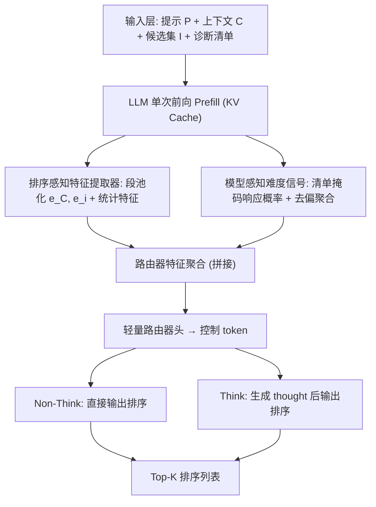
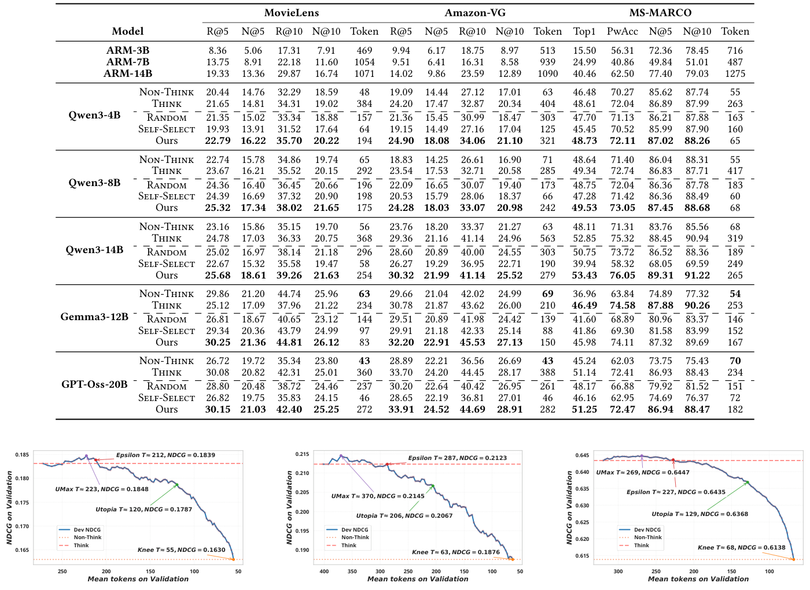
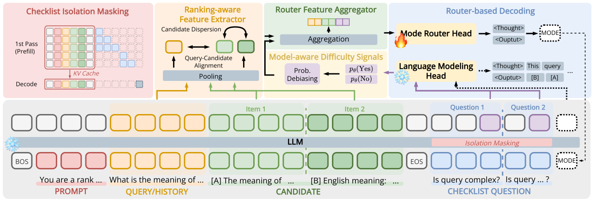
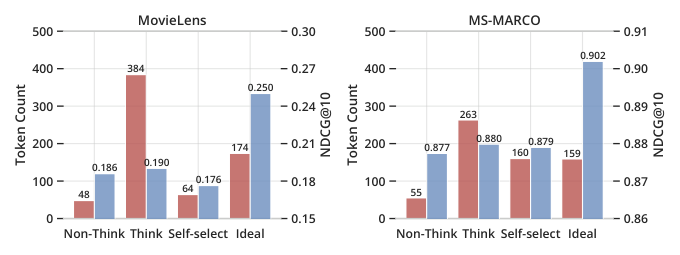
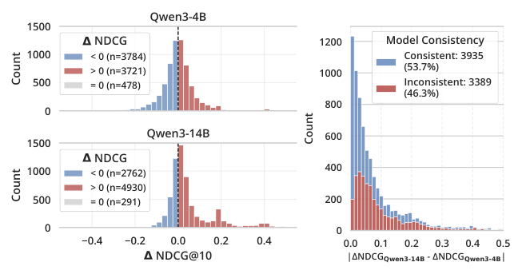
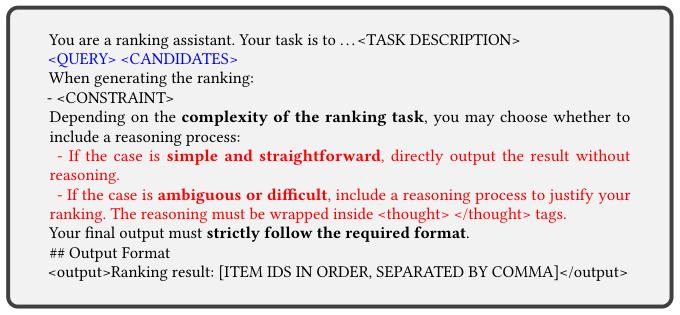
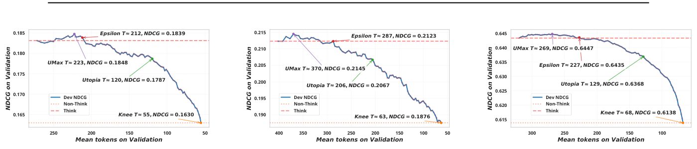

# Think When Needed: Model-Aware Reasoning Routing for LLM-based Ranking (按需思考：面向 LLM 排序的模型感知推理路由)

- **会议/期刊**: SIGIR 2026 (第 49 届国际 ACM SIGIR 会议)
- **推荐链路定位**: 重排 (Re-ranking) / 列表级排序 (List-wise Ranking)
- **研究方向**: 大语言模型推荐 (LLM4Rec) / 多任务学习与列表级重排
- **论文原文**: [https://arxiv.org/abs/2601.18146v2](https://arxiv.org/abs/2601.18146v2)
- **开源代码**: [https://github.com/Grey-z/reasoning_router](https://github.com/Grey-z/reasoning_router)

## TL;DR (核心速览)

针对 LLM 排序中"推理提示 (Think) 收益不一致且 token 开销巨大"的痛点，本文提出轻量即插即用的**推理路由器 (Reasoning Router)**：在生成前仅依赖排序感知特征（候选分散度、上下文-候选对齐）与模型感知难度信号（诊断清单的掩码响应概率），逐实例决定走 Non-Think 还是 Think。在 MS-MARCO、MovieLens、Amazon-VG 三个数据集上，配合 Qwen3-4B/8B/14B，实现精度提升同时 token 大幅下降（MovieLens + Qwen3-4B：NDCG@10 +6.3%，token −49.5%）。

## Background & Motivation (背景与动机)

- **领域背景与主流范式**: LLM 已被广泛用于 IR 与 Rec 的列表级排序，近期工作（如 Sun et al. [30]）表明推理提示 (Think) 能让模型通过多步推理区分近邻候选的相关性，提升排序质量。
- **现有方法局限 (Limitations of Prior Work)**:
  1. **收益不一致**：图 1 显示 Think 平均提升 NDCG，但 token 消耗约为 Non-Think 的 7–8 倍；图 2(a) 进一步表明在 MS-MARCO + Qwen3-14B 上，**35% 的实例 Non-Think 反而优于 Think**，另有 3.6% 实例两种模式均零收益（超出模型能力）。
  2. **LLM 自选模式不可靠**：Self-Select 模式（让 LLM 自行决定是否推理）的排序效用显著低于始终 Think，说明当前 LLM 无法可靠评估实例难度或推理的边际收益。
  3. **模型依赖性**：图 2(b) 显示同一实例在 Qwen3-4B 与 Qwen3-14B 上的最优模式判断有 **46.3% 不一致**，通用路由器无法跨模型迁移。
- **核心挑战 (Key Challenge)**: 排序任务的难度缺乏显式客观度量（候选间关系、查询-候选关联多因素交织）；且排序系统本质是成本敏感的——token 预算直接转化为系统延迟，不能像数学/代码任务那样以"最大化单实例正确率"为唯一目标。
- **核心洞察与切入点 (Key Insight)**: 作者通过诊断实验发现 **Ideal 模式**（oracle 逐实例选优）在 MovieLens 上可同时实现 NDCG +32% 与 token −55%，证明"**何时推理**与**如何推理**同等重要"。因此应设计一个在生成前即可决策的、模型感知的逐实例路由器。

## Problem Formulation & Method (问题定义与方法架构)

### 1. 符号定义与输入表征 (Notations & Input Representations)

- 任务指令提示 $P$，候选集 $\mathcal{I}=\{i_1,\dots,i_n\}$，上下文 $C$（IR 中 $C=Q$ 为查询；Rec 中 $C=H=\{h_t\}_{t=1}^m$ 为用户历史），目标长度 $K\le n$。
- LLM $f_\theta$ 为每个候选打分 $s_\theta(i\mid P,C,\mathcal{I})\in\mathbb{R}$，返回 top-$K$ 列表 $L_K=\tau_K(\{s_\theta(i\mid P,C,\mathcal{I}):i\in\mathcal{I}\})$。
- 记 LLM 最后一层隐状态 $S\in\mathbb{R}^{T\times d}$（$T$ 为输入 token 数，$d$ 为隐维），$\mathcal{T}_C$、$\mathcal{T}_i$ 分别为上下文段与第 $i$ 个候选段的 token 索引集合。

### 2. 整体流水线 (Overall Architecture)

数据流：输入提示（含候选与诊断清单）→ 单次前向 prefill → 同时抽取 (i) 排序感知特征（段池化 + 统计量）与 (ii) 模型感知难度信号（清单问题掩码响应概率）→ 拼接送入轻量路由器头 → 输出控制 token（`<Thought>` 或 `<Output>`）→ 决定后续解码是否进入推理。全部组件在**单次前向**内完成，不修改骨干架构与解码流程。

### 3. 核心模块设计与数学原理 (Key Designs & Formulations)

**(1) 排序感知特征提取器 (Ranking-Aware Feature Extractor)**：对上下文段与候选段做池化得到段嵌入：

$$e_C=\text{pooling}(S_{\mathcal{T}_C}),\quad e_i=\text{pooling}(S_{\mathcal{T}_i})$$

Rec 任务额外对每个历史物品提取 $e_{h_t}=\text{pooling}(S_{\mathcal{T}_{h_t}})$。特征沿两个维度组织：
- **上下文/候选复杂度**：上下文表征的集中度/漂移（查询具体性、用户兴趣稳定性）与候选集在嵌入空间的分布离散度（candidate dispersion）；
- **上下文-候选对齐**：$e_C$ 与 $\{e_i\}$ 的对齐程度及 top 候选的可区分性——高对齐意味着清晰的相关性线索适合 Non-Think，低对齐则提示 Think 可能更有益。

特征选择采用**两阶段精炼**：先用带稀疏正则的轻量预测器按路由目标筛除低贡献特征，再跨数据集与骨干模型做一致性分析，仅保留稳定特征。

**(2) 模型感知难度信号 (Model-Aware Difficulty Signals)**：在提示后缀插入少量领域定制的诊断 yes/no 问题作为**掩码清单**，通过隔离掩码 (Isolation Masking) 保证清单问题不干扰排序任务本身，读取 LLM 对这些问题的响应概率，经**去偏与聚合**后作为模型内部不确定性与潜在推理失败模式的信号。该信号与排序感知特征互补，且天然随骨干模型变化（解决图 2(b) 的跨模型不一致问题）。

**(3) 轻量路由器头与帕累托策略选择**：两类特征拼接后送入轻量路由器头，输出控制 token 决定模式。路由器被训练为估计"Think 相对 Non-Think 的期望效用增益"。部署时利用**验证集帕累托前沿**在多个操作点（Knee、Utopia、Epsilon、UMax，见图 5）间自适应选择策略，在给定计算约束下仅对预测收益最高的实例分配 Think。

### 4. 训练目标、负采样与推理复杂度 (Optimization, Negative Sampling & Complexity)

- **损失函数**: 原文正文未给出完整损失公式（受篇幅限制，特征集与实现细节置于开源代码）。路由器以"是否应触发 Think"为二分类/效用回归目标训练，采用带稀疏诱导正则的轻量预测器做特征筛选。**具体损失形式与权重原文未在正文完整报告**。
- **训练负采样策略**: 不适用（非召回/对比学习任务，无负采样环节）；训练样本为逐实例的 (特征, 最优模式标签) 对，标签由 Non-Think 与 Think 的实际 NDCG 对比生成。
- **时间与空间复杂度**: 路由器所有组件在骨干 LLM 的**单次前向 prefill** 内完成，复用 KV Cache，不增加额外生成轮次；相比 Always-Think 可节省约 49.5% token（MovieLens + Qwen3-4B）。**原文未报告具体 ms/request 延迟与峰值显存数值**。

## Experimental Setup & Evaluation Protocol (实验设置与评估协议)

- **数据集统计与预处理**: 原文使用三个公开数据集，覆盖 IR 与 Rec 两类任务。**原文正文未提供 #Users / #Items / #Interactions / 稀疏度的完整统计表**（受 11 页篇幅限制），下表仅列出原文明确提及的信息：

| 数据集 (Dataset) | 用户数 (#Users) | 物品数 (#Items) | 交互数 (#Interactions) | 稀疏度/密度 (Sparsity) | 模态/辅助特征说明 |
| :--- | :---: | :---: | :---: | :---: | :--- |
| MS-MARCO [26] | - | - | - | - | IR 任务：查询-段落相关性排序 |
| MovieLens [11] | - | - | - | - | Rec 任务：电影推荐，用户历史为上下文 |
| Amazon-VG [21] | - | - | - | - | Rec 任务：视频游戏推荐 |

- **数据划分方式 (Splitting Strategy)**: 原文使用验证集做帕累托前沿策略选择（图 5 明确标注 "validation sets"），测试集报告主结果。**具体划分比例（LOO / Ratio / 时间戳切分）原文正文未明确说明**，需查阅开源代码确认。
- **排名评测协议 (Ranking Protocol)**: 采用列表级排序评测，指标为 **NDCG@10**（主指标）与 **NDCG@100**（图 1 中 MS-MARCO 报告）。**是否为 Full-Ranking 或 Sampled Ranking 原文未明确说明**；由于任务设定为"上游检索器/采样器提供候选集"，实际为**给定候选集内的重排评测**。
- **评价指标与显著性检验**: NDCG@10 / NDCG@100；表 1 中所有分数指标乘以 100 以便阅读，并报告**五次独立运行的平均值**。**原文未明确报告配对显著性检验（如 $p<0.05$）**。

## Key Experimental Results (核心实验结果)

### 1. 主实验对比 (Main Results)

表 1 报告了跨数据集与 LLM 骨干的排序效用与 token 成本。核心结论为：本文路由器在三个数据集、Qwen3-4B/8B/14B 三种规模上**一致实现精度提升与 token 下降**。代表性结果（MovieLens + Qwen3-4B）：**NDCG@10 +6.3%，token −49.5%**。图 1 的对照显示：MovieLens 上 Think 相对 Non-Think 仅提升 NDCG 2.1%（0.186→0.190）却消耗约 7 倍 token（48→384）；而 Ideal 模式可达 NDCG 0.250、token 174，验证了路由的潜在上限。

| 数据集 | 指标 | Non-Think | Think | Self-Select | 本文方法 (Ours) | 相对提升 (Improv.) |
| :--- | :--- | :---: | :---: | :---: | :---: | :---: |
| MovieLens (Qwen3-4B) | NDCG@10 / Token | 0.186 / 48 | 0.190 / 384 | 0.176 / 64 | **+6.3% NDCG, −49.5% token** | +6.3% |
| MS-MARCO (Qwen3-14B) | NDCG@100 / Token | 0.877 / 55 | 0.880 / 263 | 0.879 / 160 | 见表 1（原文报告） | 原文报告 |

> 注：表 1 完整数值（含 Amazon-VG 与 Qwen3-8B）请参见原文；上表仅提取正文明确给出的数字，其余标注"原文报告"以避免臆造。

<figure class="paper-figure" markdown="span">
  <figcaption>表 1</figcaption>
</figure>

### 2. 消融实验与控制变量分析 (Ablation Study)

原文通过特征来源的对照间接验证各模块贡献：**排序感知特征**单独刻画实例内在结构复杂度，**模型感知难度信号**单独刻画 LLM 自身对难度的感知；二者互补拼接。图 2(b) 的跨模型一致性分析（46.3% 不一致）直接支撑了模型感知信号的必要性。**原文正文未提供逐模块移除的定量消融表格**，完整消融见开源代码。

<figure class="paper-figure" markdown="span">
  <figcaption>图 4</figcaption>
</figure>

### 3. 稀疏度/冷启动分桶与超参敏感度 (Sparsity Buckets & Hyperparameters)

- **实例级分桶表现**: 图 2(a) 按 ΔNDCG 符号分桶：MS-MARCO + Qwen3-4B 中 ΔNDCG<0 有 3784 例、>0 有 3721 例、=0 有 478 例；Qwen3-14B 中分别为 2762 / 4930 / 291 例。说明"何时不该推理"的实例占比极高，路由空间巨大。
- **关键超参数敏感度**: 路由器在验证集帕累托前沿上提供 Knee、Utopia、Epsilon、UMax 四个操作点（图 5），对应不同 token 预算约束下的精度-效率权衡；**具体超参（如路由器隐藏维、清单问题数量）原文正文未系统报告**。
- **线上 A/B 测试结果**: **原文仅包含离线实验**，未报告线上 A/B 测试。

<figure class="paper-figure" markdown="span">
  <figcaption>图 1</figcaption>
</figure>
<figure class="paper-figure" markdown="span">
  <figcaption>图 2</figcaption>
</figure>
<figure class="paper-figure" markdown="span">
  <figcaption>图 3</figcaption>
</figure>
<figure class="paper-figure" markdown="span">
  <figcaption>图 5</figcaption>
</figure>

## Highlights, Limitations & Critiques (亮点、局限与审稿级批判)

- **核心亮点与可迁移性**:
  1. **问题形式化新颖**：首次将"推理路由"形式化到排序任务，并用诊断实验（图 1、图 2）扎实论证"Think 非普适有益"与"LLM 自选不可靠"两大动机。
  2. **生成前决策 + 单次前向**：路由器完全依赖 pre-generation 信号，复用 KV Cache，工程上即插即用，可直接迁移到任意 LLM 排序/重排管线。
  3. **模型感知设计**：清单探测信号天然随骨干变化，解决了跨模型难度感知不一致（46.3%）的关键痛点；帕累托前沿策略选择使系统可在不同延迟约束下灵活部署。
- **局限性与审稿视角批判 (Critical Limitations)**:
  1. **评估协议透明度不足**：正文未明确数据划分方式（LOO / Ratio / 时间戳）、候选集构造与是否 Full-Ranking，复现与公平比较存在障碍；亦未报告配对显著性检验。
  2. **效率证据偏弱**：仅报告 token 数作为成本代理，**缺少真实端到端延迟 (ms/request)、峰值显存与路由器自身开销**的量化，而排序系统对延迟高度敏感，这是审稿人最可能质疑之处。
  3. **清单问题的领域定制成本**：诊断清单需"领域定制"，跨域迁移时清单构造的人工成本与鲁棒性未讨论；特征集因篇幅被推至代码仓库，削弱了正文自洽性。
  4. **基线覆盖有限**：未与已有的通用自适应推理方法（如长度惩罚 RL、latent reasoning）在排序任务上直接对比，仅与 Non-Think / Think / Self-Select 对照。

## Rating (四维评分)

- **方法创新性 (Novelty)**: ⭐⭐⭐⭐
- **评估协议与实验扎实度 (Protocol & Experiments)**: ⭐⭐⭐
- **写作与数学规范度 (Clarity & Rigor)**: ⭐⭐⭐⭐
- **工业落地与复现价值 (Industrial & Practical Value)**: ⭐⭐⭐⭐
