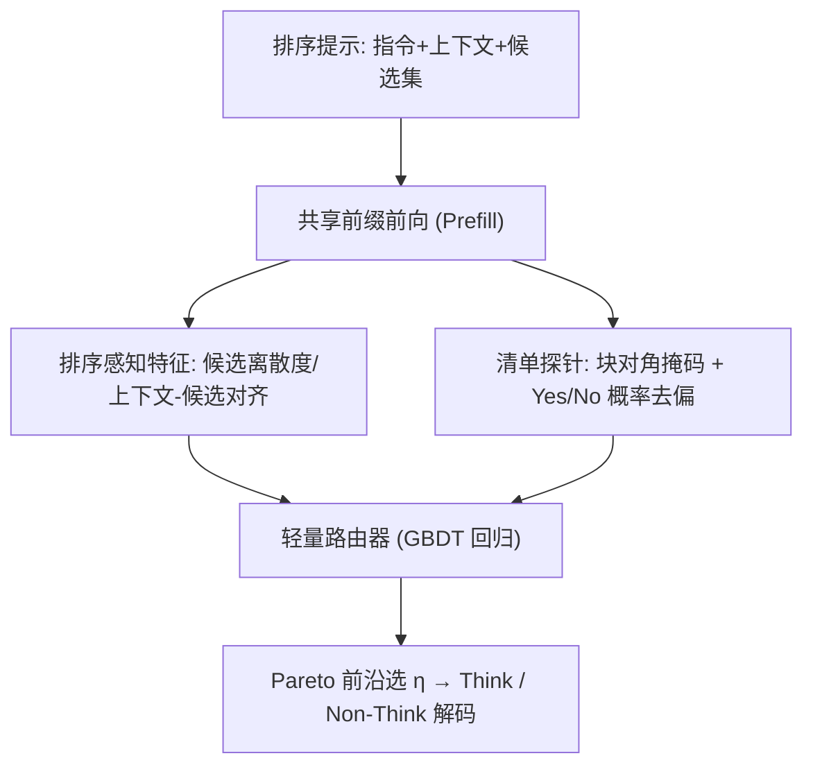

# Think When Needed: Model-Aware Reasoning Routing for LLM-based Ranking (按需思考：面向 LLM 排序的模型感知推理路由)

- **会议/期刊**: SIGIR 2026
- **作者与机构**: Huizhong Guo、Dongxia Wang（浙江大学），Tianjun Wei、Yingpeng Du、Ziyan Wang、Jie Zhang（南洋理工大学），Zhu Sun（新加坡科技设计大学）
- **推荐链路定位**: 重排（LLM 列表级排序 / 生成式打分）
- **研究方向**: 大语言模型推荐 / 多任务学习与列表级重排
- **论文原文**: [https://arxiv.org/abs/2601.18146v2](https://arxiv.org/abs/2601.18146v2)
- **开源代码**: [https://github.com/Grey-z/reasoning_router](https://github.com/Grey-z/reasoning_router)

## TL;DR (1分钟核心速览)

LLM 排序中"推理提示 (Think)"平均有效但并非普遍有益：约 35% 实例上 Non-Think 反而更优，且 Think 的 token 开销约为 Non-Think 的 8 倍。本文提出轻量即插即用的**模型感知推理路由器**，仅用生成前信号（排序感知特征 + 清单探针难度信号）逐实例预测 Think 相对 Non-Think 的效用增益，并沿验证集 Pareto 前沿选择部署策略。在 MovieLens/Amazon-VG/MS-MARCO 三个数据集、五种开源 LLM 上，Qwen3-4B 于 MovieLens 取得 NDCG@10 +6.3% 且 token −49.5%。

## Background & Motivation (背景与核心矛盾)

- **主流范式**: 将 LLM 作为列表级排序器，通过推理提示（`<thought>` 前缀触发 CoT）提升细粒度相关性判别，已在 IR 与推荐中被验证平均有效。
- **前人局限**: 其一，Think 的收益**不一致**——MS-MARCO 上 Qwen3-14B 有 35% 实例 Non-Think 更优，另有 3.6% 实例两种模式均零收益（超出模型能力）；其二，让 LLM 自选模式（Self-Select）不可靠，其效用甚至低于固定 Think，说明模型无法自估实例难度。
- **核心洞察 (Key Insight)**: 图 1 显示 oracle 的 Ideal 模式可在 MovieLens 上 NDCG +32% 同时 token −55%，即"**何时推理**"与"**如何推理**"同等关键；且图 2(b) 显示同一实例在 Qwen3-4B 与 14B 上的最优模式仅 53.7% 一致，路由必须**模型感知**。
- **本文切入点**: 在生成前用一个轻量回归路由器预测逐实例的 Think 效用优势，把推理预算分配给最可能受益的实例。

## Method (核心方法设计)

### 1. 整体框架 (Overall Architecture)

路由器与主干 LLM 共享**同一次前向**：输入排序提示（指令 + 上下文 + 候选集）后，一方面从末层隐状态池化出上下文/候选段嵌入并计算排序感知统计特征；另一方面在提示后缀挂接带块对角因果掩码的诊断清单，从 "Answer:" 锚点处 LM Head 读出 Yes/No 概率作为模型感知难度信号。两类特征拼接后送入梯度提升回归器，输出 Think 相对 Non-Think 的效用优势 $\hat{A}_p$；部署时按验证集 Pareto 前沿选定密度参数$\eta$，以$a_p(\eta)=\mathbb{I}[\hat{A}_p-\eta(T^{\text{Think}}_p-T^{\text{Non}}_p)\ge 0]$ 决定是否触发 Think。全程不修改主干架构与解码流程。

### 2. 关键设计拆解 (Key Designs)

1. **排序感知特征提取器（刻画实例内在结构复杂度）**：LLM 难以直接从长文本判断排序难度，故将上下文段与候选段在末层隐状态上池化得 $\mathbf{e}_C=\text{pooling}(S_{\mathcal{T}_C})$、$\mathbf{e}_i=\text{pooling}(S_{\mathcal{T}_i})$，再沿两个维度构造统计量——(i) 上下文/候选复杂度（候选簇大小熵、上下文漂移相邻余弦）；(ii) 上下文-候选对齐（质心余弦、Top-k 相似度间隙、成对胜出计数）。直觉：排序难度源于表征重叠与弱可分，这些量在生成前即可显式量化歧义度。特征经"稀疏正则筛选 + 跨数据集/跨模型一致性"两阶段裁剪为紧凑子集。

2. **清单式模型感知难度信号（捕捉模型自身的不确定性）**：排序感知特征不含模型能力差异，故在提示后缀插入成对、方向平衡的诊断问题（如"Is the query single-intent?" vs "Is the query ambiguous or multi-intent?"），用**块对角因果掩码**令每个探针只关注共享前缀与自身 token，保证探针不干扰排序生成；从 "Answer:" 锚点取 Yes/No log-odds 并减去中性探针基线 $\beta$以抑制 yes-bias，聚合为$\Delta\text{logit}_j=r^{\text{NT}}_j-r^{\text{T}}_j$ 等信号。

3. **代价感知优势回归与 Pareto 策略选择**：路由标签为 $A_p=(U^{\text{Think}}_p-U^{\text{Non}}_p)-\lambda(T^{\text{Think}}_p-T^{\text{Non}}_p)$，训练目标为带单调性约束的加权平方损失$\min_\phi \frac{1}{N_p}\sum_p w_p(f_\phi(\mathbf{x}_p)-A_p)^2\ \text{s.t.}\ \partial f_\phi/\partial \Delta T\le 0$，强制"成本越高预测优势不增"。部署时在验证 Pareto 前沿上定义 Knee（效率优先，取离反对角线最远点）、Utopia（均衡）、Epsilon（效用约束）、UMax（效用优先）四个锚点反解$\eta$ 并冻结。**无负采样、无参数微调**，额外开销仅为一次共享前向中的探针 token。

## Experimental Setup & Evaluation Protocol (实验设置与评估协议)

- **数据集与预处理**:

| 数据集 | 任务 | 候选集构造 | 划分 | 说明 |
| :--- | :---: | :---: | :---: | :--- |
| MovieLens | 推荐 | 1 正 + 49 均匀采样负 = 50 | 6:2:2 | 按天排序，Leave-One-Out 取最后一项为目标 |
| Amazon-VG | 推荐 | 同上，50 候选 | 6:2:2 | 视频游戏评论 |
| MS-MARCO | 检索 | 原始候选池，不增强 | 6:2:2 | 变长候选池 |

- **数据划分与防穿越**: 推荐任务采用 `Leave-One-Out`（最后一项为测试目标，历史为上下文）后按 6:2:2 切分；检索任务按原始 query 划分。
- **排名评测协议**: 推荐为 `Sampled Ranking`（固定 50 候选，1:49 正负比）；检索为原始池内排序。指标含 Top-1 Agreement、Pairwise Accuracy、Recall@k、NDCG@k，token 数作为效率度量，五次独立运行取均值。
- **对比基线与超参**: 主干为 Qwen3-4B/8B/14B、Gemma3-12B、GPT-Oss-20B（指令微调版，零参数更新，统一 prompt 与解码超参）；基线含 Non-Think、Think、Random、Self-Select 及自适应推理 SOTA 家族 ARM-3B/7B/14B。

## Key Experimental Results (实验关键数据)

### 1. 主实验对比 (Main Results)

| 主干 / 方法 | MovieLens N@10 | Token | Amazon-VG N@10 | Token | MS-MARCO N@10 | Token |
| :--- | :---: | :---: | :---: | :---: | :---: | :---: |
| Qwen3-4B Non-Think | 18.59 | 48 | 17.01 | 63 | 87.74 | 55 |
| Qwen3-4B Think | 19.02 | 384 | 20.34 | 404 | 87.99 | 263 |
| Qwen3-4B Self-Select | 17.64 | 64 | 17.04 | 125 | 87.90 | 160 |
| **Qwen3-4B Ours** | **20.22** | **194** | **21.10** | **321** | **88.26** | **65** |
| Qwen3-14B Think | 20.75 | 368 | 24.96 | 563 | 90.94 | 319 |
| **Qwen3-14B Ours** | **21.63** | **254** | **25.52** | **279** | **91.22** | **265** |
| Gemma3-12B Non-Think | 25.96 | 63 | 24.99 | 69 | 77.32 | 54 |
| Gemma3-12B Think | 21.22 | 234 | 26.00 | 210 | 90.26 | 253 |
| **Gemma3-12B Ours** | **26.12** | **83** | **27.13** | **150** | 89.69 | 167 |
| GPT-Oss-20B Think | 25.01 | 360 | 28.17 | 388 | 88.43 | 234 |
| **GPT-Oss-20B Ours** | **25.25** | **272** | **28.91** | **282** | **88.47** | **182** |
| ARM-14B | 16.74 | 1071 | 12.89 | 1090 | 79.03 | 1275 |

相对 Think 的提升：Qwen3-4B 于 MovieLens **+6.3% N@10 / −49.5% token**，Amazon-VG **+3.9% / −20.5%**，MS-MARCO **−75.3% token**；Gemma3-12B 在 MovieLens 上 Think 本身劣于 Non-Think，路由器仍取得 26.12（优于两者）。

### 2. 消融实验 (Ablation Study)

| 主干 / 变体 | Amazon-VG N@10 | Token | Trade-off | MS-MARCO N@10 | Token | Trade-off |
| :--- | :---: | :---: | :---: | :---: | :---: | :---: |
| Qwen3-14B w/o ranking-aware | 23.57 | 254 | 21.03 | 90.87 | 243 | 88.44 |
| Qwen3-14B w/o model-aware | 24.61 | 286 | 21.75 | 90.44 | 236 | 88.08 |
| **Qwen3-14B Ours** | **25.52** | 279 | **22.73** | **91.22** | 265 | **88.57** |
| Gemma3-12B w/o model-aware | 26.91 | 144 | 25.47 | 81.97 | 104 | 80.93 |
| **Gemma3-12B Ours** | **27.13** | 150 | **25.63** | **89.69** | 167 | **88.02** |
| GPT-Oss-20B w/o model-aware | 27.89 | 204 | 25.85 | 84.61 | 141 | 83.20 |
| **GPT-Oss-20B Ours** | **28.91** | 282 | **26.09** | **88.47** | 182 | **86.65** |

（Trade-off $=\text{N@10}-10^{-4}\times\text{Token}$）

### 3. 关键实验发现 (Key Findings)

1. **两类特征互补且任务相关**：推荐任务上移除排序感知特征损失更大（Qwen3-14B 于 Amazon-VG N@10 掉 1.95），检索任务上移除模型感知信号损失更大（Gemma3-12B 于 MS-MARCO N@10 从 89.69 骤降至 81.97），与 SHAP 分析一致——Rec 依赖偏好/匹配结构，IR 依赖逐 query 难度探针。
2. **Pareto 前沿给出可解释的部署旋钮**：Epsilon 锚点在 MovieLens/Amazon-VG 上以约少 10–30% token 达到 Think 级 NDCG；Utopia 通常将 token 减半而效用仅微降（0.1787 vs 0.183）；UMax 甚至因规避"有害过度推理"而超过 Think 峰值。
3. **通用自适应推理方法不适配排序**：ARM 家族倾向把几乎所有实例判为"难"并默认长链推理，token 高达 1000+ 却效用垫底（ARM-14B 于 Amazon-VG N@10 仅 12.89），反证排序场景需要模型感知的逐实例路由。

## Highlights & Limitations (亮点、对比与审稿批判)

- **与代表作对比 (vs. Prior Work)**: 相较固定推理提示（Sun et al. 的推理模板）与 Self-Select，本文把"是否推理"外置为可学习回归问题；相较 ARM 等通用自适应推理，本文不依赖可验证答案反馈，而是用生成前信号 + 代价感知优势标签，且显式建模跨模型难度差异。
- **可迁移亮点**: (i) 块对角因果掩码的"探针隔离"技巧可在单次前向中零干扰地读取模型内部置信度，可迁移至 CTR 预估的样本难度估计与主动学习；(ii) 以验证 Pareto 前沿反解阈值 $\eta$ 的部署范式，适合任何"精度-延迟"可调的服务化排序系统。
- **审稿级局限批判**: 其一，路由策略依赖训练/测试分布对齐，若用户意图、候选构成或 prompt 格式显著漂移，策略可能退化为近似均匀模式；其二，实验候选集仅 50（受 LLM 上下文限制），未验证大规模检索池与多阶段级联场景，且探针 token 与 GBDT 特征工程带来额外离线维护成本。

## Rating (四维评分)

- **方法创新性 (Novelty)**: ⭐⭐⭐⭐ （首次形式化排序任务的推理路由，模型感知清单探针与代价感知优势回归设计新颖，但整体为特征工程 + GBDT 的组合式创新）
- **评估协议与实验扎实度 (Protocol & Experiments)**: ⭐⭐⭐⭐ （三数据集 × 五主干 × 五随机种子，含 Pareto 前沿、SHAP、prompt 敏感性与消融，但推荐侧为 50 候选采样排序，未覆盖全库排序）
- **写作与数学规范度 (Clarity & Rigor)**: ⭐⭐⭐⭐ （路由规则、单调约束与四类策略公式定义清晰，动机实验图表有力；部分特征细节下放代码仓库略影响可复现阅读）
- **工业落地与复现价值 (Industrial & Practical Value)**: ⭐⭐⭐⭐ （即插即用、不改主干、单次前向完成路由，代码已开源；但需按主干模型重训路由器，跨模型迁移需重新标定）
