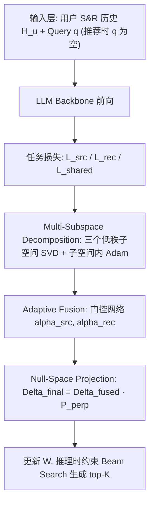
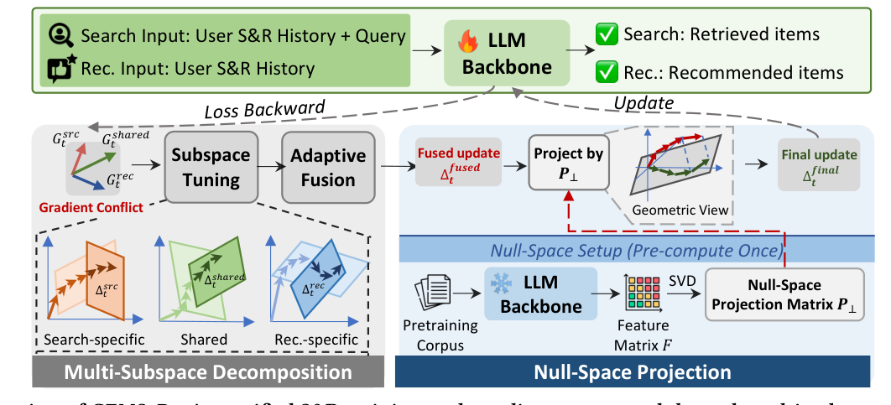
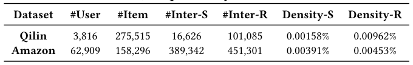
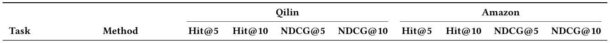
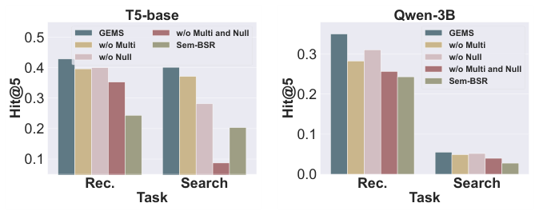
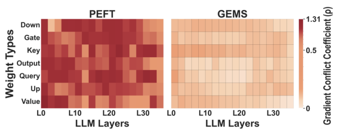
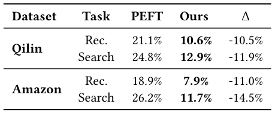

# Unifying Search and Recommendation in LLMs via Gradient Multi-Subspace Tuning (基于梯度多子空间调优的 LLM 搜索与推荐统一建模)

- **会议/期刊**: SIGIR 2026
- **推荐链路定位**: 端到端生成式 (End-to-End Generative) — 将搜索与推荐统一为条件生成式物品标识预测
- **研究方向**: 大语言模型推荐 (LLM4Rec) / 多任务学习与列表级重排
- **论文原文**: [https://arxiv.org/abs/2601.09496v2](https://arxiv.org/abs/2601.09496v2)
- **开源代码**: [https://github.com/Polaris-JZ/GEMS](https://github.com/Polaris-JZ/GEMS)

## TL;DR (核心速览)

针对 LLM 统一搜索与推荐 (S&R) 时 PEFT 面临的两大痛点——任务梯度冲突与通用知识漂移，本文提出 GEMS：将任务梯度分解到共享/搜索专属/推荐专属三个低秩子空间并自适应门控融合，再将融合更新投影到预训练知识零空间。在 Qilin/Amazon 上以 1 正 99 负采样排序协议评测，Qwen-3B 骨干下推荐 Hit@5 相对最强基线提升约 14%~184%，搜索提升约 7%~68%，并显著降低梯度冲突与意图理解退化。

## Background & Motivation (背景与动机)

- **领域背景与主流范式**: 搜索 (显式 query 意图) 与推荐 (隐式行为意图) 天然互补，统一建模可互相增强。早期方案采用共享 Transformer + 任务专属头做打分排序；近期范式转向**生成式统一**——把两任务的物品排序都重构为条件生成 (以 query 或交互历史为条件生成目标物品标识)，可端到端优化并继承 LLM 语义理解能力 (BSR、Sem-BSR、GenSAR)。
- **现有方法局限 (Limitations of Prior Work)**:
  1. **全参数微调代价高**：生成式统一方法依赖 full fine-tuning，在十亿级 LLM 上显存与算力开销巨大，限制可扩展性。
  2. **PEFT 下的梯度冲突**：搜索优化 query–item 相关性、推荐优化长期偏好，二者梯度方向对立 (图 1(a) 显示 Qwen-3B 多层存在显著冲突)，共享表征下互相拖累，训练不稳定。
  3. **用户意图理解漂移**：PEFT 在有限微调数据上过拟合，扰动通用领域知识，导致原本答对的 query 微调后答错 (图 1(b))。
- **核心挑战 (Key Challenge)**: 简单增加路由容量 (如 LoRA-MoE) 或加深网络并不能消除冲突——因为冲突源于**同一参数空间内方向对立**；而常规对比学习/正则无法约束更新**不侵入预训练主语义方向**。
- **核心洞察与切入点 (Key Insight)**: 作者观察到冲突集中在 Query/Key 注意力层，且 PEFT 更新会沿预训练主成分方向漂移。由此引入**子空间调优 (subspace tuning)**：不沿原始梯度全参数更新，而是投影到由梯度统计学习出的低秩主方向；进一步把方向拆成"共识/专属"三类，并把最终更新限制在与通用知识空间正交的零空间内。

## Problem Formulation & Method (问题定义与方法架构)

### 1. 符号定义与输入表征 (Notations & Input Representations)

- 用户集 $\mathcal{U}$、物品标识集 $\mathcal{I}$。
- 用户 $u$ 的交互历史 $H_u = (i_1,b_1),(i_2,b_2),\dots,(i_N,b_N)$，其中 $i_n\in\mathcal{I}$，$b_n\in\{\text{src},\text{rec}\}$ 表示该交互来自搜索还是推荐。
- 查询 $q$：搜索场景提供，推荐场景为空。
- 统一结构化 prompt $x$ 由 $(H_u,q)$ 构造并 tokenize 输入模型；输出为目标物品标识 $i$ 的 token 序列。
- 骨干：Flan-T5-base 与 Qwen2.5-3B-Instruct；可训练层权重 $W_t\in\mathbb{R}^{m\times n}$ ($m\le n$)。

### 2. 整体流水线 (Overall Architecture)

数据流：统一 prompt 构造 → LLM 前向 → 分别计算搜索/推荐/共享损失并反传得三个梯度矩阵 → 各自 SVD 投影到低秩子空间并在子空间内做 Adam 更新 → 自适应门控融合三路更新 → 零空间投影 $P_\perp$ 去除预训练主方向分量 → 映射回全参数空间更新 $W$。推理时用约束 beam search 在候选集内生成 top-$K$。

<figure class="paper-figure" markdown="span">
  <figcaption>图 2：GEMS 概览。在统一 S&amp;R 训练中，任务梯度经多子空间分解与自适应融合进行路由，然后投影到预训练知识的零空间上，以保留通用领域理解。</figcaption>
</figure>

### 3. 核心模块设计与数学原理 (Key Designs & Formulations)

**(1) 子空间调优基座 (Subspace Tuning)**：对每层梯度 $G_t=-\nabla_{W_t}\mathcal{L}(\Theta_t)\in\mathbb{R}^{m\times n}$ 做 SVD $G_t=U\Sigma V^\top$，取前 $r$ 个奇异向量 $U_r\in\mathbb{R}^{m\times r}$ 为基，投影 $G_t^{(r)}=U_r^\top G_t\in\mathbb{R}^{r\times n}$。在 $r$ 维子空间内维护一阶/二阶矩 $M_t^{(r)},V_t^{(r)}$ 并做偏差校正，得子空间更新 $\Delta_t^{(r)}=-\eta\cdot\hat{M}_t^{(r)}/(\sqrt{\hat{V}_t^{(r)}}+\epsilon)$，再映射回全空间 $\Delta_t=\alpha\cdot U_r\Delta_t^{(r)}$。SVD 每 $T_{\text{svd}}=200$ 步刷新一次以省算力。物理直觉：沿少数主方向优化既降显存又滤除噪声梯度，同时保留接近全参微调的表达力，且**不引入额外 adapter 权重**。

**(2) 多子空间分解 (Multi-Subspace Decomposition)**：分别计算 $G_t^{\text{src}},G_t^{\text{rec}}$ 与共享梯度 $G_t^{\text{shared}}=-\nabla_{W_t}(\mathcal{L}_{\text{src}}+\mathcal{L}_{\text{rec}})$，各自按上式得到 $\Delta_t^{\text{shared}},\Delta_t^{\text{src}},\Delta_t^{\text{rec}}$。共享子空间捕获两任务一致方向 (通用偏好、物品语义)，搜索专属子空间捕获 query 语义对齐，推荐专属子空间捕获长期偏好与协同模式。由于专属子空间源自不同梯度统计，几何重叠极小，融合时破坏性干扰大幅降低。融合：$\Delta_t^{\text{fused}}=\Delta_t^{\text{shared}}+\alpha_{\text{src}}\Delta_t^{\text{src}}+\alpha_{\text{rec}}\Delta_t^{\text{rec}}$，其中 $\alpha_{\text{src}}+\alpha_{\text{rec}}=1$，共享项固定权重 1。

**(3) 自适应门控**：以任务级统计构造特征 $z=[s_{\text{loss}},s_{\text{grad}},s_{\text{sample}}]$ (损失比、梯度范数比、batch 样本量比)，经两层 ReLU MLP 得 $o$，再温度 softmax $\alpha=\text{softmax}(o/\tau)$。直觉：某任务损失大/梯度不稳时其子空间权重被调小，防止单任务主导共享表征。

**(4) 零空间投影 (Null-Space Projection)**：用通用语料 (Wikipedia 采样 $C=100{,}000$ 文档) 喂入冻结骨干，堆叠各层输入隐状态得特征矩阵 $F\in\mathbb{R}^{n\times C}$，对 $FF^\top=U_{\text{pre}}\Sigma_{\text{pre}}U_{\text{pre}}^\top$ 做 SVD，取前 $k$ 个主方向 $U_k^{\text{pre}}$，构造 $P_\perp=I-U_k^{\text{pre}}U_k^{\top\text{pre}}$，最终更新 $\Delta_t^{\text{final}}=\Delta_t^{\text{fused}}P_\perp$。$P_\perp$ 每层只需预计算一次。物理直觉：把更新限制在与预训练主语义正交的补空间，避免覆盖通用推理能力。

### 4. 训练目标、负采样与推理复杂度 (Optimization, Negative Sampling & Complexity)

- **损失函数**: 自回归负对数似然 $\mathcal{L}(\Theta)=-\sum_{t=1}^{|i|}\log P_\Theta(i_t\mid i_{<t},x)$，搜索/推荐/共享三路损失分别反传；无显式对比温度项，门控温度 $\tau$ 为超参。
- **训练负采样策略**: 评测阶段每用户随机采样 **99 个负样本 + 1 个正样本** 构成候选列表 (sampled ranking)；训练阶段原文未单独报告负采样构造细节 (以代码仓库为准)。
- **时间与空间复杂度**: 权重存储 GEMS 为 $mn$ (无额外 adapter)，LoRA 为 $mn+mr+nr$，LoRA-MoE 为 $mn+E(mr+nr)$；训练态 GEMS 为 $2mr+4nr$ (三子空间基+矩估计)，LoRA 为 $2mr+2nr$，LoRA-MoE 随专家数 $E$ 线性增长。GEMS 训练态略高于 LoRA，但当 $E\ge2$ 时常低于 LoRA-MoE；且因不引入额外权重，部署/推理更省。推理需约束 beam search，原文未报告 ms/request 级在线延迟。

## Experimental Setup & Evaluation Protocol (实验设置与评估协议)

- **数据集统计与预处理**:

| 数据集 (Dataset) | 用户数 (#Users) | 物品数 (#Items) | 交互数 (#Interactions) | 稀疏度/密度 (Sparsity) | 模态/辅助特征说明 |
| :--- | :---: | :---: | :---: | :---: | :--- |
| Qilin | 3,816 | 275,515 | 搜索 16,626 / 推荐 101,085 | 搜索 0.00158% / 推荐 0.00962% | 社交媒体平台，含真实 query 与物品描述 |
| Amazon (Electronics 5-core) | 62,909 | 158,296 | 搜索 389,342 / 推荐 451,301 | 搜索 0.00391% / 推荐 0.00453% | 基于 Amazon 评论的半合成数据，含评论与评分 |

<figure class="paper-figure" markdown="span">
  <figcaption>表 1：两个数据集的统计信息。#Inter-S 和 #Inter-R 分别表示搜索行为和推荐行为的交互数量。</figcaption>
</figure>

- **数据划分方式 (Splitting Strategy)**: 原文正文未明确给出划分策略，仅说明"数据处理与划分细节见代码仓库"；需注意若采用随机划分而非全局时间戳切分，存在未来信息泄露风险 (审稿视角需关注)。
- **排名评测协议 (Ranking Protocol)**: **Sampled Ranking** — 每用户 1 正 + 99 随机负样本构成候选列表，所有模型 (含生成式方法) 用约束 beam search 限制输出在候选集内，再排序取 top-$K$。
- **评价指标与显著性检验**: Hit@5/10、NDCG@5/10；最优结果标注 $t$-test $p<0.01$ 显著性；骨干为 Flan-T5-base (全参微调基线) 与 Qwen2.5-3B-Instruct (LoRA 基线)；超参网格：$\alpha\in\{0.5,1,2,3,4\}$、$\tau\in\{0.1,0.5,1,2,3\}$、子空间秩 $\in\{256,512,1024\}$，任务专属子空间秩取共享子空间秩的一半。

## Key Experimental Results (核心实验结果)

### 1. 主实验对比 (Main Results)

**T5-base 骨干 (表 2)**：

| 数据集 | 指标 | 最强统一/生成基线 | 本文方法 (Ours) | 相对提升 (Improv.) |
| :--- | :--- | :---: | :---: | :---: |
| Qilin-推荐 | Hit@5 | TIGER 0.2548 | **0.4285** | +68.2% |
| Qilin-搜索 | Hit@5 | Sem-BSR 0.0261 | **0.1511** | +478.9% |
| Amazon-推荐 | Hit@5 | TIGER 0.2019 | **0.4025** | +99.4% |
| Amazon-搜索 | Hit@5 | GenRet 0.4198 | **0.8399** | +100.1% |

**Qwen-3B 骨干 (表 3)**：

| 数据集 | 指标 | 最强基线 (Sem-BSR-MoE 等) | 本文方法 (Ours) | 相对提升 (Improv.) |
| :--- | :--- | :---: | :---: | :---: |
| Qilin-推荐 | Hit@5 | Sem-BSR-MoE 0.3061 | **0.3499** | +14.3% |
| Qilin-搜索 | Hit@5 | GenRet 0.0510 | **0.0552** | +8.2% |
| Amazon-推荐 | Hit@5 | TIGER 0.1886 | **0.3686** | +95.4% |
| Amazon-搜索 | Hit@5 | Sem-BSR-MoE 0.3291 | **0.3510** | +6.7% |

<figure class="paper-figure" markdown="span">
  <figcaption>表 2：S&amp;R 上的结果。对于所有生成式方法（包括我们的模型和生成式基线），骨干模型为 T5-base。最佳和次佳结果分别以粗体和下划线突出显示。* 表示最佳结果在统计上显著优于次佳结果（t 检验，𝑝&lt; 0.01）。</figcaption>
</figure>

<figure class="paper-figure" markdown="span">
  <figcaption>表 3：S&amp;R 上的结果。骨干模型为 Qwen-3B。最佳和次佳结果分别以粗体和下划线突出显示。* 表示最佳结果在统计上显著优于次佳结果（t 检验，𝑝&lt; 0.01）。</figcaption>
</figure>

关键观察：(1) 统一基线常不如专用模型，印证梯度冲突严重；(2) GEMS 在几乎所有数据集/任务上最优，T5-base 下增益尤其显著；(3) 优于 LoRA-MoE，说明单纯增加路由容量不足以解决跨任务干扰。

### 2. 消融实验与控制变量分析 (Ablation Study)

<figure class="paper-figure" markdown="span">
  <figcaption>图 3：GEMS 在 Qilin 上的消融研究。</figcaption>
</figure>

- **w/o Multi (仅单共享子空间)**：两任务均显著下降，说明显式解耦共享/专属信号是缓解干扰的关键。
- **w/o Null (去掉零空间投影)**：较基线有中等提升但落后完整 GEMS，说明约束更新正交于预训练知识对保留语言理解能力重要。
- **w/o Multi and Null (仅单子空间调优)**：整体仍优于基线，但在部分场景被 Sem-BSR 反超，进一步凸显多子空间分解的必要性。
- 消融未严格报告参数量对齐/图度数匹配等控制变量 (本方法无图结构，参数量天然对齐)。

### 3. 稀疏度/冷启动分桶与超参敏感度 (Sparsity Buckets & Hyperparameters)

- **梯度冲突缓解**: 定义冲突系数 $\rho=1-\frac{g_{\text{src}}\cdot g_{\text{rec}}}{\|g_{\text{src}}\|\|g_{\text{rec}}\|}$，逐层逐 batch 计算。GEMS 在所有 LLM 层均低于 LoRA，平均冲突幅度缓解 **超过 85% (最高 88%)**；PEFT 高冲突区集中在 Query/Key 层，GEMS 全层均匀低冲突。

<figure class="paper-figure" markdown="span">
  ![图 1：(a) 在 Qilin 数据集上，Qwen-3B 在 PEFT（如 LoRA）与我们的方法下各层的梯度冲突分析。梯度冲突系数（𝜌）\[5\] 量化 S&amp;R 任务梯度之间的对立程度（见第 5.3.2 节）；数值越低表示冲突越小。结果表明，与 PEFT 相比，我们的方法始终实现更低的梯度冲突。(b) 真实场景 S&amp;R 中用户意图理解的变化。](../../../../assets/papers/2601.09496v2/figure_1.png)<figcaption>图 1：(a) 在 Qilin 数据集上，Qwen-3B 在 PEFT（如 LoRA）与我们的方法下各层的梯度冲突分析。梯度冲突系数（𝜌）[5] 量化 S&amp;R 任务梯度之间的对立程度（见第 5.3.2 节）；数值越低表示冲突越小。结果表明，与 PEFT 相比，我们的方法始终实现更低的梯度冲突。(b) 真实场景 S&amp;R 中用户意图理解的变化。</figcaption>
</figure>

<figure class="paper-figure" markdown="span">
  <figcaption>图 4：在 Qilin 数据集上使用 Qwen-3B 的 PEFT 与 GEMS 梯度冲突热图分析。</figcaption>
</figure>

- **用户意图理解保持 (表 4)**：报告"微调前正确→微调后错误"比例 (越低越好)。Qilin 推荐 21.1%→10.6% (Δ-10.5%)、搜索 24.8%→12.9% (Δ-11.9%)；Amazon 推荐 18.9%→7.9% (Δ-11.0%)、搜索 26.2%→11.7% (Δ-14.5%)。

<figure class="paper-figure" markdown="span">
  <figcaption>表 4：Qwen-3B 下的用户意图理解保持分析。我们报告“正确→错误”的百分比（越低越好）。Δ 表示相对于 BSR 基线的绝对降低。</figcaption>
</figure>

- **超参敏感度 (图 5)**：$\alpha$ 过小欠更新、过大训练不稳；$\tau$ 过小近 one-hot 抑制单任务、过大退化为均匀权重，中间值稳健；S&R 最优区间略有偏移但存在宽重叠区，框架整体鲁棒。
- **线上 A/B 测试**: 原文仅包含离线实验，未报告线上 A/B 结果。

 图 5：Qilin 上的超参数分析。

## Highlights, Limitations & Critiques (亮点、局限与审稿级批判)

- **核心亮点与可迁移性**:
  1. **子空间调优 + 零空间投影** 是通用多任务 LLM 微调算子，可迁移到 CTR/多目标精排、跨域推荐等任何存在任务冲突且需保留通用知识的场景。
  2. **无额外 adapter 权重**，部署友好，且天然支持预训练与微调两阶段，优于 LoRA 系列。
  3. 首次将十亿级 LLM 用于统一 S&R 而无需全参微调，工程价值明确。
- **局限性与审稿视角批判 (Critical Limitations)**:
  1. **评测协议偏弱**：仅 1 正 99 负的 sampled ranking，未做 full-ranking，且负样本随机采样可能高估绝对指标；数据划分策略正文未交代，存在潜在数据泄露疑虑。
  2. **数据集有限**：仅 Qilin 与半合成 Amazon Electronics，缺乏真实工业大规模 S&R 日志与线上 A/B 验证。
  3. **训练态开销**：$2mr+4nr$ 高于 LoRA，SVD 周期性刷新带来额外计算，原文未报告单 epoch 耗时/峰值显存的具体数值。
  4. **超参较多**：$\alpha,\tau,r,k,T_{\text{svd}}$ 及任务专属秩减半等设计依赖经验，泛化性需更多验证；零空间估计依赖 Wikipedia 语料代表性。
  5. **理论保证有限**：零空间投影仅经验性缓解漂移，缺乏对"知识保持"的正式界。

## Rating (四维评分)

- **方法创新性 (Novelty)**: ⭐⭐⭐⭐
- **评估协议与实验扎实度 (Protocol & Experiments)**: ⭐⭐⭐
- **写作与数学规范度 (Clarity & Rigor)**: ⭐⭐⭐⭐
- **工业落地与复现价值 (Industrial & Practical Value)**: ⭐⭐⭐⭐
