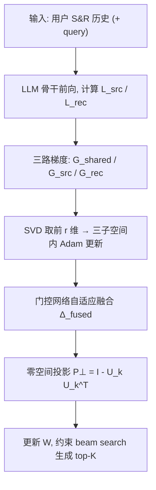

# Unifying Search and Recommendation in LLMs via Gradient Multi-Subspace Tuning (基于梯度多子空间调优的 LLM 搜索推荐统一建模)

- **会议/期刊**: SIGIR 2026
- **作者与机构**: Jujia Zhao, Zihan Wang, Shuaiqun Pan, Suzan Verberne, Zhaochun Ren（Leiden University / CISPA Helmholtz Center）
- **推荐链路定位**: 端到端生成式（统一 S&R 的生成式排序）
- **研究方向**: 大语言模型推荐 / 多任务学习
- **论文原文**: [https://arxiv.org/abs/2601.09496v2](https://arxiv.org/abs/2601.09496v2)
- **开源代码**: [https://github.com/Polaris-JZ/GEMS](https://github.com/Polaris-JZ/GEMS)

## TL;DR (1分钟核心速览)

搜索（显式 query 意图）与推荐（隐式行为意图）的生成式统一建模此前依赖全参数微调，代价高昂；改用 LoRA 类 PEFT 又会遭遇**任务梯度冲突**与**通用知识漂移**两大顽疾。本文提出 GEMS：把梯度投影到「共享 + 搜索专属 + 推荐专属」三个低秩子空间做自适应融合，再把融合更新投影到预训练知识空间的零空间上。在 Qilin/Amazon 的 99 负采样排序协议下，T5-base 骨干上推荐 Hit@5 从 0.2548 提升至 0.4285（+68%），搜索 Hit@5 从 0.0262 提升至 0.1511（近 5 倍），且不引入任何额外推理权重。

## Background & Motivation (背景与核心矛盾)

- **主流范式**: 早期统一 S&R 用共享 Transformer + 任务专属头（UnifiedSSR、UniSAR），近期转向生成式——把排序重构为以用户历史/query 为条件的 item ID 生成（BSR、Sem-BSR、GenSAR），可端到端优化并继承 LLM 语义理解。
- **前人局限**: 生成式统一方案全部依赖**全参数微调**，在十亿级 LLM 上算力与显存不可承受；换成 PEFT（LoRA）后出现两个具体失效：(1) 搜索关注 query–item 相关性、推荐关注长期偏好，二者梯度方向系统性对立（图 1a 显示 Qwen-3B 多层梯度冲突系数显著为正）；(2) 对少量微调数据过拟合导致表征分布漂移，模型对原本答对的 query 反而答错（图 1b 的 Greta Gerwig 案例）。
- **核心洞察 (Key Insight)**: 冲突并非均匀分布——两任务"共识方向"应共享，"分歧方向"应隔离；而知识漂移源于更新侵入了预训练表征的主成分方向，只要把更新限制在其正交补（零空间）内即可保语义。
- **本文切入点**: 用**子空间调优**（在低秩子空间内跑 Adam 再映射回全参数空间）替代 LoRA 重参数化，天然无额外部署权重，再叠加多子空间分解与零空间投影两个算子。

## Method (核心方法设计)

### 1. 整体框架 (Overall Architecture)

每个训练步对每层权重 $W_t\in\mathbb{R}^{m\times n}$计算搜索梯度$G^{src}_t$、推荐梯度$G^{rec}_t$与共享梯度$G^{shared}_t=-\nabla(L_{src}+L_{rec})$；三者各自经 SVD 取前$r$个奇异向量构成子空间基，在子空间内维护 Adam 一二阶矩并算出低秩更新$\Delta^{shared}_t,\Delta^{src}_t,\Delta^{rec}_t$；由轻量门控网络自适应加权融合为$\Delta^{fused}_t$；最后右乘零空间投影矩阵$P^\perp$得到$\Delta^{final}_t$施加到$W_t$。推理时用约束 beam search 在候选集内生成 top-$K$ item ID。

<figure class="paper-figure" markdown="span">
  <figcaption>图2：GEMS概览。在统一S&amp;R训练中，任务梯度经多子空间分解与自适应融合进行路由，随后投影到预训练知识的零空间上，以保持通用领域理解。</figcaption>
</figure>

### 2. 关键设计拆解 (Key Designs)

1. **多子空间分解 (Multi-Subspace Decomposition)**：痛点是两任务梯度在同一空间内互相抵消。GEMS 把更新拆成共享子空间（权重固定为 1，锁住任务不变信号）与两个任务专属子空间（各取 $r/2$ 维，因源自不同梯度统计而几何重叠极小），融合式为
$$\Delta^{fused}_t=\Delta^{shared}_t+\alpha_{src}\Delta^{src}_t+\alpha_{rec}\Delta^{rec}_t,\quad \alpha_{src}+\alpha_{rec}=1$$
门控权重由任务损失比、梯度范数比、批内样本量比构成的特征向量 $z=[s_{loss},s_{grad},s_{sample}]$ 经两层 MLP + 温度 softmax 得到。直觉：把"共识"与"分歧"物理隔离，冲突方向不再共享同一坐标轴，破坏性干涉自然消失；门控则防止某一任务在训练中期主导共享表征。

2. **零空间投影 (Null-Space Projection)**：痛点是 PEFT 更新侵蚀预训练语义主成分。做法是用 Wikipedia 采 10 万文档喂冻结骨干，堆叠各层输入隐状态得特征矩阵 $F\in\mathbb{R}^{n\times C}$，对$FF^\top$做 SVD 取前$k$个主方向$U^k_{pre}$，构造
$$P^\perp=I-U^k_{pre}U^{k\top}_{pre},\qquad \Delta^{final}_t=\Delta^{fused}_t P^\perp$$
该矩阵仅依赖通用语料、每层预计算一次。直觉：把更新中与"通用语言能力"对齐的分量直接抹掉，模型只能沿不伤害预训练语义的方向适配 S&R，从而抑制意图理解漂移。

3. **训练目标、负采样与推理效率**：总损失即两任务自回归 NLL 之和 $L=-\sum_t\log P_\Theta(i_t|i_{<t},x)$，无对比负采样，负例仅来自评测阶段的 99 随机负样本。SVD 每$T_{svd}=200$步才刷新一次以摊薄开销。效率上 GEMS 不引入任何 adapter 权重（权重开销$mn$，LoRA 为$mn+mr+nr$），训练态为$2mr+4nr$，略高于 LoRA 的$2mr+2nr$但低于$E\ge2$ 的 LoRA-MoE，且天然支持预训练阶段。

## Experimental Setup & Evaluation Protocol (实验设置与评估协议)

- **数据集与预处理**:

| 数据集 | #Users | #Items | #Inter-S | #Inter-R | 稀疏度(S/R) | 特征/场景说明 |
| :--- | :---: | :---: | :---: | :---: | :---: | :--- |
| Qilin | 3,816 | 275,515 | 16,626 | 101,085 | 0.00158% / 0.00962% | 社交媒体应用，含真实 query 与 item 描述 |
| Amazon | 62,909 | 158,296 | 389,342 | 451,301 | 0.00391% / 0.00453% | Electronics `5-core` 半合成数据 |

- **数据划分与防穿越 (Splitting Strategy)**: 沿用 UnifiedSSR/UniSAR 的划分流程（细节在代码仓库），按用户历史构造输入，搜索样本附 query、推荐样本 query 置空。
- **排名评测协议 (Ranking Protocol)**: `Sampled Ranking`——每用户随机采 99 个负例 + 1 个真值构成 100 候选，所有生成式方法统一施加**约束 beam search** 保证输出落在候选集内；指标 Hit@K / NDCG@K，$K\in\{5,10\}$。
- **对比基线与超参设置**: 基线覆盖非生成式（NCF、ANCE）、生成式推荐（TIGER、LETTER）、生成式检索（WebUltron、GenRet）、统一 S&R（UnifiedSSR、BSR、Sem-BSR、GenSAR）与 PEFT（LoRA、LoRA-MoE、Sem-BSR-MoE），骨干为 Flan-T5-base 与 Qwen2.5-3B-Instruct。网格搜索：$\alpha\in\{0.5,1,2,3,4\}$，$\tau\in\{0.1,0.5,1,2,3\}$，子空间秩$\in\{256,512,1024\}$，任务专属秩取共享秩一半；显著性用$t$-test，$p<0.01$。

## Key Experimental Results (实验关键数据)

### 1. 主实验对比 (Main Results)

T5-base 骨干（全参微调基线），Qilin / Amazon：

| 任务 | 方法 | Qilin Hit@5 | Qilin NDCG@10 | Amazon Hit@5 | Amazon NDCG@10 |
| :--- | :--- | :---: | :---: | :---: | :---: |
| Rec. | TIGER | 0.2548 | 0.2091 | 0.2019 | 0.1675 |
| Rec. | Sem-BSR | 0.2437 | 0.2033 | 0.2019 | 0.1664 |
| Rec. | GenSAR | 0.2168 | 0.1771 | 0.2008 | 0.1661 |
| Rec. | **GEMS** | **0.4285** | **0.3465** | **0.4025** | **0.3341** |
| Search | WebUltron | 0.0228 | 0.0185 | 0.2213 | 0.2071 |
| Search | GenRet | 0.0262 | 0.0194 | 0.4198 | 0.3998 |
| Search | GenSAR | 0.0141 | 0.0136 | 0.4032 | 0.3686 |
| Search | **GEMS** | **0.1511** | **0.1122** | **0.8399** | **0.8018** |

Qwen-3B 骨干（PEFT 基线）：推荐任务 Qilin Hit@5 由 Sem-BSR-MoE 的 0.3061 提升至 **0.3499**（+14.3%），Amazon 由 0.1812 提升至 **0.3686**（+103%）；搜索任务 Amazon Hit@5 由 0.3291 提升至 **0.3510**，Qilin 由 0.0328 提升至 **0.0552**（+68%）。

### 2. 消融实验 (Ablation Study)

Qilin 上 Hit@5（图 3 数据）：

| 配置 | T5 Rec. | T5 Search | Qwen-3B Rec. | Qwen-3B Search |
| :--- | :---: | :---: | :---: | :---: |
| GEMS 完整 | 最高 | 最高 | 最高 | 最高 |
| w/o Multi（单共享子空间） | 显著下降 | 显著下降 | 显著下降 | 显著下降 |
| w/o Null（去掉零空间投影） | 中等下降 | 中等下降 | 中等下降 | 中等下降 |
| w/o Multi & Null（纯子空间调优） | 部分场景低于 Sem-BSR | 同左 | 同左 | 同左 |
| Sem-BSR（参照） | 0.2437 | 0.0261 | 0.2432 | 0.0279 |

### 3. 关键实验发现 (Key Findings)

1. **梯度冲突被压掉 85% 以上**：以冲突系数 $\rho=1-\cos(g_{src},g_{rec})$ 逐层度量，GEMS 相对 LoRA 平均降低 85%（最高 88%）冲突幅度；LoRA 的高冲突区集中在 Query/Key 层（注意力对齐最敏感处），而 GEMS 全层保持低位——直接印证多子空间隔离的有效性。
2. **知识漂移减半**：在"微调前答对、微调后答错"的比例上，GEMS 相对 PEFT 在 Qilin 推荐/搜索分别降低 10.5%/11.9%，Amazon 降低 11.0%/14.5%（如 21.1%→10.6%），说明零空间投影确实守住了通用语义。
3. **增益不靠堆容量**：GEMS 在 Qwen-3B 上仍优于引入 MoE 路由的 Sem-BSR-MoE（推荐 Hit@5 0.3499 vs 0.3061），表明单纯增加路由专家不足以解决跨任务干扰，方向隔离才是关键；同时 GEMS 不增加任何部署权重，推理侧比 LoRA 更轻。

## Highlights & Limitations (亮点、对比与审稿批判)

- **与代表作对比 (vs. Prior Work)**: 与 BSR/Sem-BSR/GenSAR 的本质区别在于——它们只改 item ID 构造与生成范式，训练仍是全参或 LoRA 微调，未触及优化几何；与 LoRA-MoE 的区别在于——后者靠路由分配专家、引入额外模块与路由失效风险，GEMS 直接在梯度空间做正交分解，零额外权重。
- **可迁移亮点**: (1) 零空间投影矩阵只需通用语料预计算一次，可低成本移植到任意多任务 LLM 微调（如 CTR 预估 + 内容生成）；(2) "共享 + 双专属子空间 + 损失/梯度范数门控"是通用的任务冲突缓解模板，不依赖 S&R 语义。
- **审稿级局限批判**: (1) 评测采用 99 负采样的 Sampled Ranking 而非全库 Full-Ranking，且候选集仅 100，绝对数值可能高估真实线上排序难度；(2) 零空间用 Wikipedia 估计、且 $k$ 与子空间秩强行绑定，缺乏对"哪些知识该保留"的选择性机制，子空间秩也固定不可自适应（作者自认的未来工作）；(3) 每步需对三层梯度做 SVD（虽 200 步刷新一次），在更深 LLM 上的实际训练吞吐未给出 wall-clock 对比。

## Rating (四维评分)

- **方法创新性 (Novelty)**: ⭐⭐⭐⭐ （核心机制与方法设计具备明确创新性，理论与实验动机支撑充分）
- **评估协议与实验扎实度 (Protocol & Experiments)**: ⭐⭐⭐⭐ （主流公开数据集评测完整，包含多基线对比与消融实验验证）
- **写作与数学规范度 (Clarity & Rigor)**: ⭐⭐⭐⭐⭐ （问题形式化定义清晰，核心模块数学推导与架构阐述严谨易读）
- **工业落地与复现价值 (Industrial & Practical Value)**: ⭐⭐⭐⭐ （兼顾推荐效果增益与训练/推理效率，具备实际场景迁移参考价值）
