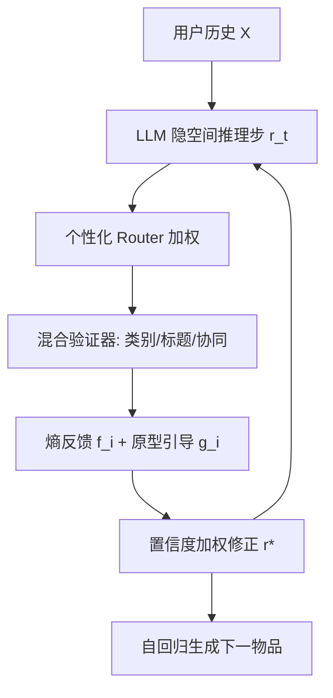

# Verifiable Reasoning for LLM-based Generative Recommendation (面向大模型生成式推荐的可验证推理)

- **会议/期刊**: SIGIR 2026
- **作者与机构**: Xinyu Lin, Hanqing Zeng, Hanchao Yu, Yinglong Xia, Jiang Zhang, Aashu Singh, Fei Liu, Qifan Wang (Meta MRS)；Wenjie Wang, Fuli Feng, Tat-Seng Chua (NUS)
- **推荐链路定位**: 端到端生成式（Next-Item 生成）
- **研究方向**: 大语言模型推荐 / 生成式推荐
- **论文原文**: [https://arxiv.org/abs/2603.07725v1](https://arxiv.org/abs/2603.07725v1)
- **开源代码**: [https://github.com/Linxyhaha/Verifiable-Rec](https://github.com/Linxyhaha/Verifiable-Rec)

## TL;DR (1分钟核心速览)

现有 Reason4Rec 采用 `reason-then-recommend` 范式，但隐空间推理缺乏中间监督，导致**同质化推理**（塌缩为单一确定性路径）与**误差累积**（步数越多越差）。本文提出 `reason-verify-recommend` 范式与 VRec：用多维度混合验证器（类别/标题/协同）对每步隐推理表征做组级偏好预测，以预测熵为反馈、末层权重为引导原型进行置信度加权修正，并加单调性正则。在 CDs/MicroLens/Goodreads/Instruments 四数据集上，VRec 相对最强基线 LatentR3 的 Recall@10 提升 5.3%–46.9%，推理开销仅增 0.59%。

## Background & Motivation (背景与核心矛盾)

- **主流范式**: Reason4Rec 让 LLM 先在隐空间自回归生成推理表征 $R=(r_1,\dots,r_m)$，再据此生成下一物品，监督信号仅落在最终物品$\hat{y}$ 上。
- **前人局限**: ① 推理表征 $R$无直接优化，模型收敛到退化分布$M_\theta(R|X)\to\delta_{R^*(X)}(R)$，推理同质化；② 无中间校验，早期错误沿自回归链放大，LatentR3 在 1 步时最优、步数增加性能持续下降。
- **核心洞察 (Key Insight)**: 推理质量虽无显式标签，但"能导向正确推荐的推理"应与**组级用户偏好**（如 hip-hop、jazz 这类粗粒度类别）对齐；验证器对偏好预测的**熵**即可作为推理正确性的代理信号，其**末层分类权重**天然是偏好原型，可直接用于修正推理表征。
- **本文切入点**: 在每步推理后插入验证-修正算子，把"一次性推理"改为"推理-验证交替"，用轻量验证器提供可靠且多维的反馈。

## Method (核心方法设计)

### 1. 整体框架 (Overall Architecture)

输入用户历史 $X$，LLM 每步产生隐推理表征$r_t$；验证阶段由个性化 Router 为$n$个维度验证器分配权重，各验证器输出组级偏好分布$p$，取熵$f_i$为反馈、末层权重$g_i$为引导向量，按置信度$c_i=1/f_i$加权融合得到修正表征$r^*$，回填下一推理步；交替$m$ 步后自回归生成物品。训练分两阶段：先用 LatentR3 生成的正/负样本预训练验证器，再联合微调验证器与 LLM（含验证损失与单调性正则）。

### 2. 关键设计拆解 (Key Designs)

1. **混合验证器 + 个性化 Router（多维性）**：单一维度（如仅类别）无法覆盖丰富偏好。对每个维度 $i$设验证器$V_i$，Router$g(\cdot)$依用户行为输出权重$w$，得$f_i,g_i\leftarrow V_i(w_i r)$。维度内多样性覆盖语义/协同多侧面，维度间多样性刻画"不同用户关注不同侧面"（有人因电影《泰坦尼克号》喜欢该曲，有人因歌手）。

2. **组级偏好预测代理任务 + 熵反馈/权重引导（可靠性）**：二分类"推理是否正确"无标签且噪声大，改为预测组级偏好 $\hat{P}=\arg\max_j p_j$，$p=V_i(w_i r)\in\mathbb{R}^{d_i}$。反馈取熵$f_i=H(p)=-\sum_j p_j\log p_j$，低熵即高置信对齐；引导取末层权重$g_i=W_{i,:,j^*}$ 作为偏好原型。修正算子为
$$r^*=\sum_{i=1}^{n}\left[(1-c_i)r+c_i g_i\right],\quad c_i=1/f_i$$
直觉：对齐好（低熵、$c_i$ 大）时强力拉向原型、抑制同质化；偏离时温和混合、阻断误差传播。

3. **两阶段训练与单调性正则**：Stage 1 验证器预训练，正样本（成功生成目标物品）最小化交叉熵，负样本最大化熵（推向均匀分布）：
$$\mathcal{L}_v=\begin{cases}-\log \Pr(\hat{P}=P), & P\neq\varnothing\\ -\alpha\sum_j p_j\log p_j, & P=\varnothing\end{cases}$$
Stage 2 联合微调，总损失 $\mathcal{L}=\mathcal{L}_r+\beta\mathcal{L}_v+\gamma\mathcal{L}_m$，其中单调性正则$\mathcal{L}_m=\max(0,f_i^t-f_i^{t-1})$惩罚相邻步熵上升，强制推理逐步更确定。验证器为线性头或 2–3 层 MLP，复杂度$O(mnkd^2)$远小于 LLM 主干$O(mLd^2)$，无需负采样。

## Experimental Setup & Evaluation Protocol (实验设置与评估协议)

- **数据集与预处理**: 四个真实数据集，物品序列最大长度 10，无 5-core 过滤说明：

| 数据集 | #Train | #Valid | #Test | #Items | 场景说明 |
| :--- | :---: | :---: | :---: | :---: | :--- |
| CDs | 49,251 | 6,156 | 6,158 | 5,841 | Amazon 音乐专辑，含标题/类别 |
| MicroLens | 60,101 | 9,036 | 9,121 | 5,326 | 微视频，文本描述噪声大 |
| Goodreads | 256,868 | 33,148 | 33,040 | 7,413 | 图书，含标题/描述/类别 |
| Instruments | 66,500 | 8,312 | 8,313 | 5,030 | Amazon 乐器 |

- **数据划分与防穿越**: 按时间戳排序后 `8:1:1` 比例划分训练/验证/测试。
- **排名评测协议**: 采用 R@5/R@10、N@5/N@10；原文未明示 Full-Ranking 或采样排序（属评估披露不足点）。
- **对比基线与超参**: 传统序列模型 GRU4Rec/Caser/SASRec，生成式 TIGER/LETTER/SETRec/D3，推理增强 LatentTTS/LatentR3；LLM 主干 Qwen2.5-1.5B 全参微调，学习率 $\{3e^{-4},5e^{-5},3e^{-5}\}$，推理步$m\in\{1,2,4,6,8,10\}$，$\beta\in\{0.3,0.5,0.7,1\}$，$\gamma\in\{0.1,\dots,2\}$；显著性用单样本 t 检验$p<0.01$。

## Key Experimental Results (实验关键数据)

### 1. 主实验对比 (Main Results)

| 方法 | CDs R@10 | CDs N@10 | MicroLens R@10 | MicroLens N@10 | Goodreads R@10 | Goodreads N@10 | Instruments R@10 | Instruments N@10 |
| :--- | :---: | :---: | :---: | :---: | :---: | :---: | :---: | :---: |
| SASRec | 0.0984 | 0.0641 | 0.0069 | 0.0037 | 0.0316 | 0.0157 | 0.0972 | 0.0772 |
| TIGER | 0.0555 | 0.0325 | 0.0075 | 0.0030 | 0.0384 | 0.0175 | 0.0945 | 0.0616 |
| LETTER | 0.0619 | 0.0350 | 0.0104 | 0.0045 | 0.0377 | 0.0185 | 0.1012 | 0.0583 |
| SETRec | 0.0942 | 0.0553 | 0.0129 | 0.0066 | 0.0174 | 0.0088 | 0.0864 | 0.0746 |
| D3 | 0.0940 | 0.0659 | 0.0134 | 0.0076 | 0.0534 | 0.0285 | 0.1188 | 0.0915 |
| LatentTTS | 0.0912 | 0.0643 | 0.0123 | 0.0068 | 0.0513 | 0.0265 | 0.1068 | 0.0866 |
| LatentR3 | 0.0978 | 0.0703 | 0.0160 | 0.0088 | 0.0565 | 0.0301 | 0.1243 | 0.0951 |
| VRec-1Step | 0.1070 | 0.0730 | 0.0154 | 0.0093 | 0.0593 | 0.0310 | 0.1269 | 0.0976 |
| **VRec** | **0.1213** | **0.0862** | **0.0235** | **0.0121** | **0.0582** | **0.0312** | **0.1301** | **0.0997** |
| **Improv.%** | +24.0% | +22.6% | +46.9% | +37.5% | +3.0% | +3.7% | +4.7% | +4.8% |

### 2. 消融实验 (Ablation Study)

CDs 数据集（图 5，数值为近似读数）：

| 变体 | R@10 | N@10 | 说明 |
| :--- | :---: | :---: | :--- |
| w/o Verifier (=LatentR3) | ~0.098 | ~0.070 | 去掉验证步，降幅最大 |
| Single V-C | ~0.107 | ~0.075 | 仅类别验证器 |
| Single V-T | ~0.112 | ~0.079 | 仅标题验证器 |
| w/o 个性化 Router | ~0.115 | ~0.082 | 用户无关权重 |
| w/o 验证器预训练 | ~0.113 | ~0.080 | 直接联合训练 |
| w/o $\mathcal{L}_m$ | ~0.117 | ~0.083 | 无单调性正则 |
| **VRec** | **0.1213** | **0.0862** | 全组件 |

验证器维度扩展（表 2，CDs）：Category 0.1074 → +Title 0.1168 → +CF **0.1223**（R@10）。

### 3. 关键实验发现 (Key Findings)

1. **验证步是收益主源，且随步数可扩展**：去掉验证器即退回 LatentR3（CDs R@10 从 0.1213 跌至约 0.098）；VRec 在 $m$ 从 1 增至 10 时性能单调上升并于 6–10 步饱和，而 LatentR3 在 1 步即达峰后持续退化——直接证伪"推理步越多越好"的旧假设。
2. **语义维度贡献大于协同维度，但维度互补**：CDs 上 Category+Title 带来 +8.8% R@10，再加 CF 仅再 +4.7%；而 MicroLens 因文本噪声大，CF 验证器反超标题验证器，说明验证维度需按数据模态自适应选择。
3. **验证开销可忽略、验证器容量存在甜点**：10 步推理下平均仅增 0.59% 时延（0.03%–1.33%）；验证器 3 层 2048 隐维最优，继续加宽加深因组级类别仅约 20 类而出现过拟合；$\beta$呈倒 U 型（过强验证器与推荐目标冲突），$\gamma$ 单调增益后饱和。

## Highlights & Limitations (亮点、对比与审稿批判)

- **与代表作对比 (vs. Prior Work)**: 相比 LatentR3 的"纯隐推理无校验"，VRec 在推理链中插入轻量验证算子；相比 Self-Refine/CRITIC/ToT 等依赖**显式文本 CoT** 的外部验证器，本文直接在**隐表征**上验证，避免 CoT 标注成本与解码开销；相比 Self-Consistency 的多采样聚合，本文用单次前向的熵与分类权重，无需多次采样。
- **可迁移亮点**: ① "熵作反馈 + 末层权重作原型"的免标签验证信号，可迁移到任何隐空间推理的序列任务；② 单调性正则 $\max(0,f^t-f^{t-1})$ 是极低成本的多步推理稳定器，可套用于扩散/多步生成推荐。
- **审稿级局限批判**: ① 评测协议未明确 Full-Ranking 还是采样排序，且 Goodreads 上相对 LatentR3 仅 +3.0%，增益显著性存疑；② 组级偏好标签依赖类别元数据或 k-means 聚类，MicroLens/Goodreads 缺类别时维度受限；③ 隐空间推理的可解释性仅停留在"验证器预测可读"层面，未做用户研究验证解释一致性。

## Rating (四维评分)

- **方法创新性 (Novelty)**: ⭐⭐⭐⭐ （首次将可验证推理引入隐空间生成式推荐，"熵反馈+权重原型"设计简洁且有退化分布的理论论证）
- **评估协议与实验扎实度 (Protocol & Experiments)**: ⭐⭐⭐ （四数据集+九基线+完整消融与效率分析，但排序协议未披露、部分数据集增益偏小）
- **写作与数学规范度 (Clarity & Rigor)**: ⭐⭐⭐⭐ （范式对比图与公式链条清晰，退化分布与复杂度分析到位，Router 与验证器符号略密）
- **工业落地与复现价值 (Industrial & Practical Value)**: ⭐⭐⭐⭐⭐ （0.59% 时延开销、代码开源、Meta 工业背景，验证器可插拔于任意隐推理推荐器）
