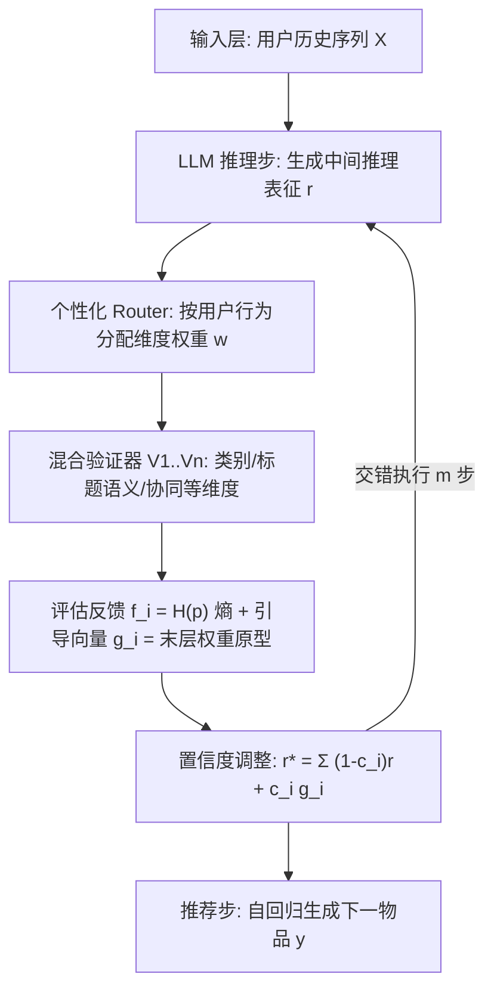

# Verifiable Reasoning for LLM-based Generative Recommendation (面向 LLM 生成式推荐的可验证推理)

- **会议/期刊**: SIGIR 2026
- **推荐链路定位**: 端到端生成式 (End-to-End Generative)
- **研究方向**: 大语言模型推荐 (LLM4Rec) / 生成式推荐与离散语义 ID
- **论文原文**: [https://arxiv.org/abs/2603.07725v1](https://arxiv.org/abs/2603.07725v1)
- **开源代码**: [https://github.com/Linxyhaha/Verifiable-Rec](https://github.com/Linxyhaha/Verifiable-Rec)

## TL;DR (核心速览)

针对 LLM 生成式推荐中 `reason-then-recommend` 范式因缺乏中间验证而导致的**同质化推理**与**误差累积推理**两大退化问题，本文提出 `reason-verify-recommend` 范式及实现 VRec：用混合验证器（多维度）+ 代理偏好预测任务（可靠性）+ 置信度引导调整 + 单调性正则，在四个真实数据集上显著提升推荐效果且不牺牲效率。

## Background & Motivation (背景与动机)

- **领域背景与主流范式**: 以 OpenAI-o1、DeepSeek-R1 为代表的 LLM 推理能力被引入生成式推荐（Reason4Rec）。主流做法是 `reason-then-recommend`：LLM 先在隐空间自回归地逐步推理用户历史，再生成下一个物品。
- **现有方法局限 (Limitations of Prior Work)**:
  1. **同质化推理 (Homogeneous reasoning)**：监督信号仅施加于最终推荐物品 $\hat{y}$，中间推理 $R$ 无直接优化，模型易收敛到退化分布，反复利用相同的虚假关联（spurious correlations），推理表征在 t-SNE 上坍缩（图 3(a)）。
  2. **误差累积推理 (Error-accumulated reasoning)**：早期推理错误沿自回归链条传播放大，随推理步数增加性能持续下降（图 3(b)）。
  3. 根因：推理过程**未被验证 (unverified)**，缺乏对中间推理质量的反馈与纠偏。
- **核心挑战 (Key Challenge)**: 推理在隐空间进行，**没有天然的中间步骤监督信号**来判断其正确性；且用户偏好本身是多维的（语义、协同、类别等），单一视角验证不足以刻画。
- **核心洞察与切入点 (Key Insight)**: 若推理导向正确推荐，则其应与**群体级用户偏好 (group-level preference)** 对齐。因此可将"推理正确性"这一不可得标签，转化为"偏好预测"这一可监督的**代理任务**，用预测熵作为评估反馈、用分类器末层权重作为引导原型。

## Problem Formulation & Method (问题定义与方法架构)

### 1. 符号定义与输入表征 (Notations & Input Representations)

- 用户历史交互序列 $X = [i_1, i_2, \ldots, i_L]$，$i \in \mathcal{I}$ 为物品标识（如物品标题），$L=|X|$。
- 目标：生成下一个物品 $y = i_{L+1}$。
- LLM $M$ 参数为 $\theta$，隐维度 $d_M$；推理序列 $R=(r_1,\ldots,r_m)$，$r_j \in \mathbb{R}^{d_M}$，$m$ 为推理步数。
- 物品词表 $\mathcal{V}$；验证器集合 $\mathcal{V}_{er} = \{V_1,\ldots,V_n\}$，每个验证器对应一个偏好维度 $i$，类别数 $d_i$。

### 2. 整体流水线 (Overall Architecture)

数据流：用户历史 $X$ → LLM 自回归生成中间推理表征 $r$ → 混合验证器（个性化 router 加权 + $n$ 个维度验证器）输出反馈 $f_i$ 与引导向量 $g_i$ → 置信度加权调整得到 $r^*$ → 替换原 $r$ 进入下一步推理 → 多步后自回归生成下一物品。

### 3. 核心模块设计与数学原理 (Key Designs & Formulations)

**(1) 混合验证器 + 个性化 Router（多维度性）**

- 每个验证器 $V_i$ 评估推理表征与用户在第 $i$ 个偏好维度上的对齐：$f_i, g_i \leftarrow V_i(r)$。
- 个性化 router $g(\cdot)$ 为不同用户自适应分配维度权重：$w = g(r_i) \in \mathbb{R}^n$，然后 $f_i, g_i \leftarrow V_i(w_i r)$。物理直觉：有的用户重类别（如爵士乐），有的重价格/歌手，router 实现 **inter-user 多样性**；多验证器实现 **intra-user 多样性**。

**(2) 代理偏好预测 + 熵评估（可靠性）**

- 不做二分类（无真值、噪声大），而是定义群体级偏好预测任务：$p = V_i(w_i r) \in \mathbb{R}^{d_i}$，$\hat{P} = \arg\max_j p_j$。
- 评估反馈用预测熵：$f_i = H(p) = -\sum_{j=1}^{d_i} p_j \log p_j$。熵小 → 推理与偏好高置信对齐；熵大 → 推理可能偏离偏好。

**(3) 引导向量与置信度调整**

- 引导信号取验证器末层权重作为偏好原型：$g_i = W_{i,:,j^*}$，$j^* = \arg\max_j p_j$，$W_i \in \mathbb{R}^{d_M \times d_i}$。
- 置信度 $c_i = 1/f_i$，调整公式：
$$r^* = \sum_{i=1}^{n} \left[(1-c_i) r + c_i g_i\right]$$
直觉：对齐好（$f_i$ 小、$c_i$ 大）时更激进地沿当前路径增强推理，缓解同质化；偏离时保守混合、鼓励探索其他路径，阻断误差传播。

### 4. 训练目标、负采样与推理复杂度 (Optimization, Negative Sampling & Complexity)

**两阶段训练：**

- **Stage 1 验证器预训练**：用预训练 LLM 推理推荐器对全部样本 $(X,y)$ 生成推理与推荐。成功生成目标物品 → 正样本，推理 $R$ 与各维度偏好 $P$ 配对；失败 → 负样本，$R$ 配 $\varnothing$。损失：
$$\mathcal{L}_v = \begin{cases} -\log \Pr(\hat{P}=P), & P \neq \varnothing \\ -\alpha \sum_{j=1}^{d_i} p_j \log p_j, & P = \varnothing \end{cases}$$
即正样本最小化交叉熵，负样本最大化熵（输出均匀分布 → 大 $f$）。

- **Stage 2 可验证推理微调**：联合微调验证器与 LLM 推荐器：
$$\mathcal{L}_r = -\frac{1}{|\mathcal{D}|}\sum_{\mathcal{D}}\sum_{t=1}^{|y|} M_\theta(X, R, y_{<t}), \quad R=(r_1^*,\ldots,r_m^*)$$
- **单调性正则**：$\mathcal{L}_m = \max(0, f_i^t - f_i^{t-1})$，惩罚相邻步熵上升，强制推理逐步更对齐（防验证器跨步共享导致的捷径学习）。
- **总损失**：$\mathcal{L} = \mathcal{L}_r + \beta \mathcal{L}_v + \gamma \mathcal{L}_m$，$\beta,\gamma$ 为平衡超参。

**负采样策略**：验证器预训练阶段以"生成失败样本"作为负例（非传统 item 负采样）；推荐器本身为自回归生成，免负采样。

**复杂度**：LLM 推荐器主导 $O(mLd^2)$（$m$ 推理步、$L$ 层、$d$ 隐维）；验证模块增加 $O(mnkd^2)$（$n$ 个验证器、每个 $k$ 层 MLP）。验证器为轻量线性头/MLP，开销相对 LLM 主干可忽略，故称"不牺牲效率"。

## Experimental Setup & Evaluation Protocol (实验设置与评估协议)

> **说明**：提供的 PDF 抽取文本在 Table 1 处截断，以下数据集统计、划分与主实验数值**原文未在抽取文本中完整报告**，仅能依据可见信息与摘要/正文描述标注，具体数值需以原文完整版为准。

- **数据集**: 四个真实世界数据集（摘要与正文均称 "four real-world datasets"）。抽取文本中**未列出具体数据集名称与统计表**；代码仓库关联了 MicroLens 数据集（候选代码 URL 中出现 `westlake-repl/MicroLens`），推测短视频推荐场景为其中之一，但原文未在可见文本中确认。
- **数据划分方式 (Splitting Strategy)**: 抽取文本未明确报告（LOO / Ratio / Temporal 均未在可见部分说明），**原文未报告**。
- **排名评测协议 (Ranking Protocol)**: 抽取文本未明确报告 Full-Ranking 或 Sampled Ranking，**原文未报告**。
- **评价指标与显著性检验**: 抽取文本未列出具体指标（Recall@K / NDCG@K 等）与显著性检验方式，**原文未报告**。

## Key Experimental Results (核心实验结果)

### 1. 主实验对比 (Main Results)

抽取文本在 "Table 1 Overall performance of VRec and baselines on four real-world datasets. The" 处截断，**具体数值原文未在可见文本中报告**。仅可确认结论：VRec 在四个数据集上"substantially enhances recommendation effectiveness and scalability without compromising efficiency"。

| 数据集 | 指标 | 最强基线 | 本文方法 (Ours) | 相对提升 (Improv.) |
| :--- | :--- | :---: | :---: | :---: |
| 四个真实数据集（名称未在抽取文本中给出） | 未报告 | 未报告 | 未报告 | 原文称"substantial"，具体数值原文未报告 |

### 2. 消融实验与控制变量分析 (Ablation Study)

抽取文本未包含消融表格。正文提及将验证器分类器设计（线性头 vs. MLP）的讨论放在 Section 4.3.3，但具体消融数值**原文未在可见文本中报告**。

### 3. 稀疏度/冷启动分桶与超参敏感度 (Sparsity Buckets & Hyperparameters)

- **分桶表现**: 抽取文本未报告长尾/冷启动分桶结果。
- **关键超参数**: 涉及 $\alpha$（负样本熵权重）、$\beta$（验证器损失权重）、$\gamma$（单调性正则权重）、推理步数 $m$、验证器数量 $n$、类别数 $d_i$，但敏感度分析数值**原文未在可见文本中报告**。
- **线上 A/B 测试**: 抽取文本未提及线上实验，**原文仅包含离线实验**（据可见文本判断）。

## Highlights, Limitations & Critiques (亮点、局限与审稿级批判)

- **核心亮点与可迁移性**:
  1. **范式贡献**：将"验证"显式插入推理链，`reason-verify-recommend` 交错结构可迁移到任何隐空间推理的生成式推荐/检索任务。
  2. **代理任务设计巧妙**：把不可监督的"推理正确性"转化为可监督的"群体级偏好预测"，用熵作置信度、末层权重作引导原型，工程上轻量（线性头/MLP）且与 LLM 主干解耦。
  3. **单调性正则**：以熵单调下降约束推理逐步收敛，是对"验证器跨步共享导致捷径学习"的针对性补丁，思路可复用到多步推理的 RL/自训练场景。
- **局限性与审稿视角批判 (Critical Limitations)**:
  1. **评估协议透明度不足**：抽取文本未给出数据集统计、划分策略、Full-Ranking vs. Sampled Ranking、显著性检验，审稿中会被要求补充；若采用采样排序则结论强度打折。
  2. **代理任务的有效性边界**：群体级偏好（粗粒度如"hip-hop"）与个体细粒度偏好存在 gap，熵低≠推理正确，仅保证"与粗粒度偏好一致"，可能奖励"安全但平庸"的推理。
  3. **验证器预训练依赖推荐器生成质量**：正负样本由预训练推荐器成败划分，存在自举偏差（bootstrap bias），失败样本的推理未必"错"，只是未命中目标。
  4. **效率声明需实证**：虽理论复杂度验证模块相对 LLM 可忽略，但 $m$ 步交错验证的**实际推理延迟 (ms/request)** 与峰值显存未在可见文本报告，端到端生成场景下延迟敏感。
  5. **可复现性**：代码已开源（Verifiable-Rec），但抽取文本缺失关键实验细节，复现需依赖完整版与仓库。

## Rating (四维评分)

- **方法创新性 (Novelty)**: ⭐⭐⭐⭐
- **评估协议与实验扎实度 (Protocol & Experiments)**: ⭐⭐⭐（抽取文本缺失关键协议与数值，暂评三星，待完整版核实）
- **写作与数学规范度 (Clarity & Rigor)**: ⭐⭐⭐⭐
- **工业落地与复现价值 (Industrial & Practical Value)**: ⭐⭐⭐⭐
