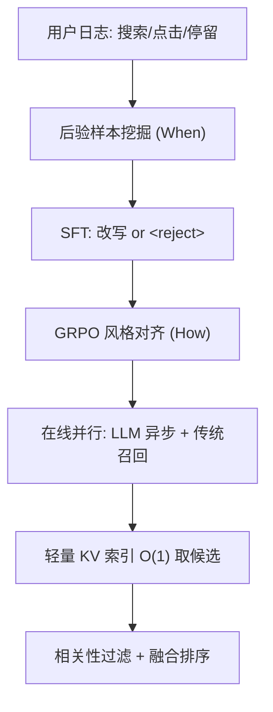
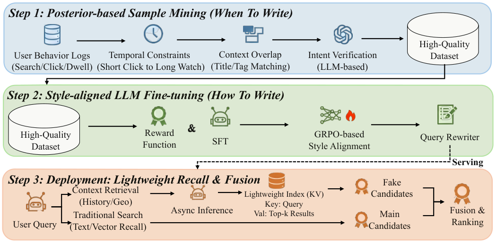

# When & How to Write for Personalized Demand-aware Query Rewriting in Video Search (视频搜索中个性化需求感知查询改写的「何时写」与「如何写」)

- **会议/期刊**: SIGIR 2026
- **作者与机构**: Cheng Cheng, Chenxing Wang, Aolin Li, Haijun Wu, Huiyun Hu, Juyuan Wang, Dongliang Liao（腾讯微信事业群 Weixin Group）
- **推荐链路定位**: 召回（查询理解侧，改写后走轻量索引召回）
- **研究方向**: 大语言模型推荐 / 序列与会话推荐
- **论文原文**: [https://arxiv.org/abs/2602.17667v2](https://arxiv.org/abs/2602.17667v2)
- **开源代码**: 暂未开源

## TL;DR (1分钟核心速览)

短视频搜索的 query 短且歧义（"Guangliang" 既是歌手又是白酒品牌），传统隐式历史特征存在信号稀释与延迟反馈。WeWrite 把个性化改写拆成两个问题：用后验行为（短点击 $T_{orig}<2.4$s 后接长观看$T_{next}>10$s）挖掘「必须改写」的正样本与「必须拒写」的负样本，解决 **When**；再用 SFT + GRPO（奖励融合 ROUGE-L 语义分与系统 query 热度$qv$）把输出风格对齐到检索索引，解决 **How**。离线 Acc 达 0.583，较 Qwen3-32B zero/few-shot 提升超 27%；微信线 A/B 上 VV>10s +1.07%、改写率 -2.97%，且不增加服务成本。

## Background & Motivation (背景与核心矛盾)

- **主流范式**: 改写已从判别式（词典/规则扩展）走向生成式——LLM 做 query expansion、工业框架（CardRewriter、淘宝语义对齐、美团 IterQR）做检索目标对齐，近期再用 PPO/DPO/KTO/GRPO 把 LLM 输出与下游系统奖励对齐。
- **前人局限**: 其一，上述方法基本是 **context-agnostic**，对所有用户一视同仁，忽略个体潜在意图；其二，个性化在 QAC / Query Suggestion 中已有探索，但实时搜索的显式改写面临 **意图漂移**（功能性 query "Air fryer" 被娱乐历史带偏）与 **LLM 推理延迟** 两大非平凡障碍。
- **核心洞察 (Key Insight)**: 用户「先短点击失败、再改写成功」的后验行为序列，本身就是「此处个性化改写是刚需」的天然标注；而生成 query 是否可用，取决于它是否落在系统索引的 query 分布内（避免 zero-recall）。
- **本文切入点**: 用后验挖掘决定「何时写」（含拒写负样本），用 SFT+GRPO 混合训练决定「如何写」，用并行轻量索引把 LLM 移出同步链路。

## Method (核心方法设计)

### 1. 整体框架 (Overall Architecture)

输入为用户上下文元组 $C_u=\{H_{query},H_{video},G\}$（历史 query、观看视频、地理特征）与原始 query$Q_{orig}$，目标是学习条件生成策略$\pi_\theta(Q'|Q,C_u)$，最大化同时反映用户满意度（CTR）与系统可检索性（Index Hit Rate）的期望奖励。离线阶段先用后验行为挖掘出正/负样本集，再以 SFT 教会模型「改写或输出 `<reject>`」，随后用 GRPO 以混合后验奖励做风格对齐；在线阶段 LLM 异步推理与传统召回并行，改写结果命中预建 KV 轻量索引后取候选，经轻量相关性模型过滤再与主候选集融合排序。

<figure class="paper-figure" markdown="span">
  <figcaption>图3：所提框架概览。它包括意图对齐样本的离线挖掘、用于风格对齐的混合 LLM 训练（SFT+RL），以及用于最小化延迟的在线并行“轻量级召回”架构。</figcaption>
</figure>

### 2. 关键设计拆解 (Key Designs)

1. **后验样本挖掘（When to Write）**： indiscriminate 改写会引入噪声与意图漂移。正样本要求同时满足「原 query 失败」$T_{orig}<2.4$s 与「改写后成功」$T_{next}>10$s，再做两级需求感知过滤：Stage 1 要求增益词$\Delta T=\text{Terms}(Q_{next})\setminus\text{Terms}(Q_{orig})$与$C_u$有交集，Stage 2 用 Qwen3-32B 做二分类专家校验，仅保留 "Positive"。负样本来自「原 query 直接满足」（$T_{orig}>\tau_{long}$ 且无后续改写）与「被过滤器拒绝」两类，标签为 `<reject>`。直觉：把「改写收益」直接定义在可观测的行为落差上，比隐式特征更抗信号稀释。

2. **GRPO 混合后验奖励（How to Write）**：SFT 后的模型常生成语义正确但索引中零召回的稀有 query。奖励设计为
$$R(Q_{rew})=\begin{cases}1.0+\alpha\cdot\text{clip}(\log(qv+1),N_{low},N_{up}) & S_{eval}>\tau_{thd}\\ S_{eval} & \text{otherwise}\end{cases}$$
其中 $qv$为生成 query 在系统日志中的历史搜索量（可索引性的代理），$S_{eval}$用 ROUGE-L 度量与真值$Q_{next}$的语义相似度。$\tau_{thd}$保证「先语义保真、后热度优化」，clip 稳定奖励尺度。组内归一化优势$A_i=\frac{R(Q'_i)-\mu(R)}{\sigma(R)+\epsilon}$，总目标$\mathcal{L}_{Total}=\beta\cdot\mathcal{L}_{SFT}-\mathbb{E}[\mathcal{J}_{GRPO}(\theta)]$，以 SFT 正则约束 RL 不偏离语义。

3. **训练目标、负采样与推理效率**：SFT 损失为标准负对数似然 $\mathcal{L}_{SFT}=-\sum_t\log P(y_t|y_{<t},C_u,Q_{orig})$；RL 阶段无需负采样，靠组内$G$条采样相对比较构造优势，且省去 value network。在线侧预建 KV 索引$I_{lw}$（query → Top-$K$文档，$K=50$，日更 + 日内实时更新，覆盖约 83% 请求），头 query 按历史 CTR/停留缓存、长尾 query 从历史日志 top 结果补充，使改写 query 的候选获取为$O(1)$，LLM 推理与主召回并行，端到端延迟不变。

## Experimental Setup & Evaluation Protocol (实验设置与评估协议)

- **数据集与预处理**: 取连续 20 天线上用户日志为训练集，次日数据为测试集；样本经时间约束（2.4s / 10s 阈值）与两级需求感知过滤后构成 $S_{pos}\cup S_{neg}$。原文未披露用户/物品级统计量，属工业日志型评估。

| 数据集 | #Users | #Items | #Interactions | 稀疏度/密度 | 特征/场景说明 |
| :--- | :---: | :---: | :---: | :---: | :--- |
| 微信视频搜索日志（20 天训练 + 1 天测试） | 未披露 | 未披露（视频库） | 未披露 | 未披露 | query + 历史 query/观看视频 + 地理特征 |

- **数据划分与防穿越 (Splitting Strategy)**: **全局时间戳切分**——前 20 天训练、次日测试，严格按时间先后，避免未来行为泄漏。
- **排名评测协议 (Ranking Protocol)**: 非排序型评测，采用生成质量指标 BLEU-4、ROUGE-L、Bert-Score，并定义加权聚合准确率 $\text{Acc}=\frac{1}{N}\sum_i\mathbb{I}((0.4B_i+0.4R_i+0.2S_i)>0.5)$；线上以 VV>10s 与 Query Reformulation Rate 做 A/B。
- **对比基线与超参设置**: 基线含 Qwen3-32B zero-shot（有/无上下文）、few-shot、微调 BART-Large；本文主干为 4B 级 Qwen3。显著性以 $p<0.01$ 检验线上指标。

## Key Experimental Results (实验关键数据)

### 1. 主实验对比 (Main Results)

| Method | Acc | BLEU-4 | ROUGE-L | Bert-Score |
| :--- | :---: | :---: | :---: | :---: |
| Zero-shot (Qwen3-32B) w/o context | 0.111 | 0.078 | 0.196 | 0.616 |
| Zero-shot (Qwen3-32B) | 0.178 | 0.102 | 0.200 | 0.604 |
| Few-shot (Qwen3-32B) | 0.305 | 0.168 | 0.392 | 0.714 |
| BART-Large (Fine-tuned) | 0.298 | 0.163 | 0.388 | 0.708 |
| **WeWrite (4B)** | **0.583** | **0.330** | **0.620** | **0.828** |
| Improv. vs. best baseline | **+91.1%** | **+96.4%** | **+58.2%** | **+16.0%** |

线上 A/B（微信主场景）：**VV>10s +1.07%**（$p<0.01$），**Query Reformulation Rate -2.97%**（$p<0.01$），服务成本不增。

### 2. 消融实验 (Ablation Study)

| 变体 | Acc | BLEU-4 | ROUGE-L | Bert-Score |
| :--- | :---: | :---: | :---: | :---: |
| WeWrite (SFT) w/o Intent Verif. | 0.500 | 0.293 | 0.556 | 0.801 |
| WeWrite (SFT) | 0.535 | 0.316 | 0.584 | 0.813 |
| WeWrite (SFT-GRPO-w/o $qv$) | 0.564 | 0.329 | 0.613 | 0.829 |
| **WeWrite (full)** | **0.583** | **0.330** | **0.620** | 0.828 |

### 3. 关键实验发现 (Key Findings)

1. **领域适配远胜模型规模**：4B 的 WeWrite（Acc 0.583）大幅超过 32B zero/few-shot（0.178 / 0.305），说明通用 LLM 的涌现能力在专用改写任务上无法替代任务级适配，Acc 相对提升超 27%（对 few-shot 达 +91%）。
2. **LLM 意图校验是数据质量的关键增量**：在规则过滤之上加 LLM 二分类校验，SFT 版 Acc 从 0.500 升至 0.535（+3.5pt），证明后验挖掘中的语义推理比刚性启发式能捕获更高质量的训练信号。
3. **热度奖励带来「可检索性」而非「语义妥协」**：加入 $qv$条件奖励后 Acc 由 0.564 升至 0.583，且 RL 模型生成 query 中$qv$ 提升的比例达 20.21%，说明模型在保持语义精度的同时向真实搜索分布靠拢，直接缓解 zero-recall。

## Highlights & Limitations (亮点、对比与审稿批判)

- **与代表作对比 (vs. Prior Work)**: 相较 CardRewriter / IterQR 等工业改写框架，本文首次把「是否改写」作为显式决策（`<reject>` 动作）而非默认全量改写；相较 PPO/DPO 类 RL 对齐工作，采用无需 value network 的 GRPO 并引入系统侧 $qv$ 作为可索引性奖励，把「生成质量」与「索引命中」解耦后再联合优化。
- **可迁移亮点**: ①「失败-成功」行为落差 + 增益词交集 + LLM 校验的三级样本挖掘范式，可直接迁移到电商/资讯搜索的 query 改写与意图补全；②预建 KV 结果缓存 + 异步 LLM 的并行架构，是 LLM 进实时链路的通用低延迟模板。
- **审稿级局限批判**: ① 离线评测以 BLEU/ROUGE 等对真值 $Q_{next}$的相似度为主，而$Q_{next}$本身只是「用户当时的选择」而非最优改写，指标存在天花板与偏置；② 2.4s / 10s /$\tau_{thd}$/$\alpha$ 等阈值均为经验设定，论文未给出敏感性分析，跨场景迁移需重调；③ 轻量索引仅覆盖约 83% 请求，剩余长尾 query 的改写收益未被评估。

## Rating (四维评分)

- **方法创新性 (Novelty)**: ⭐⭐⭐⭐ （把「何时改写」形式化为带拒写动作的决策问题，并用后验行为落差自动标注，思路朴素但切中工业痛点；GRPO 奖励设计有新意但理论深度有限）
- **评估协议与实验扎实度 (Protocol & Experiments)**: ⭐⭐⭐⭐ （20 天日志 + 次日测试的时间切分严谨，离线四指标 + 线上 $p<0.01$ A/B 双验证；但缺数据集统计与超参敏感性分析）
- **写作与数学规范度 (Clarity & Rigor)**: ⭐⭐⭐⭐ （问题形式化、奖励函数与 GRPO 目标推导清晰，公式紧凑；部分符号如 $N_{low}/N_{up}$ 取值未交代）
- **工业落地与复现价值 (Industrial & Practical Value)**: ⭐⭐⭐⭐⭐ （十亿级 MAU 平台全量部署，零额外服务成本、零感知延迟，架构可复用性极强；扣分项为未开源）

