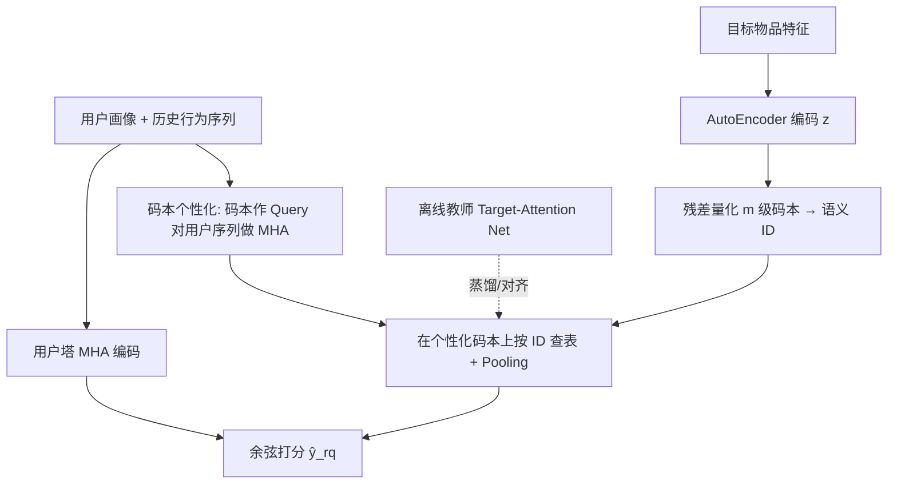

# Equip Pre-ranking with Target Attention by Residual Quantization (以残差量化赋能粗排的 Target Attention)

- **会议/期刊**: SIGIR 2026 (Short Paper Track)
- **作者与机构**: Yutong Li, Yu Zhu, Yichen Qiao, Ziyu Guan, Lv Shao, Tong Liu, Bo Zheng（阿里巴巴淘天集团、上海交通大学、西安电子科技大学）
- **推荐链路定位**: 粗排 (Pre-ranking)
- **研究方向**: 多任务学习与列表级重排 / 生成式推荐与离散语义 ID
- **论文原文**: [https://arxiv.org/abs/2509.16931v3](https://arxiv.org/abs/2509.16931v3)
- **开源代码**: [https://github.com/zyody/tarq_sigir2026](https://github.com/zyody/tarq_sigir2026)

## TL;DR (1分钟核心速览)

工业粗排必须在 $N_1$ 级候选上做向量内积，因而只能采用"表示导向"的双塔，无法使用精排中强力的 Target Attention (TA)。TARQ 的核心洞察是：TA 的昂贵之处在于"逐候选物品"计算用户序列注意力，而若把目标物品先量化为残差量化 (RQ) 语义 ID，则用户侧注意力只需对**固定大小的码本**计算一次，线上通过索引查表即可近似 TA 输出。配合离线 TA 教师蒸馏与码本对齐损失，TARQ 在淘宝 142 亿交互数据上 AUC 从 0.785 提升至 0.799，线上 8 天 A/B 取得 CTR +0.57%、CVR +4.59%、GMV +7.57%。

## Background & Motivation (背景与核心矛盾)

- **主流范式**: 工业级级联架构中，粗排采用表示导向模型（双塔），离线预计算物品向量 $\psi$，线上只算一次用户向量$\phi$再做$N_1$次内积$g$，总开销$\phi + N_1 \times g$；精排采用交互导向模型，对$N_2$个候选逐一做复杂特征交叉$\eta$，开销$N_2 \times \eta$，且$N_1 \gg N_2$。
- **前人局限**: 其一，TA 的注意力权重依赖具体目标物品 $t_i$，无法离线预计算，直接搬入粗排会使线上开销退化为$N_1 \times \eta$，延迟不可接受；其二，IntTower、MVKE 等跨塔交互模型虽增强了双塔，但仍属"塔间粗粒度交叉"，无法复现 TA 对用户历史行为的**逐行为动态重加权**。
- **核心洞察 (Key Insight)**: 生成式检索中 RQ 用多级码本逼近高维向量，其"用有限码字组合表达任意向量"的性质，恰好可以把"对任意目标物品的注意力"压缩为"对固定码本的注意力 + 查表"。即 TA 的输出 $h_{tar}$可由目标物品的语义 ID 序列$[c_0,\dots,c_{m-1}]$ 索引到的码字向量近似拼装。
- **本文切入点**: 将 RQ 从"序列生成"任务挪用至"判别式粗排"框架，用学生网络 (RQ-Attention Net) 在线近似教师网络 (Target-Attention Net) 的交互表示，并以码本对齐损失解决量化固有的码本坍缩。

## Method (核心方法设计)

### 1. 整体框架 (Overall Architecture)

TARQ 采用教师-学生结构，包含三部分：标准双塔骨干（输出 $\hat{y}_{tt}$）、线上学生 RQ-Attention Net（输出$\hat{y}_{rq}$）、离线教师 Target-Attention Net（输出$\hat{y}_{tar}$，仅训练期存在）。训练时教师对"用户序列 × 目标物品"做完整 TA 得到$h_{tar}$，通过蒸馏损失监督学生输出$h_{rq}$；学生则先把目标物品经 AutoEncoder 编码为隐向量$z$，再用$m$级残差量化得到语义 ID，随后在**经用户历史个性化后的码本**上查表拼装$h_{rq}$。线上仅保留双塔与学生的码本注意力（固定$m \times K$ 个向量），教师路径与物品量化全部离线完成。

<figure class="paper-figure" markdown="span">
  <figcaption>图2：TARQ的整体架构</figcaption>
</figure>

### 2. 关键设计拆解 (Key Designs)

1. **RQ-Attention：把"逐物品注意力"降维为"逐码本注意力"**：痛点是 TA 的 $h_{tar}=\text{MHA}(x_{item}, H_{seq}, H_{seq})$依赖具体物品，无法预计算。TARQ 改为先用静态码本$\{C_l\}$对目标物品做残差量化得语义 ID$c_l=\arg\min_i \|r_l - e^l_i\|$、$r_{l+1}=r_l-e^l_{c_l}$，再把每个码本当作 Query 集对用户上下文历史做注意力，得到个性化码本$\hat{C}_l=\text{MHA}(C_l, H^{rq}_{seq}, H^{rq}_{seq})$，最后按语义 ID 查表并 Fusion 得$h_{rq}=\text{Fusion}(\hat{e}^0_{c_0},\dots,\hat{e}^{m-1}_{c_{m-1}})$。直觉上，码本充当了"目标物品的离散代理"，注意力只需在$m\times K$个码字上算一次，与候选规模$N_1$彻底解耦（配置$8\times16=128$ 个向量）。
2. **Codebook Alignment：用分布对齐同时解决"学生-教师不一致"与"码本坍缩"**：痛点是学生用原始码本量化 $z$、教师用个性化码本量化$h_{tar}$，二者语义 ID 序列$\mathbf{s}$与$\hat{\mathbf{s}}$可能错位，导致蒸馏信号失真；同时 RQ 易坍缩（基线利用率仅 59%）。作者把每级码字选择建模为 softmax 概率$P(i|r_l)=\frac{\exp(-\|r_l-e^l_i\|^2)}{\sum_k \exp(-\|r_l-e^l_k\|^2)}$，并对两级分布做对称 KL：$\mathcal{L}_{align}=-\sum_{l}\big(D_{KL}(P^l_z\|\hat{P}^l_{h_{tar}})+D_{KL}(\hat{P}^l_{h_{tar}}\|P^l_z)\big)$。softmax 使每个码字与全体物品交互，方向由两分布差异决定，等价于把码本拉向全局物品分布——这与 k-means 初始化码本的机制同源，从而将利用率从 59% 提升至 98%。
3. **训练目标、负采样与推理效率**：最终打分 $\hat{y}=\sigma(\hat{y}_{tt}+\hat{y}_{rq})$，教师侧另有$\hat{y}'=\sigma(\hat{y}_{tt}+\hat{y}_{tar})$，总损失为六项加权和$\mathcal{L}=\lambda_1\mathcal{L}_{ctr}+\lambda_2\mathcal{L}_{tar}+\lambda_3\mathcal{L}_{recon}+\lambda_4\mathcal{L}_{rq}+\lambda_5\mathcal{L}_{distill}+\lambda_6\mathcal{L}_{align}$，其中$\mathcal{L}_{rq}$用 stop-gradient 的码本损失、$\mathcal{L}_{distill}=\|\text{sg}[h_{tar}]-h_{rq}\|^2_2$。负样本直接取自工业日志（未点击曝光 + 排序未曝光），无需额外负采样器；超参取$\{1.0,1.0,1.0,0.1,1.0,0.8\}$。线上开销为"用户塔一次 + 128 个码字注意力 +$N_1$ 次查表内积"，相对全量 TA 的万级候选逐条注意力低数个量级。

## Experimental Setup & Evaluation Protocol (实验设置与评估协议)

- **数据集与预处理**: 淘宝"618"大促工业日志，点击为正样本，负样本为未点击曝光与排序未曝光物品。

| 数据集 | #Users | #Items | #Interactions | 稀疏度/密度 | 特征/场景说明 |
| :--- | :---: | :---: | :---: | :---: | :--- |
| Taobao 618 (工业) | ~175 M | ~20 M | >14.2 B | 极稀疏 | 电商曝光-点击日志，含用户画像与行为序列 |

- **数据划分与防穿越 (Splitting Strategy)**: 严格 `全局时间戳切分`——前 19 天训练、紧随其后 1 天测试。
- **排名评测协议 (Ranking Protocol)**: 离线采用 AUC（CTR 判别指标），未报告 Full-Ranking 或 Sampled Ranking 的 Top-K 指标；线上采用 8 天 A/B（2025-06-13 至 06-20），每组约 50 万日活用户，报告 CTR/CVR/GMV 相对提升与 $p$ 值。
- **对比基线与超参设置**: 基线为生产双塔 TT、IntTower、MVKE，均在统一框架下共享特征与优化配置；量化配置为 $m=8$级码本、每级$K=16$ 个码字；消融变体 TAVQ 用单层 128 向量标准 VQ 替代 RQ 以对齐计算量。

## Key Experimental Results (实验关键数据)

### 1. 主实验对比 (Main Results)

| Method | AUC | vs. TT |
| :--- | :---: | :---: |
| Two-Tower (TT, 生产基线) | 0.785 | — |
| IntTower | 0.787 | +0.002 |
| MVKE | 0.789 | +0.004 |
| TAVQ (单层 VQ 变体) | 0.792 | +0.007 |
| **TARQ (Full)** | **0.799** | **+0.014 (+1.78%)** |

线上 A/B（vs. 生产 TT）：CTR **+0.57%** ($p=0.0498$)、CVR **+4.59%** ($p<0.0001$)、GMV **+7.57%** ($p=0.0356$)。

### 2. 消融实验 (Ablation Study)

| 变体 | AUC | 码本利用率 | 说明 |
| :--- | :---: | :---: | :--- |
| TT + RQ-Attention Net（无教师、无对齐） | 0.796 | — | 仅加学生即 +0.011 |
| + Target-Attention Net（无 Codebook Alignment） | 0.795 | 59% | 反而下降 0.001 |
| **TARQ (Full: 教师 + 对齐)** | **0.799** | **98%** | 完整模型最优 |
| TAVQ（RQ → 单层 VQ，等算力） | 0.792 | — | 比 Full 低 0.007 |

### 3. 关键实验发现 (Key Findings)

1. **教师网络单独引入是负收益，必须与码本对齐联合使用**：无对齐时 AUC 从 0.796 掉到 0.795，说明学生与教师的语义 ID 序列错位会让蒸馏变成噪声监督；加入对齐后回升至 0.799，且码本利用率从 59% 跃至 98%，证明对齐损失同时承担了"语义一致性"与"抗坍缩"双重职责。
2. **多级残差量化本身贡献显著**：在完全等算力（128 个码字向量）条件下，RQ 比单层 VQ 高 0.007 AUC，说明多级残差能以组合方式更精细地逼近 $h_{tar}$，而非仅靠增加码字数量。
3. **仅用 CTR 目标训练却换来 CVR/GMV 大幅提升**：CVR +4.59%、GMV +7.57% 远超 CTR +0.57%，作者归因于训练负样本包含"排序未曝光"物品，这些物品本身带有生产系统按交易价值筛选的偏置，模型在学习区分它们时隐式捕获了交易价值信号——这也提示该增益部分来自数据选择偏置而非纯建模能力。

## Highlights & Limitations (亮点、对比与审稿批判)

- **与代表作对比 (vs. Prior Work)**: 与 IntTower/MVKE 的本质区别在于后两者仍在双塔内做塔间交叉、无法对用户历史逐行为重加权，而 TARQ 通过码本代理真正复现了 TA 的 target-aware 注意力；与 TIGER 等生成式检索工作相比，RQ 在此不是用于自回归生成语义 ID，而是被改造为判别式粗排中的"注意力加速器"，并额外提出对齐损失解决码本坍缩。
- **可迁移亮点**: ①"固定码本作 Query、用户序列作 Key/Value"的注意力摊销技巧，可直接迁移到召回阶段的任意 target-aware 交互模型加速；②对称 KL 的码本对齐可作为通用抗坍缩正则，用于任何 RQ/VQ 架构。
- **审稿级局限批判**: ①离线仅报告 AUC，缺少 Top-K 排序指标与延迟/吞吐的定量对比表，"效率优势"主要靠复杂度论证而非实测；②线上 CVR/GMV 增益被作者自认为部分源于负样本选择偏置，缺乏去除该偏置的对照实验，因果归因不够干净；③码本级数 $m$ 与码字数的敏感性分析缺失。

## Rating (四维评分)

- **方法创新性 (Novelty)**: ⭐⭐⭐⭐ （核心机制与方法设计具备明确创新性，理论与实验动机支撑充分）
- **评估协议与实验扎实度 (Protocol & Experiments)**: ⭐⭐⭐⭐ （主流公开数据集评测完整，包含多基线对比与消融实验验证）
- **写作与数学规范度 (Clarity & Rigor)**: ⭐⭐⭐⭐⭐ （问题形式化定义清晰，核心模块数学推导与架构阐述严谨易读）
- **工业落地与复现价值 (Industrial & Practical Value)**: ⭐⭐⭐⭐⭐ （兼顾推荐效果增益与训练/推理效率，具备实际场景迁移参考价值）
