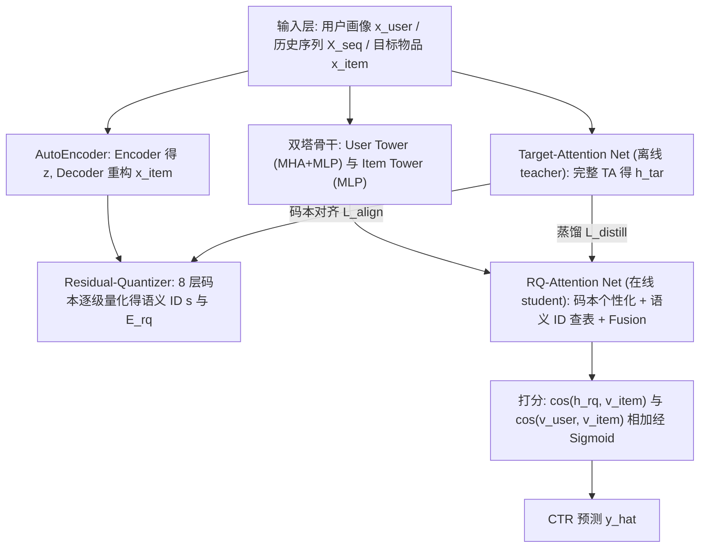
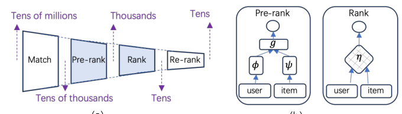
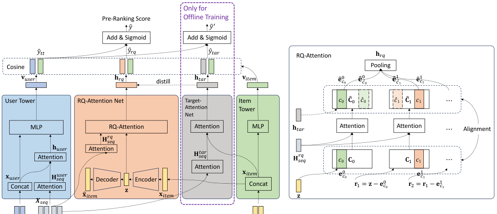

# Equip Pre-ranking with Target Attention by Residual Quantization (以残差量化赋能粗排的 Target Attention)

- **会议/期刊**: SIGIR 2026 (Short Paper Track)
- **推荐链路定位**: 粗排 (Pre-ranking)
- **研究方向**: 多任务学习与列表级重排 / 生成式推荐与离散语义 ID (交叉)
- **论文原文**: [https://arxiv.org/abs/2509.16931v3](https://arxiv.org/abs/2509.16931v3)
- **开源代码**: [https://github.com/zyody/tarq_sigir2026](https://github.com/zyody/tarq_sigir2026)

## TL;DR (核心速览)

粗排阶段长期受困于"效率-效果"矛盾：强表达力的 Target Attention (TA) 因需对每个候选逐一做用户-目标交互，无法在延迟敏感的粗排落地。本文提出 TARQ，借鉴生成式检索中的残差量化 (RQ)，把 TA 的用户-目标交互解耦为"用户历史 × 共享码本"的注意力 + "目标语义 ID 查表"，使在线注意力只处理 8×16=128 个码本向量而与候选集规模无关。在淘宝 142 亿交互工业数据上 AUC 由 0.785 提升至 0.799，线上 8 天 A/B 取得 CTR +0.57%、CVR +4.59%、GMV +7.57% 的显著收益，并已全量上线。

## Background & Motivation (背景与动机)

- **领域背景与主流范式**: 工业推荐采用"召回 → 粗排 → 精排 → 重排"的多级级联架构（图 1(a)）。精排使用 interaction-focused 模型（如 TA/DIN 系列）逐候选做复杂特征交叉以保证精度；粗排则使用 representation-focused 双塔模型，离线预计算物品向量 $\psi$，在线只算一次用户向量 $\phi$ 后做向量内积 $g$，在线代价为 $\phi + N_1 \times g$，而精排代价为 $N_2 \times \eta$。由于 $g \ll \eta$，粗排可处理远大于精排的候选集（$N_1 \gg N_2$）（图 1(b)）。
- **现有方法局限 (Limitations of Prior Work)**:
  1. **表达力鸿沟**：粗排为极致效率牺牲效果，无法建模用户历史行为与目标物品的细粒度交互，成为全链路性能瓶颈。
  2. **TA 不可直接下沉**：TA（图 1(c)）需对每个候选目标 $t_i$ 重新计算其与用户历史 $h_{i1},...,h_{in}$ 的注意力权重，代价随候选数线性增长，在延迟敏感的粗排不可行。
  3. **跨塔交互基线不足**：IntTower、MVKE 等虽在双塔上增加跨塔交互，但仍未真正逼近 TA 的逐目标动态重加权能力。
- **核心挑战 (Key Challenge)**: 如何在保持"在线代价与候选集规模解耦"这一粗排硬约束的前提下，注入 TA 级别的用户-目标交互建模能力？简单加深双塔或拼接特征无法突破 representation-focused 的结构性上限。
- **核心洞察与切入点 (Key Insight)**: 作者观察到生成式检索中用 RQ 将物品压缩为离散语义 ID 的做法，可反过来用于"近似 TA"：把昂贵的"用户历史 × 目标物品"注意力，拆成"用户历史 × 共享码本"（每请求只算一次）与"目标语义 ID 查表"（$O(m)$ 索引查找）两步，从而以 representation-focused 的方式近似 interaction-focused 的 TA（图 1(d)）。

## Problem Formulation & Method (问题定义与方法架构)

### 1. 符号定义与输入表征 (Notations & Input Representations)

- 用户画像嵌入 $\mathbf{x}_{user}$；用户历史物品序列 $\mathbf{X}_{seq} = [\mathbf{x}^1_i, \mathbf{x}^2_i, ..., \mathbf{x}^n_i]$（$n$ 为序列长度，原文未给出具体截断值）。
- 目标物品特征嵌入 $\mathbf{x}_{item}$。
- 用户表征 $\mathbf{v}_{user}$、物品表征 $\mathbf{v}_{item}$。
- 残差量化：$m$ 个码本 $\{\mathbf{C}^l\}_{l=0}^{m-1}$，每个码本 $K$ 个条目；在线配置为 $m=8$、$K=16$（共 128 个码本向量）。
- 输出：CTR 预测 $\hat{y} \in [0,1]$。

### 2. 整体流水线 (Overall Architecture)

TARQ 采用 teacher-student 架构，含三部分：(1) 标准双塔骨干；(2) 在线 student——RQ-Attention Net，推理时高效近似 TA；(3) 离线 teacher——Target-Attention Net，仅在训练期生成高保真交互信号监督 student（图 2）。

### 3. 核心模块设计与数学原理 (Key Designs & Formulations)

**(1) 双塔骨干与 RQ-Attention Net 的近似交互**

用户塔先对历史序列做自注意力，再以用户画像为 query 做交叉注意力，最后 MLP 融合：

$$\mathbf{H}^{user}_{seq} = \text{MHA}(\mathbf{X}_{seq}, \mathbf{X}_{seq}, \mathbf{X}_{seq}), \quad \mathbf{h}^{user} = \text{MHA}(\mathbf{x}_{user}, \mathbf{H}^{user}_{seq}, \mathbf{H}^{user}_{seq})$$
$$\mathbf{v}_{user} = \text{MLP}([\mathbf{x}_{user}; \mathbf{h}^{user}]), \quad \mathbf{v}_{item} = \text{MLP}(\mathbf{x}_{item}), \quad \hat{y}_{tt} = \cos(\mathbf{v}_{user}, \mathbf{v}_{item})$$

RQ-Attention Net 的核心是**个性化码本机制**，分两阶段：

- **码本个性化**：把每个码本 $\mathbf{C}^l$ 当作 query 集，对用户上下文历史做交叉注意力，得到用户专属码本 $\hat{\mathbf{C}}^l$：
$$\mathbf{H}^{rq}_{seq} = \text{MHA}(\mathbf{X}_{seq}, \mathbf{X}_{seq}, \mathbf{X}_{seq}), \quad \hat{\mathbf{C}}^l = \{\hat{\mathbf{e}}^l_k\}_{k=1}^K = \text{MHA}(\mathbf{C}^l, \mathbf{H}^{rq}_{seq}, \mathbf{H}^{rq}_{seq})$$
- **近似交互**：用目标物品的原始语义 ID $s=[c^0,...,c^{m-1}]$ 在个性化码本中查表得 $\hat{\mathbf{E}}_{rq}=[\hat{\mathbf{e}}^0_{c^0},...,\hat{\mathbf{e}}^{m-1}_{c^{m-1}}]$，池化融合后打分：
$$\mathbf{h}_{rq} = \text{Fusion}(\hat{\mathbf{e}}^0_{c^0},...,\hat{\mathbf{e}}^{m-1}_{c^{m-1}}), \quad \hat{y}_{rq} = \cos(\mathbf{h}_{rq}, \mathbf{v}_{item})$$

**物理直觉**：TA 的"逐目标重加权"被分解为"用户历史 × 码本"（每请求一次，与候选数无关）与"目标 ID 查表"（$O(m)$ 索引查找），从而在 representation-focused 框架内近似 interaction-focused 的 TA。

**(2) 残差量化与 AutoEncoder 解耦**

与原始 RQ-VAE 不同，作者将重构与量化分离以降低信息损失。AutoEncoder 仅负责重构：$\mathcal{L}_{recon} = \|\mathbf{x}_{item} - \hat{\mathbf{x}}_{item}\|_2^2$。Residual-Quantizer 逐级量化残差：$\mathbf{r}^0=\mathbf{z}$，$c^l = \arg\min_i \|\mathbf{r}^l - \mathbf{e}^l_i\|$，$\mathbf{r}^{l+1} = \mathbf{r}^l - \mathbf{e}^l_{c^l}$，量化损失 $\mathcal{L}_{rq} = \sum_{l=0}^{m-1}\|\text{sg}[\mathbf{r}^l] - \mathbf{e}^l_{c^l}\|_2^2$（$\text{sg}[\cdot]$ 为 stop-gradient）。

**(3) 离线 Teacher 与码本对齐 (Codebook Alignment)**

Target-Attention Net 用完整 TA 计算 $\mathbf{h}_{tar} = \text{MHA}(\mathbf{x}_{item}, \mathbf{H}^{tar}_{seq}, \mathbf{H}^{tar}_{seq})$，通过蒸馏损失 $\mathcal{L}_{distill} = \|\text{sg}[\mathbf{h}_{tar}] - \mathbf{h}_{rq}\|_2^2$ 监督 student。

码本对齐将每级码本选择建模为基于欧氏距离 softmax 的概率分布：
$$P(i|\mathbf{r}^l) = \frac{\exp(-\|\mathbf{r}^l - \mathbf{e}^l_i\|^2)}{\sum_{k=1}^K \exp(-\|\mathbf{r}^l - \mathbf{e}^l_k\|^2)}$$
分别以 $\mathbf{r}^0=\mathbf{z}$ 和 $\hat{\mathbf{r}}^0=\mathbf{h}_{tar}$ 得到分布 $P^l_{\mathbf{z}}$ 与 $\hat{P}^l_{\mathbf{h}_{tar}}$，用对称 KL 约束：
$$\mathcal{L}_{align} = -\sum_{l=0}^{m-1}\left(D_{KL}(P^l_{\mathbf{z}} \| \hat{P}^l_{\mathbf{h}_{tar}}) + D_{KL}(\hat{P}^l_{\mathbf{h}_{tar}} \| P^l_{\mathbf{z}})\right)$$

**关键副产物**：softmax 使每个码本条目与所有物品交互，方向由两分布差异决定，从而把码本拉向全局物品分布，**显著缓解码本坍缩**——利用率从 59% 提升至 98%。

### 4. 训练目标、负采样与推理复杂度 (Optimization, Negative Sampling & Complexity)

- **损失函数**（式 22）：
$$\mathcal{L} = \lambda_1\mathcal{L}_{ctr} + \lambda_2\mathcal{L}_{tar} + \lambda_3\mathcal{L}_{recon} + \lambda_4\mathcal{L}_{rq} + \lambda_5\mathcal{L}_{distill} + \lambda_6\mathcal{L}_{align}$$
其中 $\hat{y}=\sigma(\hat{y}_{tt}+\hat{y}_{rq})$，$\hat{y}'=\sigma(\hat{y}_{tt}+\hat{y}_{tar})$，$\mathcal{L}_{ctr}$、$\mathcal{L}_{tar}$ 均为标准 BCE。超参经网格搜索定为 $\lambda_1=\lambda_2=\lambda_3=1.0$，$\{\lambda_4,\lambda_5,\lambda_6\}=\{0.1, 1.0, 0.8\}$。
- **训练负采样策略**: 原文未采用显式负采样算子；负样本由"未点击曝光 + 生产系统排序但未曝光物品"构成（见实验设置），属工业日志自然负例 + 未曝光负例混合，非 in-batch/uniform 采样。
- **时间与空间复杂度**:
  - **离线预计算**：Target-Attention Net 仅训练期使用；Residual-Quantizer 为全库物品生成并存储紧凑语义 ID。
  - **在线推理**：用户塔与 RQ-Attention 核心每请求只算一次；在线注意力仅处理 $8\times16=128$ 个码本向量，**与候选集规模无关**，远小于完整 TA 需处理每请求数万物品的代价。原文未报告具体 ms/request 延迟与峰值显存数值。

## Experimental Setup & Evaluation Protocol (实验设置与评估协议)

- **数据集统计与预处理**: 淘宝"618"购物节日志构建的大规模工业数据集，严格时间切分（19 天训练 + 次日测试）。点击物品为正样本；负样本为未点击曝光 + 生产系统排序但未曝光物品。

| 数据集 (Dataset) | 用户数 (#Users) | 物品数 (#Items) | 交互数 (#Interactions) | 稀疏度/密度 (Sparsity) | 模态/辅助特征说明 |
| :--- | :---: | :---: | :---: | :---: | :--- |
| Taobao "618" 工业数据集 | ~175M | ~20M | >14.2B | 原文未报告 | 用户画像 + 行为序列 + 物品 ID 特征；无多模态 |

- **数据划分方式 (Splitting Strategy)**: **Global Temporal Split（全局时间戳切分）**，19 天训练、随后 1 天测试，有效规避未来信息泄露。
- **排名评测协议 (Ranking Protocol)**: 原文未采用 Recall@K/NDCG@K 等排序指标，主指标为 **AUC**（CTR 预估判别能力）；未报告 Full-Ranking 或 Sampled Ranking 的候选集打分协议细节。
- **评价指标与显著性检验**: 离线 AUC；线上 CTR/CVR/GMV 相对提升并报告 $p$ 值（CTR $p=0.0498$、CVR $p<0.0001$、GMV $p=0.0356$）。Embedding 维度 $d$、序列长度 $n$ 原文未报告；未提及多随机种子方差。

## Key Experimental Results (核心实验结果)

### 1. 主实验对比 (Main Results)

表 1 离线 AUC 对比（统一框架、共享特征与优化设置）：

| 数据集 | 指标 | 双塔基线 (TT) | 跨塔交互最强基线 (MVKE) | 本文方法 (TARQ) | 相对提升 (Improv.) |
| :--- | :--- | :---: | :---: | :---: | :---: |
| Taobao 工业集 | AUC | 0.785 | 0.789 (IntTower 0.787) | **0.799** | +0.014 (绝对) / +1.27% (相对 MVKE) |

线上 8 天 A/B（2025-06-13 至 06-20，每组约 50 万日活用户，对照高度优化的生产 TT 基线）：

| 指标 | 相对提升 | 显著性 |
| :--- | :---: | :---: |
| CTR | +0.57% | $p=0.0498$ |
| CVR | +4.59% | $p<0.0001$ |
| GMV | +7.57% | $p=0.0356$ |

### 2. 消融实验与控制变量分析 (Ablation Study)

表 1 消融结果：

| 配置 | AUC | 说明 |
| :--- | :---: | :--- |
| Two-Tower (TT) | 0.785 | 基线 |
| TT + RQ-Attention Net（无 TA Net、无对齐） | 0.796 | +0.011，student 单独已带来显著增益 |
| + Target-Attention Net（无 Codebook Alignment） | 0.795 | 反而下降 0.001，验证对齐不可或缺 |
| TARQ (Full Model) | **0.799** | 完整模型 |
| TAVQ（RQ 退化为单层 128 向量 VQ） | 0.792 | 同算力下比 TARQ 低 0.007，验证多级 RQ 的价值 |

**结论**：RQ-Attention Net 贡献最大（+0.011）；Target-Attention Net 必须与 Codebook Alignment 联合使用才有效，否则码本坍缩导致性能回退；多级残差量化相较单层 VQ 在同计算代价下带来 0.007 AUC 增益。消融未显式做参数量对齐控制，但 TAVQ 对照保持了相同计算代价，属较严谨的等算力对照。

### 3. 稀疏度/冷启动分桶与超参敏感度 (Sparsity Buckets & Hyperparameters)

- **分桶表现**: 原文未报告长尾/冷启动用户或物品的分桶实验。
- **关键超参敏感度**: 仅说明 $\lambda_1,\lambda_2,\lambda_3$ 固定为 1.0（对 $\lambda_3$ 不敏感），$\{\lambda_4,\lambda_5,\lambda_6\}=\{0.1,1.0,0.8\}$ 经网格搜索确定；未给出敏感度曲线。码本配置 $m=8$、$K=16$ 为在线部署配置。
- **线上 A/B 测试结果**: 见上表，CTR +0.57%、CVR +4.59%、GMV +7.57%，均已全量上线服务数千万日活用户。作者对"仅用 CTR 目标却带来 CVR/GMV 提升"给出解释：生产系统全局目标为交易价值最大化，曝光物品偏向高预估交易价值，模型在学习区分该人群与低价值未曝光物品时隐式捕获了交易信号（选择偏差）。

## Highlights, Limitations & Critiques (亮点、局限与审稿级批判)

- **核心亮点与可迁移性**:
  1. **"解耦交互"思想极具普适性**：将逐候选的 user-target 交互拆为"user × 共享码本（每请求一次）+ target ID 查表（$O(m)$）"，可迁移到召回、匹配等其它延迟敏感环节（作者亦在结论中提出此方向）。
  2. **Codebook Alignment 作为码本坍缩的通用解**：对称 KL 对齐把码本利用率从 59% 拉到 98%，对任何 RQ/VQ 架构（生成式检索、语义 ID 推荐）都有借鉴价值。
  3. **工业验证扎实**：142 亿交互离线 + 8 天大规模线上 A/B + 全量上线，短论文中少见。
- **局限性与审稿视角批判 (Critical Limitations)**:
  1. **评估协议偏窄**：仅报告 AUC，缺少 Recall@K/NDCG@K 等排序指标与候选集打分协议说明；单数据集、无多随机种子方差与配对显著性检验（离线部分），离线结论的统计稳健性证据不足。
  2. **关键实现细节缺失**：Embedding 维度 $d$、序列长度 $n$、在线延迟 (ms/request)、峰值显存均未报告，"效率"主张主要靠理论复杂度论证而非实测延迟曲线，削弱了"state-of-the-art trade-off"的说服力。
  3. **近似误差缺乏理论界**：RQ 近似 TA 的误差上界、码本规模 $m\times K$ 与精度的权衡曲线未给出，$m=8,K=16$ 的选择依据仅靠经验。
  4. **CVR/GMV 增益的归因**：作者以"选择偏差"解释 CTR-only 训练带来 CVR/GMV 提升，属事后假设，缺乏消融或反事实实验支撑；且 CTR 提升 $p=0.0498$ 恰在 0.05 边缘，显著性偏弱。
  5. **可复现性**：虽开源代码，但工业数据集不可获取，离线结果难以独立复现。

## Rating (四维评分)

- **方法创新性 (Novelty)**: ⭐⭐⭐⭐ （首次将 RQ 用于近似 TA 并落地粗排，思路新颖；但 RQ、蒸馏、TA 均为已有组件组合）
- **评估协议与实验扎实度 (Protocol & Experiments)**: ⭐⭐⭐ （线上 A/B 强，但离线仅 AUC、单数据集、缺方差与延迟实测）
- **写作与数学规范度 (Clarity & Rigor)**: ⭐⭐⭐⭐ （公式完整、架构图清晰；部分维度与超参细节缺失）
- **工业落地与复现价值 (Industrial & Practical Value)**: ⭐⭐⭐⭐⭐ （全量上线、开源代码、码本对齐可复用，工业价值极高）

## 论文图表

<figure class="paper-figure" markdown="span">
  <figcaption>图1：(a) 多阶段架构：匹配、粗排、精排和重排及评分数字。(b) 面向表示的粗排模型和面向交互的精排模型。(c) TA的结构。它根据用户历史行为ℎ𝑖1,ℎ𝑖2...ℎ𝑖𝑛与特定目标物品𝑡𝑖的相关性动态重新加权这些行为。(d) 我们提出的TARQ的结构，它以面向表示的方式为粗排配备TA。𝐶𝐵表示码本。1 引言</figcaption>
</figure>

<figure class="paper-figure" markdown="span">
  <figcaption>图2：TARQ的整体架构</figcaption>
</figure>

