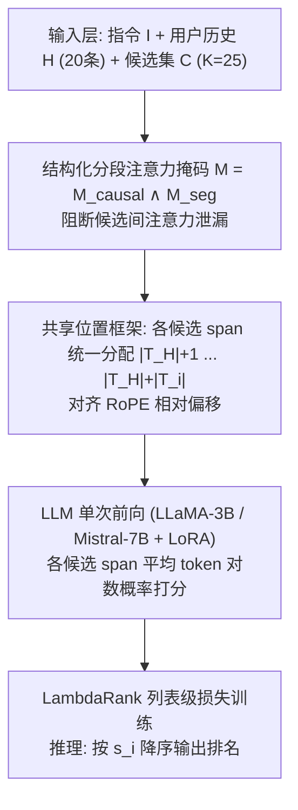
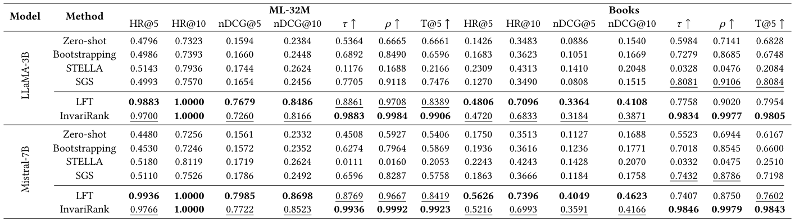
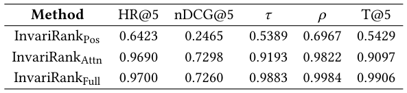

# One Pass, Any Order: Position-Invariant Listwise Reranking for LLM-Based Recommendation (一次前向，任意顺序：面向 LLM 推荐的排列不变列表级重排)

- **会议/期刊**: SIGIR 2026 (49th International ACM SIGIR Conference, Melbourne, VIC, Australia)
- **推荐链路定位**: 重排 (Re-ranking) — 两阶段召回-重排流水线中的列表级重排器
- **研究方向**: 多任务学习与列表级重排 / 大语言模型推荐 (LLM4Rec)
- **论文原文**: [https://arxiv.org/abs/2604.27599v1](https://arxiv.org/abs/2604.27599v1)
- **开源代码**: [https://github.com/ejbito/InvariRank](https://github.com/ejbito/InvariRank)

## TL;DR (核心速览)

针对 decoder-only LLM 列表重排中"候选集合是集合、但模型按序列计算"导致的顺序敏感问题，InvariRank 从架构层面切断顺序依赖通道：用结构化分段注意力掩码阻断候选间注意力泄漏，用共享位置框架在 RoPE 下对齐各候选相对用户上下文的位置偏移，配合 LambdaRank 列表级损失，单次前向即可打分全部候选。在 ML-32M 与 Amazon Books 上（K=25，LLaMA-3B / Mistral-7B），nDCG@10 与最强微调基线 LFT 基本持平（0.8166 vs. 0.8486），而 Kendall τ 从 0.8861 提升至 0.9883、Spearman ρ 从 0.9708 提升至 0.9984，且无需排列集成或不变性正则。

## Background & Motivation (背景与动机)

- **领域背景与主流范式**: LLM 作为两阶段推荐流水线中的重排器已成主流——第一阶段检索器（如 LightGCN）产出固定候选集，第二阶段将用户历史、物品描述与任务指令拼进同一 prompt，由 LLM 在**一次前向**中对全部候选做列表级 (listwise) 联合打分。相比 pointwise / pairwise，listwise 能利用全局上下文，是 LLM 重排最自然的范式。
- **现有方法局限 (Limitations of Prior Work)**:
  1. **推理时方法**（排列集成 Bootstrapping、贪心 SGS）通过聚合多个候选顺序提升稳定性，但需**多次模型调用**，推理成本成倍增长，且只是"平均掉"而非"消除"顺序依赖。
  2. **后处理校准**（STELLA 学习位置偏置矩阵）在打分已被污染之后才修正分数，无法保证诱导出的偏好序一致。
  3. **训练时正则**（排列一致性损失、位置感知微调、ALRO 式生成式不变性目标）惩罚跨排列分歧，但模型在计算过程中**仍可访问顺序信息**，顺序依赖的根源未被移除。
- **核心挑战 (Key Challenge)**: 推荐候选构成**集合**，而 decoder-only LLM 按**序列**计算。因果注意力让候选 token 互相"看见"，RoPE 让候选与共享上下文的相对位置偏移随排列漂移——二者共同把预测相关性耦合到候选的**序列化位置**而非仅内容与用户上下文。简单加深网络或加对比/正则损失无法解决，因为信息通道本身仍在。
- **核心洞察与切入点 (Key Insight)**: 作者将顺序敏感性归因于两个**具体架构来源**：(i) 跨候选注意力泄漏 (cross-candidate attention leakage)；(ii) RoPE 下的偏移漂移 (offset drift)。既然根源在计算图，就应在**架构层面**移除顺序依赖通道，使排列不变性成为模型计算的**性质**，而非推理集成或辅助损失的**效果**。

## Problem Formulation & Method (问题定义与方法架构)

### 1. 符号定义与输入表征 (Notations & Input Representations)

- 候选集 $\mathcal{C}=\{c_1,\dots,c_N\}$，$N=K=25$；$\pi$ 为候选索引上的一个排列。
- 用户指令 $\mathcal{I}$、用户历史 $\mathcal{H}$（最近 20 条交互）、候选集 $\mathcal{C}$。
- 单一输入序列构造为：
$$q=\text{concat}\Big(\underbrace{\texttt{[SPAN]}\mathcal{I}\,\|\,\mathcal{H}\texttt{[/SPAN]}}_{\text{shared context}},\ \underbrace{\texttt{[ITEM]}c_1\texttt{[/ITEM]}\cdots\texttt{[ITEM]}c_N\texttt{[/ITEM]}}_{\text{candidate set}}\Big)$$
- 记 $\mathcal{T}_H$ 为共享上下文 token 索引集，$\mathcal{T}_i$ 为候选 $c_i$ 的 `[ITEM]` span token 索引集。
- 输出：每个候选一个标量分 $s_i$，取该候选 `[ITEM]` span 上**token 级对数概率的均值**；按 $s_i$ 降序得最终排名。

### 2. 整体流水线 (Overall Architecture)

数据流：LightGCN 一阶段召回构造 $K=25$ 候选列表 → 拼接共享上下文与候选集为单序列 → 结构化分段注意力掩码（阻断候选间注意力）+ 共享位置框架（对齐 RoPE 偏移）→ 单次前向得到各候选 span 平均对数概率分 → 排序输出。训练阶段用 LambdaRank 式 pairwise logistic 损失做列表级监督。

<figure class="paper-figure" markdown="span">
  <figcaption>图1：InvariRank 概览。结构化注意力块跨候选交互，共享位置框架对齐各候选的位置偏移。</figcaption>
</figure>

### 3. 核心模块设计与数学原理 (Key Designs & Formulations)

**(1) 排列等变的目标定义。** 理想重排器应满足排列等变：
$$s_{\pi(i)}(\mathcal{H},\pi(\mathcal{C}))=s_i(\mathcal{H},\mathcal{C}),\quad \forall \pi$$
即重排输入候选不改变每个物品的得分，诱导排名在排列下一致。而标准 decoder-only LLM 的实际打分为
$$s_i=f_\theta(\mathcal{H},c_i,c_{<i},p_i),$$
其中 $c_{<i}$ 为前序候选、$p_i$ 为序列化位置——这正是顺序依赖的两个入口。

**(2) 结构化注意力掩码（候选隔离）。** 定义分段掩码
$$M^{\text{seg}}_{t,u}=\mathbb{I}\Big[(t,u)\in(\mathcal{T}_H\times\mathcal{T}_H)\cup\bigcup_{i=1}^{N}(\mathcal{T}_i\times\mathcal{T}_i)\cup\bigcup_{i=1}^{N}(\mathcal{T}_i\times\mathcal{T}_H)\Big],$$
并与因果掩码取交 $M=M^{\text{causal}}\wedge M^{\text{seg}}$。效果：每个候选只能关注**共享上下文与自身**，不能关注其他候选，从而
$$s_i=g_\theta(\mathcal{H},c_i),$$
彻底移除对 $c_{<i}$ 的依赖。物理直觉：把"列表联合打分"退化为"在共享上下文条件下的条件独立打分"，候选间不再有顺序相关的干扰通道。

**(3) 共享位置框架（消除 RoPE 偏移漂移）。** 仅隔离注意力还不够——位置编码仍会引入顺序依赖。作者令 $\mathcal{T}_H$ 中 token 取位置 $1,\dots,|\mathcal{T}_H|$，而**每个**候选段 $\mathcal{T}_i$ 都独立地分配 $|\mathcal{T}_H|+1,\dots,|\mathcal{T}_H|+|\mathcal{T}_i|$，与 $i$ 及排列无关。于是对任意排列 $\pi$：
$$p_{\pi(u)}-p_{\pi(t)}=p(u)-p(t),\quad \forall t\in\mathcal{T}_H,\ u\in\mathcal{T}_i,$$
即候选与上下文之间的**相对位置偏移被严格保持**，每个候选都在与上下文完全相同的位置关系下被评估。这是 RoPE 只依赖相对位置的特性所允许的"共享坐标系"技巧。

**(4) 列表级训练目标。** 尽管前向时候选表征条件独立，训练仍是列表级：对每个满足 $y_i>y_j$ 的偏好对 $(i,j)$，采用 LambdaRank 式 pairwise logistic 损失
$$\ell_{ij}=|\Delta\text{nDCG}_{ij}|\cdot\log\Big(1+\exp\big(-\sigma(s_i-s_j)\big)\Big),$$
最终损失为所有偏好对的平均。$\Delta\text{nDCG}_{ij}$ 为交换两候选引起的 nDCG 变化，作为配对权重。这样候选分数通过**损失**耦合，保留列表级监督，而排列不变性由**模型计算**而非目标函数保证。

### 4. 训练目标、负采样与推理复杂度 (Optimization, Negative Sampling & Complexity)

- **损失函数**: 上述 LambdaRank 式加权 pairwise logistic 损失（原文未显式给出 $\sigma$ 取值与 $\Delta$nDCG 的具体归一化细节，属原文未报告项）。
- **训练负采样策略**: 无显式负采样。候选列表由 LightGCN 检索池构造：确保未来正样本在列时纳入，其余槽位用检索到的或采样的**未交互物品**填充，未交互物品相关性标为 0。属"检索候选 + 采样填充"的构造式负例，而非训练期 Uniform/In-batch 负采样。
- **时间与空间复杂度**:
  - 离线：LightGCN 一阶段训练 + 候选构造；LLM 侧用 LoRA (rank 16, $\alpha=32$) 微调，500 优化步、batch size 16（梯度累积）、学习率 $5\times10^{-5}$、AdamW + 5% warmup、最大序列长度 4096。
  - 在线推理：**单次前向**为全部 $N$ 个候选打分，无需 Beam Search、无需排列集成、无需多次调用——这是相对 Bootstrapping / SGS 的核心效率优势（后者需多次前向）。原文未报告具体 ms/request 延迟与峰值显存数值。

## Experimental Setup & Evaluation Protocol (实验设置与评估协议)

- **数据集统计与预处理**: 原文仅给出两数据集名称与划分，**未报告** #Users / #Items / #Interactions / 稀疏度等统计量（下表按原文可得信息填写，缺失项标注"原文未报告"）：

| 数据集 (Dataset) | 用户数 (#Users) | 物品数 (#Items) | 交互数 (#Interactions) | 稀疏度/密度 (Sparsity) | 模态/辅助特征说明 |
| :--- | :---: | :---: | :---: | :---: | :--- |
| MovieLens-32M | 原文未报告 | 原文未报告 | 原文未报告 | 原文未报告 | 时间戳显式反馈；物品含标题/类型文本 |
| Amazon Books | 原文未报告 | 原文未报告 | 原文未报告 | 原文未报告 | 时间戳显式反馈；物品含标题/类别文本 |

- **数据划分方式 (Splitting Strategy)**: 按用户**时间戳排序**后切分为 **70%/10%/20% 训练/验证/测试**（按比例 + 时间序的混合切分）。每个 query 用最近 20 条历史，相关性由**未来交互**导出，作者明确声明以此**避免时间泄漏**。正样本定义为评分 $\ge 4$ 的隐式正例（用于训练一阶段 LightGCN）。
- **排名评测协议 (Ranking Protocol)**: 固定候选列表 $K=25$，所有方法重排**同一候选集**，未交互物品相关性记 0。属**固定小候选集的列表级重排评测**，非全库 Full-Ranking，也非 1:99 采样排序；候选池由 LightGCN 检索 + 采样填充构成。
- **评价指标与显著性检验**: 效果指标 HR@$\{5,10\}$、nDCG@$\{5,10\}$；稳健性指标 Kendall $\tau$、Spearman $\rho$、top-$k$ 一致性 T@5。每个候选集在**多个排列**下评测并取平均。**原文未报告**多随机种子方差或配对显著性检验（$t$-test / Wilcoxon / Bootstrap）。

## Key Experimental Results (核心实验结果)

### 1. 主实验对比 (Main Results)

<figure class="paper-figure" markdown="span">
  <figcaption>表1：在 MovieLens-32M 与 Amazon Books 上列表长度 𝐾= 25 的重排序结果。HR@k 与 nDCG@k 分别表示 𝑘∈{5, 10} 处的命中率与 nDCG，Kendall 的 𝜏、Spearman 的 𝜌 与 top-𝑘一致性（T@5）衡量排列稳健性。所有指标均为越高越好。</figcaption>
</figure>

下表摘取 LLaMA-3B 与 Mistral-7B 在 ML-32M 上的关键数值（Books 趋势一致）：

| 数据集 | 指标 | 推理时/后处理最强基线 (SGS / STELLA) | 微调最强基线 LFT | 本文方法 InvariRank | 相对 LFT 变化 |
| :--- | :--- | :---: | :---: | :---: | :---: |
| ML-32M (LLaMA-3B) | nDCG@10 | 0.2624 (STELLA) | 0.8486 | **0.8166** | −3.77% |
| ML-32M (LLaMA-3B) | Kendall τ | 0.7705 (SGS) | 0.8861 | **0.9883** | +11.53% |
| ML-32M (LLaMA-3B) | Spearman ρ | 0.9118 (SGS) | 0.9708 | **0.9984** | +2.84% |
| ML-32M (LLaMA-3B) | T@5 | 0.7476 (SGS) | 0.8389 | **0.9906** | +18.08% |
| ML-32M (Mistral-7B) | nDCG@10 | 0.2624 (STELLA) | 0.8698 | **0.8523** | −2.01% |
| ML-32M (Mistral-7B) | Kendall τ | 0.6596 (SGS) | 0.8769 | **0.9936** | +13.31% |
| Books (LLaMA-3B) | nDCG@10 | 0.2048 (STELLA) | 0.4108 | **0.3871** | −5.77% |
| Books (LLaMA-3B) | Kendall τ | 0.8081 (SGS) | 0.7758 | **0.9834** | +26.76% |

要点：LFT 效果最强但顺序敏感；InvariRank 以小幅效果代价（nDCG@10 相对下降约 2%–6%）换取**近完美排列稳健性**（τ、ρ 均 > 0.98），且为单次前向，优于需多次前向的 Bootstrapping / SGS。STELLA 的秩相关极低（τ 低至 0.0111），因其设计目标是位置偏置下的效果而非偏好序一致性。

### 2. 消融实验与控制变量分析 (Ablation Study)

<figure class="paper-figure" markdown="span">
  <figcaption>表2：使用 LLaMA 3.2 3B Instruct 在 ML-32M 上的架构消融，隔离各组件贡献。</figcaption>
</figure>

ML-32M + LLaMA-3B 架构消融：

| 变体 | HR@5 | nDCG@5 | τ | ρ | T@5 |
| :--- | :---: | :---: | :---: | :---: | :---: |
| InvariRank-Pos（仅共享位置框架） | 0.6423 | 0.2465 | 0.5389 | 0.6967 | 0.5429 |
| InvariRank-Attn（仅结构化注意力） | 0.9690 | 0.7298 | 0.9193 | 0.9822 | 0.9097 |
| InvariRank-Full（完整） | **0.9700** | 0.7260 | **0.9883** | **0.9984** | **0.9906** |

结论：**结构化注意力掩码是不变性的主要贡献者**（单独使用即把 τ 从 0.54 拉到 0.92）；共享位置框架单独使用效果与稳健性均差，但与注意力掩码组合后把 τ 进一步推至 0.9883、T@5 至 0.9906，并带来最均匀的曝光分布（图 2(b)）。消融为**组件级隔离**，未做参数量对齐或图度数匹配类控制（LLM 微调场景下参数量天然一致）。

### 3. 稀疏度/冷启动分桶与超参敏感度 (Sparsity Buckets & Hyperparameters)

- **分桶表现**: 原文**未报告**按用户/物品交互频次分桶的长尾或冷启动分析。
- **关键超参敏感度**: 原文**未报告**温度 $\sigma$、损失权重、层数或候选规模 $K$ 的敏感度曲线；仅说明超参按验证集 nDCG@10 选择。
- **位置偏置与曝光分析**: 图 2 显示 Zero-shot 与 Bootstrapping 呈强位置偏置，LFT 减弱但未消除，SGS / STELLA 显著拉平曝光，InvariRank 在保持均匀曝光的同时提供近完美排列稳健性。
- **线上 A/B 测试**: 原文**仅包含离线实验**，无线上 A/B 结果。

## Highlights, Limitations & Critiques (亮点、局限与审稿级批判)

- **核心亮点与可迁移性**:
  1. **把不变性做成架构性质而非训练技巧**——结构化分段掩码 + RoPE 共享位置框架的组合思路清晰、实现轻量，可迁移到任何"集合输入、序列计算"的 decoder-only 场景（如 RAG 的列表重排、多文档摘要、setwise 检索重排）。
  2. **单次前向即达近完美稳健性**，相对排列集成/贪心选择在推理成本上有实质优势，工程落地友好。
  3. 同时报告**效果 + 稳健性**双维度指标（HR/nDCG + τ/ρ/T@k），并显式暴露效果-稳健性权衡，评测视角比多数 LLM 重排工作更完整。
- **局限性与审稿视角批判 (Critical Limitations)**:
  1. **候选隔离牺牲跨候选比较信号**：作者自承候选隔离可能丢弃有用的相对比较信息，导致 nDCG 相对 LFT 系统性下降（Books 上 nDCG@10 降约 5.8%）。"完全不变"是否是最优折中值得商榷——可控的部分跨候选交互（如对称、顺序无关的集合注意力）或许是更优解。
  2. **评测规模有限**：仅两个数据集、固定 $K=25$ 的小候选集，未验证更大候选集或 IR/RAG 等其他排序任务的泛化性；数据集统计量、显著性检验、多种子方差均未报告，统计严谨度偏弱。
  3. **基线适配存疑**：STELLA 被改造用于产出排名列表，其 τ 低至 0.01 量级，作为稳健性对照的公平性需谨慎解读（作者亦承认其设计目标不同）。
  4. **效率论证缺量化**：虽主张单次前向优于多次调用，但未给出 ms/request、显存或与 Bootstrapping/SGS 的实际耗时对比，效率优势停留在定性层面。
  5. **理论边界**：共享位置框架依赖 RoPE 的相对位置性质，对采用绝对位置编码或 ALiBi 等方案的模型是否同样成立未讨论。

## Rating (四维评分)

- **方法创新性 (Novelty)**: ⭐⭐⭐⭐ （从架构根源消除顺序依赖的视角新颖，掩码+共享位置框架组合简洁有效）
- **评估协议与实验扎实度 (Protocol & Experiments)**: ⭐⭐⭐ （双维度指标设计好，但数据集少、无显著性检验、无统计量报告、基线适配有争议）
- **写作与数学规范度 (Clarity & Rigor)**: ⭐⭐⭐⭐ （问题归因清晰、公式推导完整，部分超参与实现细节缺失）
- **工业落地与复现价值 (Industrial & Practical Value)**: ⭐⭐⭐⭐ （单次前向、LoRA 微调、代码开源，落地门槛低；缺效率量化与大规模验证）
