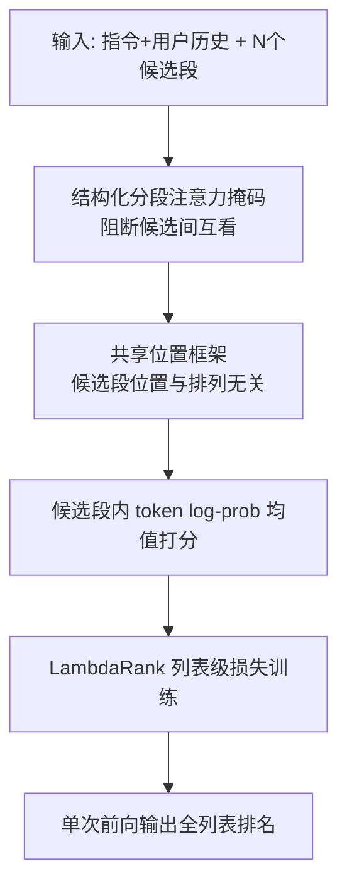
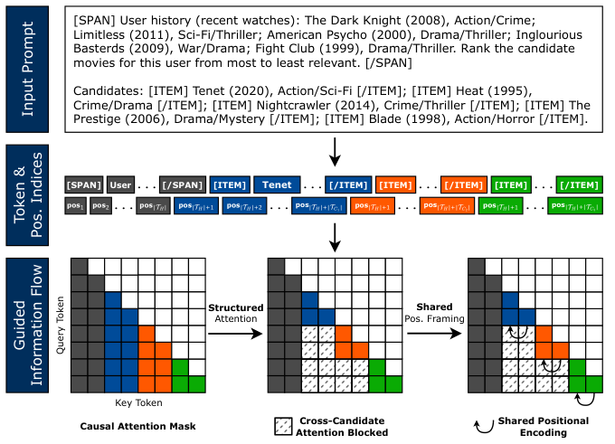

# One Pass, Any Order: Position-Invariant Listwise Reranking for LLM-Based Recommendation (一次前向，任意顺序：面向 LLM 推荐的排列不变列表级重排)

- **会议/期刊**: SIGIR 2026
- **作者与机构**: Ethan Bito, Yongli Ren, Estrid He (RMIT University)
- **推荐链路定位**: 重排 (Reranking)
- **研究方向**: 多任务学习与列表级重排 / 大语言模型推荐
- **论文原文**: [论文原文链接](https://arxiv.org/abs/2604.27599v1)
- **开源代码**: [开源代码仓库链接](https://github.com/ejbito/InvariRank)

## TL;DR (1分钟核心速览)

LLM 列表级重排器把候选集当序列处理，候选排列一变分数就变，排名反映的是 prompt 序列化而非用户偏好。本文提出 InvariRank，从架构层消除顺序依赖：结构化分段注意力掩码阻断候选间信息泄漏，共享位置框架在 RoPE 下对齐每个候选与用户上下文的相对偏移。单次前向即可完成全列表打分，无需排列集成或不变性正则。在 ML-32M/Amazon Books 上，Kendall's τ 从 LFT 的 0.886 提升至 0.988，nDCG@10 仅从 0.849 微降至 0.817。

## Background & Motivation (背景与核心矛盾)

- **主流范式**: 两阶段管线中，检索器产出固定候选集，LLM 以列表级方式在一次前向中对全部候选联合打分重排，因能利用全局上下文而成为主流。
- **前人局限**: ① 推理期方法（排列集成 Bootstrapping、贪心 SGS）靠多次前向聚合提升稳定性，推理成本成倍增加；② 训练期正则（如 ALRO）惩罚跨排列分歧，但模型计算时仍可访问顺序信息，顺序依赖的根源未除。
- **核心洞察 (Key Insight)**: 顺序敏感源于 decoder-only 架构的两个具体通道——**跨候选注意力泄漏**（候选 token 互相 attend 产生顺序相关干扰）与 **RoPE 偏移漂移**（候选排列改变其与共享上下文的相对位置偏移，扰动注意力模式）。
- **本文切入点**: 与其在输出端"补救"，不如在计算图中直接切断这两条通道，使排列不变性成为模型计算的内生属性。

## Method (核心方法设计)

### 1. 整体框架 (Overall Architecture)

输入为单条序列 `[SPAN]指令‖用户历史[/SPAN]` 拼接 N 个 `[ITEM]候选[/ITEM]` 段。模型对每个候选段内 token 的 log-prob 取均值作为标量分数 $s_i$，一次前向完成全列表打分。核心改造有两处：注意力层施加分段掩码，使候选只能看到共享上下文与自身；位置编码采用共享框架，使每个候选段无论排在何处都获得相同的位置区间。训练仍用列表级 LambdaRank 损失耦合各候选分数，从而"前向条件独立、训练列表监督"。

<figure class="paper-figure" markdown="span">
  <figcaption>图1：InvariRank 概览。结构化注意力块跨候选交互，共享位置框架对齐各候选的位置偏移。</figcaption>
</figure>

### 2. 关键设计拆解 (Key Designs)

1. **结构化分段注意力掩码 (Structured Segment Mask)**：标准因果注意力下 $s_i = f_\theta(H, c_i, c_{<i}, p_i)$，前序候选 $c_{<i}$ 会污染当前候选表示。本文定义段掩码 $M^{\text{seg}}_{t,u} = \mathbb{I}[(t,u)\in (T_H\times T_H)\cup\bigcup_i (T_i\times T_i)\cup\bigcup_i(T_i\times T_H)]$，并与因果掩码取交 $M = M^{\text{causal}} \wedge M^{\text{seg}}$，使 $s_i = g_\theta(H, c_i)$ 仅依赖上下文与自身。直觉：候选间干扰是顺序敏感的主因，隔离后分数与排列解耦。

2. **共享位置框架 (Shared Positional Framing)**：即便注意力隔离，RoPE 下候选位置 $p_i$ 仍随排列变化。本文将共享上下文占位 $1,\dots,|T_H|$，每个候选段统一分配 $|T_H|+1,\dots,|T_H|+|T_i|$，与索引 $i$ 无关，从而对任意排列 $\pi$ 有 $p_{\pi(u)} - p_{\pi(t)} = p(u) - p(t)$。直觉：每个候选都在"同一把尺子"下与上下文对齐，位置诱导的分数扰动被抵消。

3. **训练目标与推理效率**：采用 LambdaRank 式成对 logistic 损失，按交换两候选引起的 nDCG 变化加权：
$$\ell_{ij} = |\Delta\text{nDCG}_{ij}| \cdot \log\left(1+\exp(-\sigma(s_i - s_j))\right)$$
对全部偏好对取平均。前向虽条件独立，损失仍通过成对比较耦合候选，保留列表级监督。推理仅需**一次前向**，相比排列集成类方法省去 $O(N!)$ 或 $O(N)$ 次重复调用；无需负采样，候选池由 LightGCN 一阶段检索给定。

## Experimental Setup & Evaluation Protocol (实验设置与评估协议)

- **数据集与预处理**: 两个带时间戳显式反馈数据集，按用户时间序 70%/10%/20% 划分，历史取最近 20 条交互，相关性由未来交互导出以避免时间泄漏。

| 数据集 | #Users | #Items | #Interactions | 稀疏度/密度 | 特征/场景说明 |
| :--- | :---: | :---: | :---: | :---: | :--- |
| MovieLens-32M | 未报告 | 未报告 | 32M 级 | 未报告 | 电影评分，显式反馈 |
| Amazon Books | 未报告 | 未报告 | 未报告 | 未报告 | 图书评论，显式反馈 |

- **数据划分与防穿越 (Splitting Strategy)**: 按用户时间序 `70%/10%/20%` 比例划分，历史与标签严格按时间切分，未来交互仅作相关性标签。
- **排名评测协议 (Ranking Protocol)**: 候选生成用 LightGCN 一阶段检索（评分 ≥4 视为隐式正例），每查询构造 $K=25$ 的重排列表，保证未来正例尽量入列，其余以检索或采样未交互项填充，未交互项相关性记 0。属**固定候选池的列表级重排评测**（非全库 Full-Ranking），所有方法重排同一候选集。鲁棒性用 Kendall's τ、Spearman's ρ、Top-5 一致率 (T@5) 在多次排列下取均值。
- **对比基线与超参设置**: 基线含 Zero-shot、Bootstrapping（排列聚合）、STELLA（后验位置偏差校准）、SGS（贪心多轮）、LFT（同损失但无架构约束的列表微调）。骨干为 LLaMA 3.2 3B-Instruct 与 Mistral 7B-Instruct，LoRA (rank 16, α=32)，序列长 4096，500 步，batch 16，lr $5\times10^{-5}$，AdamW + 5% warmup，按验证 nDCG@10 选超参。

## Key Experimental Results (实验关键数据)

### 1. 主实验对比 (Main Results)

ML-32M，LLaMA-3B（$K=25$）：

| 方法 | HR@5 | HR@10 | nDCG@5 | nDCG@10 | τ↑ | ρ↑ | T@5↑ |
| :--- | :---: | :---: | :---: | :---: | :---: | :---: | :---: |
| Zero-shot | 0.4796 | 0.7323 | 0.1594 | 0.2384 | 0.5364 | 0.6665 | 0.6661 |
| Bootstrapping | 0.4986 | 0.7393 | 0.1660 | 0.2448 | 0.6892 | 0.8490 | 0.6596 |
| STELLA | 0.5143 | 0.7936 | 0.1744 | 0.2624 | 0.1176 | 0.1688 | 0.2166 |
| SGS | 0.4993 | 0.7570 | 0.1654 | 0.2456 | 0.7705 | 0.9118 | 0.7476 |
| LFT | **0.9883** | **1.0000** | **0.7679** | **0.8486** | 0.8861 | 0.9708 | 0.8389 |
| InvariRank | 0.9700 | **1.0000** | 0.7260 | 0.8166 | **0.9883** | **0.9984** | **0.9906** |

Amazon Books，Mistral-7B：LFT nDCG@10 = **0.4623**、τ = 0.7407；InvariRank nDCG@10 = 0.4166、τ = **0.9846**、ρ = **0.9979**、T@5 = **0.9843**。两骨干、两数据集趋势一致：InvariRank 以约 2–4 个点 nDCG 的代价换取 τ/ρ 提升约 0.10–0.24。

### 2. 消融实验 (Ablation Study)

ML-32M，LLaMA 3.2 3B：

| 变体 | HR@5 | nDCG@5 | τ | ρ | T@5 |
| :--- | :---: | :---: | :---: | :---: | :---: |
| InvariRank-Pos（仅共享位置） | 0.6423 | 0.2465 | 0.5389 | 0.6967 | 0.5429 |
| InvariRank-Attn（仅注意力掩码） | 0.9690 | 0.7298 | 0.9193 | 0.9822 | 0.9097 |
| InvariRank-Full（完整） | **0.9700** | 0.7260 | **0.9883** | **0.9984** | **0.9906** |

### 3. 关键实验发现 (Key Findings)

1. **注意力隔离是不变性的主引擎**：仅加掩码即把 τ 从 LFT 的 0.886 拉到 0.919、nDCG@5 保持 0.7298；而仅加共享位置框架时 τ 仅 0.5389、nDCG@5 崩至 0.2465——说明跨候选泄漏是顺序敏感的首要来源，位置框架单独使用反而破坏上下文对齐。
2. **两组件互补、叠加近完美**：Full 版 τ=0.9883、ρ=0.9984、T@5=0.9906，较 Attn 单件再提升约 0.07/0.016/0.08，且 nDCG 几乎无损（0.7298→0.7260），证明位置框架负责"收尾"残余偏移。
3. **单次前向即超越多次前向的鲁棒性基线**：Bootstrapping 与 SGS 需多轮调用，τ 最高仅 0.7705/0.8081；STELLA 后验校准 τ 低至 0.0111–0.1176（其设计目标是纠偏而非保序）。InvariRank 一次前向即达 τ≈0.98，且 Top-5 曝光随输入位置近乎均匀（图 2），彻底抹平位置偏差。

## Highlights, Limitations & Rating (亮点、对比与审稿评价)

- **与代表作对比 (vs. Prior Work)**: 与 ALRO 的本质区别在于 ALRO 用生成式训练目标"软性"逼近不变性且不面向两阶段重排；与 Bootstrapping/SGS 相比，本文把不变性从推理期聚合搬到架构内部，单次前向即得；与 STELLA 相比，后者是打分后的后验校准，无法保证偏好序一致。
- **可迁移亮点**: ① 分段掩码 + 共享位置框架的组合可直接移植到任何"上下文 + 多候选"的 decoder-only 打分场景（如 RAG 多文档重排、多商品对比问答）；② "前向条件独立、损失列表耦合"的解耦范式，为需要单次高效推理的列表级任务提供通用模板。
- **审稿级局限批判**: ① 候选隔离丢弃了跨候选比较信号，细粒度偏好建模受限，nDCG 系统性低于 LFT（ML-32M 上 0.8166 vs 0.8486），且候选集越大信息损失可能越显著；② 评测仅限固定 $K=25$ 与两个推荐数据集，未验证更大候选集、其他排序任务（IR/RAG）及工业级延迟表现，数据集统计信息亦披露不足。
- **四维评分**: 创新性 ⭐⭐⭐⭐ | 实验扎实度 ⭐⭐⭐ | 方法清晰度 ⭐⭐⭐⭐⭐ | 落地价值 ⭐⭐⭐⭐

