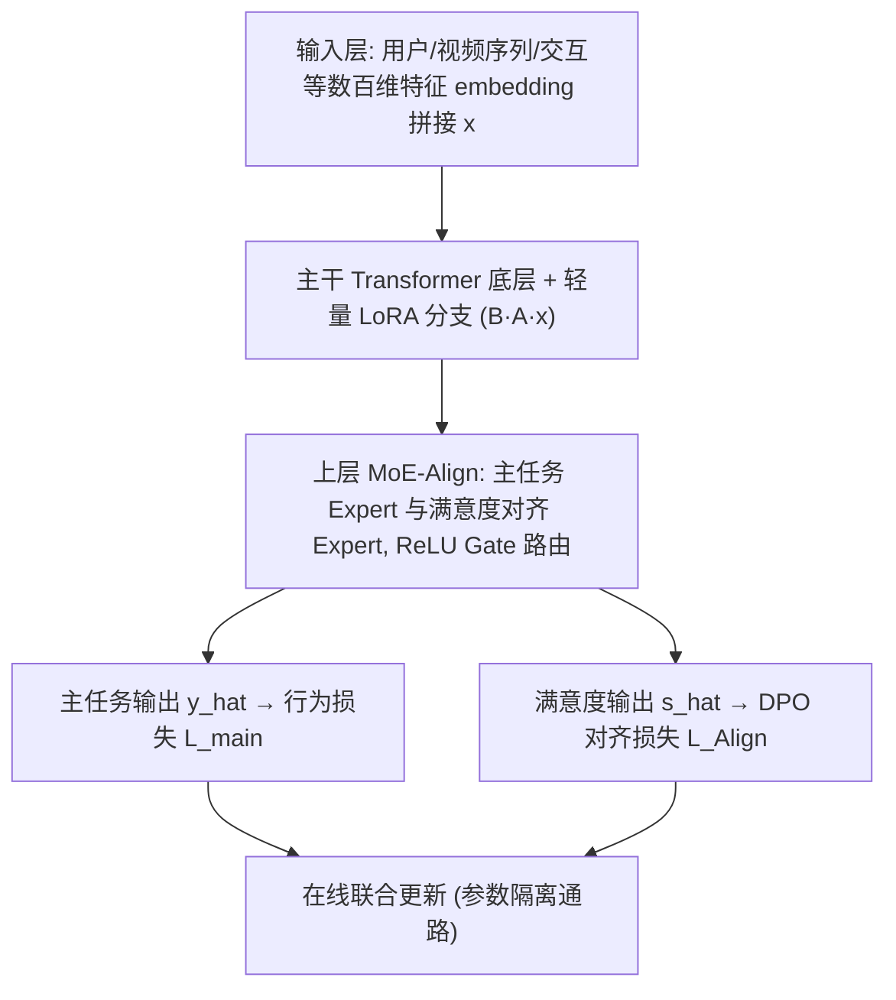
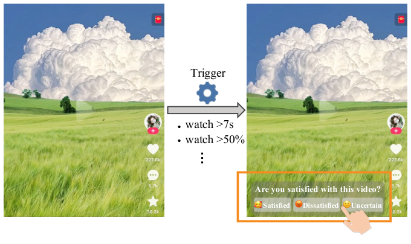
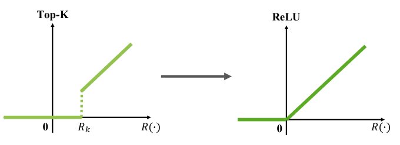
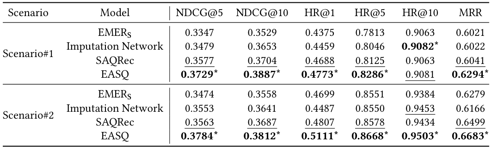
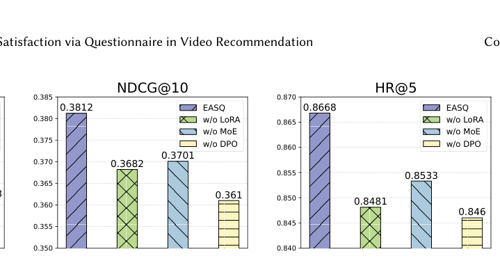
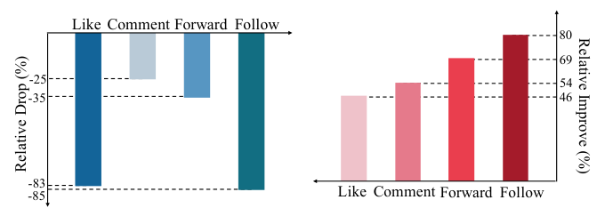

# Towards End-to-End Alignment of User Satisfaction via Questionnaire in Video Recommendation (基于问卷的短视频推荐用户满意度端到端对齐)

- **会议/期刊**: SIGIR 2026（arXiv 预印本 2601.20215v1）
- **推荐链路定位**: 精排 (Multi-Task Ranking) + 在线学习 (Online Learning)
- **研究方向**: 多任务学习与列表级重排 / 强化学习与动态探索推荐
- **论文原文**: [https://arxiv.org/abs/2601.20215v1](https://arxiv.org/abs/2601.20215v1)
- **开源代码**: 暂未开源

## TL;DR (核心速览)

短视频精排依赖点击/观看时长等稠密行为信号，但这些只是满意度的噪声代理；问卷显式满意度信号质量高却极稀疏（曝光约 0.5%、点击率 <2%），常规训练下会被行为信号淹没。EASQ 通过底层轻量 LoRA 独立参数通路 + 上层 MoE 解耦多任务 + 面向在线学习的 DPO 目标，把稀疏问卷信号端到端注入在线精排。离线实验与大规模线上 A/B 均显示满意度指标稳定提升，并已在快手生产系统全量部署。

## Background & Motivation (背景与动机)

- **领域背景与主流范式**: 短视频推荐精排模型主流以稠密隐式行为（click、watch time、like、skip）为监督，采用多任务学习（MMoE/PLE 类）联合优化多个行为目标，并在在线学习框架下持续更新参数。
- **现有方法局限 (Limitations of Prior Work)**:
  1. **代理信号有偏**: 点击与观看时长只是满意度的间接代理，用户表达满意的方式各异，导致监督噪声与偏差（如"标题党"高点击低满意）。
  2. **显式信号两阶段割裂**: SAQRec、Imputation Network、reward shaping（Q2SP）等依赖离线训练的辅助满意度模型或预定义奖励函数，再插入在线/RL 框架，属于两阶段范式，无法在线持续吸收新问卷反馈。
  3. **稀疏性极端**: 作者在真实环境统计，问卷仅覆盖约 0.5% 的视频曝光，问卷点击率不足 2%，有效满意度标签极少，常规联合训练中梯度权重被行为数据彻底压制。
- **核心挑战 (Key Challenge)**: 在参数同步更新的在线学习设定下，如何让极稀疏但高价值的满意度信号获得独立且稳定的梯度通路，同时不破坏主干行为模型的稳定性？简单加一个满意度辅助任务头会因梯度淹没与参数耦合而失效。
- **核心洞察与切入点 (Key Insight)**: 借鉴 LLM 偏好对齐（RLHF/DPO）思想——把问卷反馈视为"人类偏好对"（Satisfied ≻ Dissatisfied），用参数隔离（LoRA + 独立 Expert）构造满意度专属通路，并将 DPO 中的 reference model 替换为在线同步更新的"问卷专家网络"，从而把 DPO 改造成适配在线学习的对齐目标。图 3 的收敛效度验证（不满意用户后续 Like/Comment/Forward/Follow 相对下降 25%–85%，满意用户相对提升 46%–80%）为问卷信号作为可靠监督提供了实证支撑。

## Problem Formulation & Method (问题定义与方法架构)

### 1. 符号定义与输入表征 (Notations & Input Representations)

- 用户集 $\mathcal{U}=\{u_1,u_2,\dots\}$，物品（视频）集 $\mathcal{X}=\{x_1,x_2,\dots\}$。
- 行为集合 $\mathcal{B}_u$：用户 $u$ 的隐式交互（click、watch、like、skip 等），稠密。
- 问卷反馈集合 $\mathcal{S}_u$：通过问卷收集的显式满意度信号（Satisfied / Dissatisfied / Uncertain），稀疏但高质量。
- 目标：学习排序函数 $f(u,x)$，在利用稠密行为信号的同时与稀疏问卷反馈显式对齐。
- 输入特征：用户侧与候选物品侧数百维特征 embedding 拼接为 $x$；主干含用户-视频序列 Transformer 编码。主干线性投影 $W_0\in\mathbb{R}^{d\times k}$，LoRA 低秩矩阵 $A\in\mathbb{R}^{r\times k}$、$B\in\mathbb{R}^{d\times r}$，秩 $r\ll\min(d,k)$（原文未给出具体 $d,k,r$ 数值）。

### 2. 整体流水线 (Overall Architecture)

数据流：数百维特征 embedding 拼接 $x$ → 主干 Transformer（底层插入 LoRA 分支）→ 上层 MoE-Align 解耦多任务（主任务 Expert + 满意度对齐 Expert，ReLU Gate 路由）→ 主任务输出 $\hat{y}$ 走行为损失 $\mathcal{L}_{main}$，满意度输出 $\hat{s}$ 走对齐损失 $\mathcal{L}_{Align}$（DPO 形式），联合优化。图 1 对比了常规在线学习框架（a）与 EASQ（b）的结构差异。

<figure class="paper-figure" markdown="span">
  <figcaption>图 1</figcaption>
</figure>

### 3. 核心模块设计与数学原理 (Key Designs & Formulations)

**(1) 问卷信号设计与触发机制（图 2）**：问卷直接询问"Are you satisfied with this video?"，提供 Satisfied / Dissatisfied / Uncertain 三选项（Uncertain 降低强制选择噪声），嵌入播放界面底部单击作答、不打断播放。触发条件为观看 ≥7 秒或播放进度 ≥50%，保证反馈基于有意义的观看体验。理论依据为 experienced utility 理论——直接 elicitation 主观体验是评估真实感受的有效方式。

<figure class="paper-figure" markdown="span">
  <figcaption>图 2</figcaption>
</figure>

**(2) 底层 LoRA 独立参数通路**：主干输出 $h=W_0 x$，LoRA 增量表征为
$$h_{LoRA}=\Delta W x = BAx,\quad \Delta W=BA$$
在主干低层以参数高效方式预注入稀疏满意度语义偏好，使后续多任务模块能更有效建模满意度信号；同时主干参数保持相对稳定，避免在线同步更新时稀疏信号扰动主模型。

**(3) 上层 MoE-Align 解耦多任务**：在 LoRA 增强主干之上，为主任务与满意度对齐任务设置独立 Expert 网络，采用 ReLU Gate 路由（图 4 对比了 Top-K Softmax 与 ReLU Expert Routing 两种路由方式）。多任务设计将稀疏满意度监督与稠密行为信号在参数层面分离，防止前者被后者淹没；底层 LoRA 与上层 Expert 协同构成稀疏问卷信号的完整独立参数通路。

<figure class="paper-figure" markdown="span">
  <figcaption>图 4</figcaption>
</figure>

**(4) 面向在线学习的 DPO 目标**：标准 DPO 损失为
$$\mathcal{L}_{DPO}=-\log\sigma\left(\beta\left[\log\frac{\pi_\theta(x^+)}{\pi_{ref}(x^+)}-\log\frac{\pi_\theta(x^-)}{\pi_{ref}(x^-)}\right]\right)$$
其中 $x^+$ 为偏好物品（Satisfied），$x^-$ 为次偏好物品（Dissatisfied），$\beta$ 为温度系数，$\pi_{ref}$ 为参考模型。标准 DPO 依赖固定 reference model，不适配端到端在线学习；EASQ 将**问卷专家网络视为 reference model 的在线代理（online surrogate）**，随在线学习同步更新，从而在保持主干稳定的同时实时对齐稀疏满意度信号。原文正文在此处截断（"we adopt a multi-task archi..."），MoE-Align 的完整门控公式与 $\mathcal{L}_{Align}$ 的具体展开形式未在提供的文本中给出。

### 4. 训练目标、负采样与推理复杂度 (Optimization, Negative Sampling & Complexity)

- **损失函数**: 总损失由主任务行为损失 $\mathcal{L}_{main}$ 与满意度对齐损失 $\mathcal{L}_{Align}$（DPO 形式，含温度系数 $\beta$）联合构成，具体加权系数原文截断部分未报告。
- **训练负采样策略**: 偏好对构造基于问卷三分类——Satisfied 作为 $x^+$、Dissatisfied 作为 $x^-$；Uncertain 的处理方式原文未在可见文本中说明。行为侧负采样策略原文未报告。
- **时间与空间复杂度**: LoRA 仅引入 $r(d+k)$ 量级额外参数，计算开销可忽略；MoE-Align 增加少量 Expert 参数。原文未报告具体训练单 Epoch 耗时、在线推理延迟 (ms/request) 与峰值显存数值。在线部署层面，EASQ 已集成进生产短视频推荐系统并稳定运行。

## Experimental Setup & Evaluation Protocol (实验设置与评估协议)

- **数据集统计与预处理**: 原文使用快手大规模工业数据，覆盖两个业务场景（Scenario#1、Scenario#2）。提供的文本中**未给出**用户数、物品数、交互数、稀疏度等数据集统计表格，故不列表臆造。
- **数据划分方式 (Splitting Strategy)**: 采用在线学习设定（online learning），模型随线上流式数据持续更新；离线实验的具体划分策略原文可见文本未报告。
- **排名评测协议 (Ranking Protocol)**: 原文可见文本未明确说明是 Full-Ranking 还是 Sampled Ranking；线上部分采用大规模 A/B 测试。
- **评价指标与显著性检验**: 线上 A/B 关注用户满意度指标及业务收益（CTR/CVR/GMV/留存等具体口径原文可见文本未列出）；离线指标与显著性检验细节原文截断部分未报告。

## Key Experimental Results (核心实验结果)

### 1. 主实验对比 (Main Results)

表 1 给出 EASQ 与各基线在两个场景下的性能对比（最优加粗、次优下划线）。由于提供的文本在方法章节处截断，**具体基线名称与数值未包含在可见文本中**，此处不臆造数据，仅保留表格占位。

<figure class="paper-figure" markdown="span">
  <figcaption>表 1</figcaption>
</figure>

| 数据集 | 指标 | 最强基线 | 本文方法 (Ours) | 相对提升 (Improv.) |
| :--- | :--- | :---: | :---: | :---: |
| Scenario#1 | 原文截断未报告 | - | **-** | 原文截断未报告 |
| Scenario#2 | 原文截断未报告 | - | **-** | 原文截断未报告 |

### 2. 消融实验与控制变量分析 (Ablation Study)

图 5 展示 Scenario#2 上的消融结果。摘要与正文明确结论：**LoRA 模块持续带来性能提升**，验证其对利用稀疏问卷反馈的必要性；底层 LoRA 与上层 Expert 协同构成独立参数通路。各模块移除后的具体下降幅度、以及消融是否严格控制参数量对齐，原文可见文本未给出数值细节。

<figure class="paper-figure" markdown="span">
  <figcaption>图 5</figcaption>
</figure>

### 3. 稀疏度/冷启动分桶与超参敏感度 (Sparsity Buckets & Hyperparameters)

- **稀疏度分桶**: 原文可见文本未报告按用户/物品交互频次分桶的细粒度分析。
- **关键超参数敏感度**: DPO 温度系数 $\beta$、LoRA 秩 $r$、损失权重等的敏感度分析原文截断部分未报告。
- **线上 A/B 测试结果**: 论文声明在快手生产短视频推荐系统完成大规模线上 A/B，EASQ 在多个场景下持续提升用户满意度指标并带来显著且稳定的业务收益，且已成功部署。具体实验周期、流量占比与 CTR/GMV/留存等数值原文可见文本未列出。

## Highlights, Limitations & Critiques (亮点、局限与审稿级批判)

- **核心亮点与可迁移性**:
  1. **参数隔离思路普适**: "底层 LoRA + 上层独立 Expert"构造稀疏信号专属通路的范式，可迁移到任何"稠密主信号 + 稀疏高价值辅助信号"的推荐场景（如投诉反馈、举报信号、客服工单、冷启动少量强反馈）。
  2. **DPO 在线化改造**: 用同步更新的问卷专家网络替代固定 reference model，解决了 DPO 与在线学习不兼容的核心矛盾，这一"在线代理 reference"思想可推广到其他在线偏好对齐任务。
  3. **工业验证扎实**: 从信号设计（触发阈值、三选项、收敛效度验证）到全量部署形成闭环，工程参考价值高。
- **局限性与审稿视角批判 (Critical Limitations)**:
  1. **评估协议透明度不足**: 可见文本未披露离线数据划分、候选集打分协议（Full vs. Sampled Ranking）、离线评价指标定义与显著性检验，削弱了离线结论的可复现性。
  2. **信号稀疏与选择偏差**: 问卷曝光仅 0.5%、点击率 <2%，且触发条件（≥7s 或 ≥50% 进度）本身引入选择偏差——被问卷覆盖的样本并非全体曝光的无偏代表；Uncertain 样本的处理策略未说明，可能进一步损失信息。
  3. **DPO 理论适配性存疑**: 将在线同步更新的专家网络作为 reference model，破坏了 DPO 推导中 reference 固定所依赖的 KL 正则语义，理论上的最优性保证在在线设定下不再严格成立，论文对此缺乏理论分析。
  4. **超参与开销缺失**: $\beta$、LoRA 秩、损失权重敏感度以及在线推理延迟、显存开销均未报告，工业落地成本难以评估。
  5. **基线对比不完整**: 与 SAQRec、EMER、Q2SP 等满意度建模方法的离线定量对比在可见文本中缺失，难以判断相对增益来源。

## Rating (四维评分)

- **方法创新性 (Novelty)**: ⭐⭐⭐⭐
- **评估协议与实验扎实度 (Protocol & Experiments)**: ⭐⭐⭐
- **写作与数学规范度 (Clarity & Rigor)**: ⭐⭐⭐
- **工业落地与复现价值 (Industrial & Practical Value)**: ⭐⭐⭐⭐

## 论文图表

<figure class="paper-figure" markdown="span">
  <figcaption>图 3</figcaption>
</figure>

