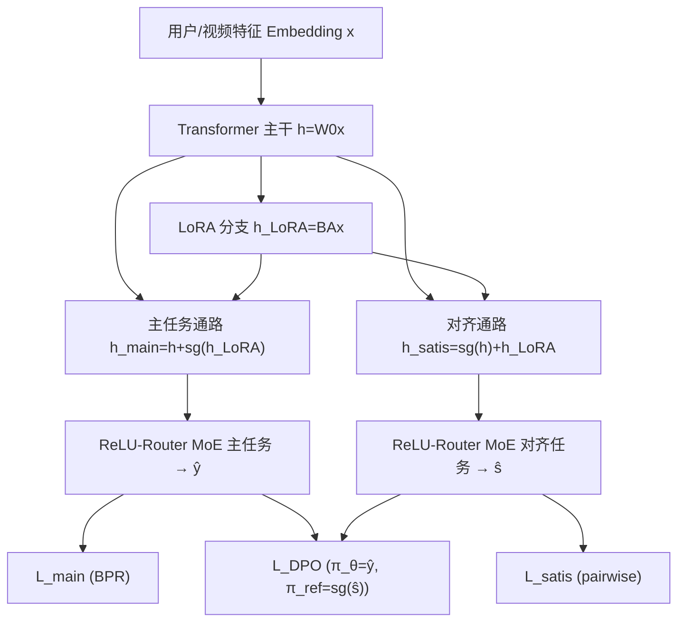
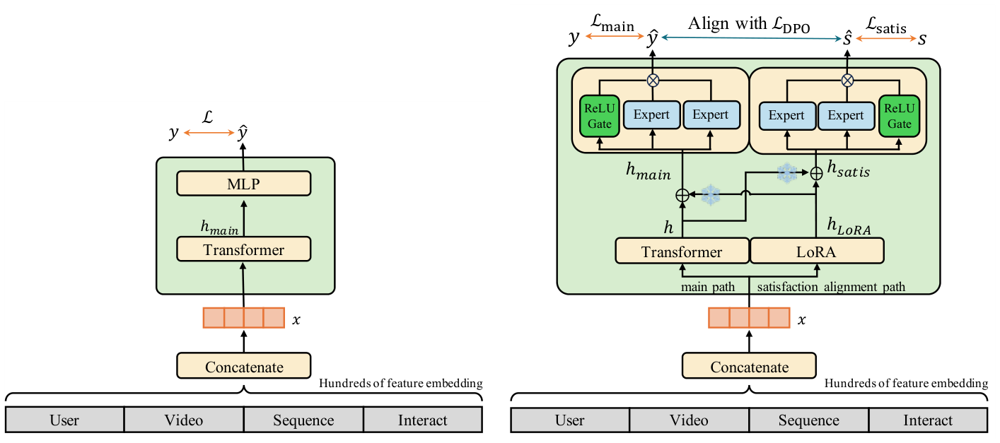

# Towards End-to-End Alignment of User Satisfaction via Questionnaire in Video Recommendation (基于问卷的短视频推荐用户满意度端到端对齐)

- **会议/期刊**: SIGIR 2026
- **作者与机构**: Na Li, Jiaqi Yu, Minzhi Xie, Tiantian He, Xiaoxiao Xu 等（快手科技；Kun Gai 无隶属）
- **推荐链路定位**: 精排（Ranking Stage，在线学习）
- **研究方向**: 多任务学习与列表级重排 / 大语言模型推荐（DPO 对齐思想迁移）
- **论文原文**: [https://arxiv.org/abs/2601.20215v1](https://arxiv.org/abs/2601.20215v1)
- **开源代码**: 暂未开源

## TL;DR (1分钟核心速览)

短视频精排长期依赖点击、观看时长等稠密行为代理信号，噪声与偏差大；而问卷采集的显式满意度信号虽直接却极度稀疏（曝光约 0.5%、点击率 <2%），在常规训练中被行为梯度淹没。EASQ 通过「底层 LoRA 预注入 + 上层 MoE 双通路解耦 + 在线 DPO 对齐」构建独立参数通路，把稀疏满意度信号端到端注入在线精排。离线在问卷正负样本对排序协议下，两场景 NDCG@5 分别提升约 4.2%/6.2%，线上 7 天 A/B 中 Q-Satisfied 提升 0.93%/0.53%、Q-Dissatisfied 下降 0.65%/1.13%。

## Background & Motivation (背景与核心矛盾)

- **主流范式**: 精排模型以点击、观看时长、点赞等稠密隐式行为构造 BPR 类 pairwise 损失，行为信号是满意度的间接代理。
- **前人局限**: ① 代理信号存在噪声与偏差，用户"看完但不满"无法被刻画；② 问卷信号虽直接，但 SAQRec、Imputation Network 等采用"离线训练辅助满意度模型 + 在线/RL 插件"的两阶段范式，无法随新问卷反馈实时自适应，且稀疏信号在联合训练中被稠密行为梯度压制。
- **核心洞察 (Key Insight)**: 问卷满意度与后验行为高度一致（不满用户后续点赞/评论/转发相对下降 25%–85%，满意用户相对提升 46%–80%），具备收敛效度，可作为高置信直接监督；但必须给它在参数空间中"划一块独立地盘"。
- **本文切入点**: 借鉴 LLM 偏好对齐（DPO），把满意度对齐从"两阶段插件"改造为"在线端到端单阶段"，用参数隔离保证主干稳定。

## Method (核心方法设计)

### 1. 整体框架 (Overall Architecture)

输入为用户/候选视频的数百维特征 embedding，经 Transformer 主干得到表示 $h=W_0x$；底层并联轻量 LoRA 分支产生满意度增量表示$h_{LoRA}=BAx$。上层分叉为两条通路：主任务通路输入$h_{main}=h+\mathrm{stop\_grad}(h_{LoRA})$，经 ReLU 路由 MoE 输出$\hat{y}$；满意度对齐通路输入$h_{satis}=\mathrm{stop\_grad}(h)+h_{LoRA}$，经独立 MoE 输出$\hat{s}$。训练时$\hat{s}$作为在线"参考模型"代理，通过 DPO 损失把$\hat{y}$拉向问卷偏好；推理仅用$\hat{y}$，对齐通路不增加线上开销。

<figure class="paper-figure" markdown="span">
  <figcaption>图1：从传统排序优化到基于用户满意度的在线学习。(a) 传统在线学习框架。(b) 所提出的EASQ框架，将推荐与稀疏满意度反馈对齐。</figcaption>
</figure>

### 2. 关键设计拆解 (Key Designs)

1. **LoRA 底层预注入（参数隔离的稀疏信号入口）**：痛点在于稀疏问卷梯度量级远小于行为梯度，深层网络根本"听不见"。本文在主干线性层注入低秩更新 $\Delta W=BA$（$r\ll\min(d,k)$），使满意度语义在 embedding 阶段即被编码；同时主任务侧用$\mathrm{stop\_grad}$ 阻断回传，保证主干参数不被稀疏信号扰动。直觉上这是"先给稀疏信号一个专属放大器，再让它单向影响主干"。

2. **MoE-Align 双通路解耦 + ReLU 路由**：单一共享塔下稀疏满意度与稠密行为目标冲突。本文在主任务与对齐任务各设 $K_1$、$K_2$个 FFN 专家，路由改为全可微的 ReLU 门控$R(h)=\mathrm{ReLU}(W_{gate}h)$，替代 Top-K Softmax 的硬截断不可导步骤，允许每个样本激活可变数量专家，提升异构满意度模式的表达灵活性。对齐通路损失为问卷标签上的 pairwise logistic：$\mathcal{L}_{satis}=-\sum_{(i,j)\in D^+}\log\sigma(\hat{s}_i-\hat{s}_j)$。

3. **在线 DPO 对齐（把问卷专家当动态参考模型）**：标准 DPO 依赖冻结参考模型与静态偏好集，在线场景下迅速过时。本文令 $\pi_\theta=\hat{y}$、$\pi_{ref}=\mathrm{stop\_grad}(\hat{s})$，即用实时更新的问卷专家网络充当参考锚点：
$$\mathcal{L}_{DPO}=-\log\sigma\Big(\beta\big[\log\tfrac{\pi_\theta(x^+)}{\pi_{ref}(x^+)}-\log\tfrac{\pi_\theta(x^-)}{\pi_{ref}(x^-)}\big]\Big),\ \beta=0.1$$
梯度只回传至主模型，参考侧由 $\mathcal{L}_{satis}$单独更新，从而把稀疏问卷反馈稳定地"蒸馏"进排序空间。总损失$\mathcal{L}_{total}=\mathcal{L}_{main}+\lambda_1\mathcal{L}_{satis}+\lambda_2\mathcal{L}_{DPO}$，$\mathcal{L}_{main}$ 为行为标签上的 BPR 损失；训练负采样沿用行为序列内构造的正负对，推理零额外开销。

## Experimental Setup & Evaluation Protocol (实验设置与评估协议)

- **数据集与预处理**: 来自真实短视频平台两个业务场景的线上日志，未公开规模统计（工业内部数据，无 5-core 等公开过滤描述）：

| 数据集 | #Users | #Items | #Interactions | 稀疏度/密度 | 特征/场景说明 |
| :--- | :---: | :---: | :---: | :---: | :--- |
| Scenario#1 | 未披露 | 未披露 | 未披露 | 未披露 | 短视频推荐场景一 |
| Scenario#2 | 未披露 | 未披露 | 未披露 | 未披露 | 短视频推荐场景二 |

- **数据划分与防穿越 (Splitting Strategy)**: 未明确说明，按在线学习流式日志处理；离线评估基于问卷反馈构造的正负样本对。
- **排名评测协议 (Ranking Protocol)**: 在问卷正负样本对构成的候选列表上做排序评估（pairwise 候选排序，非全库 Full-Ranking），指标为 HR@{1,5,10}、NDCG@{5,10,20}、MRR，按用户平均。
- **对比基线与超参设置**: 基线含 EMER（Transformer 端到端集成排序）、EMERS（EMER + 问卷监督）、Imputation Network、SAQRec，均在 EMER 框架上重实现以支持问卷信号；embedding 维度 64/32/8，多头注意力主干，Softplus 激活 + L2 归一化，Adam，学习率 $1\times10^{-3}$，$\beta=0.1$；表中 `*` 标注显著性。

## Key Experimental Results (实验关键数据)

### 1. 主实验对比 (Main Results)

| 场景 | 模型 | NDCG@5 | NDCG@10 | HR@1 | HR@5 | HR@10 | MRR |
| :--- | :--- | :---: | :---: | :---: | :---: | :---: | :---: |
| #1 | EMERS | 0.3347 | 0.3529 | 0.4375 | 0.7813 | 0.9063 | 0.6021 |
| #1 | Imputation Network | 0.3479 | 0.3653 | 0.4459 | 0.8046 | **0.9082*** | 0.6022 |
| #1 | SAQRec | 0.3577 | 0.3704 | 0.4688 | 0.8125 | 0.9063 | 0.6041 |
| #1 | **EASQ** | **0.3729*** | **0.3887*** | **0.4773*** | **0.8286*** | 0.9081 | **0.6294*** |
| #2 | EMERS | 0.3474 | 0.3558 | 0.4699 | 0.8551 | 0.9384 | 0.6279 |
| #2 | Imputation Network | 0.3553 | 0.3641 | 0.4487 | 0.8550 | 0.9453 | 0.6166 |
| #2 | SAQRec | 0.3563 | 0.3687 | 0.4807 | 0.8578 | 0.9434 | 0.6499 |
| #2 | **EASQ** | **0.3784*** | **0.3812*** | **0.5111*** | **0.8668*** | **0.9503*** | **0.6683*** |

相对最强基线平均提升约 **2.9%（场景#1）/ 3.4%（场景#2）**；对同为问卷建模的 SAQRec 平均领先约 **3.2%**。线上 7 天 A/B（5.1% 流量）：Q-Satisfied +0.929%/+0.531%，Q-Dissatisfied −0.652%/−1.129%，Forward +2.177%/+2.052%，AppStayTime +0.401%/+0.344%，LT7 +0.042%/+0.043%。

### 2. 消融实验 (Ablation Study)

场景#2 结果（图 5）：

| 变体 | NDCG@5 | NDCG@10 | HR@5 | HR@10 |
| :--- | :---: | :---: | :---: | :---: |
| EASQ (full) | **0.3784** | **0.3812** | **0.8668** | **0.9503** |
| w/o LoRA | 0.3627 | 0.3682 | 0.8481 | 0.9339 |
| w/o MoE | 0.3688 | 0.3701 | 0.8533 | 0.9369 |
| w/o DPO | 0.3613 | 0.3610 | 0.8460 | 0.9390 |

### 3. 关键实验发现 (Key Findings)

1. **LoRA 是稀疏信号的生命线**：移除后 NDCG@5 从 0.3784 跌至 0.3627（−4.1%），跌幅居三者之首，说明没有底层参数高效适配，稀疏问卷信号在主干中几乎无法形成有效梯度。
2. **DPO 对齐贡献被低估**：w/o DPO 的 NDCG@10 仅 0.3610，甚至低于 w/o LoRA 的 0.3682，证明仅靠 LoRA 间接注入不足以把满意度迁移到最终排序，显式对齐损失不可替代。
3. **专家数存在稀疏性约束的最优点**：$K_1$增大先升后平/降（过参数化过拟合），而$K_2$的最优值明显小于$K_1$——问卷监督太稀疏，对齐侧专家过多会导致每个专家监督不足；$\lambda_2$ 过大则压制行为主任务、排序质量回落。

## Highlights & Limitations (亮点、对比与审稿批判)

- **与代表作对比 (vs. Prior Work)**: 相比 SAQRec / Imputation Network 的"离线满意度模型 + 在线插件"两阶段范式，EASQ 首次把稀疏问卷信号纳入在线端到端训练；相比 EMER 仅用后验行为定义相对满意度，EASQ 引入显式问卷作为直接监督；相比标准 DPO 的冻结参考模型，EASQ 用实时更新的问卷专家网络充当动态参考，适配在线分布漂移。
- **可迁移亮点**: ① "stop_grad 双向隔离 + LoRA 单向注入"是处理任意极稀疏高价值监督（如人工标注、专家反馈）的通用模板；② 用辅助任务网络充当 DPO 动态参考模型，可迁移到任何在线偏好对齐场景。
- **审稿级局限批判**: ① 离线评估仅在问卷正负样本对上排序，未做全库 Full-Ranking，且数据集统计完全未披露，复现与横向对比困难；② 双 MoE + LoRA 引入 $K_1+K_2$个专家与额外超参$\lambda_1,\lambda_2,K_1,K_2$，且$\lambda_1$ 最优值随场景漂移，工业调参成本与在线稳定性风险未被量化讨论。

## Rating (四维评分)

- **方法创新性 (Novelty)**: ⭐⭐⭐⭐ （首次将 DPO 在线化改造并落地稀疏满意度对齐，参数隔离通路设计有清晰工程直觉，但各组件均为已有技术的组合创新）
- **评估协议与实验扎实度 (Protocol & Experiments)**: ⭐⭐⭐ （线上 7 天大规模 A/B 与多场景验证很有说服力，但离线仅 pairwise 候选排序、数据统计缺失、无全库排序与方差报告）
- **写作与数学规范度 (Clarity & Rigor)**: ⭐⭐⭐⭐ （公式推导从 RLHF 到 DPO 链条完整、符号统一，但部分模块动机论述偏工程叙述，缺复杂度分析）
- **工业落地与复现价值 (Industrial & Practical Value)**: ⭐⭐⭐⭐ （已上线生产系统并带来稳定业务增益，推理零额外开销；扣分在于未开源、数据不可得）
