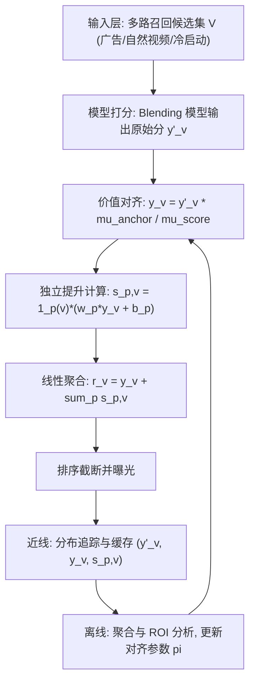
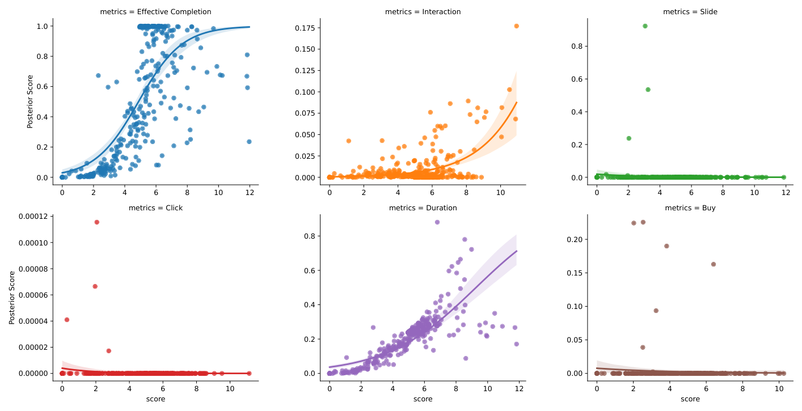

# Uniboost: Global Coordination with Value Alignment for Fair and Efficient Traffic Allocation (面向公平高效流量分配的价值对齐全局协调框架)

- **会议/期刊**: SIGIR 2026 (49th International ACM SIGIR Conference)
- **推荐链路定位**: 重排 (Re-ranking / Blending Stage)
- **研究方向**: 多任务学习与列表级重排 / 去偏公平与工业架构
- **论文原文**: [https://arxiv.org/abs/2605.26424v1](https://arxiv.org/abs/2605.26424v1)
- **开源代码**: 暂未开源

## TL;DR (核心速览)

针对工业推荐系统 Blending（重排）阶段多业务加权方案耦合、分数膨胀、缺乏可解释性的痛点，本文提出 Uniboost：以"有效完播率"为锚点指标做后验价值对齐，将抽象模型分数映射为具业务语义的期望值，再用独立线性提升范式（$s_{p,v}=\mathbb{1}_p(v)(w_p y_v + b_p)$）解耦各业务计划并线性聚合。在淘宝内容推荐流全量部署，线上 A/B 取得 VV +1.69%、Valued VV +3.07%、Duration +0.65%、Valued Score +2.54% 的一致提升。

## Background & Motivation (背景与动机)

- **领域背景与主流范式**: 工业级推荐流水线已演化为 Matching → Ranking → Blending（重排）多阶段架构。Blending 阶段负责合并多路召回候选并执行流量分配，是平衡用户体验与商业目标（广告收入、冷启动扶持、生态健康）的关键环节。广告保量通常用 PID 控制器基于历史曝光率计算调节分并加到广告混合分上；冷启动探索则用 Boost 加权（对原始分乘缩放因子 $w$）提升曝光概率。
- **现有方法局限 (Limitations of Prior Work)**:
  1. **方案耦合 (Coupled Plans)**: 运营活动（促销、联盟）不断叠加短期流量分配计划，多计划权重相互干扰，难以独立迭代优化。
  2. **分数膨胀 (Score Inflation)**: 累积权重使混合分数不断膨胀，丧失物理语义，难以解释。
  3. **归因缺失 (Lack of Attribution)**: 加权方案效果重叠，无法准确评估单个计划的成本与贡献。
- **核心挑战 (Key Challenge)**: 广告系统中已有工作通过对齐用户价值与商业价值缓解类似问题，但无法直接迁移到内容推荐，原因有三：(1) **后验目标选择难**——内容推荐目标多元（观看时长、点击、评论），不像广告收入单一稳定，哪个后验指标适合做 Boost 锚点尚未探明；(2) **统一加权框架难**——广告保量用 PID、冷启动用 Boost，机制碎片化，需在最小改动现有业务逻辑前提下统一；(3) **加权成本归因难**——计划耦合导致效果重叠，难以追踪单计划成本贡献。
- **核心洞察与切入点 (Key Insight)**: 作者通过混合模型预测分与多种后验指标（Effective Completion、Play Duration、Click、Buy、Interaction、Slide）的相关性分析（图 2）发现：Buy、Interaction、Slide 极度稀疏且波动大；Interaction 与 Play Duration 虽较稠密但在长尾高分区分布偏离、预测误差放大；唯有 **Effective Completion（有效完播）** 在各分数区间分布均匀、校准误差低且稳定。据此选定"有效完播率"作为锚点指标，将抽象分数对齐到该后验空间，从而让后续加权具备可解释的物理意义。

## Problem Formulation & Method (问题定义与方法架构)

### 1. 符号定义与输入表征 (Notations & Input Representations)

- 候选集 $\mathcal{V}$：上游召回与粗排聚合后的最终候选物品集合。
- 原始混合分 $y'_v$：Blending 模型对候选 $v\in\mathcal{V}$ 输出的原始预测分，反映用户整体偏好估计。
- 对齐参数 $\pi$：全局对齐参数，含原始分全局均值 $\mu_{score}$ 与锚点目标全局均值 $\mu_{anchor}$。
- 对齐后价值分 $y_v$：映射到锚点目标空间（有效完播率）的期望值。
- 业务计划集合 $S_{plan}$：线上配置的所有加权方案集合，$p\in S_{plan}$。
- 计划参数 $w_p, b_p$：计划 $p$ 的权重系数与偏置项（可学习超参）。
- 指示函数 $\mathbb{1}_p(v)$：物品 $v$ 属于计划 $p$ 时为 1，否则为 0。
- 最终排序分 $r_v$：基础价值分与各计划增益的线性和。

### 2. 整体流水线 (Overall Architecture)

Uniboost 部署于 Blending 阶段，由**在线服务流水线**与**近线/离线统计系统**构成闭环：在线侧完成模型打分 → 价值对齐 → 独立提升计算 → 线性聚合 → 排序截断曝光；近线侧实时追踪各阶段分数分布并缓存；离线侧聚合数据计算各计划成本、收益与 ROI，反哺宏观策略迭代。

图 1 展示了 Uniboost 混合系统概览：以广告（ad）与冷启动（cs）两类内容为例，当 $w_{ad}=0$ 且 $b_{ad}$ 设为 PID 广告投放控制器输出分时，广告原有 PID 调节机制得以保留；当赋予非零 $w_{cs}$ 且 $b_{cs}=0$ 时，公式退化为冷启动内容的传统 Boosting 方法——即统一框架可无缝兼容两类既有机制。

<figure class="paper-figure" markdown="span">
  <figcaption>图1：Uniboost 混合系统概览。该图展示了针对两种示例内容类型的提升过程：广告（ad）和冷启动（cs）内容。当 𝑤𝑎𝑑= 0 且 𝑏𝑎𝑑 设为基于 PID 的广告投放控制器的输出分数时，广告原有的 PID 调节机制得以保留。反之，当赋予非零权重 𝑤𝑐𝑠 且 𝑏𝑐𝑠= 0 时，该公式退化为用于冷启动内容的传统 Boosting 方法。</figcaption>
</figure>

### 3. 核心模块设计与数学原理 (Key Designs & Formulations)

**(1) 后验价值对齐 (Value Alignment)**：原始模型分 $y'_v$ 缺乏业务语义，直接加权不可控。对齐模块用全局参数 $\pi$ 将分数映射到锚点目标空间：

$$y_v = F(y'_v \mid \pi) = y'_v \cdot \frac{\mu_{anchor}}{\mu_{score}}$$

其中 $\mu_{score}$、$\mu_{anchor}$ 分别为原始混合分与锚点目标分的全局均值。该步将抽象分数校准为具明确业务含义的期望值，**不改变排序顺序**（全局线性缩放保序），但使后续干预权重具备可解释物理意义，弥合模型优化与业务目标间的鸿沟。

**(2) 独立提升计算 (Independent Boosting Calculation)**：在统一价值空间内，对每个业务计划 $p$ 独立计算提升分：

$$s_{p,v} = \mathbb{1}_p(v) \cdot (w_p \cdot y_v + b_p)$$

由于 $y_v$ 已对齐到锚点指标，$s_{p,v}$ 与锚点目标同量纲——所有业务干预被量化为对锚点指标的具体贡献，实现策略效果的标准化度量。指示函数保证计划仅作用于其覆盖物品，实现计划间解耦。

**(3) 线性聚合 (Linear Aggregation)**：最终排序分由基础价值与各计划增益线性和得到：

$$r_v = y_v + \sum_{p\in S_{plan}} s_{p,v}$$

采用线性而非非线性融合的核心动机是保证**可加性 (Additivity)**，从而支持精确**归因 (Attribution)**——可量化特定方案对最终排序结果的贡献，极大便利下游策略调优。候选集按 $r_v$ 降序截断曝光。

**(4) 近线/离线监控与 ROI 分析**：分布追踪模块实时缓存 $y'_v$、$y_v$、$s_{p,v}$，支撑分布漂移监控与异常诊断；聚合模块统计各计划资源消耗（流量份额）与业务表现（锚点指标提升），计算 ROI：

$$ROI_{VV} = \frac{\Delta VV_p}{Cost_p}$$

直接反映各计划部署效率，指导运营动态调参，实现数据驱动的全局最优资源配置。

### 4. 训练目标、负采样与推理复杂度 (Optimization, Negative Sampling & Complexity)

- **损失函数**: 本文为工业系统/框架类工作，**原文未报告**端到端训练的显式损失函数（如 BPR/BCE/InfoNCE）。$w_p, b_p$ 被描述为"可学习超参数"，由运营/离线分析动态调整；对齐参数 $\pi$（$\mu_{score}, \mu_{anchor}$）由近线分布追踪更新，而非梯度反传训练。
- **训练负采样策略**: **原文未报告**（不涉及召回/排序模型的负采样训练）。
- **时间与空间复杂度**: 在线服务需在**毫秒级延迟**内完成候选混合。各模块均为 $O(|\mathcal{V}|\cdot|S_{plan}|)$ 的逐物品线性运算（对齐为标量乘、提升为指示函数加权、聚合为求和），无迭代解码或 ANN 检索需求，计算开销极低。原文未报告具体 ms/request 延迟、峰值显存或单 Epoch 耗时数值。

## Experimental Setup & Evaluation Protocol (实验设置与评估协议)

- **数据集统计与预处理**: 本文为大规模工业在线系统工作，**未使用公开基准数据集**，实验基于淘宝内容推荐流（Taobao Content Feeds）真实线上流量。原文未报告用户数/物品数/交互数等离线数据集统计量。

| 数据集 (Dataset) | 用户数 (#Users) | 物品数 (#Items) | 交互数 (#Interactions) | 稀疏度/密度 (Sparsity) | 模态/辅助特征说明 |
| :--- | :---: | :---: | :---: | :---: | :--- |
| 淘宝内容推荐流（线上） | 原文未报告 | 原文未报告 | 原文未报告 | 原文未报告 | 广告/自然视频/冷启动多内容类型 |

- **数据划分方式 (Splitting Strategy)**: 采用**线上 A/B 测试**：对照组为原始加权流水线（对齐仅在加权之后执行），实验组为 Uniboost 统一加权方案。原文未报告具体流量占比与实验周期。
- **排名评测协议 (Ranking Protocol)**: 线上真实曝光排序，非离线 Full-Ranking / Sampled Ranking 协议。
- **评价指标与显著性检验**: 指标包括 VV（内容曝光总数）、Valued VV（播放超 3 秒的内容数）、Duration（总消费时长）、Valued Score（由点击、评论等多元行为构成的核心复合指标）。原文**未报告**配对显著性检验（$p$ 值）或多随机种子方差。

## Key Experimental Results (核心实验结果)

### 1. 主实验对比 (Main Results)

表 1 为线上 A/B 测试相对提升（实验组 vs. 对照组）：

| 数据集 | 指标 | 对照组 (原始加权流水线) | 本文方法 (Uniboost) | 相对提升 (Improv.) |
| :--- | :--- | :---: | :---: | :---: |
| 淘宝内容推荐流 | VV | 基线 | **Uniboost** | +1.69% |
| 淘宝内容推荐流 | Valued VV | 基线 | **Uniboost** | +3.07% |
| 淘宝内容推荐流 | Duration | 基线 | **Uniboost** | +0.65% |
| 淘宝内容推荐流 | Valued Score | 基线 | **Uniboost** | +2.54% |

监控数据显示：相比对照组，实验组广告加权分降低 **92.21%**、自然视频加权分降低 **95.81%**，但所有加权内容类别的曝光份额保持稳定——说明 Uniboost 有效缓解了原系统的权重爆炸问题，在保证所需曝光水平的同时显著降低调节策略对核心业务目标的干扰。

### 2. 消融实验与控制变量分析 (Ablation Study)

表 2 为移除最低 ROI 计划 Plan-A 后的线上相对提升：

| 配置 | VV | Valued VV | Duration | Valued Score |
| :--- | :---: | :---: | :---: | :---: |
| w/o Plan-A | +0.95% | +2.83% | +3.49% | +4.13% |

移除 Plan-A 后核心指标全面提升：VV 小幅上升，Valued VV、Duration、Valued Score 显著改善，说明 Plan-A 以高成本换取边际收益，对流水线整体性能有负面影响。这验证了 Uniboost 的归因分析能为宏观流量分配提供可执行指导。原文未做参数量对齐或图拓扑度数匹配类控制变量消融（系统类工作不适用）。

### 3. 稀疏度/冷启动分桶与超参敏感度 (Sparsity Buckets & Hyperparameters)

- **长尾/冷启动表现**: 原文未做用户/物品交互频次分桶实验；但框架本身通过 $w_{cs}, b_{cs}$ 显式支持冷启动内容扶持（图 1），且监控显示加权内容曝光份额稳定。
- **关键超参数敏感度**: 原文未报告 $w_p, b_p$ 的敏感度扫描曲线；核心发现是"降低加权分整体权重可有效缓解非预期业务干扰，获得更高效的微观流量分配策略"。
- **线上 A/B 测试结果**: 已在淘宝内容推荐流全量部署并作为核心流量分配系统稳定运行。线上收益见上表 1、表 2。

图 2 展示了后验业务指标与原始混合分数 $y'$ 的对比：Effective Completion 在各分数区间分布均匀、校准误差低且稳定；Interaction、Slide、Click、Buy 稀疏且波动大；Duration 在长尾高分区偏离明显。该图支撑了锚点指标选择的合理性。

<figure class="paper-figure" markdown="span">
  <figcaption>图2：后验业务指标与原始混合分数 𝑦′ 的对比。</figcaption>
</figure>

## Highlights, Limitations & Critiques (亮点、局限与审稿级批判)

- **核心亮点与可迁移性**:
  1. **价值对齐算子**（$y_v = y'_v \cdot \mu_{anchor}/\mu_{score}$）简洁且保序，可将任意抽象打分校准到具业务语义的锚点空间，可迁移至广告、电商、短视频等多业务重排场景。
  2. **独立线性提升 + 可加聚合**天然支持精确归因与 ROI 计算，解决了多计划耦合与分数膨胀的工业顽疾，工程可落地性强。
  3. **统一框架兼容异构机制**：通过 $w_p, b_p$ 取值即可退化为 PID 保量或传统 Boost，迁移成本低。
  4. **锚点指标选择方法论**（后验指标分布稳定性 + 校准误差分析）具普适参考价值。
- **局限性与审稿视角批判 (Critical Limitations)**:
  1. **评估协议薄弱**：仅有线上 A/B，无公开数据集离线复现实验，缺乏可复现的定量基准；未报告流量占比、实验周期、置信区间与显著性检验，提升幅度（如 Duration +0.65%）的统计可靠性存疑。
  2. **方法新颖性有限**：本质为线性缩放 + 线性加权的工程框架，缺乏理论分析（如对齐误差界、线性聚合的最优性证明）；"可学习超参数"实为人工/离线调参，与宣称的"学习"存在落差。
  3. **锚点单一性风险**：仅验证 Effective Completion 一个锚点，多目标场景下单一锚点是否足够、锚点漂移如何自适应，原文未讨论。
  4. **公平性论述不足**：标题含 "Fair"，但正文未给出公平性度量（如曝光基尼系数、双边公平指标）的定量评估，仅以曝光份额稳定间接佐证。
  5. **超参敏感度与消融不充分**：缺少 $w_p, b_p$ 扫描、对齐参数更新频率等关键设计选择的消融。

## Rating (四维评分)

- **方法创新性 (Novelty)**: ⭐⭐⭐
- **评估协议与实验扎实度 (Protocol & Experiments)**: ⭐⭐⭐
- **写作与数学规范度 (Clarity & Rigor)**: ⭐⭐⭐⭐
- **工业落地与复现价值 (Industrial & Practical Value)**: ⭐⭐⭐⭐⭐
