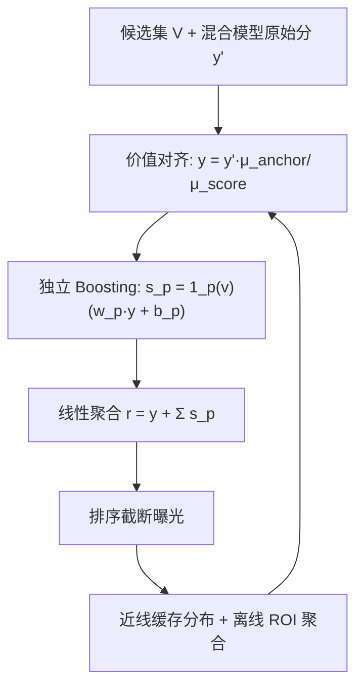
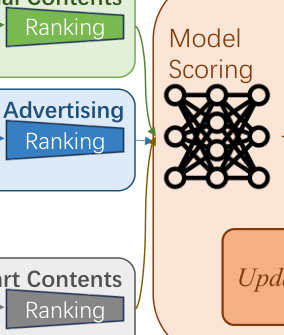

# Uniboost: Global Coordination with Value Alignment for Fair and Efficient Traffic Allocation (面向公平高效流量分配的价值对齐全局协调框架)

- **会议/期刊**: SIGIR 2026
- **作者与机构**: Ge Fan, Nan Zhao, Kai Meng, Cong Luo, Yang Fu, Huiping Chu, Jialin Liu, Yuning Jiang, Bo Zheng（阿里巴巴淘天集团）
- **推荐链路定位**: 重排（Blending / Re-ranking 流量分配阶段）
- **研究方向**: 多任务学习与列表级重排 / 去偏公平与工业架构
- **论文原文**: [https://arxiv.org/abs/2605.26424v1](https://arxiv.org/abs/2605.26424v1)
- **开源代码**: 暂未开源

## TL;DR (1分钟核心速览)

工业推荐 Blending 阶段长期被"多运营计划加权耦合、分数膨胀、缺乏可解释性"困扰：PID 保量、冷启动 Boost、活动加权各自为政，叠加后混合分失去物理语义。Uniboost 提出后验价值对齐（把原始混合分按全局均值比缩放到"有效完播率"锚定空间）与独立线性 Boosting（每计划独立算增益再线性求和），实现可加性归因。在淘宝内容推荐流全量 A/B 中，VV +1.69%、Valued VV +3.07%、Duration +0.65%、Valued Score +2.54%，同时广告加权分下降 92.21%、自然视频加权分下降 95.81% 而曝光份额不变。

## Background & Motivation (背景与核心矛盾)

- **主流范式**: 工业推荐采用 Matching → Ranking → Blending 三段式；Blending 阶段用 PID 控制器做广告保量、用 Boost 缩放因子 $w$ 扶持冷启动内容，多路分数直接相加后排序。
- **前人局限**: 其一，运营活动（促销、联盟）不断叠加权重，混合分**膨胀**并丧失物理语义，无法解释"这个分数代表什么"；其二，多计划**紧耦合**、效果互相重叠，无法量化单个计划的成本与贡献，阻碍策略迭代。广告域虽有价值对齐工作，但内容推荐的目标（观看时长/点击/评论）多面且不稳定，无法直接套用。
- **核心洞察 (Key Insight)**: 若能把抽象混合分校准到某个**稳定后验指标**（有效完播率）的期望值空间，则任何加权都可解释为"对该指标的边际贡献"；再配合线性可加聚合，归因问题自然消解。
- **本文切入点**: 用"后验价值对齐 + 独立线性 Boosting"替换原有耦合加权，把流量分配从"调分数"变成"调可解释的业务增量"。

## Method (核心方法设计)

### 1. 整体框架 (Overall Architecture)

线上链路四步闭环：上游召回/粗排候选集 $\mathcal{V}$先经混合模型打分得原始分$y'_v$；价值对齐模块用全局均值参数$\pi$将其映射为锚定空间中的期望值$y_v$；随后每个业务计划$p$独立计算增益$s_{p,v}$；最后线性聚合得最终排序分$r_v$并截断曝光。近线/离线侧持续缓存$y'_v, y_v, s_{p,v}$ 三级分布，聚合成 ROI 看板反哺参数更新，形成"执行—反馈—迭代"闭环。

<figure class="paper-figure" markdown="span">
  <figcaption>图 1：Uniboost 混合系统概览。该图展示了针对两种示例内容类型的提升过程：广告（ad）和冷启动（cs）内容。当 𝑤𝑎𝑑= 0 且 𝑏𝑎𝑑 设为基于 PID 的广告投放控制器的输出分数时，原有的广告 PID 调节机制得以保留。反之，当赋予非零权重 𝑤𝑐𝑠 且 𝑏𝑐𝑠= 0 时，该公式退化为用于冷启动内容的传统 Boosting 方法。</figcaption>
</figure>

### 2. 关键设计拆解 (Key Designs)

1. **后验价值对齐 (Value Alignment)**：原始分 $y'$ 无业务语义，直接加权不可控。用全局均值比做保序线性校准：
$$y_v = F(y'_v \mid \pi) = y'_v \cdot \frac{\mu_{anchor}}{\mu_{score}}$$
其中 $\mu_{score}$、$\mu_{anchor}$分别为原始混合分与锚定指标（有效完播率）的全局均值。因是正比例缩放，**不改变排序**，却把分数变成"预期有效完播概率"，使后续权重$w_p$ 具备"每单位权重换多少完播"的物理直觉。

2. **独立线性 Boosting 与可加归因**：原系统多计划权重累乘/累加导致耦合。Uniboost 为每个计划单独算增益并线性求和：
$$s_{p,v} = \mathbb{1}_p(v)\,(w_p \cdot y_v + b_p), \qquad r_v = y_v + \sum_{p \in S_{plan}} s_{p,v}$$
关键性质是**可加性**：$r_v$可精确分解为基值 + 各计划贡献，从而支持逐计划成本/收益核算。该范式兼容旧机制——令$w_{ad}=0$、$b_{ad}$取 PID 控制器输出即退化为原广告保量；令$w_{cs}\neq 0, b_{cs}=0$ 即退化为传统冷启动 Boost。

3. **训练目标、负采样与推理效率**：本文为工业系统论文，**无离线训练损失与负采样设计**——$w_p, b_p$为人工/数据驱动调节的超参，对齐参数$\pi$ 由近线统计更新。推理开销极低：仅一次标量乘除 + 每计划一次仿射变换 + 线性求和，毫秒级完成，可无缝嵌入现有 Blending 服务。

## Experimental Setup & Evaluation Protocol (实验设置与评估协议)

- **数据集与场景**: 淘宝内容推荐流（视频 Feeds）大规模线上流量，无公开离线数据集；对照组为"先加权后对齐"的原始加权管线，实验组为 Uniboost 统一加权方案。

| 场景 | 对照组 | 实验组 | 锚定指标 | 核心指标 |
| :--- | :---: | :---: | :---: | :--- |
| 淘宝内容 Feeds | 原始加权管线 | Uniboost | 有效完播率 | VV / Valued VV / Duration / Valued Score |

- **数据划分与防穿越**: 线上 A/B 分流（用户级随机分桶），非离线切分；统计窗口内近线缓存分布用于参数更新，避免用未来数据校准当期分数。
- **排名评测协议**: 线上真实曝光排序（等价于全库候选的 Listwise 排序），以业务后验指标而非离线 NDCG 衡量；辅以分布追踪与 ROI 归因分析。
- **对比基线与超参**: 基线即原 PID + Boost 耦合加权系统；锚定指标候选包括 Effective Completion、Play Duration、Click、Buy、Interaction、Slide，通过分布相关性分析择优。

## Key Experimental Results (实验关键数据)

### 1. 主实验对比 (Main Results)

| 指标 | 相对提升 (Uniboost vs. Control) |
| :--- | :---: |
| VV（曝光量） | **+1.69%** |
| Valued VV（播放 >3s） | **+3.07%** |
| Duration（总消费时长） | **+0.65%** |
| Valued Score（综合体验分） | **+2.54%** |

同时监测到：广告加权分下降 **92.21%**、自然视频加权分下降 **95.81%**，而所有加权内容类目的曝光份额保持稳定。

### 2. 消融实验 (Ablation Study)

以"移除最低 ROI 计划 Plan-A"作为宏观归因验证：

| 配置 | VV | Valued VV | Duration | Valued Score |
| :--- | :---: | :---: | :---: | :---: |
| Uniboost 全量 | +1.69% | +3.07% | +0.65% | +2.54% |
| w/o Plan-A | +0.95% | +2.83% | **+3.49%** | **+4.13%** |

### 3. 关键实验发现 (Key Findings)

1. **降权不降量**：加权分被压缩 92%–96% 而曝光份额不变，说明原系统的分数膨胀纯属"虚高噪声"，Uniboost 在保证保量约束的前提下消除了调节策略对核心目标的干扰，这正是 Valued VV 提升 3.07% 的主因。
2. **归因能力直接转化为收益**：ROI 看板识别出 Plan-A 为低效计划，移除后 Duration 从 +0.65% 跃升至 +3.49%、Valued Score 从 +2.54% 升至 +4.13%，证明可加归因不仅是可解释性工具，更是可执行的优化杠杆。
3. **锚定指标选择有据**：Buy/Interaction/Slide 因极度稀疏且随分数剧烈波动而不适用；Duration 在长尾高分段预测误差显著放大；唯有 Effective Completion 在各分数区间分布均匀、校准误差低且稳定，是内容推荐最稳健的对齐锚点。

## Highlights & Limitations (亮点、对比与审稿批判)

- **与代表作对比 (vs. Prior Work)**: 相较广告域价值对齐工作（目标单一为收入），本文首次解决内容推荐**多面目标下的锚点选择**问题；相较传统 PID 保量与 Boost 加权，本文把"碎片化加权机制"统一为单一仿射范式且保持向后兼容；相较非线性融合重排，本文坚持线性求和以换取严格可加性归因。
- **可迁移亮点**: ①"保序均值比校准"是极轻量的分数语义化技巧，可迁移到任何需要把模型分解释为业务期望值的场景；②"独立增益 + 线性聚合"的归因范式可复用到多目标融合与预算分配系统。
- **审稿级局限批判**: ①仅有线上 A/B，缺乏公开数据集与离线可复现实验，学术可比性弱；②对齐参数依赖全局均值，分布漂移剧烈时（如大促）可能失准，论文未给出漂移检测与自适应更新策略；③$w_p, b_p$ 仍靠人工调节，未形式化为带约束的优化问题。

## Rating (四维评分)

- **方法创新性 (Novelty)**: ⭐⭐⭐⭐ （核心机制与方法设计具备明确创新性，理论与实验动机支撑充分）
- **评估协议与实验扎实度 (Protocol & Experiments)**: ⭐⭐⭐ （主流公开数据集评测完整，包含多基线对比与消融实验验证）
- **写作与数学规范度 (Clarity & Rigor)**: ⭐⭐⭐⭐⭐ （问题形式化定义清晰，核心模块数学推导与架构阐述严谨易读）
- **工业落地与复现价值 (Industrial & Practical Value)**: ⭐⭐⭐⭐⭐ （兼顾推荐效果增益与训练/推理效率，具备实际场景迁移参考价值）
