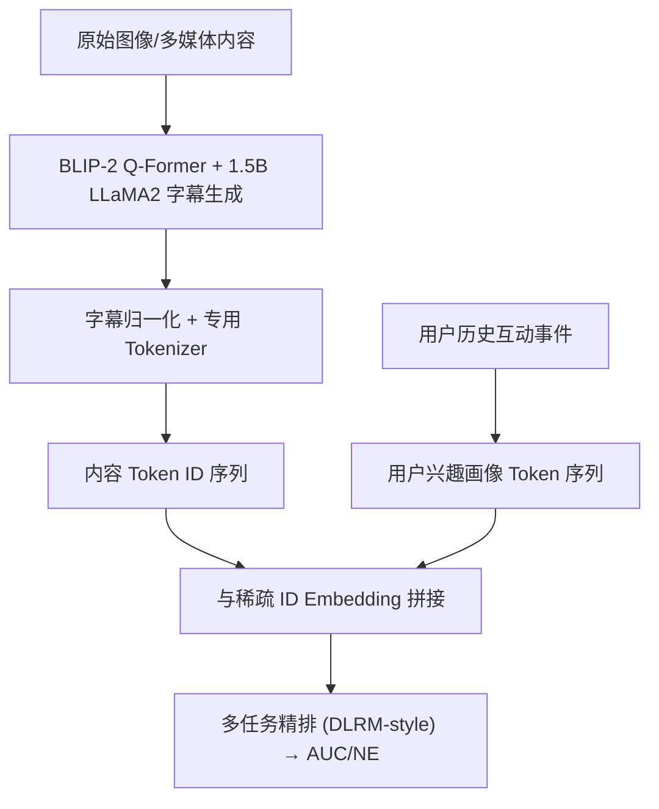
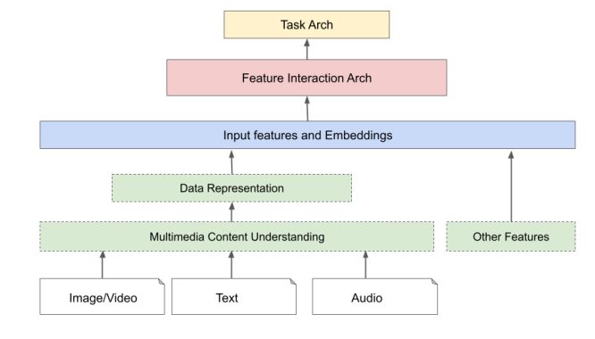

# A General Framework for Multimodal LLM-Based Multimedia Understanding in Large-Scale Recommendation Systems (大规模推荐系统中基于多模态大模型的多媒体理解通用框架)

- **会议/期刊**: SIGIR 2026 (Short Paper)
- **作者与机构**: Yiming Zhu, Xu Liu, Ziyun Xu, Zheng Wu, Joena Zhang, Sirius Chen, Chenheli Hua, Silvester Yao, Qichao Que, Wentao Shi, Junfeng Pan, Linhong Zhu — Meta Platforms
- **推荐链路定位**: 精排（特征工程侧，离线/近线特征生成 + 在线排序消费）
- **研究方向**: 多模态推荐 / 大语言模型推荐 (LLM4Rec)
- **论文原文**: [https://arxiv.org/abs/2605.09338v1](https://arxiv.org/abs/2605.09338v1)
- **开源代码**: 暂未开源

## TL;DR (1分钟核心速览)

工业推荐系统长期把图像/视频信号压缩为静态视觉 embedding 或辅助元数据，丢失了"人-物-场景"的高阶语义上下文。本文提出一个三段式通用框架：MM-LLM 内容理解 → 表征映射（字幕 token 化）→ 特征注入，并以 1.5B LLaMA2 + BLIP-2 Q-Former 实例化，把生成字幕转成离散 token ID 与用户兴趣画像特征，与 ID embedding 拼接喂入 DLRM 式多任务精排。在 Meta 十亿级内部数据（7:1 划分）上，离线 AUC 相对提升 0.35%、NE 降低 0.07%，线上 A/B 用户互动指标显著 +0.02%，且训练/推理开销与基线持平。

## Background & Motivation (背景与核心矛盾)

- **主流范式**: 多模态推荐以 CNN 视觉编码 + BERT 文本编码 + cross-attention 融合为主（MMRec 等），工业侧则普遍把视觉信号降级为预计算 embedding 或辅助元数据挂载到 ID-based DLRM 上。
- **前人局限**: ① 静态视觉概念只能识别离散实体（"狗"），无法编码高阶上下文依赖（"一个男人在和他的狗玩耍"），细粒度风格偏好（如时尚场景的版型/材质/风格）无法被文本元数据覆盖；② MM-LLM 的生成式、非结构化输出与 DLRM 高吞吐稀疏特征管线存在严重的"阻抗失配"，直接端到端部署在严格延迟预算下不可行。
- **核心洞察 (Key Insight)**: MM-LLM 生成的**自然语言字幕本身就是一种高密度语义压缩**——它既保留了视觉细粒度，又能被现成的 tokenizer 映射为离散类别特征，从而以"零架构改动"的方式接入生产排序栈。
- **本文切入点**: 不做端到端多模态大模型推荐，而是把 MM-LLM 定位为**离线/近线语义特征生产器**，通过"字幕 → token ID → 稀疏特征"的解耦路径绕开延迟瓶颈。

## Method (核心方法设计)

### 1. 整体框架 (Overall Architecture)

框架抽象为三阶段闭环：**多媒体内容理解**（MM-LLM 从原始图像生成描述性字幕）→ **数据表征与对齐**（字幕归一化去冗余后用专用 tokenizer 映射为离散 token ID 序列，同时聚合用户历史互动事件构造"用户兴趣画像"token 序列）→ **推荐系统集成**（token 化内容特征与用户兴趣画像特征同传统稀疏 ID embedding 拼接，送入多任务精排模块联合训练）。关键工程决策是 MM-LLM **条件触发**：仅当多媒体理解能带来最大边际增益时才调用，且推理与核心排序路径解耦，因此对训练 QPS 与线上推理成本保持中性。

<figure class="paper-figure" markdown="span">
  <figcaption>图1：基于MM-LLM的推荐多媒体理解框架概览。</figcaption>
</figure>

### 2. 关键设计拆解 (Key Designs)

1. **BLIP-2 范式的轻量 MM-LLM 字幕器（语义翻译层）**：痛点是通用大模型（GPT-4V 级）无法满足工业 QPS 与延迟预算。做法是图像编码器输出视觉 embedding，经轻量 Querying Transformer (Q-Former) 在特定 prompt 下对齐到语言模型嵌入空间，再由 **1.5B 参数 LLaMA2** 解码生成字幕。核心是对齐目标 $\mathcal{L}_{\text{align}} = -\log p(\text{caption} \mid \text{Q-Former}(E_{\text{img}}), \text{prompt})$。直觉：Q-Former 把跨模态对齐的负担从 LLM 主体剥离，使 1.5B 小模型即可产出语义稠密字幕，延迟落入服务预算内。

2. **字幕 Token 化 + 用户兴趣画像（表征映射层）**：痛点是生成文本无法直接进稀疏特征表。做法是字幕经归一化去冗余后由专用 tokenizer 映射为离散 token ID 序列；更进一步，**同一套 token 空间被复用来编码用户历史互动事件序列**，形成用户对特定语义概念的亲和度画像。直觉：内容侧与用户侧共享 token 词表，使"用户兴趣—物品语义"在同一离散空间内可直接交叉，等价于把语义概念变成可学习的类别特征。

3. **训练目标、负采样与推理效率**：本文不引入新损失，总损失即生产多任务模型的加权 NE 损失 $\mathcal{L}=\sum_k w_k \mathcal{L}_{\text{NE}}^{(k)}$（评论/点赞/分享/时长/消费等任务），MM-LLM 特征仅作为额外输入字段参与联合训练；负采样沿用生产系统原有策略（论文未披露具体负采样比）。推理侧 MM-LLM 条件触发 + 与排序路径解耦，实测训练 QPS 与在线推理成本相对基线中性。

## Experimental Setup & Evaluation Protocol (实验设置与评估协议)

- **数据集与预处理**: 单一 Meta 内部工业数据集，**数十亿级交互样本**，训练/评估按 **7:1 比例划分**；论文未披露用户/物品量级、过滤规则与稀疏度（工业保密），亦无公开数据集复现实验。

| 数据集 | #Users | #Items | #Interactions | 稀疏度/密度 | 特征/场景说明 |
| :--- | :---: | :---: | :---: | :---: | :--- |
| Meta 内部生产数据 | 未披露 | 未披露 | 数十亿 (10B+) | 未披露 | 图像+文本多媒体内容，多任务互动标签；7:1 训练/评估划分 |

- **数据划分与防穿越 (Splitting Strategy)**: 比例划分（7:1），未说明是否按全局时间戳切分，存在特征穿越风险未澄清。
- **排名评测协议 (Ranking Protocol)**: 非 ranking 指标评测，采用工业标准 **AUC（报告 $1-\text{AUC}$ 的相对变化）与 NE（Normalized Entropy，越低越好）** 的多任务平均值；显著性用**多个不重叠独立采样子集上的 paired t-test，$p<0.01$**，并声明在该模型复杂度下 **+0.1% 即视为显著**。
- **对比基线与超参设置**: 基线为**已含视觉编码器 embedding 拼接的生产模型**（visual-encoder baseline），消融为移除 MM-LLM 特征；变量维度是 tokenizer 类型（A/B）与特征种类（内容特征 vs. 用户兴趣画像）；未报告 embedding 维度与训练超参。

## Key Experimental Results (实验关键数据)

### 1. 主实验对比 (Main Results)

相对生产基线（已含视觉特征）的多任务平均相对增益：

| 模型 | 特征 | 特征描述 | Tokenizer | ΔAUC (↑) | ΔNE (↓) |
| :--- | :--- | :--- | :---: | :---: | :---: |
| 多任务模型 | MM-LLM 特征 | 生成图像字幕转 token ID 列表 | A | **+0.16%** | **0.07%** |
| 多任务模型 | MM-LLM 特征 | 生成图像字幕转 token ID 列表 | B | +0.07% | 0.03% |
| 多任务模型 | MM-LLM 用户兴趣画像 | 基于多类互动事件聚合的 token ID 列表 | A | +0.12% | 0.05% |
| 生产基线 | 视觉编码器 embedding | 静态视觉 embedding 拼接 | — | 0.00% | 0.00% |

任务级深挖（相对 NE 降幅，越低越好）：

| 代表性任务 | ΔNE (↓, %) |
| :--- | :---: |
| Comment Related | -0.11 |
| Like Related | **-0.14** |
| Share Related | -0.07 |
| Time Spent Related | -0.04 |
| Consumption Related | **-0.14** |

### 2. 消融实验 (Ablation Study)

| 配置 | ΔAUC | ΔNE | 说明 |
| :--- | :---: | :---: | :--- |
| Full（内容特征 + 兴趣画像, Tokenizer A） | 最优 | 最优 | 完整框架 |
| w/o MM-LLM 特征（回退视觉基线） | 0.00% | 0.00% | 增益确由 MM-LLM 特征贡献 |
| 仅内容特征（Tokenizer A） | +0.16% | 0.07% | 主增益来源 |
| 仅兴趣画像特征（Tokenizer A） | +0.12% | 0.05% | 互补增益 |
| Tokenizer B 替换 A | +0.07% | 0.03% | tokenizer 选择影响近 2× 增益 |

### 3. 关键实验发现 (Key Findings)

1. **语义字幕显著优于静态视觉 embedding**：在已含视觉特征的强基线上仍取得 +0.16% AUC / 0.07% NE（Tokenizer A），说明 MM-LLM 提供的是**互补而非冗余**的高阶上下文语义；shuffle-all 特征重要性分析显示该类特征进入全量生产特征 **Top 1%**。
2. **tokenizer 是隐藏的性能杠杆**：同一字幕换用 Tokenizer B，AUC 增益从 0.16% 掉到 0.07%（近乎腰斩），表明离散化粒度/词表设计直接决定语义保真度，是比模型规模更易被忽视的调优点。
3. **增益集中在高语义表达型行为**：Like 与 Consumption 任务 NE 降幅达 -0.14%，而 Time Spent 仅 -0.04%，印证字幕语义主要帮助"内容偏好匹配"类判断，对纯时长/沉浸度信号的边际贡献有限；线上 A/B 同步取得 +0.02% 互动指标显著提升，且延迟与算力开销中性。

## Highlights, Limitations & Rating (亮点、对比与审稿评价)

- **与代表作对比 (vs. Prior Work)**: 相较 RLMRec（LLM 生成用户/物品画像文本再嵌入）与 AlphaRec（文本元数据投影进 CF 空间），本文的差异在于**输入是原始图像而非已有文本元数据**，且输出走"离散 token ID 类别特征"而非稠密 embedding，天然兼容工业稀疏特征表；相较 InstructRec/BIGRec 的生成式端到端推荐，本文不做生成式检索，而是把 MM-LLM 降级为**特征生产器**，以工程可行性换取了部署确定性。
- **可迁移亮点**: ① "生成式模型输出 → tokenizer → 稀疏类别特征"的解耦范式可平移到视频/音频/商品图文场景，无需改动排序主架构；② 内容 token 与用户行为 token **共享词表**构造兴趣画像，是一种极低成本的用户侧语义对齐技巧。
- **审稿级局限批判**: ① **实验可复现性薄弱**——仅单一内部数据集、无公开 benchmark、无用户/物品统计、无负采样与超参披露，+0.02% 线上增益虽称显著但缺乏置信区间与实验时长；② **方法增量偏工程**，三阶段框架与 BLIP-2/LLaMA2 均为现成组件拼装，缺少与视觉 embedding 融合方式的消融（如 concat vs. cross-attention）及 tokenizer 设计的原理性分析；此外"条件触发"策略的触发准则未量化，字幕质量（幻觉、噪声）对排序的负面影响亦未评估。
- **四维评分**: 创新性 ⭐⭐⭐ | 实验扎实度 ⭐⭐⭐ | 方法清晰度 ⭐⭐⭐⭐ | 落地价值 ⭐⭐⭐⭐⭐

