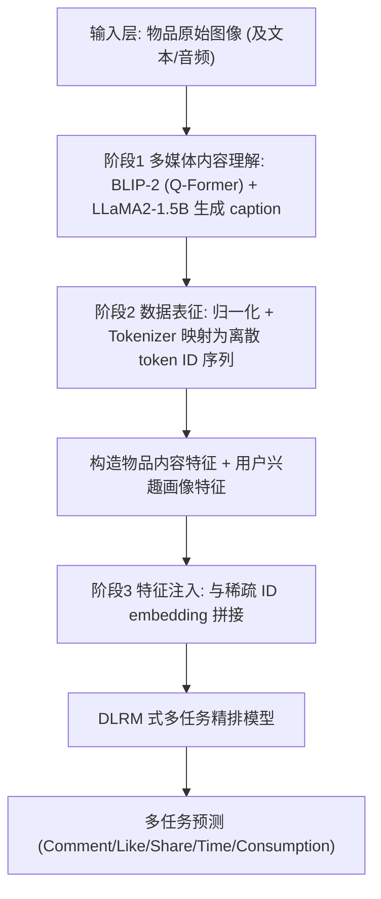
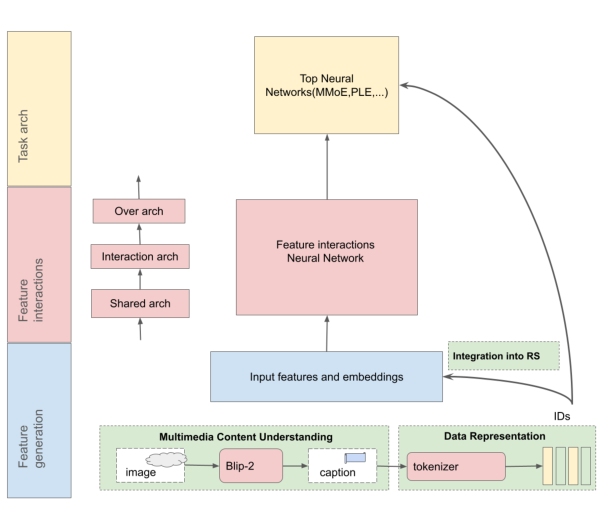
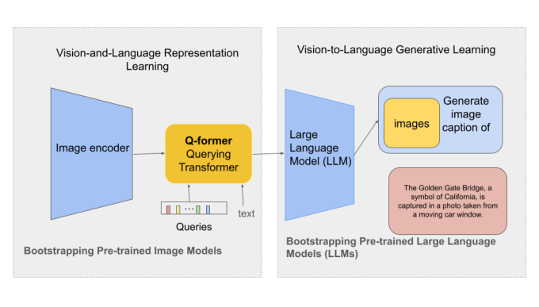
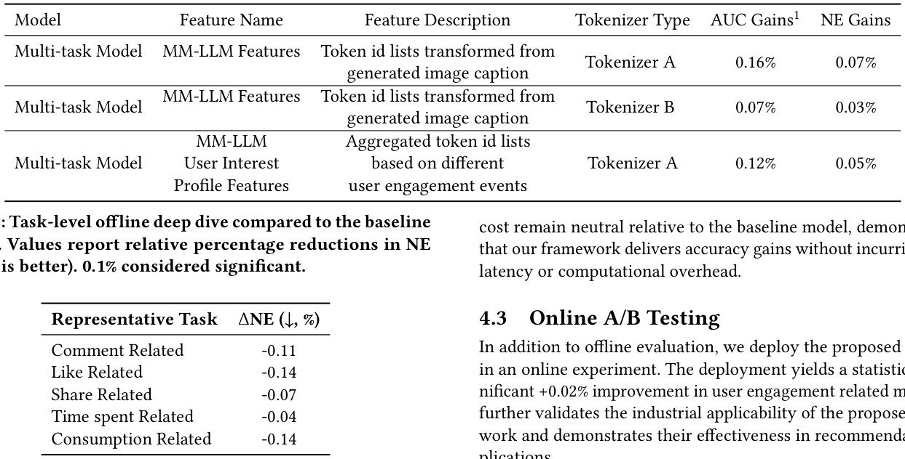
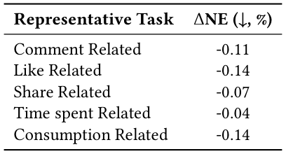

# A General Framework for Multimodal LLM-Based Multimedia Understanding in Large-Scale Recommendation Systems (大规模推荐系统中基于多模态大模型的多媒体理解通用框架)

- **会议/期刊**: SIGIR 2026 (Short Paper)
- **推荐链路定位**: 精排 (CTR/Multi-Task Ranking) — 以特征工程方式为 DLRM 式多任务精排模型注入语义特征
- **研究方向**: 多模态推荐 / 大语言模型推荐 (LLM4Rec)
- **论文原文**: [https://arxiv.org/abs/2605.09338v1](https://arxiv.org/abs/2605.09338v1)
- **开源代码**: 暂未开源

## TL;DR (核心速览)

针对工业推荐系统仅用静态视觉 embedding、无法刻画高阶语义（如"人与狗玩耍"而非仅"狗"）的痛点，本文提出一个三阶段通用框架：用 MM-LLM（BLIP-2 + LLaMA2-1.5B）把图像翻译成自然语言 caption，再经 tokenizer 映射为离散 token ID 序列，作为类别特征与 ID embedding 拼接注入 DLRM 式多任务精排模型。在 Meta 内部十亿级交互数据（7:1 划分）上，离线 AUC 相对提升 0.35%、NE 降低 0.07%，线上 A/B 用户互动指标 +0.02%，且训练/推理开销基本中性。

## Background & Motivation (背景与动机)

- **领域背景与主流范式**: 工业多模态推荐主流做法是用 CNN（如 VBPR 的视觉编码器）或 BERT 类文本编码器抽取模态特征，再通过 cross-attention 或拼接方式与 ID embedding 融合（MMRec 等统一框架）。特征本质是"静态视觉概念 + 预计算 embedding"。
- **现有方法局限 (Limitations of Prior Work)**:
  1. **语义粒度不足**：传统视觉编码器只能识别离散实体（"狗"），无法编码高阶上下文依赖（"一个男人在和他的狗玩耍"），在时尚检索等场景中视觉细微风格偏好无法被静态文本描述覆盖。
  2. **多模态信号被降级为辅助元数据**：原始多媒体流中的细粒度语义与潜在上下文被 bypass，错失与高保真用户意图对齐的机会。
  3. **生成式输出与高吞吐架构的阻抗失配**：MM-LLM 输出的是非结构化生成文本，而 DLRM 类系统要求稠密/稀疏结构化特征，且受严格延迟约束，直接集成困难。
- **核心挑战 (Key Challenge)**: 为什么不能简单加深视觉网络或做常规多模态融合？因为问题不在"视觉特征不够强"，而在"视觉特征缺少语言化的高阶语义与可解释的语义概念"，且工业系统对在线延迟极度敏感，无法在精排主路径上跑大模型。
- **核心洞察与切入点 (Key Insight)**: 将 MM-LLM 定位为**离线的"语义翻译器"**——把多媒体内容蒸馏为自然语言描述，再 tokenize 成与现有 ID 特征同构的离散类别特征，从而以"零架构改动、零在线延迟增量"的方式把语义注入推荐栈。同时用 caption 序列进一步构造**用户兴趣画像**，追踪用户对语义概念的长期偏好。

## Problem Formulation & Method (问题定义与方法架构)

### 1. 符号定义与输入表征 (Notations & Input Representations)

- 用户集 $\mathcal{U}$、物品集 $\mathcal{I}$，交互样本规模达**十亿级**（tens of billions of interaction examples）。
- 物品多媒体输入：原始图像 $x^{\text{img}}$（及文本、音频信号，框架层面通用）。
- 传统输入：用户/物品稀疏 ID embedding。
- 本文新增输入：MM-LLM 生成的 caption 文本 $c = f_{\text{MM-LLM}}(x^{\text{img}})$，经 tokenizer 映射为离散 token ID 序列 $\mathbf{t} = \text{Tok}(c) = [t_1, \dots, t_L]$。
- 输出：多任务精排模型的各任务预测（评论/点赞/分享/时长/消费相关），以 AUC 与 NE 评估。

### 2. 整体流水线 (Overall Architecture)

三阶段流水线：**语义翻译 → 表征映射 → 特征注入**。

<figure class="paper-figure" markdown="span">
  <figcaption>图1：基于MM-LLM的多媒体推荐理解框架概览。</figcaption>
</figure>

<figure class="paper-figure" markdown="span">
  <figcaption>图2：我们的方法结构按不同阶段组织。前两个阶段，多媒体内容理解和数据表示，由模型编码器表示。在最后阶段，我们将生成的ID集成到推荐模型中。</figcaption>
</figure>

### 3. 核心模块设计与数学原理 (Key Designs & Formulations)

**(1) 多媒体内容理解（MM-LLM 语义翻译）**

采用 BLIP-2 范式：图像编码器先产生视觉 embedding，再由轻量 **Querying Transformer (Q-Former)** 通过特定 prompt 将视觉特征对齐到语言模型 embedding 空间，最后由生成式文本解码器 **LLaMA2** 合成详细 caption。为满足工业延迟约束，选用 **1.5B 参数**的紧凑版 LLaMA2 以保证高 QPS 与严格 serving 预算内的推理延迟。

<figure class="paper-figure" markdown="span">
  <figcaption>图3：BLIP-2框架概览。</figcaption>
</figure>

关键工程决策：**条件触发（conditional invocation）**——仅当多媒体理解能带来最大边际收益时才调用 MM-LLM；且推理与核心排序路径**解耦（decoupled inference）**，使系统开销与训练复杂度保持中性。

**(2) 数据表征与对齐（Tokenization）**

原始 caption 先做归一化去冗余、统一格式，再由专用 tokenizer 映射为离散 token ID 序列。核心设计直觉：**离散 token ID 与推荐系统已有的类别特征（categorical feature）同构**，因此可无缝进入 DLRM 的稀疏特征表，无需为连续稠密向量设计新的特征通路。这些序列不仅表征物品内容，还被用于**构造用户兴趣画像**——按用户互动事件聚合其历史消费内容的语义 token，刻画用户对特定语义概念的偏好演化。

**(3) 特征注入（Integration）**

将 tokenized 内容特征与用户兴趣画像特征，与用户/物品的传统稀疏 ID embedding **拼接（concatenation）**，送入任务特定模块。模型同时利用协同信号与 MM-LLM 富化的语义特征联合优化预测精度。由于是纯特征层注入，**推荐模型主干架构无需任何修改**。

### 4. 训练目标、负采样与推理复杂度 (Optimization, Negative Sampling & Complexity)

- **损失函数**: 原文未报告具体损失公式。系统为多任务模型，以 NE（Normalized Entropy）与 AUC 作为优化/评估目标，推测为各任务 logloss 加权（原文未给出权重与公式）。
- **训练负采样策略**: 原文未报告（工业多任务精排通常为全曝光样本上的点式 logloss，非负采样排序）。
- **时间与空间复杂度**:
  - MM-LLM 推理为**离线/条件触发**，与排序主路径解耦；原文明确声明"model training QPS and the online inference cost remain neutral relative to the baseline model"。
  - 具体单次推理延迟 (ms/request)、峰值显存、离线 caption 生成总耗时：**原文未报告**。
  - 由于特征以离散 token ID 形式进入稀疏特征表，在线侧仅增加 embedding lookup，不引入大模型前向计算。

## Experimental Setup & Evaluation Protocol (实验设置与评估协议)

- **数据集统计与预处理**: 使用 Meta 内部大规模数据集，**十亿级交互样本**，按 **7:1** 划分训练/评估。原文未披露用户数、物品数、稀疏度及过滤规则（无 5-core 等公开基准过滤）。

| 数据集 (Dataset) | 用户数 (#Users) | 物品数 (#Items) | 交互数 (#Interactions) | 稀疏度/密度 (Sparsity) | 模态/辅助特征说明 |
| :--- | :---: | :---: | :---: | :---: | :--- |
| 内部工业数据集 | 原文未报告 | 原文未报告 | 十亿级 (tens of billions) | 原文未报告 | 图像（caption 化）+ 用户互动事件 |

- **数据划分方式 (Splitting Strategy)**: **Ratio Split (7:1)**。原文未说明是否按全局时间戳切分，**存在潜在时间穿越风险**（若为随机划分，则未来交互可能进入训练集），这是本文评估协议的主要薄弱点。
- **排名评测协议 (Ranking Protocol)**: 非排序式评估，采用**工业多任务点式指标** AUC 与 NE，在全量曝光样本上计算，不涉及负采样候选集。
- **评价指标与显著性检验**: 报告 **AUC 相对增益（以 1-AUC 的百分比变化计）** 与 **NE 相对降低**；多任务取平均。显著性：在多个**不重叠、独立采样的评估子集**上做 **paired t-test，$p < 0.01$**。作者声明因模型复杂度极高，**+0.1% 即视为显著**。另做了 shuffle-all 特征重要性分析。

## Key Experimental Results (核心实验结果)

### 1. 主实验对比 (Main Results)

基线为**已使用视觉编码器 embedding 拼接的生产推荐模型**，本文在其上增量加入 MM-LLM 特征。

<figure class="paper-figure" markdown="span">
  <figcaption>表1：与使用视觉特征的推荐生产模型相比，融合MM-LLM特征的实验结果。注意，由于模型复杂度，+0.1%被视为显著。</figcaption>
</figure>

| 模型 | 特征 | Tokenizer | AUC 增益 (1-AUC 相对) | NE 增益 |
| :--- | :--- | :---: | :---: | :---: |
| Multi-task Model | MM-LLM Features（caption token ID 序列） | Tokenizer A | **0.16%** | 0.07% |
| Multi-task Model | MM-LLM Features（caption token ID 序列） | Tokenizer B | 0.07% | 0.03% |
| Multi-task Model | MM-LLM User Interest Profile Features（基于不同互动事件聚合的 token ID 序列） | Tokenizer A | 0.12% | 0.05% |

> 注：摘要中"0.35% AUC 提升"为多任务/多特征组合的整体口径，表 1 中单特征口径最高为 0.16%；原文未给出 0.35% 的逐项拆解表。

**任务级深入分析（表 2）**：

<figure class="paper-figure" markdown="span">
  <figcaption>表2：与基线模型相比的任务级离线深入分析。数值报告NE的相对百分比降低（越低越好）。0.1%被视为显著。</figcaption>
</figure>

| 代表性任务 | ΔNE (↓, %) |
| :--- | :---: |
| Comment Related | -0.11 |
| Like Related | -0.14 |
| Share Related | -0.07 |
| Time spent Related | -0.04 |
| Consumption Related | -0.14 |

可见**点赞与消费类任务收益最大（-0.14%）**，分享与时长类任务收益较小，说明语义特征对"内容偏好匹配"类目标更有效，对"时长"这类受多因素干扰的目标贡献有限。

### 2. 消融实验与控制变量分析 (Ablation Study)

- **移除 MM-LLM 特征**：性能出现相应下降，证明增益确实归因于 MM-LLM 特征而非其他因素。
- **Tokenizer 对比**：Tokenizer A 显著优于 Tokenizer B（AUC 0.16% vs 0.07%），作者强调"合适的 tokenizer 带来更显著提升"，凸显表征映射阶段的重要性。
- **特征重要性**：shuffle-all 分析显示 MM-LLM 特征位列**全部生产特征的前 1%**。
- **控制变量严谨性**：原文未报告参数量对齐、特征维度对齐等严格控制实验；消融为"移除特征"式，未做随机同维特征替换的 placebo 对照。

### 3. 稀疏度/冷启动分桶与超参敏感度 (Sparsity Buckets & Hyperparameters)

- **长尾/冷启动分桶**: **原文未报告**。未按用户/物品交互频次分桶分析，无法判断语义特征是否对长尾物品或冷启动用户增益更大——这本应是 MM-LLM 语义特征最有说服力的场景。
- **关键超参数敏感度**: **原文未报告**。未分析 caption 长度、token 序列截断长度 $L$、LLaMA2 规模（1.5B 之外）、条件触发阈值等的影响。
- **线上 A/B 测试结果**: 已部署线上实验，用户互动相关指标取得**统计显著的 +0.02% 提升**。原文未披露实验周期、流量占比、具体指标名称（CTR/CVR/时长等）及置信区间。

## Highlights, Limitations & Critiques (亮点、局限与审稿级批判)

- **核心亮点与可迁移性**:
  1. **"语义翻译 + 离散 token 化"的桥接思路极具工程普适性**：把生成式模型输出转成与 ID 特征同构的类别特征，绕开了稠密向量注入所需的架构改造，可零成本迁移到任意 DLRM 式系统。
  2. **用户兴趣画像的构造**：用 caption token 序列按互动事件聚合用户语义偏好，是把内容理解与行为信号对齐的巧妙设计，可迁移到短视频、图文电商等场景。
  3. **条件触发 + 推理解耦**的部署范式，为工业界引入大模型提供了可复用的成本控制模板。
- **局限性与审稿视角批判 (Critical Limitations)**:
  1. **评估协议薄弱**：仅内部数据集、7:1 划分未说明时间切分，存在数据穿越风险；无公开基准（Amazon/Yelp/KuaiRec 等）复现，外部效度存疑。
  2. **增益量级极小且口径不清**：摘要 0.35% AUC 与表 1 单特征最高 0.16% 之间存在口径落差，原文未给出拆解；线上 +0.02% 虽称显著，但缺乏置信区间与实验周期，工业读者难以判断稳健性。
  3. **关键实现细节缺失**：损失函数、负采样、tokenizer 具体方案（A/B 差异）、caption 长度、延迟数值、显存开销均未报告，复现性差。
  4. **缺少最有说服力的分析**：未做长尾/冷启动分桶、未做超参敏感度、未与纯 LLM 文本 embedding（如 RLMRec/AlphaRec 式稠密表征）做对照，无法说明"离散 token 化"相对"稠密语义 embedding"的优越性来源。
  5. **Short paper 体量下框架性大于方法性**：三阶段框架本质是工程流水线抽象，缺少新的学习目标或理论分析，创新性偏应用集成。

## Rating (四维评分)

- **方法创新性 (Novelty)**: ⭐⭐⭐
- **评估协议与实验扎实度 (Protocol & Experiments)**: ⭐⭐
- **写作与数学规范度 (Clarity & Rigor)**: ⭐⭐⭐
- **工业落地与复现价值 (Industrial & Practical Value)**: ⭐⭐⭐⭐
