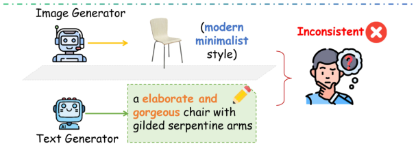
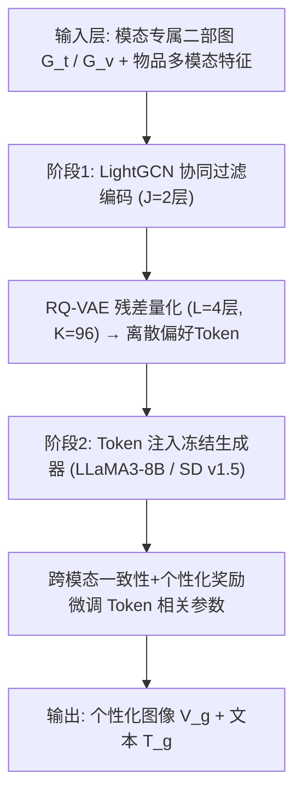
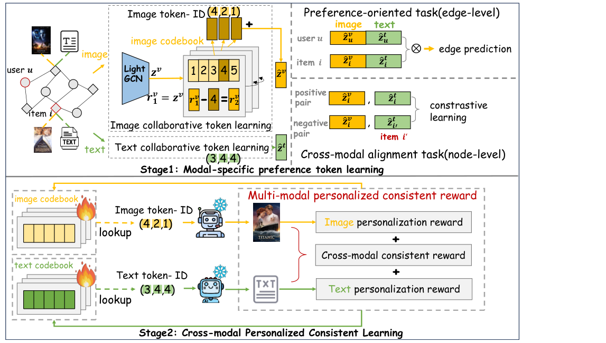
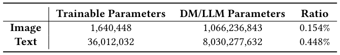
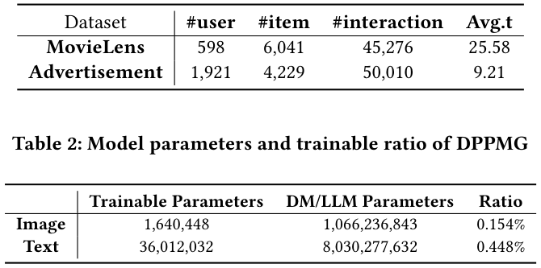
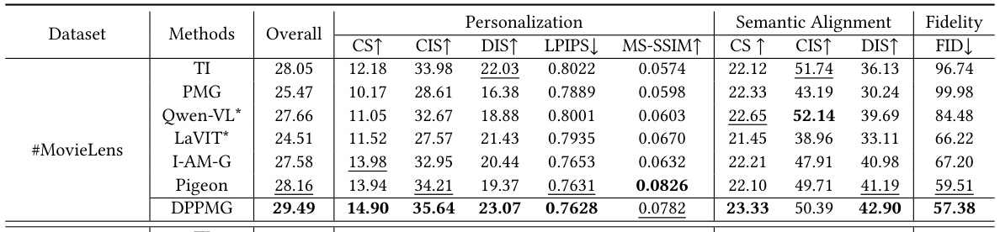
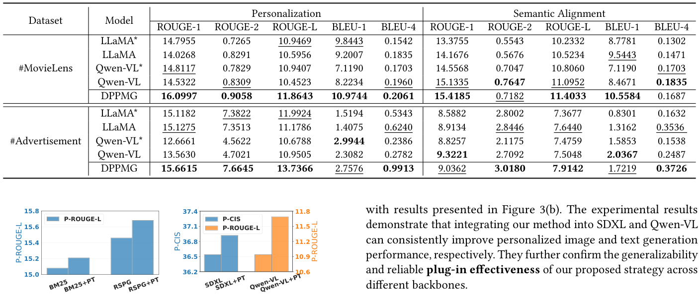
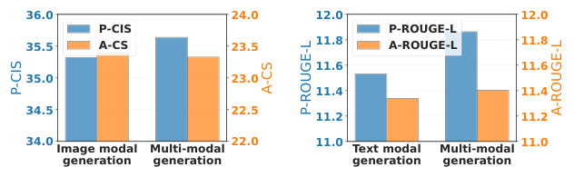

# Discrete Preference Learning for Personalized Multimodal Generation (面向个性化多模态生成的离散偏好学习)

- **会议/期刊**: SIGIR 2026
- **推荐链路定位**: 端到端生成式 (End-to-End Generative) — 偏好建模 + 下游生成器条件注入
- **研究方向**: 多模态推荐 (主) / 生成式推荐与离散语义ID (次)
- **论文原文**: [https://arxiv.org/abs/2604.20434v1](https://arxiv.org/abs/2604.20434v1)
- **开源代码**: 暂未开源（原文与正则预提取均未发现代码链接）

## TL;DR (核心速览)

针对个性化生成中"连续偏好嵌入 vs. 生成器离散token输入"的鸿沟与图文跨模态不一致两大痛点，本文提出两阶段框架 DPPMG：阶段一用模态专属 LightGCN 学习用户/物品偏好并经 RQ-VAE 量化为离散偏好 token；阶段二将 token 作为可学习占位符注入冻结的 LLaMA3-8B 与 Stable Diffusion v1.5，并用跨模态一致性+个性化奖励微调。在 MovieLens 与工业广告数据集上，个性化图像 CIS 达 35.64/37.83，图文一致性 CCS 显著优于 Pigeon 等基线，可训练参数仅占 0.154%/0.448%。

## Background & Motivation (背景与动机)

- **领域背景与主流范式**: 个性化生成范式（LLM/扩散模型）正从"检索已有内容"转向"直接生成定制内容"，覆盖电影营销、广告、时尚设计等场景。主流做法是检索增强（BM25/Contriever 检索历史文本）或直接用 DM/LLM/MLLM 从历史图像推断偏好（如 PMG 将图像转文本提关键词、Pigeon 用 MLLM 提取视觉偏好）。
- **现有方法局限**:
  1. **缺乏专用偏好建模范式**：现有生成式方法直接让生成模型"顺带"学偏好，缺少经典协同过滤那种挖掘 user-item 交互与相似性模式的专用机制，检索到的历史内容混杂偏好与非偏好特征（风格、用词噪声）。
  2. **单模态生成忽视跨模态一致性**：文本与图像分开生成导致语义割裂、风格冲突（如现代极简家具配华丽文案），直接损害用户体验。
  3. **连续-离散鸿沟**：GNN 输出连续 embedding，而 Transformer/扩散模型原生吃离散 token 序列，二者存在根本性接口不匹配。
- **核心挑战**: 简单特征拼接或加深网络无法解决——因为问题本质是"表征空间不匹配"（连续 vs. 离散）与"多目标冲突"（个性化 vs. 一致性），需要专门的重参数化与奖励设计。
- **核心洞察**: 作者观察到 RQ-VAE 的层次化残差量化天然具备"粗到细"的语义结构，可同时充当"连续偏好→离散token"的桥梁与协同过滤信号的可解释载体（共享前缀即相似性）。<figure class="paper-figure" markdown="span">
  <figcaption>图1：个性化多模态内容生成面临的挑战：(1) 连续偏好表示与生成器离散词元序列之间的差距；(2) 生成图像与文本之间的不一致。</figcaption>
</figure>

## Problem Formulation & Method (问题定义与方法架构)

### 1. 符号定义与输入表征 (Notations & Input Representations)

- 用户集 $\mathcal{U}$、物品集 $\mathcal{I}$，交互构成多模态二部图 $\mathcal{G}=\{(u,i)\mid u\in\mathcal{U}, i\in\mathcal{I}\}$。
- 模态指示 $m\in\{v,t\}$（视觉/文本），拆分为模态专属二部图 $\mathcal{G}_m=\{(u,i_m)\}$，$i_m$ 仅保留模态 $m$ 特征。
- 输入：$\mathcal{G}_m$、目标用户 $u$、参考物品 $i$；输出：个性化图像 $V_g$ 与文本 $T_g$。
- 节点初始化：文本特征 $h_i^{(0),t}$ 由下游文本生成器 last hidden state 注意力加权平均；视觉特征 $h_i^{(0),v}$ 由与扩散模型相同的 CLIP 编码；用户节点由全体模态物品特征的均值/方差高斯采样初始化。

### 2. 整体流水线 (Overall Architecture)

阶段一：模态专属 LightGCN 聚合 → RQ-VAE 量化 → 边级 BPR + 节点级跨模态对比 + 量化重建损失联合训练。阶段二：将离散 token 作为可学习占位符 $U^*, I^*$ 注入生成器 prompt，冻结主干，仅训练码本相关参数，用奖励函数微调。<figure class="paper-figure" markdown="span">
  <figcaption>图2：DPPMG概览。阶段1通过边级偏好导向和节点级跨模态对齐任务学习模态特定偏好词元。阶段2将词元注入下游模型，并通过跨模态个性化一致性奖励进行优化。文本协同词元学习遵循与图像分支相同的逻辑。为简洁起见，仅展示词元ID，省略生成器指令。</figcaption>
</figure>

### 3. 核心模块设计与数学原理 (Key Designs & Formulations)

**(1) 模态专属协同过滤编码与残差量化**：对每个 $\mathcal{G}_m$ 用 LightGCN 做 $J$ 层归一化邻域聚合，层间 mean-pooling 得 $h_u^m, h_i^m$。随后用模态专属 RQ-VAE（$L$ 级、每级码本 $\mathcal{B}_l=\{e_k^l\}_{k=1}^K$，$e_k^l\in\mathbb{R}^d$）递归量化残差：

$$c_u^l=\arg\min_k\|r_u^l-e_k^l\|^2,\quad r_u^{l+1}=r_u^l-\text{Lookup}(c_u^l,\mathcal{B}_l)$$

得到码字序列 $(c_u^1,\dots,c_u^L)=\text{RQVAE}(z_u)$。物理直觉：高层 token 编码粗粒度属性、低层编码细粒度细节，天然对应偏好的层次结构。

**(2) 偏好导向与跨模态对齐任务**：拼接图文 token 表征 $\hat{z}_u=\hat{z}_u^t\oplus\hat{z}_u^v$、$\hat{z}_i=\hat{z}_i^t\oplus\hat{z}_i^v$，用 BPR 损失在边级约束正负样本排序；再用 MLP 对比损失在节点级拉近同一物品图文表征、推远负样本，保证 token 捕获跨模态对齐。

**(3) 生成器条件注入**：图像侧在 prompt 中引入占位符 $U^*, I^*$，embedding 阶段用视觉码本 Lookup 替换为 $G^v(P_u^v), G^v(P_i^v)$，经 CLIP 文本编码器得 $c_\theta(y)$，U-Net 做条件去噪 $\epsilon_\theta(x_t,t,c_\theta(y))$；文本侧类似，将 $P^s, P_u^t|_{G^t}, P_i^t|_{G^t}$ 拼接送入 LLM 生成 $T_g$。

### 4. 训练目标、负采样与推理复杂度 (Optimization, Negative Sampling & Complexity)

- **阶段一损失**：
$$\mathcal{L}=\mathcal{L}_{BPR}+\mathcal{L}_{mm-rqvae}+\beta\mathcal{L}_{cm}$$
其中 $\mathcal{L}_{BPR}=\sum_{(u,i,i')\in\mathcal{R}}-\ln\sigma(\hat{z}_u\hat{z}_i^\top-\hat{z}_u\hat{z}_{i'}^\top)$；$\mathcal{L}_{mm-rqvae}=\sum_m\sum_l(\|sg(r_{i,l}^m)-c_{i,l}^m\|^2+\alpha\|r_{i,l}^m-sg(c_{i,l}^m)\|^2)$（$sg$ 为 stop-gradient）；$\mathcal{L}_{cm}$ 为跨模态对比损失。$\beta=0.1$。
- **阶段二奖励损失**：跨模态一致性 $R_{crs}=\text{CLIPSim}(V_g,T_g)$，个性化奖励 $R_p^v=\frac{1}{N}\sum_i\text{CLIPSim}(V_g,V_i)$（文本侧同理）。$\mathcal{L}^v=(R_p^v+\gamma R_{crs})\cdot\mathbb{E}[\|\epsilon-\epsilon_\theta\|^2]$，$\mathcal{L}^t=-(R_p^t+\gamma R_{crs})\cdot\sum_j\log P_\Theta(y_j|x,y_{<j})$，$\mathcal{L}=\mathcal{L}^t+\mathcal{L}^v$，$\gamma=0.5$。
- **负采样策略**：BPR 中 $i'$ 从随机未观测集 $\mathcal{R}^-$ 均匀采样；跨模态对比用同物品负样本 $i'$。
- **复杂度与开销**：阶段一 batch=1024、lr=1e-3；阶段二 batch=8、lr=1e-5，Adam 优化。冻结生成主干，仅训练码本相关参数——图像侧 1,640,448 可训练参数（占 0.154%），文本侧 36,012,032（占 0.448%）。推理单样本约 4 秒生成一张图。<figure class="paper-figure" markdown="span">
  <figcaption>表2：DPPMG的模型参数与可训练比例</figcaption>
</figure>

## Experimental Setup & Evaluation Protocol (实验设置与评估协议)

- **数据集统计与预处理**：

| 数据集 (Dataset) | 用户数 (#Users) | 物品数 (#Items) | 交互数 (#Interactions) | 稀疏度/密度 (Sparsity) | 模态/辅助特征说明 |
| :--- | :---: | :---: | :---: | :---: | :--- |
| MovieLens | 598 | 6,041 | 45,276 | 密度≈1.25% | 电影简介文本(平均25.58词)+海报图像；评分≥4保留 |
| Advertisement | 1,921 | 4,229 | 50,010 | 密度≈0.62% | 广告文案(平均9.21词)+广告图像；工业点击数据 |

<figure class="paper-figure" markdown="span">
  <figcaption>表1：数据集统计。“Avg.t”表示每个条目文本内容的平均词数。</figcaption>
</figure>

- **数据划分方式**: 两数据集均按**时间戳 8:1:1** 划分训练/验证/测试（Global Temporal Split 变体），MovieLens 沿用 Pigeon 设置保留评分≥4 交互。时间戳切分降低了未来信息泄露风险，但原文未明确说明是否对用户历史做严格因果截断。
- **排名评测协议**: 本文为**生成任务**，非传统 Top-N 排序，未采用 Full-Ranking/Sampled Ranking 协议；评估基于生成内容与参考内容/历史内容的相似度指标。
- **评价指标**:
  - 图像：CIS/DIS（CLIP/DINOv2 视觉特征余弦相似度）、CS（图文跨模态对齐）、LPIPS↓、MS-SSIM↑、FID↓、Overall（历史 CIS 与参考 CS 的 F1）。
  - 文本：ROUGE-1/2/L、BLEU-1/4（个性化与语义对齐两组）。
  - 多模态：CCS（生成图文 CLIP 余弦一致性）。
  - 另含 30 人**人工评测**（50 个电影案例的三项排序任务）。
  - 原文未报告配对显著性检验（$p$ 值）与多随机种子方差。

## Key Experimental Results (核心实验结果)

### 1. 主实验对比 (Main Results)

**个性化图像生成**（Overall / Personalization-CIS / CCS）：

| 数据集 | 指标 | TI | PMG | Pigeon(最强基线) | 本文 DPPMG | 相对提升 |
| :--- | :--- | :---: | :---: | :---: | :---: | :---: |
| MovieLens | Overall↑ | 28.05 | 25.47 | 28.16 | **29.49** | +4.72% |
| MovieLens | P-CIS↑ | 12.18 | 10.17 | 13.94 | **14.90** | +6.89% |
| MovieLens | CCS↑ | 22.12 | 22.33 | 22.10 | **23.33** | +4.48% |
| Advertisement | Overall↑ | 26.07 | 26.33 | 29.44 | **30.48** | +3.53% |
| Advertisement | P-CIS↑ | 20.73 | 20.69 | 22.67 | **23.08** | +1.81% |
| Advertisement | CCS↑ | 21.54 | 21.48 | 22.32 | **23.12** | +3.58% |

<figure class="paper-figure" markdown="span">
  <figcaption>表3：两种场景下个性化图像生成任务的总体性能。标有“*”的基线为预训练模型。最佳结果以粗体突出显示，次佳结果以下划线标出。</figcaption>
</figure>

**个性化文本生成**（Personalization ROUGE-L / BLEU-4）：

| 数据集 | 指标 | LLaMA* | Qwen-VL | 本文 DPPMG | 相对提升 |
| :--- | :--- | :---: | :---: | :---: | :---: |
| MovieLens | P-ROUGE-L↑ | 10.9469 | 10.9407 | **11.8643** | +8.39% |
| MovieLens | P-BLEU-4↑ | 0.1542 | 0.1703 | **0.2061** | +21.0% |
| Advertisement | P-ROUGE-L↑ | 11.9924 | 10.6788 | **13.7366** | +14.5% |
| Advertisement | P-BLEU-4↑ | 0.5343 | 0.2386 | **0.9913** | +85.5% |

<figure class="paper-figure" markdown="span">
  <figcaption>表4：两个数据集上个性化文本生成任务的总体性能。</figcaption>
</figure>

**人工评测**：62.3% 参与者更偏好 DPPMG 图像（vs. Pigeon），64.2% 更偏好其文本（vs. Qwen-VL），68.1% 认为其跨模态更一致。

### 2. 消融实验与控制变量分析 (Ablation Study)

MovieLens 上（P-CIS / P-ROUGE-L / CCS）：

| 配置 | P-CIS | P-ROUGE-L | CCS |
| :--- | :---: | :---: | :---: |
| Base（无 token） | 32.07 | 10.95 | 19.13 |
| +Preference token | 33.89 | 11.41 | 19.15 |
| +Preference token+Unimodal reward | **35.71** | **12.02** | 19.01 |
| +Preference token+Cross-modal reward | 33.98 | 11.24 | **22.43** |
| Ours (final) | 35.64 | 11.86 | 21.32 |

- **偏好 token 贡献最大**：从 Base 到 +Preference token，P-CIS 提升 1.82、P-ROUGE-L 提升 0.46，证明离散 token 确实承载偏好。
- **单模态奖励**最大化个性化但牺牲一致性（CCS 降至 19.01）；**跨模态奖励**最大化一致性（CCS 22.43）但个性化回落；联合奖励取得平衡（35.64/21.32）。
- **多模态 vs. 单模态**：拆成 image-only / text-only 变体后个性化性能均下降，验证多模态交互信号的必要性。<figure class="paper-figure" markdown="span">
  <figcaption>图4：单模态生成与多模态生成的对比。</figcaption>
</figure>
- **插件有效性**：将偏好 token 学习接入 BM25、RSPG 及 SDXL、Qwen-VL 主干均带来一致提升，验证可迁移性。<figure class="paper-figure" markdown="span">
  <figcaption>图3：偏好词元学习的插件分析。</figcaption>
</figure>
- 原文未严格控制参数量对齐的消融基线（因冻结主干，可训练参数天然极小）。

### 3. 稀疏度/冷启动分桶与超参敏感度 (Sparsity Buckets & Hyperparameters)

- **层次化相似性分析**：共享 token 前缀越长，物品对余弦相似度越高（前缀长 1→4 时相似度 0.4967→0.9973），子树规模递减，验证 RQ-VAE 的层次语义结构。
- **协同过滤效应案例**：共享前两个 token 的用户均交互过 Spider-Man 与 Batman Begins，可互相推荐 X2 与 The Avengers，说明 token 编码了 user-based/item-based CF 信号。
- **码本层数 $L$**：$L\in\{1,2,3,4,5\}$，性能先升后降；文本最优 $L=3$、图像最优 $L=4$（图像特征更复杂需更大容量），过大导致高阶残差冗余过拟合。
- **码本大小 $K$**：$K\in\{24,48,96,192\}$，$K=96$ 最优；过小容量不足，过大因 EMA 训练不稳定而下降。
- **线上 A/B 测试**：原文仅包含离线实验与人工评测，未报告线上 A/B 结果。

## Highlights, Limitations & Critiques (亮点、局限与审稿级批判)

- **核心亮点与可迁移性**:
  1. **连续→离散的优雅桥梁**：RQ-VAE 层次量化同时解决接口鸿沟与可解释性，token 前缀天然编码协同相似性，可迁移到任意"GNN 偏好 + 生成器"的生成式推荐场景（如 TIGER 式语义 ID 召回）。
  2. **极低训练成本**：冻结 8B LLM 与扩散主干，仅训 0.154%/0.448% 参数，工程落地友好。
  3. **奖励解耦设计**：个性化奖励与跨模态一致性奖励可分别调节，为多目标生成提供可调旋钮。
  4. **插件式兼容**：可与检索增强（BM25/RSPG）正交叠加。
- **局限性与审稿视角批判**:
  1. **评估协议非标准推荐指标**：全文用 CLIP/DINO 相似度、ROUGE/BLEU 等生成指标，缺少传统 Top-N 排序（Recall/NDCG）验证，且这些指标与真实用户满意度相关性存疑；未报告显著性检验与多随机种子方差。
  2. **数据集规模偏小**：MovieLens 仅 598 用户、广告集 1,921 用户，工业场景泛化性证据不足；广告集为单一工业来源，存在偏差风险。
  3. **推理延迟**：单样本约 4 秒生成一张图，难以支撑高并发在线推荐场景；原文未报告峰值显存与吞吐。
  4. **奖励函数依赖 CLIP 相似度**：CLIP 相似度作为个性化代理指标可能奖励"视觉雷同"而非真正偏好，存在 reward hacking 风险。
  5. **时间戳切分细节缺失**：未明确是否对每个用户历史做严格因果截断，存在潜在信息泄露隐忧。
  6. **基线公平性**：Pigeon 使用 SDXL 而其余用 SD v1.5，主干不一致可能影响对比公平性（虽作者已注明）。

## Rating (四维评分)

- **方法创新性 (Novelty)**: ⭐⭐⭐⭐ （首次显式定义个性化多模态生成任务，RQ-VAE 桥接连续偏好与离散生成器有巧思）
- **评估协议与实验扎实度 (Protocol & Experiments)**: ⭐⭐⭐ （含人工评测与插件分析，但缺标准排序指标、显著性检验与大规模数据）
- **写作与数学规范度 (Clarity & Rigor)**: ⭐⭐⭐⭐ （公式完整、架构图清晰，部分符号与维度说明可更细）
- **工业落地与复现价值 (Industrial & Practical Value)**: ⭐⭐⭐⭐ （极低可训练参数、插件式设计利于落地，但 4 秒推理延迟与未开源代码限制复现）
