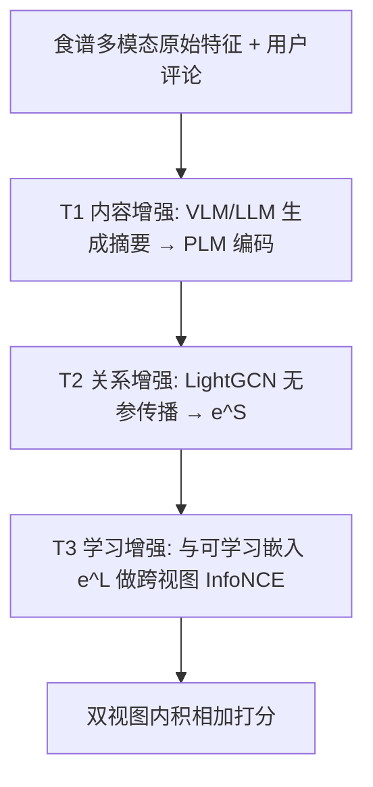
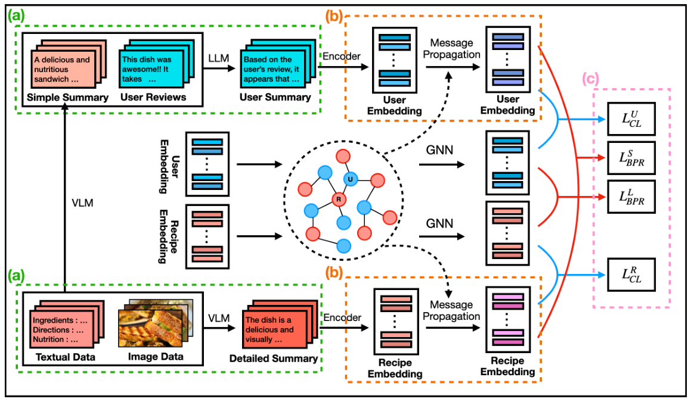

# From Raw Features to Effective Embeddings: A Three-Stage Approach for Multimodal Recipe Recommendation (从原始特征到有效嵌入：面向多模态食谱推荐的三阶段方法)

- **会议/期刊**: SIGIR 2026
- **作者与机构**: Jeeho Shin, Kyungho Kim, Kijung Shin (KAIST)
- **推荐链路定位**: 召回（用户-食谱匹配打分）
- **研究方向**: 多模态推荐 / 自监督对比学习
- **论文原文**: [https://arxiv.org/abs/2511.19176v3](https://arxiv.org/abs/2511.19176v3)
- **开源代码**: [https://github.com/JHshin6688/TESMR](https://github.com/JHshin6688/TESMR)

## TL;DR (1分钟核心速览)

食谱推荐的核心痛点是：食谱含标题、配料、步骤、营养、图片与用户评论等丰富多模态信号，但现有方法要么只用物品侧特征、要么把评论聚合成物品级特征，且依赖易受噪声配料干扰的食谱-配料图。作者先做实证：**不训练、仅用预训练编码器 + LightGCN 传播（MP）就已追平 SOTA**，说明多模态信号被系统性低估。据此提出 TESMR 三阶段框架：VLM/LLM 生成食谱与用户摘要（内容增强）→ LightGCN 传播注入协同信号（关系增强）→ 与可学习嵌入做跨视图 InfoNCE 对齐（学习增强）。在两个真实数据集上 Full-Ranking 评测，Recall@10 相对最强基线提升 **7.01%–15.38%**。

## Background & Motivation (背景与核心矛盾)

- **主流范式**: 多模态推荐（BM3、DRAGON、FREEDOM）与食谱推荐（FGCN、CLUSSL、HealthRec）主要用 GNN 在用户-物品图、食谱-配料图或食谱-食谱图上传播**物品侧**多模态表征；近期工作把基础模型当作 scorer/ranker 使用。
- **前人局限**: 其一，用户评论要么被完全忽略，要么被聚合成物品级特征，**用户侧多模态偏好从未被单独建模**；其二，食谱推荐依赖食谱-配料图，当配料过于通用/弱信息时（Allrecipes 的配料-食谱比是 Food.com 的 2.6 倍）会引入噪声，导致图方法在该数据集上明显失效。
- **核心洞察 (Key Insight)**: 图 2 的实证显示，把原始多模态特征直接编码后做无参数消息传播（MP），性能已可比甚至超过 FGCN/CLUSSL/HealthRec——**瓶颈不在模型容量，而在特征本身未被精炼**。
- **本文切入点**: 把"特征工程"显式化为三阶段递进增强（内容 → 关系 → 学习），让基础模型的语义理解与 GNN 的协同信号各司其职。

## Method (核心方法设计)

### 1. 整体框架 (Overall Architecture)

TESMR 把每个用户/食谱的表征拆成两条视图：**内容视图** $e^S$（由基础模型摘要经 PLM 编码、再经 LightGCN 传播得到，全程无参数）与**学习视图**$e^L$（随机初始化、可训练、同样经 LightGCN 传播）。离线阶段先用 VLM 把食谱的标题/配料/步骤/营养/图片压成 simple 与 detailed 两种摘要，再用 LLM 结合 simple 食谱摘要把用户历史评论压成用户偏好摘要；随后 PLM 编码摘要作为 LightGCN 初始嵌入，传播$K$层后层平均得到$e^S$；训练阶段以 BPR 分别优化两视图，并用跨视图 InfoNCE 把$e^S$锚定到$e^L$ 上；推理时两视图内积相加打分。

<figure class="paper-figure" markdown="span">
  <figcaption>图3：TESMR概览，包括（a）基于内容、（b）基于关系和（c）基于学习的多模态特征增强。</figcaption>
</figure>

### 2. 关键设计拆解 (Key Designs)

1. **内容增强：用基础模型做"有损但去噪"的摘要压缩**：原始配料表与长评论既冗长又含弱信息词，直接编码会把噪声写进嵌入。作者令 VLM 输出 $S^{\text{simple}}_r, S^{\text{detailed}}_r=\text{VLM}(V_r,T_r)$，LLM 则以"simple 食谱摘要 ‖ 该条评论"为上下文聚合出用户摘要$S_u=\text{LLM}(\{(S^{\text{simple}}_r \| T^r_u): A_{ur}=1\})$。关键取舍是**用户侧只用 simple 摘要**以控制 token 数——这让 LLM 能主动强调有意义的配料（如把"通用配料"降权），从源头缓解配料噪声。

2. **关系增强 + 学习增强：双视图传播后再对齐**：现有方法（如 BM3、FREEDOM 类）通常只对可学习嵌入做传播再对齐，内容嵌入停留在"语义相似"层面、缺乏协同信号。TESMR 对两视图**都**做 LightGCN 传播（$e^{(k+1)}_u=\sum_{r\in\mathcal{N}_u}\frac{1}{\sqrt{|\mathcal{N}_u|}\sqrt{|\mathcal{N}_r|}}e^{(k)}_r$，层平均得$e^S$），再以 InfoNCE 对齐：
$$\mathcal{L}_{UCL}=-\sum_{u\in\mathcal{U}}\log\frac{\exp(\cos(e^S_u,e^L_u)/\tau)}{\sum_{u'\in\mathcal{U}}\exp(\cos(e^S_u,e^L_{u'})/\tau)}$$
直觉是：内容视图提供可靠语义先验、学习视图提供数据驱动的协同纠偏，二者互为"教师"，当多模态内容噪声大或缺失时由 $e^L$ 兜底。

3. **训练目标、负采样与推理效率**：总损失 $\mathcal{L}_{total}=\mathcal{L}^S_{BPR}+\mathcal{L}^L_{BPR}+\lambda_{CL}\mathcal{L}_{CL}+\lambda_{REG}\|\bar{e}^{(0)}\|_2^2$，BPR 采用标准均匀负采样，对比损失以**批内其他用户/食谱为负样本**（in-batch negatives，免额外采样）。推理打分$(e^S_r)^\top e^S_u+(e^L_r)^\top e^L_u$。摘要生成是一次性离线预处理（用户约 9h、食谱约 5h，单条约 0.4–0.5s），不进入训练/推理链路。

## Experimental Setup & Evaluation Protocol (实验设置与评估协议)

- **数据集与预处理**: 沿用 CLUSSL/HealthRec 的预处理（含 k-core 过滤），统计如下：

| 数据集 | #Users | #Items | #Interactions | 稀疏度 | 特征/场景说明 |
| :--- | :---: | :---: | :---: | :---: | :--- |
| Allrecipes | 68,768 | 45,630 | 1,093,845 | 99.96% | 19,987 种配料，配料-食谱比高、配料噪声大 |
| Food.com | 7,585 | 29,905 | 322,546 | 99.86% | 4,963 种配料，配料信息更集中 |

- **数据划分与防穿越 (Splitting Strategy)**: 遵循 FGCN/CLUSSL/HealthRec 的既有划分（用户-食谱交互留出式评估），摘要生成仅使用训练可见的食谱内容与评论，避免测试交互泄漏。
- **排名评测协议 (Ranking Protocol)**: 采用 **Full-Ranking（全库未交互食谱排序）**，指标为 Recall@{10,20} 与 NDCG@{10,20}，5 个随机种子取均值。
- **对比基线与超参设置**: 8 个基线——通用（BPRMF、LightGCN）、多模态（BM3、DRAGON、FREEDOM）、食谱（FGCN、CLUSSL、HealthRec）；嵌入维度固定 $d=64$，batch 2048/4096，lr=1e-3，LightGCN 层数$\{1,2,3\}$，$\tau\in\{0.3,0.5,0.7\}$，$\lambda_{CL}\in\{0.1,0.2,0.3,0.5\}$。

## Key Experimental Results (实验关键数据)

### 1. 主实验对比 (Main Results)

| 数据集 / 指标 | Allrecipes R@10 | N@10 | R@20 | N@20 | Food.com R@10 | N@10 | R@20 | N@20 |
| :--- | :---: | :---: | :---: | :---: | :---: | :---: | :---: | :---: |
| BPRMF | 0.0201 | 0.0126 | 0.0433 | 0.0195 | 0.0236 | 0.0222 | 0.0414 | 0.0276 |
| LightGCN | 0.0203 | 0.0138 | 0.0444 | 0.0206 | 0.0263 | 0.0241 | 0.0457 | 0.0300 |
| BM3 | 0.0220 | 0.0146 | 0.0449 | 0.0212 | 0.0271 | 0.0253 | 0.0465 | 0.0311 |
| DRAGON | 0.0234 | 0.0152 | 0.0422 | 0.0206 | 0.0269 | 0.0248 | 0.0455 | 0.0302 |
| FREEDOM | 0.0224 | 0.0148 | 0.0441 | 0.0211 | 0.0264 | 0.0248 | 0.0445 | 0.0302 |
| FGCN | 0.0202 | 0.0133 | 0.0448 | 0.0204 | 0.0250 | 0.0227 | 0.0452 | 0.0291 |
| CLUSSL | 0.0225 | 0.0148 | 0.0432 | 0.0207 | 0.0263 | 0.0250 | 0.0461 | 0.0311 |
| HealthRec | 0.0213 | 0.0141 | 0.0432 | 0.0205 | 0.0266 | 0.0253 | 0.0469 | 0.0314 |
| **TESMR** | **0.0270** | **0.0166** | **0.0484** | **0.0228** | **0.0290** | **0.0272** | **0.0490** | **0.0330** |
| Improv. | +15.38% | +9.21% | +7.80% | +7.55% | +7.01% | +7.51% | +4.48% | +5.10% |

### 2. 消融实验 (Ablation Study)

| 变体 | Allrecipes R@10 | N@20 | Food.com R@10 | N@20 |
| :--- | :---: | :---: | :---: | :---: |
| TESMR-T1 (去内容增强) | 0.0255 | 0.0225 | 0.0277 | 0.0321 |
| TESMR-T2 (去关系增强) | 0.0180 | 0.0155 | 0.0156 | 0.0178 |
| TESMR-T3 (去学习增强) | 0.0249 | 0.0225 | 0.0281 | 0.0324 |
| TESMR-R (用户摘要不用评论) | 0.0242 | 0.0223 | 0.0284 | 0.0325 |
| TESMR-V (摘要不用食谱图片) | 0.0250 | 0.0225 | 0.0259 | 0.0319 |
| **TESMR** | **0.0270** | **0.0228** | **0.0290** | **0.0330** |

### 3. 关键实验发现 (Key Findings)

1. **关系增强是命脉，内容增强是前提**：去掉 T2 后 Allrecipes R@10 从 0.0270 崩到 0.0180（−33%），甚至低于纯 LightGCN，说明"语义嵌入 + 协同传播"缺一不可；而去掉 T1 仅降 5.6%，表明基础模型摘要的价值必须经由图传播才能兑现。
2. **用户评论与食谱图片各自贡献独立增益**：TESMR-R 在 Allrecipes 掉 10.4%（0.0270→0.0242），TESMR-V 在 Food.com 掉 10.7%（0.0290→0.0259），验证了"用户侧多模态偏好建模"这一被前人忽略的维度确实有效。
3. **效率反超而非牺牲**：Allrecipes 上 TESMR 单 epoch 训练 25.67s、收敛 15min、推理 5.72s、显存 4732MB，相比 HealthRec（107.31s / 55min / 15.45s / 15404MB）全面更优——因为内容视图无参数、可学习部分仅剩轻量 LightGCN；超参也稳健，$\tau$与$\lambda_{CL}$ 全网格下 NDCG@20 最大波动仅 4.15%。

## Highlights & Limitations (亮点、对比与审稿批判)

- **与代表作对比 (vs. Prior Work)**: 相比 BM3/FREEDOM 类"只传播可学习嵌入再对齐"，TESMR 让**内容视图也参与传播**，对齐发生在两个都含协同信号的视图之间；相比 FGCN/CLUSSL/HealthRec 依赖食谱-配料图，TESMR 用 LLM 摘要替代显式配料图，天然免疫通用配料噪声；相比把基础模型当 ranker 的工作，TESMR 只把它当**离线特征精炼器**，零在线开销。
- **可迁移亮点**: ①"simple/detailed 双粒度摘要 + 用户侧只用 simple 控 token"是低成本可复用的 LLM 特征压缩范式；②"无参数内容视图 + 可学习视图 + 跨视图 InfoNCE"可作为任意 GNN 推荐器的即插即用增强模块。
- **审稿级局限批判**: ①摘要生成需约 14 小时离线预处理，且依赖 LLaVA-1.5-7B / Llama-3.1-8B，**基础模型换代后摘要质量与结论是否稳定未验证**；②用户摘要为静态快照，无法刻画偏好的时间演化（作者亦在 future work 中承认），且未报告摘要生成的 API/算力成本与跨域（非食谱）场景的泛化实验。

## Rating (四维评分)

- **方法创新性 (Novelty)**: ⭐⭐⭐⭐ （三阶段递进增强思路清晰、双视图均传播后再对齐是相对前人的实质改动，但各组件本身均为成熟技术组合）
- **评估协议与实验扎实度 (Protocol & Experiments)**: ⭐⭐⭐⭐ （Full-Ranking + 8 基线 + 5 种子 + 5 组消融 + 效率与超参分析齐全，缺显著性检验与跨域验证）
- **写作与数学规范度 (Clarity & Rigor)**: ⭐⭐⭐⭐ （公式简洁、动机—方法—实验闭环严密，5 页短文信息密度高，但部分实现细节如摘要 prompt 未给出）
- **工业落地与复现价值 (Industrial & Practical Value)**: ⭐⭐⭐⭐⭐ （代码与数据全开源，离线预处理换在线零开销，训练/推理/显存全面优于基线，工程迁移成本低）

