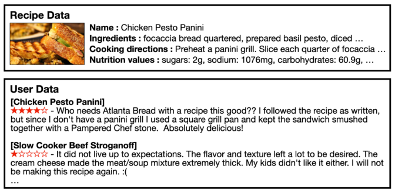
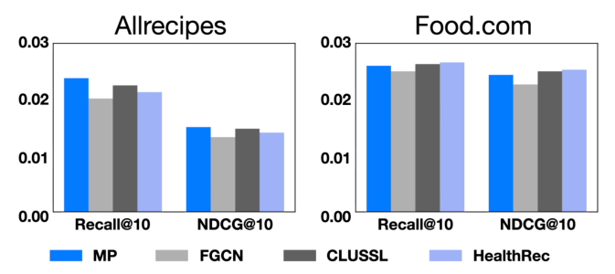
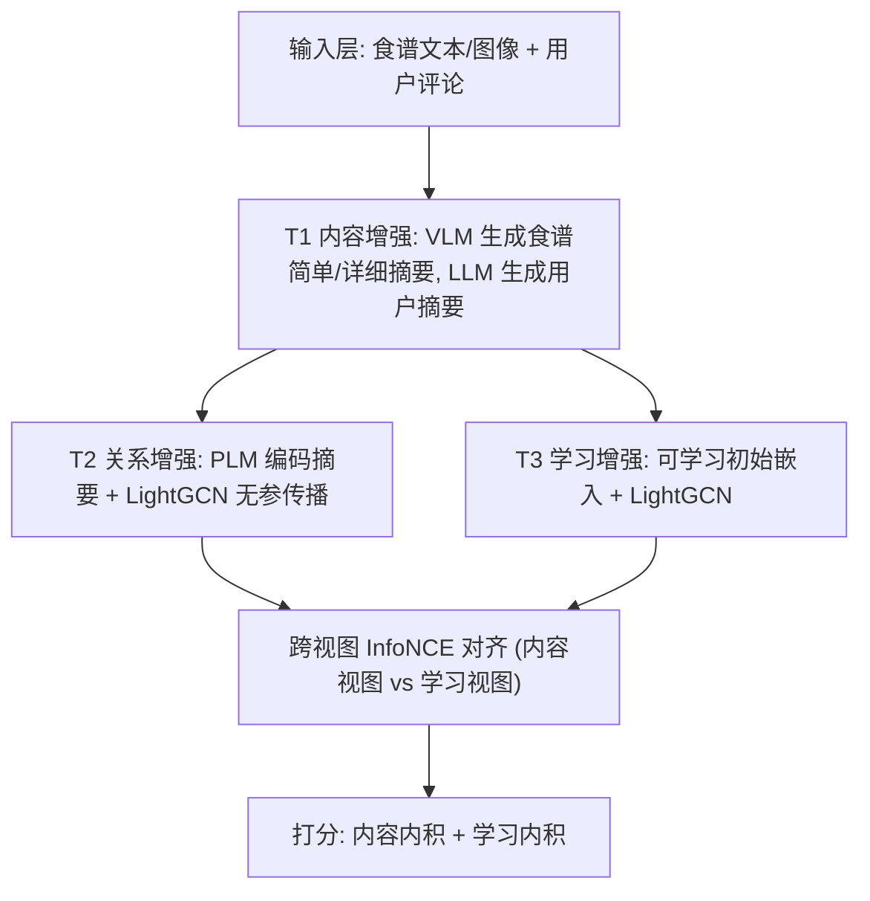
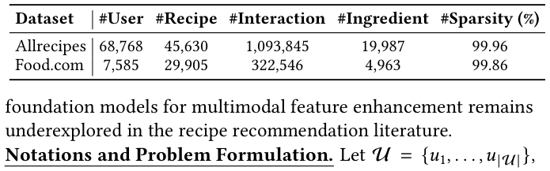
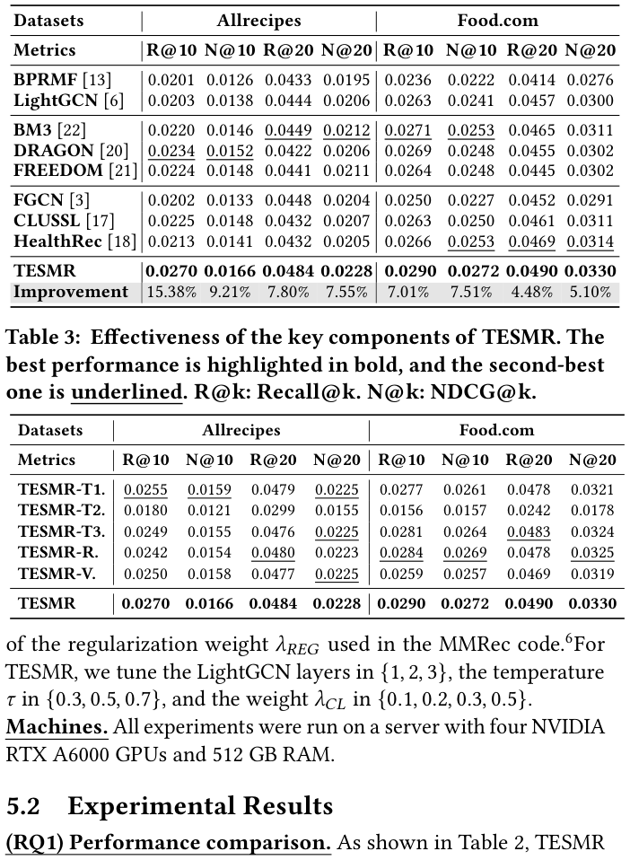
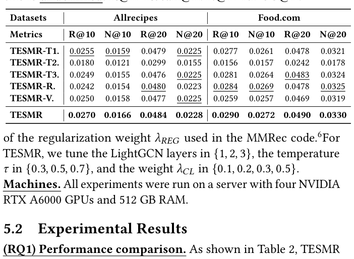

# From Raw Features to Effective Embeddings: A Three-Stage Approach for Multimodal Recipe Recommendation (从原始特征到有效嵌入：面向多模态食谱推荐的三阶段方法)

- **会议/期刊**: SIGIR 2026 (49th International ACM SIGIR Conference)
- **推荐链路定位**: 召回 (Retrieval) — 基于 LightGCN 表征的 Top-K 排序推荐
- **研究方向**: 多模态推荐 (主) / 自监督对比学习与交互去噪 (次)
- **论文原文**: [https://arxiv.org/abs/2511.19176v3](https://arxiv.org/abs/2511.19176v3)
- **开源代码**: [https://github.com/JHshin6688/TESMR](https://github.com/JHshin6688/TESMR)

## TL;DR (核心速览)

针对食谱推荐中多模态特征（食谱文本/图像、用户评论）利用不充分的问题，本文提出 TESMR 三阶段框架：先用 VLM/LLM 基础模型生成食谱与用户摘要（内容增强），再用 LightGCN 在用户-食谱交互图上传播摘要嵌入（关系增强），最后用跨视图 InfoNCE 对齐内容嵌入与可学习嵌入（学习增强）。在 Allrecipes/Food.com 两数据集上，Recall@10 相对最强基线提升 7.01%–15.38%。

## Background & Motivation (背景与动机)

- **领域背景与主流范式**: 多模态推荐主流做法是在用户-物品交互图（及物品-物品图）上跑 GNN，把物品侧多模态特征（标题、描述、图像）作为初始嵌入，代表工作有 FREEDOM、DRAGON、BM3。食谱推荐子领域（FGCN、CLUSSL、HealthRec）则额外构建食谱-食材图或食谱-食谱图做传播。
- **现有方法局限 (Limitations of Prior Work)**:
  1. 现有方法几乎只利用**物品侧**多模态信息，用户侧评论（直接反映偏好的文本）要么被完全忽略，要么被聚合成物品级特征，丢失了"用户-具体食谱"的个性化语义。
  2. 依赖食谱-食材图的方法对**噪声/泛化食材**敏感：Allrecipes 的食材-食谱比是 Food.com 的 2.6 倍，大量弱信息食材引入噪声，导致 FGCN/CLUSSL/HealthRec 在 Allrecipes 上甚至不如纯协同过滤 LightGCN。
  3. 基础模型在推荐中多被当作 scorer/ranker 使用，而"用基础模型增强 GNN 输入特征"这一路线在食谱推荐中尚未被系统探索。
- **核心挑战 (Key Challenge)**: 原始多模态特征（长文本、图像、评论）噪声大、维度异构，直接拼接或简单编码无法提炼出对协同信号有用的语义；而单纯增加 GNN 深度只能传播已有噪声。
- **核心洞察与切入点 (Key Insight)**: 作者做了一个关键 Pilot Study（图 2）：仅用预训练句向量编码原始特征 + **无参数**的 LightGCN 式消息传播（记为 MP），不做任何训练，性能就已匹敌甚至超过 FGCN/CLUSSL/HealthRec 等 SOTA。这说明多模态信号本身潜力巨大，瓶颈在于"如何系统性地增强"，而非模型容量。

<figure class="paper-figure" markdown="span">
  <figcaption>图 1</figcaption>
</figure>
图 1: 食谱与用户的多模态数据示例（食谱文本/图像、用户评论）。

<figure class="paper-figure" markdown="span">
  <figcaption>图 2</figcaption>
</figure>
图 2: 观察：不训练、简单使用多模态特征（MP）即可匹敌 SOTA。

## Problem Formulation & Method (问题定义与方法架构)

### 1. 符号定义与输入表征 (Notations & Input Representations)

- 用户集 $\mathcal{U}=\{u_1,\dots,u_{|\mathcal{U}|}\}$，食谱集 $\mathcal{R}=\{r_1,\dots,r_{|\mathcal{R}|}\}$。
- 交互矩阵 $\mathbf{A}\in\{0,1\}^{|\mathcal{U}|\times|\mathcal{R}|}$，$A_{ur}=1$ 表示用户 $u$ 评论过食谱 $r$。
- 每个食谱 $r$ 有原始文本描述 $T_r$（名称、食材、步骤、营养）与图像 $V_r$；每次交互附带用户评论 $T_r^u$。
- 目标：结合 $\mathbf{A}$ 与多模态信息 $(T_r, V_r, T_r^u)$ 预测未来用户-食谱交互。
- 特征嵌入维度固定为 $d=64$；编码器为 `all-MiniLM-L6-v2`（PLM），摘要生成器为 LLaVA-1.5-7B（VLM）与 Llama-3.1-8B-Instruct（LLM）。

### 2. 整体流水线 (Overall Architecture)

数据流：原始多模态特征 → (T1) VLM/LLM 生成食谱简单/详细摘要与用户偏好摘要 → (T2) PLM 编码摘要得初始嵌入，LightGCN 在交互图上传播（无参数）→ (T3) 另建一套可学习初始嵌入的 LightGCN，与内容嵌入做跨视图对比对齐 → 双路内积相加打分。

<figure class="paper-figure" markdown="span">
  <figcaption>图 3</figcaption>
</figure>
图 3: TESMR 总览，包含 (a) 内容增强、(b) 关系增强、(c) 学习增强。

### 3. 核心模块设计与数学原理 (Key Designs & Formulations)

**(T1) 内容增强 (Content-based Enhancement)**：用 VLM 把食谱特征 $(V_r, T_r)$ 压缩为两种摘要——简单摘要 $S_r^{\text{simple}}$（除步骤外全部特征）与详细摘要 $S_r^{\text{detailed}}$（全部特征）。用户侧用 LLM 汇总评论，每条评论与对应食谱的**简单摘要**拼接作为上下文（控制 token 数）：
$$S_u = \text{LLM}\big(\{(S_r^{\text{simple}} \,\|\, T_r^u) : A_{ur}=1\}\big).$$
物理直觉：基础模型的语义理解能力可"过滤"弱信息食材噪声，把长文本蒸馏为信息密度更高的语义摘要。

**(T2) 关系增强 (Relation-based Enhancement)**：PLM 编码摘要得初始嵌入 $e_u^{(0)}=\text{PLM}(S_u)$、$e_r^{(0)}=\text{PLM}(S_r^{\text{detailed}})$，再做标准 LightGCN 对称归一化传播：
$$e_u^{(k+1)}=\sum_{r\in\mathcal{N}_u}\frac{1}{\sqrt{|\mathcal{N}_u|}\sqrt{|\mathcal{N}_r|}}e_r^{(k)},\quad e_r^{(k+1)}=\sum_{u\in\mathcal{N}_r}\frac{1}{\sqrt{|\mathcal{N}_r|}\sqrt{|\mathcal{N}_u|}}e_u^{(k)},$$
并做层平均 $e_u^S=\frac{1}{K+1}\sum_{k=0}^{K}e_u^{(k)}$（食谱同理）。该阶段**无任何可训练参数**，纯靠图结构把协同信号注入内容嵌入。

**(T3) 学习增强 (Learning-based Enhancement)**：另建一套可学习初始嵌入 $\bar{e}_r^{(0)},\bar{e}_u^{(0)}$ 的 LightGCN 得 $e_u^L,e_r^L$，与内容视图做跨视图 InfoNCE 对齐（用户侧）：
$$\mathcal{L}_{UCL}=-\sum_{u\in\mathcal{U}}\log\frac{\exp(\cos(e_u^S,e_u^L)/\tau)}{\sum_{u'\in\mathcal{U}}\exp(\cos(e_u^S,e_u^{L})/\tau)},$$
食谱侧 $\mathcal{L}_{RCL}$ 同理，$\mathcal{L}_{CL}=\mathcal{L}_{UCL}+\mathcal{L}_{RCL}$。设计直觉：当多模态内容噪声大或缺失时，可学习嵌入提供可靠兜底，对比对齐使两视图互相纠偏。与现有方法（仅对可学习嵌入做传播再对齐）不同，本文对**两个视图都做传播后再对齐**。

### 4. 训练目标、负采样与推理复杂度 (Optimization, Negative Sampling & Complexity)

- **损失函数**:
$$\mathcal{L}_{\text{total}}=\mathcal{L}_{BPR}^S+\mathcal{L}_{BPR}^L+\lambda_{CL}\mathcal{L}_{CL}+\lambda_{REG}\Big(\sum_{r}\|\bar{e}_r^{(0)}\|_2^2+\sum_{u}\|\bar{e}_u^{(0)}\|_2^2\Big),$$
其中 $\mathcal{L}_{BPR}$ 为 BPR 成对损失（内容视图与学习视图各一份），$\tau$ 为 InfoNCE 温度，$\lambda_{CL},\lambda_{REG}$ 为超参。
- **训练负采样策略**: 采用 BPR 标准做法——对每个正样本 $(u,r)$ 随机采样一个未交互食谱作为负例（Uniform 随机负采样）；对比损失中的负例为 batch 内其他用户/食谱（In-batch 负例）。原文未报告难负例挖掘。
- **推理打分**: 双路内积相加 $(e_r^S)^\top e_u^S+(e_r^L)^\top e_u^L$。
- **时间与空间复杂度**: 离线预处理（摘要生成）约 9 小时（用户，约 0.5 s/用户）+ 5 小时（食谱，约 0.4 s/食谱），仅执行一次；训练每 epoch 25.67 s、收敛 15 min、全用户推理 5.72 s、峰值显存 4732 MB（Allrecipes），均显著优于 FGCN/CLUSSL/HealthRec（表 4）。

## Experimental Setup & Evaluation Protocol (实验设置与评估协议)

- **数据集统计与预处理**: 使用 Allrecipes 与 Food.com，沿用 CLUSSL/HealthRec 的预处理（原文未明确写出 5-core 等过滤阈值，仅称"following the preprocessing in [17,18]"）。

<figure class="paper-figure" markdown="span">
  <figcaption>表 1</figcaption>
</figure>
表 1: 真实数据集的数据统计。

| 数据集 (Dataset) | 用户数 (#Users) | 物品数 (#Recipes) | 交互数 (#Interactions) | 食材数 (#Ingredient) | 稀疏度 (Sparsity) |
| :--- | :---: | :---: | :---: | :---: | :---: |
| Allrecipes | 68,768 | 45,630 | 1,093,845 | 19,987 | 99.96% |
| Food.com | 7,585 | 29,905 | 322,546 | 4,963 | 99.86% |

- **数据划分方式 (Splitting Strategy)**: 原文未明确报告划分细节（仅引用 [17,18] 的预处理），**未说明**是 Leave-One-Out 还是 Ratio Split，也未讨论时间戳切分与数据泄露风险——这是评估协议上的一个信息缺口。
- **排名评测协议 (Ranking Protocol)**: 原文未显式声明 Full-Ranking 还是 Sampled Ranking；结合 MMRec 生态与 batch size 4096 的评测设置，推测为全库排序，但**原文未报告**明确说明。
- **评价指标与显著性检验**: Recall@{10,20}、NDCG@{10,20}；5 个随机种子取平均；嵌入维度统一 $d=64$；**未报告**配对显著性检验（如 $p<0.05$）。

## Key Experimental Results (核心实验结果)

### 1. 主实验对比 (Main Results)

8 个基线：BPRMF、LightGCN（通用）；BM3、DRAGON、FREEDOM（多模态）；FGCN、CLUSSL、HealthRec（食谱）。

<figure class="paper-figure" markdown="span">
  <figcaption>表 2</figcaption>
</figure>
表 2: 食谱推荐性能对比（加粗为最优，下划线为次优）。

| 数据集 | 指标 | 最强基线 (数值) | 本文方法 (Ours) | 相对提升 (Improv.) |
| :--- | :--- | :---: | :---: | :---: |
| Allrecipes | Recall@10 | DRAGON 0.0234 | **0.0270** | +15.38% |
| Allrecipes | NDCG@10 | DRAGON 0.0152 | **0.0166** | +9.21% |
| Allrecipes | Recall@20 | BM3 0.0449 | **0.0484** | +7.80% |
| Allrecipes | NDCG@20 | BM3 0.0212 | **0.0228** | +7.55% |
| Food.com | Recall@10 | BM3 0.0271 | **0.0290** | +7.01% |
| Food.com | NDCG@10 | HealthRec 0.0253 | **0.0272** | +7.51% |
| Food.com | Recall@20 | HealthRec 0.0469 | **0.0490** | +4.48% |
| Food.com | NDCG@20 | HealthRec 0.0314 | **0.0330** | +5.10% |

值得注意的现象：食谱专用方法（FGCN/CLUSSL/HealthRec）在 Allrecipes 上普遍弱于 LightGCN，作者归因于食材-食谱比过高（2.6×）带来的食材噪声，而 TESMR 借助基础模型语义摘要对噪声食材更鲁棒。

### 2. 消融实验与控制变量分析 (Ablation Study)

<figure class="paper-figure" markdown="span">
  <figcaption>表 3</figcaption>
</figure>
表 3: TESMR 关键组件有效性（加粗最优，下划线次优）。

| 变体 | Allrecipes R@10 | Allrecipes N@20 | Food.com R@10 | Food.com N@20 |
| :--- | :---: | :---: | :---: | :---: |
| TESMR-T1（去内容增强） | 0.0255 | 0.0225 | 0.0277 | 0.0321 |
| TESMR-T2（去关系增强） | 0.0180 | 0.0155 | 0.0156 | 0.0178 |
| TESMR-T3（去学习增强） | 0.0249 | 0.0225 | 0.0281 | 0.0324 |
| TESMR-R（去用户评论） | 0.0242 | 0.0223 | 0.0284 | 0.0325 |
| TESMR-V（去食谱图像） | 0.0250 | 0.0225 | 0.0259 | 0.0319 |
| TESMR（完整） | **0.0270** | **0.0228** | **0.0290** | **0.0330** |

- **关系增强 (T2) 贡献最大**：去掉后 Allrecipes R@10 从 0.0270 跌至 0.0180（-33%），Food.com 从 0.0290 跌至 0.0156（-46%），说明"内容摘要 + 图传播融合协同信号"是核心。
- 去掉用户评论（TESMR-R）与去掉食谱图像（TESMR-V）均有下降，验证用户侧评论与视觉模态的必要性；其中 Food.com 上去图像降幅更大（R@10 0.0290→0.0259）。
- 消融对照**未报告**参数量对齐或图度数匹配等控制变量说明。

### 3. 稀疏度/冷启动分桶与超参敏感度 (Sparsity Buckets & Hyperparameters)

- **长尾/冷启动分桶**: 原文**未报告**按交互频次分桶的细粒度分析。
- **关键超参数敏感度**: 图 4 显示 $\tau\in\{0.3,0.5,0.7\}$ 与 $\lambda_{CL}\in\{0.1,0.2,0.3,0.5\}$ 下 NDCG@20 最大波动仅 4.15%，模型对超参稳健；LightGCN 层数在 $\{1,2,3\}$ 中调优。
- **效率对比（表 4，Allrecipes）**: TESMR 训练 25.67 s/epoch、收敛 15 min、推理 5.72 s、显存 4732 MB，全面优于 FGCN（75.13 s / 47 min / 16.44 s / 13077 MB）、CLUSSL（86.19 s / 36 min / 13.62 s / 13107 MB）、HealthRec（107.31 s / 55 min / 15.45 s / 15404 MB）。
- **线上 A/B 测试**: 原文仅包含离线实验，**未报告**线上结果。

## Highlights, Limitations & Critiques (亮点、局限与审稿级批判)

- **核心亮点与可迁移性**:
  1. "基础模型做特征增强器而非打分器"的定位清晰，三阶段（内容→关系→学习）解耦设计可迁移到电商、短视频等任意带丰富多模态副文本的推荐场景。
  2. 用户侧摘要以"评论 + 对应物品简单摘要"拼接构造上下文，是低成本注入个性化语义的实用技巧。
  3. 双视图均传播后再对比对齐，比"仅对可学习嵌入传播后对齐"更充分，消融中 T2 的巨大跌幅佐证了传播融合的价值。
  4. 效率优势明显：无参数传播阶段 + 一次性离线摘要，训练/推理/显存全面优于图基线。
- **局限性与审稿视角批判 (Critical Limitations)**:
  1. **评估协议披露不足**：未明确数据划分方式（LOO vs. Ratio）、是否全库排序、过滤阈值，也未做显著性检验，削弱结论可复现性。
  2. **离线预处理成本高**：摘要生成需约 14 小时（9h 用户 + 5h 食谱）且依赖 7B/8B 级基础模型，冷启动新用户/新食谱需重新调用 LLM，工程上存在延迟与成本瓶颈；论文未讨论增量更新策略。
  3. **提升幅度有限**：绝对指标普遍在 0.02–0.05 量级（Recall@10 最高 0.0290），相对提升虽达 7–15%，但绝对收益小，实际业务价值需线上验证。
  4. **基线时效性**：对比基线多为 2023–2024 年工作，缺少与最新 LLM4Rec/生成式推荐方法的比较；且未与"直接用 LLM 打分"的范式对比，难以判断三阶段设计的必要性边界。
  5. **消融控制不严**：未报告参数量/计算量对齐，T1/T3 变体的性能差异可能部分来自训练预算差异而非模块本身。

## Rating (四维评分)

- **方法创新性 (Novelty)**: ⭐⭐⭐
- **评估协议与实验扎实度 (Protocol & Experiments)**: ⭐⭐⭐
- **写作与数学规范度 (Clarity & Rigor)**: ⭐⭐⭐⭐
- **工业落地与复现价值 (Industrial & Practical Value)**: ⭐⭐⭐⭐
