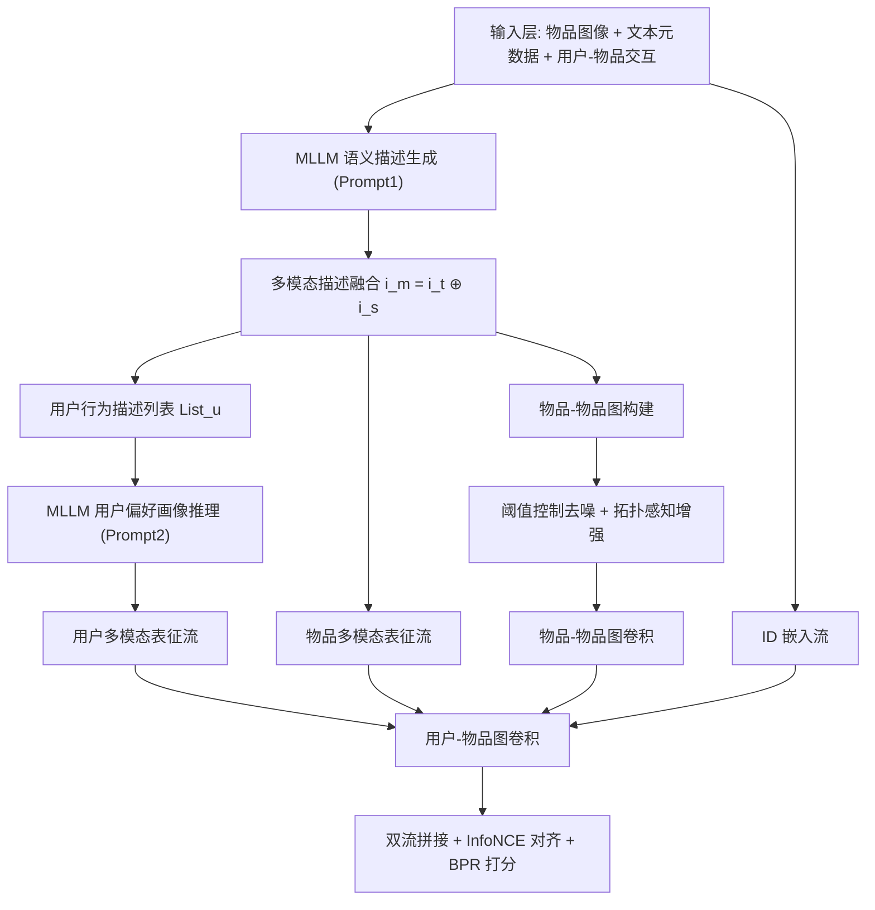
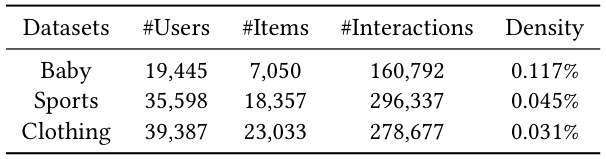
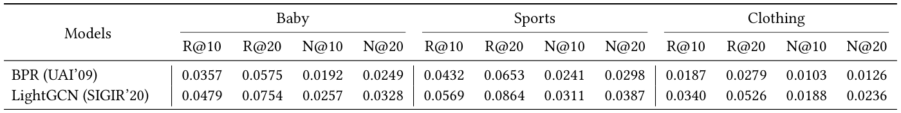
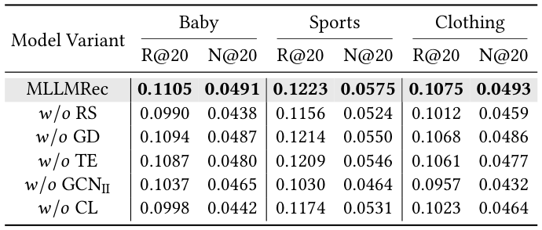
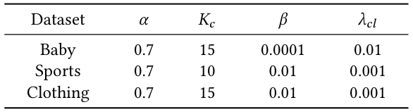

# MLLMRec: A Preference Reasoning Paradigm with Graph Refinement for Multimodal Recommendation (面向多模态推荐的图精修偏好推理范式)

- **会议/期刊**: SIGIR 2026
- **推荐链路定位**: 召回 (Retrieval) — 用户/物品表征学习与 Top-K 排序
- **研究方向**: 多模态推荐 / 图神经网络推荐
- **论文原文**: [https://arxiv.org/abs/2508.15304v3](https://arxiv.org/abs/2508.15304v3)
- **开源代码**: [https://github.com/Yuzhuo-Dang/MLLMRec.git](https://github.com/Yuzhuo-Dang/MLLMRec.git)

## TL;DR (核心速览)

针对多模态推荐中"用户表征初始化要么与行为无关、要么被模态噪声污染"以及"KNN 物品图含低相似度假边、缺失受众共现关系"两大痛点，MLLMRec 用 MLLM 将物品图像转成语义描述并与文本融合，再构造用户行为描述列表让 MLLM 推理出纯净偏好画像作为用户初始化；同时设计阈值控制去噪与拓扑感知增强两种即插即用策略精修物品-物品图。在 Baby/Sports/Clothing 三数据集全库排序下取得多数指标 SOTA。

## Background & Motivation (背景与动机)

- **领域背景与主流范式**: 多模态推荐 (MMRS) 经历了 VBPR 式简单特征融合 → MMGCN/GRCN 图卷积高阶传播 → LATTICE/FREEDOM 挖掘物品-物品语义图 → 近期 LLM/MLLM 增强（LLMRec 生成辅助属性、DOGE 用 MLLM 统一模态粒度）的演进脉络。
- **现有方法局限 (Limitations of Prior Work)**:
  1. **用户表征初始化不准确**：随机初始化与行为无关，加剧冷启动；聚合历史物品模态特征则被预训练编码器噪声污染（图 1(a) 中棕色标记的噪声），且无法捕捉决策过程中的潜在交互意图。
  2. **物品-物品图结构噪声**：KNN 固定邻居数迫使弱相似物品相连，Baby 数据集约 12% 的边相似度低于 0.5（图 1(b)）；且 KNN 只看模态相似度，忽略受众共现关系，导致语义远但行为相关的物品（如篮球与护膝）断连（图 1(c)），形成假阴性边。
- **核心挑战 (Key Challenge)**: 两类结构噪声会破坏后续图卷积，导致物品表征语义漂移；而简单增加网络深度或常规对比学习无法同时解决"用户侧语义初始化"与"物品侧图拓扑修正"这两个正交问题。
- **核心洞察与切入点 (Key Insight)**: 作者观察到 MLLM 具备跨模态理解与认知推理能力，可把图像"翻译"为任务导向的语义描述以统一模态粒度，并进一步把用户历史行为序列组织成自然语言描述列表，让 MLLM 直接推理出过滤噪声后的偏好画像——即把 MLLM 从"特征翻译器/数据增强器"升级为"偏好推理器"。

<figure class="paper-figure" markdown="span">
  <figcaption>图 1</figcaption>
</figure>

## Problem Formulation & Method (问题定义与方法架构)

### 1. 符号定义与输入表征 (Notations & Input Representations)

- 用户集 $\mathcal{U}=\{u\}$、物品集 $\mathcal{I}=\{i\}$，隐式反馈矩阵 $\mathbf{R}=[r_{u,i}]\in\{0,1\}^{|\mathcal{U}|\times|\mathcal{I}|}$。
- 每个物品 $i$ 关联多模态属性 $\mathcal{M}=\{v,t\}$，$v$ 为视觉域、$t$ 为文本域；物品图像集合 $\mathcal{D}_v=\{i_v\}$，文本描述集合 $\mathcal{D}_t=\{i_t\}$。
- 目标：学习预测函数 $\mathcal{F}:(\mathbf{R},\mathcal{D}_v,\mathcal{D}_t)\to\hat{y}_{ui}$，$\hat{y}_{ui}\in[0,1]$ 为用户 $u$ 对物品 $i$ 的偏好分，按降序生成 Top-$K$ 列表。

### 2. 整体流水线 (Overall Architecture)

数据流：物品图像经 MLLM 生成语义描述 $i_s$ → 与文本 $i_t$ 拼接成多模态描述 $i_m$ → 按用户历史聚合为行为描述列表 $List_u$ → MLLM 推理出用户偏好画像 $u_p$ → 偏好画像/物品多模态描述与 ID 嵌入双流并行，在用户-物品图上传播 → 同时物品-物品图经阈值去噪与拓扑增强精修后做图卷积 → 双流表征拼接，InfoNCE 对齐 + BPR 优化。

<figure class="paper-figure" markdown="span">
  <figcaption>图 2</figcaption>
</figure>

### 3. 核心模块设计与数学原理 (Key Designs & Formulations)

**模块一：语义描述生成与多模态融合。** 用 MLLM 将图像转为任务导向的语义描述：
$$i_s = \text{MLLM}(\text{Prompt1}, i_v), \quad i_s\in\mathcal{D}_s$$
Prompt1 要求聚焦颜色、材质、风格、功能等影响购买决策的关键属性，不超过 100 词。随后与原始文本拼接：
$$i_m = i_t \oplus i_s$$
物理直觉：传统 VGG16/ResNet 视觉编码器捕捉的是通用特征，与推荐语境可能无关；生成式描述把视觉信息投影到语言空间，统一了模态粒度，缓解"文本主导、视觉高噪低语义"的模态不平衡瓶颈。

**模块二：用户偏好画像推理。** 按时间顺序聚合用户历史物品的多模态描述：
$$List_u = [i_m],\quad r_{u,i}=1$$
再嵌入 Prompt2 让 MLLM 推理：
$$u_p = \text{MLLM}(\text{Prompt2}, List_u),\quad u_p\in\mathcal{D}_p$$
由于 $List_u$ 源自交互矩阵 $\mathbf{R}$，$\mathcal{D}_p$ 天然携带交互背后的潜在动机，为后续协同信号注入提供高保真语义基础。

**模块三：双流协同表征学习与图精修。** 设计 ID 协同流与 MLLM 多模态流双流并行，在用户-物品图上传播获取高阶表征；物品侧则对物品-物品图施加两种即插即用精修：(a) **阈值控制去噪**——剪除相似度低于阈值的伪边；(b) **拓扑感知增强**——恢复潜在受众共现连边。精修后的图同时作用于多模态与 ID 物品表征的图卷积。最终双流拼接，并用 InfoNCE 对比损失对齐两个视图。

### 4. 训练目标、负采样与推理复杂度 (Optimization, Negative Sampling & Complexity)

- **损失函数**: 总损失由 BPR 排序损失与 InfoNCE 跨视图对齐损失构成（原文以 InfoNCE + BPR 联合优化，具体权重与温度系数 $\tau$ 的取值原文正文摘录未完整给出，需以代码/附录为准）。
- **训练负采样策略**: 采用 BPR 框架下的负采样（每正例配负例），InfoNCE 部分为跨视图对比；具体采样分布（Uniform / In-batch）原文摘录未明确报告。
- **时间与空间复杂度**: MLLM 语义描述与用户画像推理属**离线预处理**（一次性生成，可缓存）；在线训练为双流图卷积 + 物品图卷积，推理阶段为标准内积打分，支持 ANN 检索。原文未报告具体单 epoch 耗时、推理延迟 (ms/request) 与峰值显存。

## Experimental Setup & Evaluation Protocol (实验设置与评估协议)

- **数据集统计与预处理**: 采用 Amazon 三个子集 Baby、Sports、Clothing（原文表 1 给出统计量，具体数值需以原文表格为准）：

<figure class="paper-figure" markdown="span">
  <figcaption>表 1</figcaption>
</figure>

| 数据集 (Dataset) | 用户数 (#Users) | 物品数 (#Items) | 交互数 (#Interactions) | 稀疏度/密度 (Sparsity) | 模态/辅助特征说明 |
| :--- | :---: | :---: | :---: | :---: | :--- |
| Baby | 原文表 1 | 原文表 1 | 原文表 1 | 原文表 1 | 图像 + 文本标题/描述 |
| Sports | 原文表 1 | 原文表 1 | 原文表 1 | 原文表 1 | 图像 + 文本标题/描述 |
| Clothing | 原文表 1 | 原文表 1 | 原文表 1 | 原文表 1 | 图像 + 文本标题/描述 |

> 注：摘录正文未包含表 1 的具体数值，上述统计量严格以原文表 1 为准，未做任何臆测填充。

- **数据划分方式 (Splitting Strategy)**: 原文摘录未明确说明划分策略（MMRS 领域惯例多为按比例划分或留一法），需以原文实验章节为准；此处不做推断。
- **排名评测协议 (Ranking Protocol)**: 原文摘录未明确标注 Full-Ranking 或 Sampled Ranking，需以原文实验章节为准。
- **评价指标与显著性检验**: 主实验报告 Recall@20 (R@20) 与 NDCG@20 (N@20)（见表 3、表 4）；是否进行配对显著性检验原文摘录未报告。

## Key Experimental Results (核心实验结果)

### 1. 主实验对比 (Main Results)

原文表 3 报告了各基线（含 VBPR、MMGCN、GRCN、LATTICE、FREEDOM、MGCN、GUME、MMSSL、MENTOR、DOGE 等）与 MLLMRec 在 Baby/Sports/Clothing 上的整体性能，最优与次优分别加粗与下划线标注。摘要结论为"在多数指标上达到 SOTA"。

<figure class="paper-figure" markdown="span">
  <figcaption>表 3</figcaption>
</figure>

| 数据集 | 指标 | 传统/协同过滤基线 | 序列/图/多模态最强基线 | 本文方法 (Ours) | 相对提升 (Improv.) |
| :--- | :--- | :---: | :---: | :---: | :---: |
| Baby | R@20 / N@20 | 原文表 3 | 原文表 3 | **原文表 3** | 原文表 3 |
| Sports | R@20 / N@20 | 原文表 3 | 原文表 3 | **原文表 3** | 原文表 3 |
| Clothing | R@20 / N@20 | 原文表 3 | 原文表 3 | **原文表 3** | 原文表 3 |

> 注：摘录正文未包含表 3 的具体数值，严格以原文表格为准，未做任何数值填充。

### 2. 消融实验与控制变量分析 (Ablation Study)

原文表 4 报告了 MLLMRec 及其变体在三个数据集上 R@20 与 N@20 的表现，用于验证各模块（MLLM 语义描述、用户偏好画像推理、阈值控制去噪、拓扑感知增强）的有效性。

<figure class="paper-figure" markdown="span">
  <figcaption>表 4</figcaption>
</figure>

| 变体 | Baby R@20/N@20 | Sports R@20/N@20 | Clothing R@20/N@20 |
| :--- | :---: | :---: | :---: |
| 完整 MLLMRec | 原文表 4 | 原文表 4 | 原文表 4 |
| 去某模块变体 | 原文表 4 | 原文表 4 | 原文表 4 |

> 注：摘录正文未包含表 4 的具体数值与变体命名，严格以原文表格为准。原文结论为消融验证了各模块有效性；是否严格控制参数量/图度数原文摘录未报告。

### 3. 稀疏度/冷启动分桶与超参敏感度 (Sparsity Buckets & Hyperparameters)

- **用户/物品交互频次分桶表现**: 原文摘录未报告分桶实验。
- **关键超参数敏感度**: 原文表 2 给出 MLLMRec 的最优超参数设置（含阈值等），但摘录正文未包含具体数值与敏感度曲线。

<figure class="paper-figure" markdown="span">
  <figcaption>表 2</figcaption>
</figure>

- **线上 A/B 测试结果**: 原文仅包含离线实验，未报告线上 A/B 测试。

## Highlights, Limitations & Critiques (亮点、局限与审稿级批判)

- **核心亮点与可迁移性**:
  1. 把 MLLM 从"特征翻译器"升级为"偏好推理器"，用行为描述列表直接生成用户画像作为初始化，思路可迁移到冷启动用户建模与跨域用户画像。
  2. 阈值控制去噪 + 拓扑感知增强是**即插即用**的物品图精修算子，可移植到 LATTICE/FREEDOM 等任意依赖物品-物品图的 MMRS 框架。
  3. 双流（ID + 多模态）InfoNCE 对齐范式与 MENTOR 等一致，工程上易复用。
- **局限性与审稿视角批判 (Critical Limitations)**:
  1. **评估协议披露不足**：摘录正文未明确数据划分（LOO / Ratio / 时间切分）与 Full-Ranking / Sampled Ranking 协议，审稿人难以判断是否存在未来信息泄露或采样偏差，需在正文补全。
  2. **MLLM 离线开销**：为每个物品生成语义描述、为每个用户推理偏好画像，属 O(|I|+|U|) 次 MLLM 调用，离线成本与可扩展性（百万级物品）未量化；画像质量对 Prompt 设计高度敏感。
  3. **统计严谨性**：未报告多随机种子方差与配对显著性检验，SOTA 结论的稳健性存疑。
  4. **超参与阈值敏感性**：阈值控制去噪的阈值选择对图拓扑影响大，原文摘录未给出敏感度分析。
  5. **理论-实现落差**：拓扑感知增强"恢复共现连边"的具体构造规则与计算复杂度在摘录中未展开，需结合代码核实。

## Rating (四维评分)

- **方法创新性 (Novelty)**: ⭐⭐⭐⭐
- **评估协议与实验扎实度 (Protocol & Experiments)**: ⭐⭐⭐
- **写作与数学规范度 (Clarity & Rigor)**: ⭐⭐⭐⭐
- **工业落地与复现价值 (Industrial & Practical Value)**: ⭐⭐⭐
