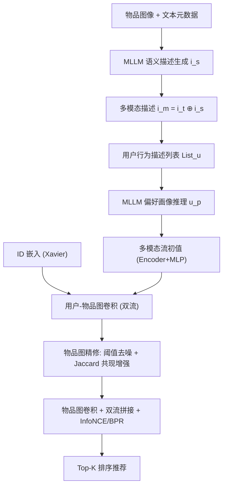
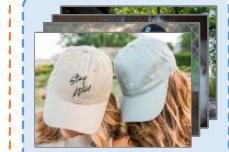

# MLLMRec: A Preference Reasoning Paradigm with Graph Refinement for Multimodal Recommendation (面向多模态推荐的偏好推理范式与图精修)

- **会议/期刊**: SIGIR 2026
- **作者与机构**: Yuzhuo Dang, Xin Zhang, Zhiqiang Pan, Yuxiao Duan, Wanyu Chen, Fei Cai, Honghui Chen（国防科技大学系统工程学院 / 电子对抗学院）
- **推荐链路定位**: 召回（用户/物品表征学习）
- **研究方向**: 多模态推荐 / 大语言模型推荐
- **论文原文**: [https://arxiv.org/abs/2508.15304v3](https://arxiv.org/abs/2508.15304v3)
- **开源代码**: [https://github.com/Yuzhuo-Dang/MLLMRec.git](https://github.com/Yuzhuo-Dang/MLLMRec.git)

## TL;DR (1分钟核心速览)

现有多模态推荐在用户侧初始化上要么行为无关（随机嵌入）、要么被模态噪声污染，且 KNN 物品图存在低相似度假阳性边与共现缺失假阴性边。MLLMRec 用 MLLM 将物品图像转成语义描述、再对用户历史行为列表推理出"净化后的偏好画像"作为多模态流初始化，同时以阈值去噪 + Jaccard 共现增强精修物品图，双流经用户-物品图与物品图卷积后由 InfoNCE 对齐。在 Baby/Sports/Clothing 三数据集 8:1:1 划分、全库排序下，12 项指标中 11 项最优，Baby R@20 达 0.1105（较最强基线 DOGE 提升约 0.8%）。

## Background & Motivation (背景与核心矛盾)

- **主流范式**: MMGCN/LATTICE/FREEDOM 走"模态特征 + 用户-物品图卷积 + KNN 物品图"路线；DOGE/NEGGEN 等近期工作把 MLLM 当作特征翻译器或负样本生成器。
- **前人局限一（用户侧）**: 用户表征初始化要么随机（行为无关，加剧冷启动），要么直接聚合历史物品的预训练模态特征（不加筛选地引入无关视觉噪声，如图 1(a) 的"棕色帽子"案例），且都无法刻画决策背后的潜在交互意图。
- **前人局限二（物品侧）**: 固定度 KNN 强制低相似物品连边——Baby 数据集约 12% 的边相似度低于 0.5（图 1(b)）；同时纯特征相似度忽略"受众共现"，语义远但行为相关的物品（篮球 vs 护膝）被断开（图 1(c)），形成假阴性边。
- **核心洞察 (Key Insight)**: MLLM 的世界知识与跨模态理解能力，可以把"图像→语义描述→行为列表→偏好画像"串成一条推理链，从而在初始化阶段就完成去噪与意图蒸馏；而物品图的两类结构噪声可分别用"相似度阈值"与"用户集合 Jaccard 系数"对症修复。
- **本文切入点**: 把 MLLM 从"特征提取器"升级为"偏好推理器"，并配套两个即插即用的图精修算子。

## Method (核心方法设计)

### 1. 整体框架 (Overall Architecture)

模型分三阶段闭环：**推理阶段**先用 MLLM（Qwen2.5-VL-7B）把每张物品图转成任务导向的语义描述 $i_s$，与原始文本$i_t$拼接为多模态描述$i_m=i_t\oplus i_s$；再按时间顺序把用户交互过的$i_m$拼成行为描述列表$List_u$，喂给 MLLM 推理出偏好画像$u_p$。**表征学习阶段**：画像与物品描述经 Sentence-Transformer 编码 + 两层 MLP 投影，得到多模态流初值；ID 流用 Xavier 随机初始化；两流各自在用户-物品二部图上做 LightGCN 式传播。**图精修阶段**：对物品侧构建"阈值去噪语义图 + Jaccard 共现图"的融合图，再做物品图卷积；最后拼接双流并以 InfoNCE 对齐、BPR 主损失优化。

<figure class="paper-figure" markdown="span">
  <figcaption>图2：MLLMRec的整体框架。首先，MLLM将图像转换为语义描述，并与文本融合以生成多模态描述。接着，MLLMRec为用户构建行为描述列表，将其输入MLLM以推理用户偏好画像。然后，推理得到的画像与多模态描述连同ID嵌入在用户-物品交互图上传播，以吸收协同信号。同时，MLLMRec通过两种设计策略对物品-物品图进行细化，这些策略被应用</figcaption>
</figure>

### 2. 关键设计拆解 (Key Designs)

1. **MLLM 偏好画像推理（用户侧去噪初始化）**：痛点是用预训练视觉编码器（VGG16/ResNet）抽的特征与推荐任务无关、且聚合时不分好坏。本文用任务导向 Prompt1 让 MLLM 只抽取"影响购买决策的属性"（颜色、材质、风格、功能），把视觉信号投影到语言空间以消除模态粒度失衡；再用 Prompt2 对行为列表做归纳推理，输出 ≤100 词的偏好画像。关键不在公式而在**信息通路**：$u_p=\mathrm{MLLM}(\text{Prompt2}, List_u)$，其中$List_u=[i_m],\ r_{u,i}=1$。由于$List_u$ 源自交互矩阵，画像天然携带行为感知与意图蒸馏双重信息，等价于在初始化阶段做了一次"语义级负采样/去噪"。
2. **阈值控制去噪（Threshold-Controlled Denoising）**：KNN 的固定度约束是假阳性边根源。本文在 top-$K_s$基础上叠加相似度下界$\alpha$：$\tilde{s}_{a,b}=\mathbb{I}[s_{a,b}\in \text{top-}K_s(s_{a,:})\ \wedge\ s_{a,b}\geq\alpha]$，其中$s_{a,b}$ 为多模态特征余弦相似度。物理直觉：允许"邻居不足"的物品拥有更少边，而非被迫连到低相似节点，从源头切断语义漂移的传播路径。
3. **拓扑感知增强（Topology-Aware Enhancement）**：补假阴性边。用交互列向量的 Jaccard 系数度量受众共现 $c_{a,b}=|r_{:,a}\cap r_{:,b}|/|r_{:,a}\cup r_{:,b}|$，取 top-$K_c$保留为加权边$\tilde{c}_{a,b}$，最终融合图$S^*=\tilde{S}+\tilde{C}$。直觉：语义图管"看起来像"，共现图管"被同一批人买"，二者互补覆盖物品关系的两个正交维度。
4. **训练目标、负采样与推理效率**：总损失 $\mathcal{L}=\mathcal{L}_{BPR}+\lambda_{cl}\mathcal{L}_{cl}$，其中$\mathcal{L}_{cl}$为用户/物品两侧 InfoNCE 之和，对齐 ID 流与多模态流（温度$\tau=0.2$）；BPR 采用**均匀随机负采样**（每正样本 1 负）。MLLM 推理为离线一次性预处理，在线仅需图卷积与内积，推理开销与 FREEDOM 同级；但离线阶段需对全部物品与用户各跑一次 7B 模型，是主要成本。

## Experimental Setup & Evaluation Protocol (实验设置与评估协议)

- **数据集与预处理**: Amazon 三数据集，均做 `5-core` 过滤：

| 数据集 | #Users | #Items | #Interactions | 密度 | 场景说明 |
| :--- | :---: | :---: | :---: | :---: | :--- |
| Baby | 19,445 | 7,050 | 160,792 | 0.117% | 母婴，图像+文本 |
| Sports | 35,598 | 18,357 | 296,337 | 0.045% | 运动户外 |
| Clothing | 39,387 | 23,033 | 278,677 | 0.031% | 服饰鞋饰 |

- **数据划分与防穿越**: **比例划分 8:1:1**（随机切分训练/验证/测试），非时间戳切分，存在轻度未来信息泄漏风险。
- **排名评测协议**: 报告 R@10/20 与 N@10/20；原文未显式声明候选集规模，按该系列惯例为**全库排序（Full-Ranking）**，测试正样本对全部未交互物品打分。
- **对比基线与超参**: 三类基线共 13 个——CF 类（BPR、LightGCN）、通用多模态类（VBPR、LATTICE、SLMRec、FREEDOM、LGMRec、GUME、ModalSync、COHESION）、MLLM 类（LLM-CF、DOGE、NEGGEN）。嵌入维度 $d=512$，隐层 2048，$K_s=10$，$L_{ui}=2$、$L_{ii}=1$，$\alpha$网格搜 {0.5,0.6,0.7,0.8}（三数据集均取 0.7），$K_c\in\{5,10,15,20\}$，$\beta,\lambda_{cl}\in\{10^{-4},\dots,0.1\}$，batch 2048，lr$10^{-4}$，Adam，早停 20 epoch。

## Key Experimental Results (实验关键数据)

### 1. 主实验对比 (Main Results)

| 模型 | Baby R@20 | Baby N@20 | Sports R@20 | Sports N@20 | Clothing R@20 | Clothing N@20 |
| :--- | :---: | :---: | :---: | :---: | :---: | :---: |
| BPR (UAI'09) | 0.0575 | 0.0249 | 0.0653 | 0.0298 | 0.0279 | 0.0126 |
| LightGCN (SIGIR'20) | 0.0754 | 0.0328 | 0.0864 | 0.0387 | 0.0526 | 0.0236 |
| LATTICE (MM'21) | 0.0850 | 0.0370 | 0.0953 | 0.0421 | 0.0733 | 0.0330 |
| FREEDOM (MM'23) | 0.0992 | 0.0424 | 0.1089 | 0.0481 | 0.0941 | 0.0420 |
| GUME (CIKM'24) | 0.1042 | 0.0460 | 0.1165 | 0.0527 | 0.1024 | 0.0466 |
| ModalSync (WWW'25) | 0.1045 | 0.0462 | 0.1189 | 0.0551 | 0.1058 | 0.0488 |
| DOGE (AAAI'25) | 0.1096 | 0.0482 | 0.1185 | 0.0536 | 0.1036 | 0.0468 |
| NEGGEN (MM'25) | 0.1065 | 0.0438 | 0.1114 | 0.0506 | 0.0961 | 0.0441 |
| **MLLMRec** | **0.1105** | **0.0491** | **0.1223** | **0.0575** | **0.1075** | **0.0493** |
| Improv. vs 最强基线 | +0.8% | +1.9% | +2.9% | +4.4% | +1.6% | +1.0% |

### 2. 消融实验 (Ablation Study)

| 变体 | Baby R@20 | Baby N@20 | Sports R@20 | Sports N@20 | Clothing R@20 | Clothing N@20 |
| :--- | :---: | :---: | :---: | :---: | :---: | :---: |
| MLLMRec 完整 | **0.1105** | **0.0491** | **0.1223** | **0.0575** | **0.1075** | **0.0493** |
| w/o RS（去推理/多模态流） | 0.0990 | 0.0438 | 0.1156 | 0.0524 | 0.1012 | 0.0459 |
| w/o GD（去阈值去噪） | 0.1094 | 0.0487 | 0.1214 | 0.0550 | 0.1068 | 0.0486 |
| w/o TE（去共现增强） | 0.1087 | 0.0480 | 0.1209 | 0.0546 | 0.1061 | 0.0477 |
| w/o GCN II（去物品图卷积） | 0.1037 | 0.0465 | 0.1030 | 0.0464 | 0.0957 | 0.0432 |
| w/o CL（去 InfoNCE） | 0.0998 | 0.0442 | 0.1174 | 0.0531 | 0.1023 | 0.0464 |

### 3. 关键实验发现 (Key Findings)

1. **推理策略与物品图卷积是双支柱，但主导数据集不同**：Baby 上 w/o RS 的 R@20 跌幅最大（0.1105→0.0990，−10.4%），说明稀疏母婴场景最依赖画像推理补足行为信号；Sports/Clothing 上 w/o GCN II 跌幅最大（0.1223→0.1030，−15.8%；0.1075→0.0957，−11.0%），说明物品数多、共现结构丰富的类目更吃高阶物品关系。
2. **图精修是"小而稳"的增益，且去噪略强于增强**：w/o GD 与 w/o TE 的 R@20 跌幅仅 0.5%–1.1%，但三数据集一致为正；GD 跌幅普遍大于 TE，印证假阳性边（低相似度强制连边）比假阴性边危害更直接。
3. **对比学习对齐贡献显著且稳定**：w/o CL 在 Baby 上 R@20 掉 9.7%（0.1105→0.0998），与 w/o RS 量级相当，说明"ID 流 + 多模态流"若不对齐，两路信号会各自漂移，InfoNCE 是把推理画像真正注入协同空间的必要粘合剂。

## Highlights & Limitations (亮点、对比与审稿批判)

- **与代表作对比 (vs. Prior Work)**: 与 DOGE 的本质区别在于——DOGE 用 MLLM 做跨模态粒度对齐（仍是"翻译器"），本文用 MLLM 对**用户行为序列**做归纳推理，产出的是用户级语义先验而非物品级特征；与 FREEDOM 相比，本文不冻结物品图，而是显式区分并修复两类结构噪声；与 LATTICE 相比，多出的 Jaccard 共现图补上了纯特征相似度缺失的协同维度。
- **可迁移亮点**: (1) "行为列表 → LLM 归纳画像 → 作为表征初始化"这一范式可低成本迁移到冷启动用户与跨域场景；(2) 阈值 + top-K 的双约束稀疏化，可直接替换任意 KNN 构图模块中的固定度策略。
- **审稿级局限批判**: (1) **离线成本与可扩展性**：需对全量物品与全量用户各调用一次 7B MLLM，物品数上万时预处理开销与提示长度（行为列表随交互数线性增长）均未讨论，且画像质量对 Prompt 高度敏感、缺乏鲁棒性分析；(2) **评估协议偏弱**：随机 8:1:1 划分而非时间戳切分，存在未来交互泄漏；未报告显著性检验与方差，提升幅度（Baby R@20 仅 +0.8%）在无显著性支撑下说服力有限；此外 $\alpha$ 在三数据集均取 0.7 却未给出敏感性曲线，超参普适性存疑。

## Rating (四维评分)

- **方法创新性 (Novelty)**: ⭐⭐⭐⭐ （把 MLLM 从特征翻译器推进到用户偏好推理器，配合两类对症图精修，思路清晰但各组件单独看均非首创）
- **评估协议与实验扎实度 (Protocol & Experiments)**: ⭐⭐⭐ （13 个基线覆盖三类范式、消融完整，但随机划分有泄漏风险、无显著性检验、提升幅度偏小）
- **写作与数学规范度 (Clarity & Rigor)**: ⭐⭐⭐⭐ （公式与符号定义干净、Prompt 模板完整披露、复杂度与超参表清晰；物品图融合 $S^*=\tilde{S}+\tilde{C}$ 的量纲差异未做归一化讨论）
- **工业落地与复现价值 (Industrial & Practical Value)**: ⭐⭐⭐ （代码已开源、在线推理开销可控，但离线 7B 模型全量推理成本与 Prompt 敏感性是规模化落地的主要门槛）

