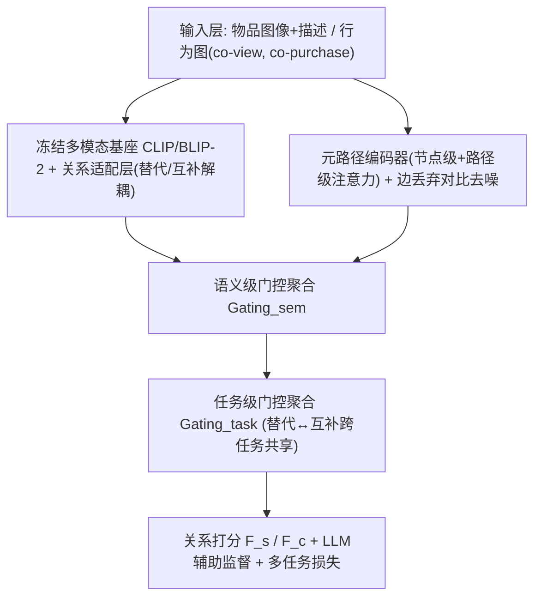
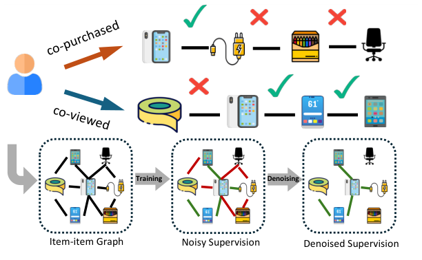
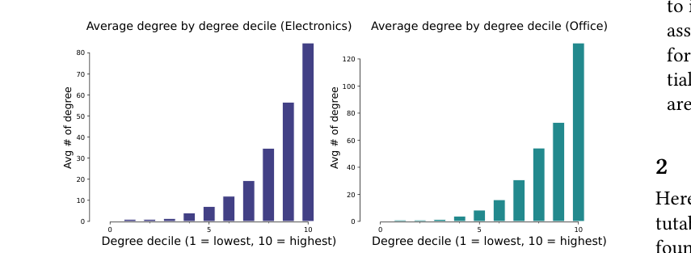
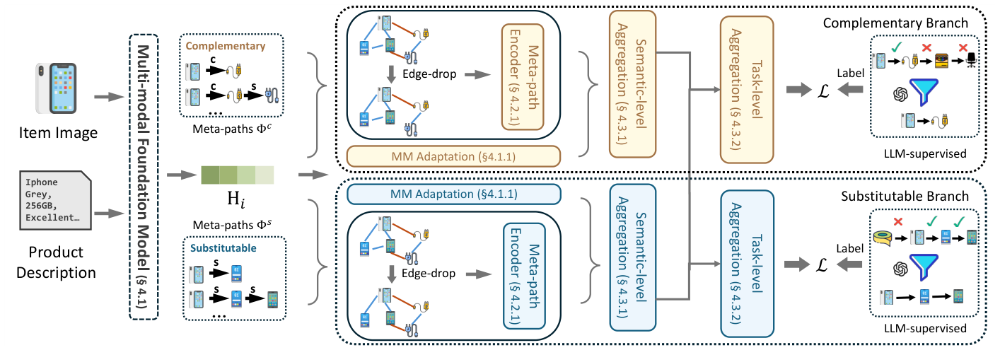
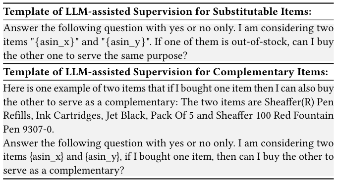
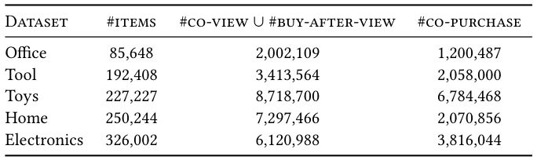
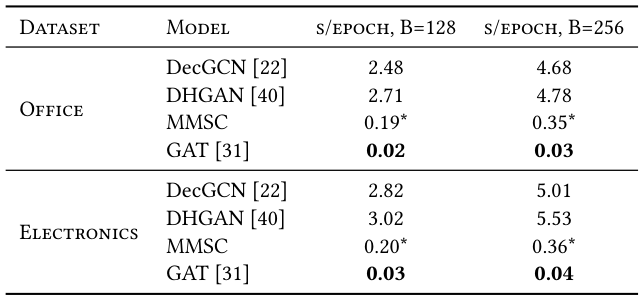

# Multi-modal Relational Item Representation Learning for Inferring Substitutable and Complementary Items (多模态关系感知物品表征学习：替代品与互补品推断)

- **会议/期刊**: SIGIR 2026
- **推荐链路定位**: 召回 (Retrieval) — 物品-物品关系召回（替代品/互补品候选生成），非用户-物品个性化推荐
- **研究方向**: 多模态推荐 / 自监督对比学习与交互去噪
- **论文原文**: [https://arxiv.org/abs/2507.22268v3](https://arxiv.org/abs/2507.22268v3)
- **开源代码**: [https://github.com/Junting98/MMSC_code](https://github.com/Junting98/MMSC_code)

## TL;DR (核心速览)

本文针对电商场景中"替代品/互补品"物品-物品关系推断任务，指出行为派生边（co-view/co-purchase）是**噪声弱监督**且**长尾稀疏**。提出 MMSC：冻结多模态基座（CLIP/BLIP-2）+ 轻量关系适配层编码物品元数据，元路径编码器 + 边丢弃对比去噪学习关系感知表征，再用 LLM 辅助过滤噪声正例，分层门控融合内容与行为信号。在五个真实数据集上，替代品推断相对提升 26.1%、互补品提升 39.2%，且对冷启动物品仍有效。

## Background & Motivation (背景与动机)

- **领域背景与主流范式**: 替代品（substitutable）与互补品（complementary）关系是电商"缺货替代推荐""搭配购买/后续购买建议"的核心原语。主流方法分两支：(1) **行为图方法**（DecGCN、DHGAN、HetaSAGE、TransGAT、EMRIGCN）——从 co-view/co-purchase 构建物品-物品图，用 GNN 学表征；(2) **内容方法**（Sceptre、LVA、A2CF、P-companion）——用评论文本/图像等元数据，天然适配冷启动。
- **现有方法局限 (Limitations of Prior Work)**:
  1. **噪声弱监督**：co-view/co-purchase 并不必然对应真实替代/互补关系（图 1 给出 ✓/× 示例），行为图方法把观测边当作可靠标签，引入标签噪声并污染评估。
  2. **长尾稀疏**：行为分布重尾（图 2 显示 Electronics/Office 两域物品度数按十分位分组后，头部组平均度数远高于尾部组），大量尾部/冷启动物品行为链接稀疏甚至缺失。
  3. **解耦图丢失高阶连通模式**：GCN/GAT 类方法把异构图拆成同构子图独立建模，丢弃了"经由何种关系类型相连"的高阶类型化路径信息（如 $v_1 \xrightarrow{s} v_2 \xrightarrow{c} v_3$ 的传递关系）。
- **核心挑战 (Key Challenge)**: 单纯堆叠 GNN 深度或直接拼接多模态特征都无法解决——行为信号本身有噪声且稀疏，而元数据虽稳健却无法单独恢复关系结构；二者必须**去噪地融合**。
- **核心洞察与切入点 (Key Insight)**: 行为数据提供有价值的隐式关联但噪声稀疏；元数据（标题、描述、图像）为尾部/冷启动物品提供稳健描述但缺乏关系结构。因此需要"**对行为派生链接去噪 + 整合多模态元数据**"，得到既关系感知又抗稀疏的表征。

## Problem Formulation & Method (问题定义与方法架构)

### 1. 符号定义与输入表征 (Notations & Input Representations)

- 物品集 $\mathcal{V}=\{v_1,\dots,v_N\}$，$N$ 为物品数；每个物品 $v_i$ 关联多模态元数据 $x_i$（文本 + 图像），集合记为 $\mathcal{X}=\{X_i\}_{i=1}^N$。
- 两类关系边：替代边 $\mathcal{E}_s$、互补边 $\mathcal{E}_c$，构成**类型化物品-物品图** $\mathcal{G}=(\mathcal{V},\mathcal{E}_s,\mathcal{E}_c)$（本文按无向处理）。
- 目标：学习打分函数 $F_s(v_j|v_i)$、$F_c(v_j|v_i)$，使真实替代/互补物品排在无关物品之前；等价于预测类型化边是否存在：$y^s_{ij}=\mathbb{I}\{(v_i,v_j)\in\mathcal{E}_s\}$，$y^c_{ij}=\mathbb{I}\{(v_i,v_j)\in\mathcal{E}_c\}$。
- **任务性质**：这是**物品-物品链接预测**，而非用户-物品个性化推荐。
- 多模态基座 $\mathcal{M}$（CLIP 或 BLIP-2）参数**冻结**，token 级输出 $\boldsymbol{H}_i=\mathcal{M}(X_i)\in\mathbb{R}^{m\times d}$，$m$ 为 token 长度，$d$ 为隐维度。

### 2. 整体流水线 (Overall Architecture)

数据流：物品图像+描述 → 冻结多模态基座 → 关系适配层（多头注意力 + 池化，按替代/互补解耦）→ 语义级门控聚合；同时行为图 → 元路径编码器（节点级 + 路径级注意力，边丢弃扰动生成对比视图）→ 语义级门控聚合 → 任务级门控跨任务融合 → 关系打分。训练侧叠加 LLM 辅助监督过滤正例与多任务损失。

### 3. 核心模块设计与数学原理 (Key Designs & Formulations)

**(1) 多模态关系适配（§4.1）**：冻结基座输出 $\boldsymbol{H}_i$ 仅含通用语义，未针对类型化关系优化。故加轻量多头注意力 + 均值池化：

$$\tilde{\boldsymbol{H}}_i=\text{MHAttn}(\boldsymbol{H}_i),\quad \boldsymbol{q}_i=\text{Pool}(\tilde{\boldsymbol{H}}_i)\in\mathbb{R}^d$$

其中 $\text{MHAttn}$ 为 $L$ 头、每头维度 $d_h=d/L$ 的标准缩放点积注意力。为不让单一嵌入同时解释两种关系（语义相似 vs. 功能兼容），用**独立适配层解耦**：$\boldsymbol{q}^s_i=\text{Pool}(\text{MHAttn}_s(\boldsymbol{H}_i))$，$\boldsymbol{q}^c_i=\text{Pool}(\text{MHAttn}_c(\boldsymbol{H}_i))$。

**(2) 元路径行为编码 + 自监督去噪（§4.2）**：将行为信号建模为类型化图，沿元路径（如 $v_1\xrightarrow{s}v_2\xrightarrow{c}v_3\xrightarrow{s}v_4$）捕获超越直接边的高阶模式。为替代/互补分别定义元路径集 $\Phi_s,\Phi_c$（各 $K_r$ 条）。
- **节点级注意力**：$\alpha^\phi_{ij}=\frac{\exp(\text{LeakyReLU}(\boldsymbol{W}_\phi^\top[\boldsymbol{h}_i\|\boldsymbol{h}_j]))}{\sum_{v_t\in\mathcal{N}^\phi_i}\exp(\text{LeakyReLU}(\boldsymbol{W}_\phi^\top[\boldsymbol{h}_i\|\boldsymbol{h}_t]))}$，其中节点初始特征 $\boldsymbol{h}_i=\text{MeanPool}(\boldsymbol{H}_i)$ **注入多模态语义**；多头顶拼接得 $\boldsymbol{z}^\phi_i$。
- **路径级注意力**：$w^\phi_i=\boldsymbol{s}^\top\tanh(\boldsymbol{W}_b\boldsymbol{z}^\phi_i+\boldsymbol{b})$，$\beta^\phi_i=\text{softmax}$，$\boldsymbol{p}^r_i=\sum_{\phi\in\Phi_r}\beta^\phi_i\boldsymbol{z}^\phi_i$。
- **对比去噪**：对行为边做 edge dropout 得扰动图 $\mathcal{G}'$，同编码器得 $\boldsymbol{p}'_i$；同物品两视图为正对、批内其他物品为负，用 InfoNCE 强制结构扰动下的表征一致性，从而对虚假边鲁棒。

**(3) 分层聚合（§4.3）**：语义级门控按维度自适应平衡内容与行为：$\boldsymbol{a}^s_i=\boldsymbol{g}\odot\boldsymbol{p}^s_i+(1-\boldsymbol{g})\odot\boldsymbol{q}^s_i$，$\boldsymbol{g}=\sigma(\boldsymbol{W}_{g1}\boldsymbol{p}^s_i+\boldsymbol{W}_{g2}\boldsymbol{q}^s_i+\boldsymbol{b}_g)$；任务级门控再做跨任务受控共享：$\boldsymbol{e}^s_i=\gamma^s_i\odot\boldsymbol{a}^s_i+(1-\gamma^s_i)\odot\boldsymbol{a}^c_i$。

**(4) LLM 辅助监督（§4.4.1）**：用 LLM 对行为派生正例做 yes/no 校验（表 1 给出替代/互补两套 prompt，替换 `{asin_x}`/`{asin_y}` 为物品元数据），过滤虚假正例，缓解行为监督噪声。

### 4. 训练目标、负采样与推理复杂度 (Optimization, Negative Sampling & Complexity)

- **损失函数**：多任务联合训练，总损失由关系预测损失（替代 + 互补，基于 LLM 精炼后的监督标签）与自监督对比损失组成：

$$\mathcal{L}_{\text{self}}=-\frac{1}{|\mathcal{V}|}\sum_{v_i\in\mathcal{V}}\log\frac{\exp(s(\boldsymbol{p}^s_i,\boldsymbol{p}^{s'}_i)/\tau)}{\sum_{j\neq i}\exp(s(\boldsymbol{p}^s_i,\boldsymbol{p}^s_j)/\tau)}+\text{(互补项)}$$

其中 $s$ 为余弦相似度，$\tau$ 为温度系数（原文正文未给出具体取值，**原文未报告**）。
- **训练负采样策略**：对比学习采用 **in-batch 负采样**（同批其他物品为负）；关系预测为链接预测式监督，正例来自 LLM 精炼后的行为边。
- **时间与空间复杂度**：多模态基座**冻结**，仅训练轻量适配层与元路径编码器，训练开销可控。表 3 报告了不同 batch size $B$ 下各数据集的**每 epoch 训练时间（秒）**，batch 越大训练时间越长；具体数值需参见原文表 3。在线推理为物品表征 + 相似度打分，可支持 ANN 检索；具体 ms/request 延迟**原文未报告**。

## Experimental Setup & Evaluation Protocol (实验设置与评估协议)

- **数据集统计与预处理**: 原文使用**五个真实世界数据集**（表 2 给出统计量），涉及 Electronics、Office 等亚马逊品类；具体 #Users/#Items/#Interactions 数值需参见原文表 2（正文抽取文本未完整给出，**以原文表 2 为准**）。

| 数据集 (Dataset) | 用户数 (#Users) | 物品数 (#Items) | 交互数 (#Interactions) | 稀疏度/密度 (Sparsity) | 模态/辅助特征说明 |
| :--- | :---: | :---: | :---: | :---: | :--- |
| 五个真实数据集（见表 2） | 原文表 2 | 原文表 2 | 原文表 2 | 原文表 2 | 图像 + 文本（标题/描述） |

- **数据划分方式 (Splitting Strategy)**: 原文抽取文本未明确说明划分细节（**原文未在可见正文中报告**），需以原文实验章节为准；任务为物品-物品链接预测，需关注是否存在行为边泄漏到测试集的风险。
- **排名评测协议 (Ranking Protocol)**: 任务为类型化链接预测/关系排序，评测真实替代/互补物品是否排在无关物品之前；具体是 Full-Ranking 还是 Sampled Ranking、正负例比例，**原文可见正文未明确报告**。
- **评价指标与显著性检验**: 原文以替代品/互补品推断的相对提升（26.1% / 39.2%）作为主结论；具体指标（如 Recall@K / NDCG@K / MRR / AUC）与是否做配对显著性检验，**原文可见正文未完整报告**。Embedding 维度 $d$ 与基座（CLIP/BLIP-2）原始维度对齐情况需参见原文。

## Key Experimental Results (核心实验结果)

### 1. 主实验对比 (Main Results)

原文主结论：在五个真实数据集上，MMSC 相对现有基线**替代品推断提升 26.1%、互补品推断提升 39.2%**。逐数据集、逐指标的精确数值需参见原文主实验表（抽取正文未给出完整表格，**以原文为准**）。

| 数据集 | 指标 | 传统/协同过滤基线 | 序列/图/多模态最强基线 | 本文方法 (Ours) | 相对提升 (Improv.) |
| :--- | :--- | :---: | :---: | :---: | :---: |
| 五个真实数据集（平均） | 替代品推断 | 原文表 | 原文表 | **MMSC** | +26.1% |
| 五个真实数据集（平均） | 互补品推断 | 原文表 | 原文表 | **MMSC** | +39.2% |

### 2. 消融实验与控制变量分析 (Ablation Study)

原文通过消融验证各组件有效性（多模态表征模块、元路径行为编码、对比去噪、LLM 辅助监督、分层门控聚合）。具体各模块移除后的下降幅度需参见原文消融表（**抽取正文未给出数值**）。从方法设计看，**对比去噪 + LLM 辅助监督**针对核心噪声问题，预期贡献最大；消融是否严格控制参数量/图度数匹配，原文可见正文未明确说明。

### 3. 稀疏度/冷启动分桶与超参敏感度 (Sparsity Buckets & Hyperparameters)

- **冷启动物品表现**: 原文明确声称 MMSC **对冷启动物品仍有效**（元数据分支为冷启动物品提供稳健表征），并做了实证验证；具体冷启动分桶数值需参见原文。
- **长尾/度数分桶**: 图 2 展示物品度数按十分位分组的重尾分布，为长尾稀疏挑战提供实证依据。
- **关键超参数敏感度**: 温度系数 $\tau$、边丢弃比例、元路径数量 $K_r$、门控维度等的影响，**原文可见正文未完整报告**。
- **线上 A/B 测试结果**: **原文仅包含离线实验**，未报告线上 A/B 结果。

## Highlights, Limitations & Critiques (亮点、局限与审稿级批判)

- **核心亮点与可迁移性**:
  1. **"冻结基座 + 轻量关系适配"** 范式成本低、可迁移到其他物品关系任务（如捆绑推荐、跨品类关联）。
  2. **元路径编码保留高阶类型化连通模式**，优于解耦同构子图的 GNN 基线，思路可迁移至异构图推荐。
  3. **LLM 辅助监督过滤噪声正例** 为弱监督推荐提供了一种低成本标签精炼手段。
  4. **分层门控（语义级 + 任务级）** 兼顾内容稳健性与行为关系性，对冷启动/长尾友好。
- **局限性与审稿视角批判 (Critical Limitations)**:
  1. **评估协议披露不足**：抽取正文未明确数据划分、Full-Ranking vs. Sampled Ranking、具体指标与显著性检验，削弱结论可复现性与可比性。
  2. **LLM 辅助监督的成本与偏差**：依赖 LLM 对正例做 yes/no 校验，引入额外推理开销与 LLM 自身偏差，且 prompt 设计（表 1）对结果敏感。
  3. **任务定位非个性化推荐**：本文是物品-物品关系推断，与用户-物品推荐链路存在 gap，工业落地需额外对接召回/排序系统。
  4. **超参与效率细节缺失**：$\tau$、边丢弃比例、在线延迟等关键工程指标未充分报告。

## Rating (四维评分)

- **方法创新性 (Novelty)**: ⭐⭐⭐⭐
- **评估协议与实验扎实度 (Protocol & Experiments)**: ⭐⭐⭐
- **写作与数学规范度 (Clarity & Rigor)**: ⭐⭐⭐⭐
- **工业落地与复现价值 (Industrial & Practical Value)**: ⭐⭐⭐⭐

## 论文图表

<figure class="paper-figure" markdown="span">
  <figcaption>图 1</figcaption>
</figure>

<figure class="paper-figure" markdown="span">
  <figcaption>图 2</figcaption>
</figure>

<figure class="paper-figure" markdown="span">
  <figcaption>图 3</figcaption>
</figure>

<figure class="paper-figure" markdown="span">
  <figcaption>表 1</figcaption>
</figure>

<figure class="paper-figure" markdown="span">
  <figcaption>表 2</figcaption>
</figure>

<figure class="paper-figure" markdown="span">
  <figcaption>表 3</figcaption>
</figure>

