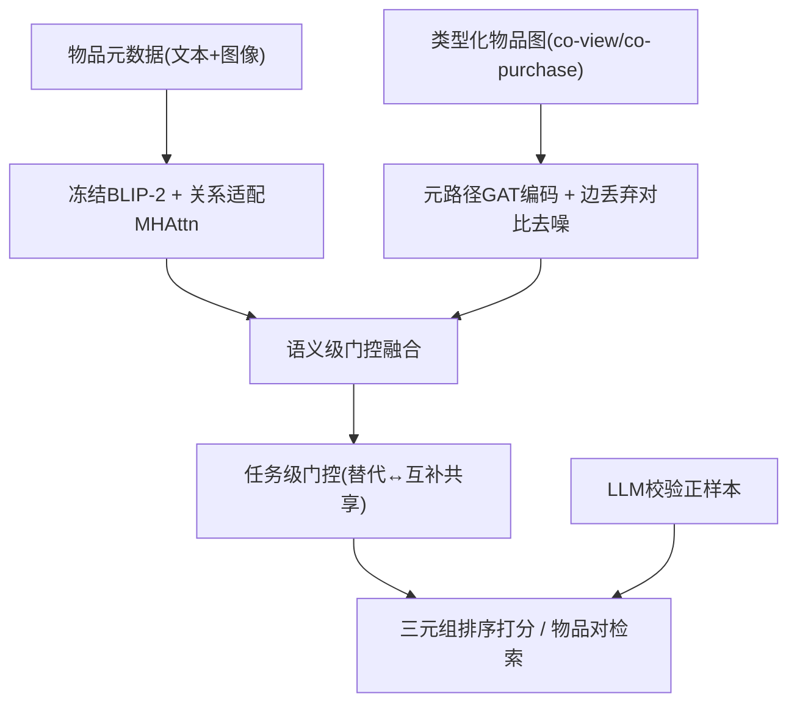

# Multi-modal Relational Item Representation Learning for Inferring Substitutable and Complementary Items (多模态关系型物品表征学习：可替代与互补物品推断)

- **会议/期刊**: SIGIR 2026
- **作者与机构**: Junting Wang, Hari Sundaram (UIUC)；Chenghuan Guo, Yang Jiao, Yanhui Guo, Yan Gao (Amazon)
- **推荐链路定位**: 召回（物品-物品关系召回 / 替代品与捆绑推荐）
- **研究方向**: 多模态推荐 / 自监督对比学习与交互去噪
- **论文原文**: [https://arxiv.org/abs/2507.22268v3](https://arxiv.org/abs/2507.22268v3)
- **开源代码**: [https://github.com/Junting98/MMSC_code](https://github.com/Junting98/MMSC_code)

## TL;DR (1分钟核心速览)

本文研究电商物品-物品关系推断（可替代 vs. 互补），指出行为派生边（co-view/co-purchase）是**噪声弱监督**且呈**长尾稀疏**，而纯内容方法又丢失关系结构。MMSC 用冻结多模态基础模型（BLIP-2）加轻量关系适配层编码元数据，用元路径 GAT 编码行为图，并以边丢弃对比学习去噪、LLM 校验清洗正样本、双层门控聚合两路表征。在 5 个 Amazon 数据集、LLM 精炼测试集 + 1000 负采样排序协议下，M@10 平均提升 **26.1%（可替代）/ 39.2%（互补）**，冷启动场景亦领先。

## Background & Motivation (背景与核心矛盾)

- **主流范式**: 行为图方法（DecGCN、DHGAN、HetaSAGE）在 co-view/co-purchase 构成的物品图上跑 GNN；内容方法（Sceptre、LVA、P-companion）仅用评论文本/图像编码。
- **前人局限**: ① 行为边并非真实关系（图 1 显示 co-purchase 常混入无关甚至可替代物品），作者实测 co-view 标签仅 78.0% 准确、co-purchase 仅 24.5%；② 行为度呈重尾分布（图 2），尾部物品几乎无连接，GNN 无法泛化；③ 现有方法把两类关系图**解耦**建模，丢失跨类型高阶连通模式（如 $v_1 \xrightarrow{s} v_2 \xrightarrow{c} v_3$ 的传递线索）。
- **核心洞察 (Key Insight)**: 元数据对所有物品（含冷启动）稳定可得，但单独不足以恢复关系结构；行为边含关系信号但需去噪。二者互补，且需在**类型化异质图**上保留高阶路径。
- **本文切入点**: 以「多模态内容 + 去噪行为图」双路表征 + 层级门控融合，并用 LLM 离线校验弱标签，兼顾噪声鲁棒与长尾覆盖。

## Method (核心方法设计)

### 1. 整体框架 (Overall Architecture)

输入为物品多模态元数据（标题/描述 + 商品图）与类型化物品图 $\mathcal{G}=(\mathcal{V},\mathcal{E}_s,\mathcal{E}_c)$。左路：冻结 BLIP-2 输出 token 序列$\boldsymbol{H}_i$，经关系适配 MHAttn + 均值池化得$\boldsymbol{q}_i^s,\boldsymbol{q}_i^c$；右路：在元路径邻域上做节点级/路径级注意力得$\boldsymbol{p}_i^s,\boldsymbol{p}_i^c$，并对边丢弃扰动视图施加 InfoNCE 去噪。两路先做语义级门控融合，再做任务级门控跨关系共享，最终以 LLM 校验正样本的三元组损失 + 自监督损失多任务联合训练；推理时仅用物品表征做余弦打分，LLM 不参与在线服务。

### 2. 关键设计拆解 (Key Designs)

1. **元路径行为编码（保留跨类型高阶连通）**：痛点在于解耦同质图会切断 $s$-$c$交替路径。本文在异质图上定义关系专属元路径集$\Phi_s,\Phi_c$（最长 3 跳），先做节点级多头注意力$\alpha_{ij}^{\phi}=\mathrm{softmax}\big(\mathrm{LeakyReLU}(\boldsymbol{W}_\phi^\top[\boldsymbol{h}_i\|\boldsymbol{h}_j])\big)$，再做路径级注意力$\beta_i^\phi=\mathrm{softmax}\big(\boldsymbol{s}^\top\tanh(\boldsymbol{W}_b\boldsymbol{z}_i^\phi+\boldsymbol{b})\big)$加权得$\boldsymbol{p}_i^r=\sum_{\phi\in\Phi_r}\beta_i^\phi\boldsymbol{z}_i^\phi$。直觉：3 跳路径把尾部物品接入关系证据链（表 8 显示 3 跳将尾部覆盖率从 1.7% 提至 8.8%），代价是正例率下降，故必须配去噪。

2. **自监督结构去噪**：行为边噪声使表征对虚假边敏感。对图做边丢弃得扰动视图 $\mathcal{G}'$，同一物品两视图为正对、批内其他物品为负对，最小化$\mathcal{L}_{\text{self}}=-\frac{1}{|\mathcal{V}|}\sum_{v_i}\log\frac{\exp(s(\boldsymbol{p}_i^r,\boldsymbol{p}_i^{r\prime})/\tau)}{\sum_{j\neq i}\exp(s(\boldsymbol{p}_i^r,\boldsymbol{p}_j^r)/\tau)}$（$r\in\{s,c\}$）。直觉：强制表征对「随机删边」不变，等价于把虚假边视为可丢弃扰动，从而学到关系本质而非边本身。

3. **LLM 校验监督 + 层级门控 + 训练目标**：用 Flan-T5-XXL 以模板（表 1）判定采样物品对是否为真替代/互补，构成 $\mathcal{E}_{\text{LLM}}$（每数据集固定 500K），仅作训练监督。语义级门控$\boldsymbol{a}_i^s=\boldsymbol{g}\odot\boldsymbol{p}_i^s+(1-\boldsymbol{g})\odot\boldsymbol{q}_i^s$，$\boldsymbol{g}=\sigma(\boldsymbol{W}_{g1}\boldsymbol{p}_i^s+\boldsymbol{W}_{g2}\boldsymbol{q}_i^s+\boldsymbol{b}_g)$；任务级门控$\boldsymbol{e}_i^s=\gamma_i^s\odot\boldsymbol{a}_i^s+(1-\gamma_i^s)\odot\boldsymbol{a}_i^c$实现受控跨关系共享。总损失$\mathcal{L}=\mathcal{L}_{\text{triplet}}+\lambda\mathcal{L}_{\text{self}}$，三元组损失以$\mathcal{E}_{\text{LLM}}$为正、行为邻接但未通过校验的物品为负（每正样本采 5 负），margin 排序；$\lambda$ 最优 0.005。推理零 LLM 开销，每 epoch 训练 0.19–0.20s（B=128），远快于 DecGCN 的 2.48s。

## Experimental Setup & Evaluation Protocol (实验设置与评估协议)

- **数据集与预处理**: Amazon Review 五类目，过滤缺失文本或图像的物品；co-view ∪ buy-after-view 作可替代弱信号，co-purchase 作互补弱信号。

| 数据集 | #Items | #co-view∪buy-after-view | #co-purchase | 场景说明 |
| :--- | :---: | :---: | :---: | :--- |
| Office | 85,648 | 2,002,109 | 1,200,487 | 办公用品 |
| Tools | 192,408 | 3,413,564 | 2,058,000 | 工具/家装 |
| Toys | 227,227 | 8,718,700 | 6,784,468 | 玩具游戏 |
| Home | 250,244 | 7,297,466 | 2,070,856 | 家居厨房 |
| Electronics | 326,002 | 6,120,988 | 3,816,044 | 电子产品（最大异质） |

- **数据划分与防穿越 (Splitting Strategy)**: 对每个在某关系下有邻居的物品，随机抽 1 条关联边作测试候选，其余入训练图，测试边从训练图移除防泄漏；测试候选再经 LLM 校验得高精度集 $Y_{\text{sub}},Y_{\text{com}}$。
- **排名评测协议 (Ranking Protocol)**: **Sampled Ranking**——每条测试边均匀采 1000 个同关系下不与源物品相连的负样本，报告 H@10 / MRR@10 / NDCG@10；训练每正样本采 5 负。
- **对比基线与超参设置**: 三类基线——GNN（GATNE-I、GAT、HAN）、关系模型（DecGCN、DHGAN）、适配多模态基础模型（CLIP、BLIP-2 + 关系 MLP）；BLIP-2 冻结，仅训适配层；Adam，lr $\in\{10^{-4},10^{-3},10^{-2}\}$，dropout 0.2，$\lambda\in\{10^{-3},5\times10^{-3},10^{-2}\}$。

## Key Experimental Results (实验关键数据)

### 1. 主实验对比 (Main Results)

可替代推断（M@10 / N@10，节选；完整见原文表 4）：

| 数据集 | DHGAN | CLIP | BLIP-2 | MMSC | Improv.(M@10) |
| :--- | :---: | :---: | :---: | :---: | :---: |
| Office | 0.573 | 0.580* | 0.519 | **0.782** | +36.5% |
| Tools | 0.652 | 0.644 | 0.658* | **0.841** | +29.0% |
| Toys | 0.658* | 0.527 | 0.587 | **0.827** | +25.7% |
| Home | 0.727* | 0.685 | 0.692 | **0.830** | +14.2% |
| Electronics | 0.652* | 0.483 | 0.547 | **0.816** | +25.2% |

互补推断（M@10）：

| 数据集 | GAT | DHGAN | CLIP | BLIP-2 | MMSC | Improv.(M@10) |
| :--- | :---: | :---: | :---: | :---: | :---: | :---: |
| Office | 0.567* | 0.540 | 0.553 | 0.482 | **0.789** | +39.2% |
| Tools | 0.669* | 0.585 | 0.618 | 0.621 | **0.885** | +32.3% |
| Toys | 0.609* | 0.529 | 0.493 | 0.482 | **0.863** | +62.8% |
| Home | 0.713* | 0.681 | 0.644 | 0.628 | **0.872** | +22.3% |
| Electronics | 0.589* | 0.546 | 0.405 | 0.428 | **0.821** | +39.4% |

冷启动（20% 物品删边，M@10）：Office 可替代 0.702 vs. BLIP-2-SA 0.532（+32.0%），互补 0.505 vs. 0.435（+16.1%）；Electronics 可替代 +41.0%、互补 +37.7%。

### 2. 消融实验 (Ablation Study)

| 变体 | Office Sub. M@10 | Office Comp. M@10 | Elec. Sub. M@10 | Elec. Comp. M@10 |
| :--- | :---: | :---: | :---: | :---: |
| MMSC 完整 | **0.782** | **0.789** | **0.816** | **0.821** |
| w/o SSL | 0.749 | 0.757 | 0.797 | 0.774 |
| w/o TA（任务级门控） | 0.776 | 0.775 | 0.798 | 0.787 |
| w/o SSL & TA | 0.757 | 0.649 | 0.789 | 0.749 |
| w/o MM（多模态） | 0.603 | 0.594 | 0.772 | 0.787 |
| w/o BM（行为编码） | 0.560 | 0.482 | 0.622 | 0.487 |
| w/o $\mathcal{E}_{\text{LLM}}$ | 0.727 | 0.718 | 0.812* | 0.789 |
| w/o 3rd-hop | 0.750 | 0.730 | 0.785 | 0.785 |

### 3. 关键实验发现 (Key Findings)

1. **行为编码是主引擎，多模态是长尾补丁**：去掉 BM 使 Office 互补 M@10 从 0.789 崩至 0.482（−38.9%），去掉 MM 降至 0.594；但冷启动下 MMSC 仍大幅领先纯内容 BLIP-2-SA（+32.0%/+16.1%），说明内容路在无行为时接管、行为路在有行为时主导。
2. **去噪与 LLM 校验互补而非冗余**：单独去 SSL 使互补 M@10 掉 0.032（Office），单独去 $\mathcal{E}_{\text{LLM}}$ 掉 0.071；二者同去（w/o SSL & TA 的互补 0.649）跌幅远超单项之和，且注入 100% 随机噪声时 MMSC 的 MRR 曲线最平（图 6/7），验证双重去噪对虚假边的叠加鲁棒性。
3. **度分桶呈非对称收益**：可替代推断在低度组（Group 1–3）增益最大（内容补足稀疏行为），互补推断在高度组（Group 8–10）增益最大（去噪压制 co-purchase 异质性噪声），与表 8 的「深路径提覆盖、降精度」权衡一致。

## Highlights & Limitations (亮点、对比与审稿批判)

- **与代表作对比 (vs. Prior Work)**: 相比 DHGAN 仅用双曲空间行为图、DecGCN 解耦关系图后 co-attention 融合，MMSC 首次在**类型化异质图**上以元路径保留 $s/c$ 交替高阶连通，并显式把行为边当噪声源处理；相比 CLIP/BLIP-2 直接相似度，本文证明基础模型须加关系适配层与行为结构才能胜任 typed 关系推断（CLIP 在 Electronics 互补仅 0.405）。
- **可迁移亮点**: ① 「LLM 离线校验弱标签 + 在线轻量表征」范式可迁移到任意行为弱监督召回任务；② 边丢弃对比 + 元路径深度分层的 precision-coverage 权衡分析，为图召回的特征工程提供可复用诊断方法。
- **审稿级局限批判**: ① 关系假设静态，未建模季节性/演化互补（如节日捆绑），且打分仅靠共享物品表征、忽略边级上下文（query 意图、用户分群）；② 评测依赖 LLM 构造的测试集，LLM 自身对互补关系准确率仅 57.9%，测试集精度天花板可能压低绝对指标并影响跨方法可比性；③ $\mathcal{E}_{\text{LLM}}$ 固定 500K，在 Electronics 这类大目录上增益明显弱于 Office（0.812 vs. 0.727 的差距反转），规模自适应策略缺失。

## Rating (四维评分)

- **方法创新性 (Novelty)**: ⭐⭐⭐⭐ （元路径保留跨类型高阶连通 + 双路门控融合 + 双重去噪的组合较新颖，但各组件均为已有技术的针对性拼装，缺理论分析）
- **评估协议与实验扎实度 (Protocol & Experiments)**: ⭐⭐⭐⭐ （五数据集、三类基线、冷启动/度分桶/噪声注入/超参敏感性齐全，但 1000 负采样排序偏乐观，测试集经 LLM 过滤引入评估偏差）
- **写作与数学规范度 (Clarity & Rigor)**: ⭐⭐⭐⭐ （公式与符号定义清晰、元路径与门控推导完整，训练时间与 LLM 预处理成本均有量化，但部分符号如 $\boldsymbol{z}_i^{\phi\prime}$与$\boldsymbol{z}_i^\phi$ 关系表述略含糊）
- **工业落地与复现价值 (Industrial & Practical Value)**: ⭐⭐⭐⭐ （代码开源、推理零 LLM 开销、每 epoch 0.2s 远快于 DHGAN，LLM 预处理为一次性离线成本；但依赖 BLIP-2 与 Flan-T5-XXL 的部署门槛与静态关系假设限制实时演化场景）

