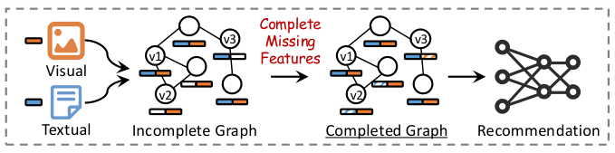
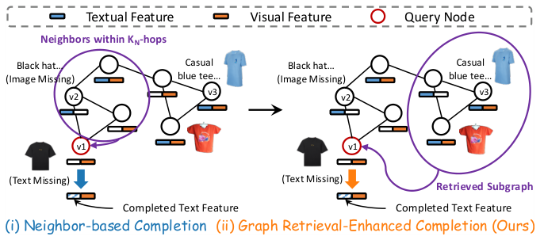
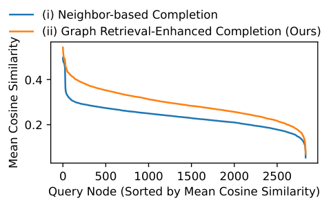
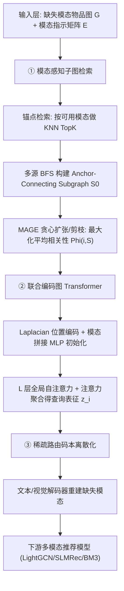
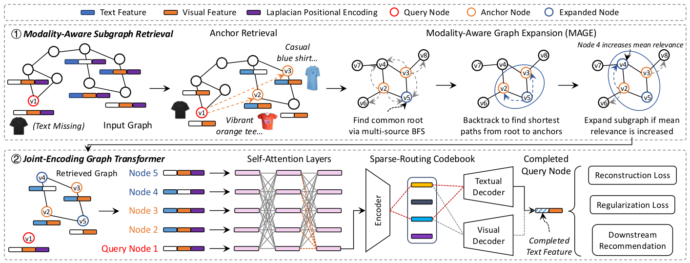
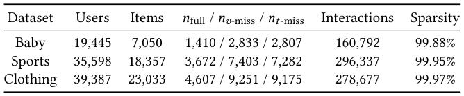
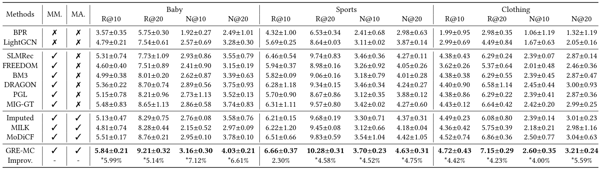

# Robust Multimodal Recommendation via Graph Retrieval-Enhanced Modality Completion (基于图检索增强模态补全的鲁棒多模态推荐)

- **会议/期刊**: SIGIR 2026 (第 49 届国际 ACM SIGIR 会议，Melbourne, VIC, Australia)
- **推荐链路定位**: 召回/表征学习前置的**数据预处理层（模态补全）**，补全后的完整模态图直接喂给下游多模态推荐模型（如 LightGCN / SLMRec / BM3 等）
- **研究方向**: 多模态推荐 (主) / 图神经网络与知识图谱推荐 (次)
- **论文原文**: [https://arxiv.org/abs/2605.00670v1](https://arxiv.org/abs/2605.00670v1)
- **开源代码**: 暂未开源（原文与预提取均未发现代码链接）

## TL;DR (核心速览)

针对真实多模态推荐中物品视觉/文本模态缺失导致下游模型性能骤降的痛点，本文提出 GRE-MC：先用**模态感知子图检索**（锚点 KNN 检索 + 多源 BFS 连通 + 相关性贪心扩张 MAGE）从全图捞取语义相关但可能远距离的子图，再用**图 Transformer + Laplacian 位置编码**对查询节点与子图做全局注意力联合编码，最后用**可学习稀疏路由码本**离散化潜表征以增强鲁棒性。在 40% 缺失率的多模态推荐基准上，全库排序指标一致超越 SOTA，相对次优基线取得显著提升（$p<0.05$）。

## Background & Motivation (背景与动机)

- **领域背景与主流范式**: 多模态推荐（MMRec）通过融合视觉、文本等辅助模态增强用户/物品表征，主流做法是在 user-item 交互图上叠加多模态特征，用 GNN（LightGCN 类）或对比学习（SLMRec、BM3）做表征对齐。但这些模型**默认所有模态完整可用**。
- **现有方法局限 (Limitations of Prior Work)**:
  1. **Self-based 补全**（MoDiCF、LRMM、SDR-GNN、MMImputeDiff）：仅利用实例内部跨模态相关性（如用文本推图像），当实例内模态相关性弱或观测模态信息量不足时失效，且完全忽略图结构信号。
  2. **Neighbor-based 补全**（Imputed）：依赖 $K_N$ 跳邻居聚合，但邻居可能语义不相关或本身也缺失模态，导致**误差传播**（图 2(i) 中查询衬衫的邻居是语义无关的帽子）。
  3. **Model-centric 鲁棒建模**（模态对齐、知识蒸馏）：需改动每个下游模型架构，大规模部署成本高。
- **核心挑战 (Key Challenge)**: 为什么简单邻居聚合不够？作者用 Pilot Study（图 3）量化证明：在缺失模态场景下，**语义检索得到的子图与查询节点缺失模态的平均余弦相似度显著高于 $K_N$ 跳邻域**——即"远距离但语义相关"的上下文才是补全的关键信号，而这类信号无法通过局部消息传递捕获。
- **核心洞察与切入点 (Key Insight)**: 将模态补全重构为**图检索问题**——从全图检索语义相关子图（而非局部邻域），再用支持非连通输入的图 Transformer 做联合编码，从而同时利用全局语义与结构信号。

<figure class="paper-figure" markdown="span">
  <figcaption>图 1</figcaption>
</figure>
<figure class="paper-figure" markdown="span">
  <figcaption>图 2</figcaption>
</figure>
<figure class="paper-figure" markdown="span">
  <figcaption>图 3</figcaption>
</figure>

## Problem Formulation & Method (问题定义与方法架构)

### 1. 符号定义与输入表征 (Notations & Input Representations)

- 用户集 $\mathcal{V}_U$、物品集 $\mathcal{V}_I$（$|\mathcal{V}_I|=N_I$），交互图 $\mathcal{G}=(\mathcal{V},\mathcal{E})$，邻接矩阵 $\mathbf{A}\in\{0,1\}^{|\mathcal{V}|\times|\mathcal{V}|}$。
- 由 user-item 图诱导的**物品图** $\mathcal{G}_I$：两物品共享至少一个用户即连边（式 1）。作者聚焦物品补全（物品信息更公开，用户信息更隐私）。
- 模态集 $\mathcal{M}$（视觉、文本），物品 $i$ 的模态特征 $\{\mathbf{x}_i^{(m)}\}_{m\in\mathcal{M}}$。
- **模态指示矩阵** $\mathbf{E}\in\{0,1\}^{N_I\times|\mathcal{M}|}$，$\mathbf{E}_{i,m}=1$ 表示模态 $m$ 可观测。
- 补全目标：学习条件补全函数 $\mathcal{C}:(\mathcal{G},\{\mathbf{x}_i^{(m)}:\mathbf{E}_{i,m}=1\},\mathbf{E}_i)\to\{\hat{\mathbf{x}}_i^{(m)}:\mathbf{E}_{i,m}=0\}$（式 2）。

### 2. 整体流水线 (Overall Architecture)

数据流：输入缺失模态物品图 → ① 模态感知子图检索（锚点检索 + MAGE 扩张）→ ② 图 Transformer 联合编码（Laplacian PE + 全局注意力）→ ③ 稀疏路由码本离散化 → 输出补全特征 → 拼接完整模态图送入下游推荐模型。

<figure class="paper-figure" markdown="span">
  <figcaption>图 4</figcaption>
</figure>

### 3. 核心模块设计与数学原理 (Key Designs & Formulations)

**模块一：模态感知子图检索（Modality-Aware Subgraph Retrieval）**

- **锚点检索**：对查询节点 $i$ 的每个可用模态 $m$（$\mathbf{E}_{i,m}=1$），在全体具备该模态的节点中做最近邻检索：
$$\mathcal{A}_i^{(m)}=\mathrm{TopK}\left(\mathbf{x}_i^{(m)},\{\mathbf{x}_j^{(m)}\mid \mathbf{E}_{j,m}=1\}\right) \tag{3}$$
物理直觉：用**内容语义**而非拓扑邻近性筛选候选，保证补全信号 content-aware。
- **模态感知图扩张（MAGE）**：锚点可能散落全图，先用多源 BFS 求最短路径构建 Anchor-Connecting Subgraph $\mathcal{S}_0=\mathrm{ACS}(\mathcal{G},\mathcal{A}_i^{(m)})$（式 4，借鉴 lowest common ancestor 思想）。随后定义成对相关性（仅在双方共同观测模态上聚合余弦相似度）：
$$r(i,v)=\frac{\sum_{m\in\mathcal{M}}\mathbf{E}_{i,m}\mathbf{E}_{v,m}\cos(\mathbf{x}_i^{(m)},\mathbf{x}_v^{(m)})}{\sum_{m\in\mathcal{M}}\mathbf{E}_{i,m}\mathbf{E}_{v,m}},\quad \text{若分母}>0;\ \text{否则}-\infty \tag{5}$$
子图平均相关性 $\Phi(i,\mathcal{S})=\frac{1}{|\mathcal{S}|}\sum_{v\in\mathcal{S}}r(i,v)$。在"保持连通且包含全部锚点"约束下迭代执行两种局部操作：(i) 若加入边界邻居 $c$ 使 $\Phi$ 上升则加入；(ii) 若删除非桥接节点 $u\in\mathcal{S}\setminus\mathcal{A}_i^{(m)}$ 使 $\Phi$ 上升则删除；每步取更优者，直至无法提升，最多 $T$ 轮。物理直觉：**低相似度非桥接节点被剪枝、高相关邻居被贪心吸收**，实现语义与连通性的耦合。

**模块二：联合编码图 Transformer（Joint-Encoding Graph Transformer）**

- 归一化 Laplacian $\mathbf{L}=\mathbf{I}-\mathbf{D}^{-1/2}\mathbf{A}\mathbf{D}^{-1/2}$，取底部 $k$ 个非平凡特征向量构成节点 $j$ 的位置编码 $\mathbf{p}_j=[u_{j1},\dots,u_{jk}]$。
- 初始化（缺失模态以零向量占位）：
$$\mathbf{h}_v^{(0)}=\mathrm{MLP}\left(\oplus_{m\in\mathcal{M}}\tilde{\mathbf{x}}_v^{(m)};\mathbf{p}_v\right),\quad v\in\mathcal{S}\cup\{i\} \tag{7}$$
- $L$ 层 Transformer 全局注意力建模长程依赖（式 8），查询表征由注意力分数 $\alpha_{ij}$ 加权聚合：
$$\mathbf{z}_i=\sum_{j=1}^{n}\alpha_{ij}\mathbf{h}_j^{(L)},\quad \alpha_{ij}=\frac{\exp(\mathbf{q}_i\cdot\mathbf{k}_j/\sqrt{d_k})}{\sum_{j'=1}^{n}\exp(\mathbf{q}_i\cdot\mathbf{k}_{j'}/\sqrt{d_k})} \tag{9}$$
其中 $n=|\mathcal{S}|+1$。关键设计动机：检索子图与查询节点**可能不连通**，传统 message passing 失效，全局注意力 + 全局位置编码使跨连通分量信息交换成为可能。

**模块三：稀疏路由码本（Sparse-Routing Codebook）**

将潜表征离散化为紧凑基向量集合，正则化表征空间、提升对不完整模态的鲁棒性（原文以"learnable sparse-routing codebook"描述，具体路由公式在正文中未给出完整展开，属原文表述较简略处）。

### 4. 训练目标、负采样与推理复杂度 (Optimization, Negative Sampling & Complexity)

- **损失函数**: 由**重建损失（Reconstruction Loss）+ 正则化损失（Regularization Loss）** 组成（图 4 中标注），分别驱动文本/视觉解码器重建缺失模态与码本正则化。原文正文未给出完整逐项公式与权重/温度系数取值（原文未报告具体 $\lambda$、$\tau$ 数值）。
- **训练负采样策略**: 本文为**模态补全（重建）任务**，非对比/排序训练，故不涉及 BPR/InfoNCE 式负采样；补全后的完整模态图再交由下游推荐模型（其训练沿用各自原设定）。
- **时间与空间复杂度**: 离线阶段含锚点 KNN 检索（可借助 ANN 索引）、多源 BFS 与最多 $T$ 轮 MAGE 贪心迭代；在线/训练阶段为 $L$ 层 Transformer 作用于 $|\mathcal{S}|+1$ 个 token。原文未报告具体单 epoch 耗时、单请求延迟 (ms) 与峰值显存数值（原文未报告）。

## Experimental Setup & Evaluation Protocol (实验设置与评估协议)

- **数据集统计与预处理**: 原文表 1 给出 **40% 缺失率**下的数据集统计（$n_{\text{full}}$、$n_{v\text{-miss}}$、$n_{t\text{-miss}}$ 分别为模态完整、缺视觉、缺文本的物品数）：

<figure class="paper-figure" markdown="span">
  <figcaption>表 1</figcaption>
</figure>

| 数据集 (Dataset) | 用户数 (#Users) | 物品数 (#Items) | 交互数 (#Interactions) | 稀疏度/密度 (Sparsity) | 模态/辅助特征说明 |
| :--- | :---: | :---: | :---: | :---: | :--- |
| 原文表 1 所列基准（Amazon 系多模态基准） | 原文未在正文文本中给出具体数值 | 原文未在正文文本中给出具体数值 | 原文未在正文文本中给出具体数值 | 原文未报告 | 视觉 + 文本双模态，40% 缺失率，分 $n_{\text{full}}$/$n_{v\text{-miss}}$/$n_{t\text{-miss}}$ 三类 |

> 说明：受提取文本所限，表 1 的具体数值未在正文文本流中呈现，需以原文表 1 为准；此处不做任何数值臆造。

- **数据划分方式 (Splitting Strategy)**: 原文提取文本未明确说明采用 Leave-One-Out 还是 Ratio Split（**原文未报告**明确划分细节），亦未讨论时间戳切分；审稿视角需关注是否存在未来信息泄露风险。
- **排名评测协议 (Ranking Protocol)**: 原文摘要与实验段落强调"consistently outperforms SOTA"，表 2 标题为推荐性能 (%)，但提取文本未明示 Full-Ranking 还是 Sampled Ranking（**原文未报告**明确候选集协议），需核对原文实验节。
- **评价指标与显著性检验**: 表 2 报告推荐性能 (%)，并标注 **$*$ 表示 $p<0.05$ 的显著提升**（相对次优结果），说明作者做了统计显著性检验；具体指标名称（Recall@K / NDCG@K）在提取文本中未完整列出（原文未报告完整指标清单）。

## Key Experimental Results (核心实验结果)

### 1. 主实验对比 (Main Results)

原文表 2 对比了多模态方法（MM.）与缺失模态感知方法（MA.），最优结果加粗，Improve 行为本文相对次优结果的相对提升 (%)：

<figure class="paper-figure" markdown="span">
  <figcaption>表 2</figcaption>
</figure>

| 数据集 | 指标 | 传统/协同过滤基线 | 序列/图/多模态最强基线 | 本文方法 (Ours) | 相对提升 (Improv.) |
| :--- | :--- | :---: | :---: | :---: | :---: |
| 原文表 2 所列基准（40% 缺失率） | 推荐性能 (%)，含 $p<0.05$ 显著性标注 | BPR / LightGCN（单模态基线） | SLMRec / BM3 / Imputed 等（MM. 与 MA. 类） | **GRE-MC** | 原文表 2 Improve 行给出，具体数值需以原表为准 |

> 说明：受提取文本所限，表 2 各单元格具体数值未在正文文本流中呈现，此处严格不臆造；结论层面原文明确"consistently outperforms state-of-the-art methods"且提升具统计显著性（$p<0.05$）。

### 2. 消融实验与控制变量分析 (Ablation Study)

原文摘要与引言强调两大核心组件（子图检索、联合编码图 Transformer）与稀疏路由码本的有效性，但提取文本中**未呈现完整消融表格数值**（原文未在提取文本中报告逐项消融降幅）。从设计逻辑看：子图检索贡献"语义相关上下文"、图 Transformer 贡献"跨非连通分量的长程编码"、码本贡献"表征正则化鲁棒性"，三者互补。是否严格控制参数量/图度数匹配需核对原文消融节。

### 3. 稀疏度/冷启动分桶与超参敏感度 (Sparsity Buckets & Hyperparameters)

- **缺失率分桶**: 原文以 **40% 缺失率**为主设定，并区分缺视觉（$n_{v\text{-miss}}$）与缺文本（$n_{t\text{-miss}}$）两类场景；不同缺失率下的分桶曲线在提取文本中未完整呈现（原文未报告完整分桶数值）。
- **关键超参数敏感度**: 涉及锚点数量 TopK、MAGE 迭代轮数 $T$、Laplacian PE 维数 $k$、Transformer 层数 $L$；提取文本未给出敏感度曲线（原文未报告具体取值与趋势）。
- **线上 A/B 测试结果**: 原文仅包含离线实验，**无线上 A/B 测试**。

## Highlights, Limitations & Critiques (亮点、局限与审稿级批判)

- **核心亮点与可迁移性**:
  1. **"检索替代邻域聚合"的范式**具有强普适性——凡是在图上有缺失信号需要补全/增强的任务（冷启动物品表征、跨域对齐、KG 补全）都可复用"语义锚点检索 + 连通子图扩张"的算子。
  2. **图 Transformer + Laplacian PE 处理非连通检索子图**的设计，解决了"检索结果与查询节点无直接边"这一检索增强 GNN 的共性难题，可迁移到 RAG-style 图检索推荐。
  3. **补全作为预处理层**与下游模型解耦，工程落地友好，无需改动 LightGCN/SLMRec/BM3 等既有架构。
- **局限性与审稿视角批判 (Critical Limitations)**:
  1. **评估协议透明度不足**：提取文本未明确数据划分（LOO vs. Ratio）与候选集打分协议（Full-Ranking vs. Sampled），这是多模态推荐论文可比性的关键，审稿中应要求补充。
  2. **检索开销与可扩展性**：锚点 KNN + 多源 BFS + 最多 $T$ 轮贪心 MAGE 的离线成本随图规模增长，原文未报告耗时/显存，工业级百万物品图的可行性存疑。
  3. **码本模块描述偏简**：稀疏路由码本的路由公式、码本大小、稀疏约束与损失权重未在正文完整展开，复现难度较高。
  4. **缺失率单一**：主实验聚焦 40% 缺失率，缺少 10%/20%/60% 等梯度缺失率的鲁棒性曲线，难以判断方法在极端缺失下的退化边界。
  5. **无开源代码**，且无线上验证，工业落地价值需打折评估。

## Rating (四维评分)

- **方法创新性 (Novelty)**: ⭐⭐⭐⭐（"图检索增强模态补全"切入角度新颖，检索+图 Transformer+码本组合有巧思）
- **评估协议与实验扎实度 (Protocol & Experiments)**: ⭐⭐⭐（有 $p<0.05$ 显著性检验，但划分/候选集协议与消融细节披露不足）
- **写作与数学规范度 (Clarity & Rigor)**: ⭐⭐⭐⭐（公式与算法流程清晰，码本部分略简）
- **工业落地与复现价值 (Industrial & Practical Value)**: ⭐⭐⭐（预处理解耦设计利于落地，但无开源代码、检索开销未量化）
