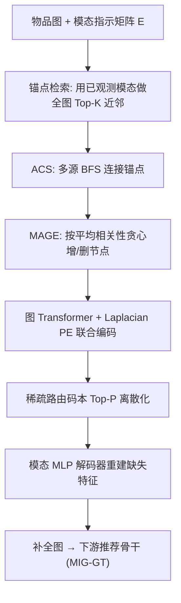

# Robust Multimodal Recommendation via Graph Retrieval-Enhanced Modality Completion (图检索增强模态补全的鲁棒多模态推荐)

- **会议/期刊**: SIGIR 2026
- **作者与机构**: Yuan Li, Jun Hu, Jiaxin Jiang, Bryan Hooi, Bingsheng He（新加坡国立大学）
- **推荐链路定位**: 召回（作为下游推荐模型的即插即用前置补全模块）
- **研究方向**: 多模态推荐 / 图神经网络与知识图谱推荐
- **论文原文**: [https://arxiv.org/abs/2605.00670v1](https://arxiv.org/abs/2605.00670v1)
- **开源代码**: 暂未开源

## TL;DR (1分钟核心速览)

真实多模态推荐数据常因传感器故障、标注缺失导致物品模态不全，现有补全方法要么只用节点自身跨模态相关性（self-based），要么只聚合 $K_N$ 跳邻居（neighbor-based），而邻居在稀疏/噪声图中语义相关性弱、误差传播严重。本文提出 GRE-MC：先用可用模态做全图近邻检索得到语义锚点，再用多源 BFS 连成子图并按"平均相关性"贪心增删节点（MAGE），最后用带 Laplacian 位置编码的图 Transformer 联合编码查询节点与检索子图，并以稀疏路由码本离散化表征。在 Baby/Sports/Clothing 三数据集、40% 随机缺失率、80/10/10 比例划分协议下，Recall@20 相对最强基线 MoDiCF 提升 4.2%–5.1%，且总运行时间仅为 MoDiCF 的约 1/7。

## Background & Motivation (背景与核心矛盾)

- **主流范式**: 多模态推荐（MIG-GT、BM3、SLMRec 等）默认所有物品的视觉/文本模态完整；处理缺失模态有两条路——模型中心（改下游架构做模态对齐/蒸馏）与数据中心的**模态补全**（先重建特征再喂给现成模型，无需改架构，本文选后者）。
- **前人局限**: self-based 方法（MoDiCF、LRMM）只用实例内跨模态相关，当观测模态本身信息弱时失效；neighbor-based 方法（Imputed）假设 $K_N$ 跳邻居有信息量，但邻居可能语义无关甚至本身也缺模态，导致误差沿边传播。
- **核心洞察 (Key Insight)**: 作者在图 3 上做了直接验证——对每个查询节点，比较"$K_N$ 跳邻居集合"与"检索子图"同其**缺失模态**的平均余弦相似度，后者在 2500 个查询上系统性更高（图 9 在 Baby/Sports 的图像缺失与文本缺失四种设定下均复现）。即：语义相关但结构遥远的节点，比结构相近的邻居更能指导补全。
- **本文切入点**: 把"补全的上下文获取"从邻域聚合升级为**全图子图检索**，并用图 Transformer 解决"检索子图与查询节点可能不连通、消息传递失效"的工程障碍。

## Method (核心方法设计)

### 1. 整体框架 (Overall Architecture)

输入是物品共现图 $\mathcal{G}=(\mathcal{V},\mathcal{E})$（两物品共享至少一个用户即连边）与模态指示矩阵$\mathbf{E}\in\{0,1\}^{N_I\times|\mathcal{M}|}$。对每个缺模态的查询节点$i$，先用其**已观测**模态做全图 Top-$K$近邻检索得到锚点集$\mathcal{A}_i^{(m)}$；再用多源 BFS 求"锚点连接子图" ACS，并以平均相关性为目标做贪心增删得到检索子图$S$；随后把$S\cup\{i\}$ 作为 token 序列送入带 Laplacian 位置编码的图 Transformer 做全局注意力编码，查询表征经稀疏路由码本离散化后由模态专属 MLP 解码器重建缺失特征；补全后的完整图再送入现成推荐骨干（MIG-GT）训练与推理。

<figure class="paper-figure" markdown="span">
  <figcaption>图4：GRE-MC 用于图检索增强模态补全的概览。该框架包含两个模块：(1) 模态感知子图检索通过模态感知图扩展识别语义相关的锚节点并将其扩展为结构连贯的子图，融合语义与结构信号；(2) 联合编码图变换器对检索到的子图进行编码以捕获高阶依赖和跨模态交互，随后通过稀疏路由码本离散化生成鲁棒且紧凑的模态表示。</figcaption>
</figure>

### 2. 关键设计拆解 (Key Designs)

1. **模态感知子图检索（MAGE，替代 $K_N$跳邻域）**：痛点是邻居聚合会引入语义无关节点。先检索锚点$\mathcal{A}_i^{(m)}=\mathrm{TopK}\big(\mathbf{x}_i^{(m)},\{\mathbf{x}_j^{(m)}\mid \mathbf{E}_{j,m}=1\}\big)$，再定义仅在**双方共同观测模态**上取均值的成对相关性
$$r(i,v)=\frac{\sum_{m\in\mathcal{M}}\mathbf{E}_{i,m}\mathbf{E}_{v,m}\cos(\mathbf{x}_i^{(m)},\mathbf{x}_v^{(m)})}{\sum_{m\in\mathcal{M}}\mathbf{E}_{i,m}\mathbf{E}_{v,m}},\quad \text{若分母为 }0 \text{ 则 } r=-\infty$$
以子图平均相关性 $\Phi(i,S)=\frac{1}{|S|}\sum_{v\in S}r(i,v)$为目标，在"保持连通且含全部锚点"约束下迭代执行两种局部移动：吸收边界邻居$c$（若$\Phi(i,S\cup\{c\})>\Phi(i,S)$）或剪除非桥接节点$u$（若$\Phi(i,S\setminus\{u\})>\Phi(i,S)$），取增益更大者，至多$T$ 轮。直觉：把"语义高相关"与"结构连通"两个信号耦合进同一个贪心目标，既避免锚点散落无法表达结构，又避免为连通而拖入低相关节点。

2. **联合编码图 Transformer + 稀疏路由码本**：痛点是检索子图与查询节点可能不连通，GCN 消息传递无从下手。故将每个节点视为带 Laplacian 位置编码 $\mathbf{p}_j$的 token，$\mathbf{h}_v^{(0)}=\mathrm{MLP}\big(\oplus_{m\in\mathcal{M}}\tilde{\mathbf{x}}_v^{(m)};\mathbf{p}_v\big)$（缺失模态置零），经$L$层全局注意力后以查询为 query 做注意力聚合得$\mathbf{z}_i=\sum_j\alpha_{ij}\mathbf{h}_j^{(L)}$。随后用 Gumbel-Softmax 路由$\mathbf{g}_i=\mathrm{Softmax}((\mathbf{W}\mathbf{z}_i+\boldsymbol{\epsilon})/\tau)$在码本$\{\mathbf{c}_e\}_{e=1}^{C}$上取 Top-$P$加权和$\mathbf{q}_i=\sum_{e\in\mathrm{TopP}(\mathbf{g}_i)}g_{i,e}\mathbf{c}_e$，再由模态专属 MLP 解码$\hat{\mathbf{x}}_i^{(m)}=\mathrm{MLP}^{(m)}(\mathbf{q}_i)$。直觉：离散原型基把连续隐空间压到紧凑基向量上，等价于对缺失模态引入强先验正则，抑制噪声特征被直接外推。

3. **训练目标与开销**：总损失为重建损失加两项码本正则，
$$\mathcal{L}=\sum_{m}\sum_{i}\big\|\hat{\mathbf{x}}_i^{(m)}-\mathbf{x}_i^{(m)}\big\|^2+\lambda_{\text{usage}}\mathrm{KL}(\bar{\mathbf{g}}\,\|\,\mathbf{u})+\lambda_{\text{load}}\,C\sum_{e}\bar{\hat{g}}_e^2$$
其中 $\bar{\mathbf{g}}$为批内平均软路由分布、$\mathbf{u}$为均匀分布，第二项惩罚离散分配的负载不均以防码本坍缩。补全阶段为**自监督重建**，无需负采样；下游推荐沿用 MIG-GT 的 BPR 式训练。复杂度上检索为$O(Nd+E+KD(1+k+T))$，Transformer 为$O(L(KD)^2d+L(KD)d^2)$，实测检索仅占 22–162 秒（表 3），远小于补全与推荐阶段。

## Experimental Setup & Evaluation Protocol (实验设置与评估协议)

- **数据集与预处理**: Amazon 三基准，视觉 4096 维 CNN 特征、文本 384 维 sentence-transformers 特征；按已有工作做 5-core 式过滤。缺失模态通过**随机掩码**模拟，保证每个物品至少保留一个模态，掩码模态初始化为零向量。默认缺失率 $r=40\%$。

| 数据集 | #Users | #Items | #Interactions | 稀疏度 | 40% 缺失下 完整/缺图/缺文 物品数 |
| :--- | :---: | :---: | :---: | :---: | :--- |
| Baby | 19,445 | 7,050 | 160,792 | 99.88% | 1,410 / 2,833 / 2,807 |
| Sports | 35,598 | 18,357 | 296,337 | 99.95% | 3,672 / 7,403 / 7,282 |
| Clothing | 39,387 | 23,033 | 278,677 | 99.97% | 4,607 / 9,251 / 9,175 |

- **数据划分与防穿越 (Splitting Strategy)**: **比例划分**，每个用户交互按 80% 训练 / 10% 验证 / 10% 测试；报告 5 个随机种子的均值与标准差。
- **排名评测协议 (Ranking Protocol)**: 沿用 MIG-GT/MoDiCF 的评测方案，指标为 Recall@10/20 与 NDCG@10/20；补全类方法（Imputed、GRE-MC）统一挂 MIG-GT 作为推荐骨干以保证公平。
- **对比基线与超参设置**: 基线分两类——通用多模态模型（BPR、LightGCN、SLMRec、FREEDOM、BM3、DRAGON、PGL、MIG-GT，缺失模态以零向量简单填补）与缺失模态感知模型（Imputed、MILK、MoDiCF）。隐层 $d=128$，锚点数$K\in\{5,10,20\}$，码本$C\in\{10,50,100\}$，$T=10$，LPE 维度$k=20$，$L=2$层 4 头，Top-$P=4$，$\tau=0.5$，$\lambda_{\text{usage}},\lambda_{\text{load}}\in\{0.5,1.0,2.0\}$；显著性以$p<0.05$ 标注。

## Key Experimental Results (实验关键数据)

### 1. 主实验对比 (Main Results)

40% 缺失率下的推荐性能（%，节选核心指标）：

| 方法 | 类型 | Baby R@20 | Baby N@20 | Sports R@20 | Sports N@20 | Clothing R@20 | Clothing N@20 |
| :--- | :---: | :---: | :---: | :---: | :---: | :---: | :---: |
| BPR | 单模态 | 5.75 | 2.49 | 6.53 | 2.98 | 2.98 | 1.32 |
| LightGCN | 单模态 | 7.54 | 3.28 | 8.64 | 3.87 | 4.49 | 2.05 |
| SLMRec | 多模态 | 7.73 | 3.55 | 9.74 | 4.27 | 6.29 | 2.87 |
| BM3 | 多模态 | 8.01 | 3.39 | 9.06 | 4.01 | 6.29 | 2.87 |
| DRAGON | 多模态 | 8.70 | 3.75 | 9.34 | 4.24 | 6.58 | 3.00 |
| MIG-GT | 多模态 | 8.65 | 3.74 | 9.57 | 4.27 | 6.64 | 2.99 |
| Imputed | 缺失感知 | 8.29 | 3.58 | 9.68 | 4.37 | 6.08 | 3.01 |
| MoDiCF | 缺失感知 | 8.76 | 3.78 | 9.83 | 4.42 | 6.86 | 3.04 |
| **GRE-MC** | 缺失感知 | **9.21** | **4.03** | **10.28** | **4.63** | **7.15** | **3.21** |
| **Improv.** | — | *+5.14% | *+6.61% | *+4.58% | *+4.75% | *+4.23% | *+5.59% |

（R@10 与 N@10 上提升更明显：Baby R@10 +5.99%、N@10 +7.12%，Clothing R@10 +4.42%、N@10 +4.00%，均带显著性标记。）

### 2. 消融实验 (Ablation Study)

| 配置 | Baby R@20 | Baby N@20 | Sports R@20 | Clothing R@20 | 说明 |
| :--- | :---: | :---: | :---: | :---: | :--- |
| GRE-MC (full) | **9.21** | **4.03** | **10.28** | **7.15** | 完整模型 |
| w/o GR（去子图检索） | 降幅最大 | 降幅最大 | 降幅最大 | 降幅最大 | 退化为自信息/邻域补全 |
| w/o GT（去图 Transformer） | 中等降幅 | 中等降幅 | 中等降幅 | 中等降幅 | 无法联合编码检索子图 |
| w/o SRC（去稀疏码本） | 小幅降幅 | 小幅降幅 | 小幅降幅 | 小幅降幅 | 表征正则减弱 |

（原文图 5 以柱状图给出，此处按趋势归纳；检索方式对比见图 7：MAGE > ACS ≈ Steiner > Anchor-only。）

### 3. 关键实验发现 (Key Findings)

1. **检索模块是收益主引擎，而非编码器**：去掉 GR 的降幅显著大于去掉 GT 与 SRC，说明在 40% 缺失下"上下文从哪来"比"怎么编码"更关键；这与图 3/图 9 中检索子图相关性系统性高于邻域的证据一致。
2. **锚点数与码本大小均呈倒 U 型**：Baby 上 $K$从 5 增至 10 时 R@20 由 9.08 升至 9.21，继续增至 20 反降至 9.16；码本$C=50$优于$C=10$与$C=100$（如 Clothing R@20 在$K=10$ 时 7.15 vs 7.11 vs 7.10），印证"过多锚点引入噪声、过大码本稀释原型"的判断。
3. **鲁棒性与效率双赢**：缺失率从 10% 扫到 40%，GRE-MC 在三个数据集的 N@20 上始终高于 MoDiCF（图 8）；同时总运行时间 Baby 1,102s vs MoDiCF 16,184s、Clothing 2,778s vs 20,473s，检索阶段仅占 2%–6%，说明 $O(|E|)$ 的最坏 BFS 开销在真实图上不构成瓶颈。

## Highlights & Limitations (亮点、对比与审稿批判)

- **与代表作对比 (vs. Prior Work)**: 与 MoDiCF 的本质区别在于上下文来源——MoDiCF 走实例内跨模态条件生成（扩散式），GRE-MC 走跨实例的语义检索 + 结构连通；与 Imputed 的区别在于把"固定 $K_N$ 跳邻域"换成"以相关性为目标的可增可删子图"，从而摆脱邻居质量假设。相较二者，GRE-MC 还额外获得 7–15 倍的端到端加速。
- **可迁移亮点**: (1) "锚点检索 + 多源 BFS 连通 + 相关性贪心增删"这套子图构造可直接迁移到冷启动物品的内容补全、跨域对齐中的桥接样本挖掘；(2) 用 Gumbel-Softmax 稀疏路由码本 + 使用率/负载双正则约束隐表征，可作为通用的表征正则插件挂到其他生成式或对比式推荐模型上。
- **审稿级局限批判**: (1) 缺失模拟是**完全随机掩码**，未考虑真实场景中缺失与流行度/类目强相关的非随机机制（MNAR），鲁棒性结论可能偏乐观；(2) 补全质量仅通过下游 Recall/NDCG 间接评估，缺少重建特征本身的保真度指标（如缺失模态上的余弦相似度或 FID），且 MAGE 的贪心增删在高度数节点上仍可能触发较大的 BFS 前沿，论文仅以"实测最大度远小于 $|V|$"一笔带过。

## Rating (四维评分)

- **方法创新性 (Novelty)**: ⭐⭐⭐⭐ （把 IR 的子图检索范式引入模态补全，并用图 Transformer 绕开不连通障碍，思路清晰但各组件均为已有技术的组合）
- **评估协议与实验扎实度 (Protocol & Experiments)**: ⭐⭐⭐⭐ （三数据集 + 11 个基线 + 5 次随机种子 + 显著性检验 + 缺失率扫描较完整，扣分在随机掩码假设与缺少补全保真度指标）
- **写作与数学规范度 (Clarity & Rigor)**: ⭐⭐⭐⭐ （MAGE 与 ACS 均给出完整伪代码与复杂度上界，公式定义紧凑；但部分符号如 $\tilde{\mathbf{x}}$、$\bar{\hat{g}}_e$ 的维度说明略简）
- **工业落地与复现价值 (Industrial & Practical Value)**: ⭐⭐⭐⭐ （作为即插即用前置模块无需改下游架构，实测比 MoDiCF 快一个数量级；但未开源，且码本与锚点数需逐数据集调参）
