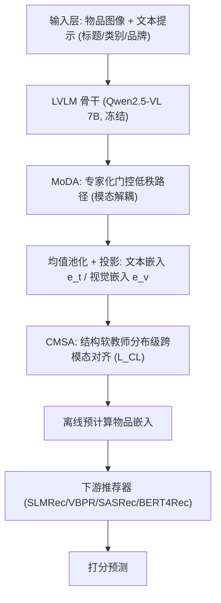
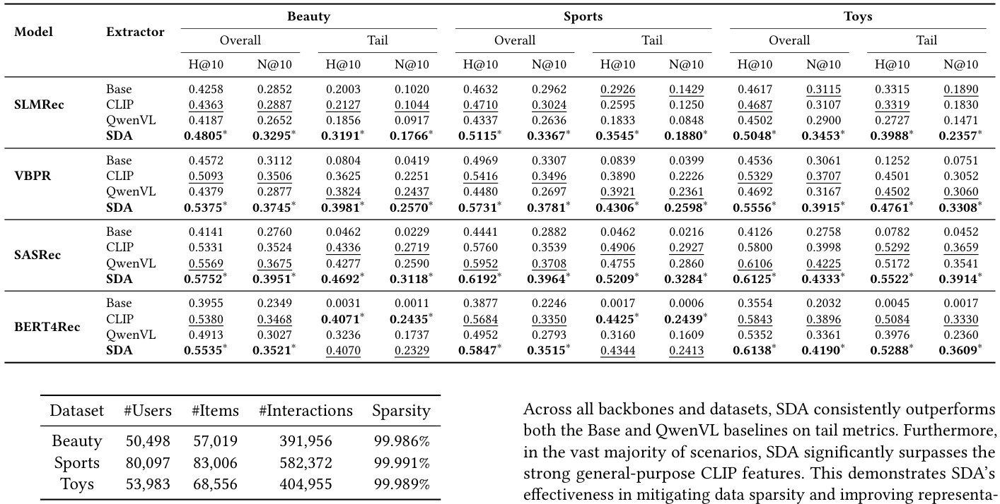
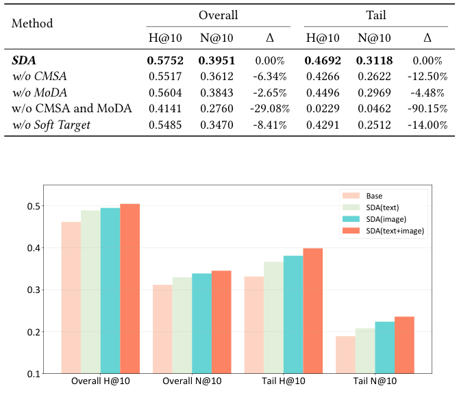
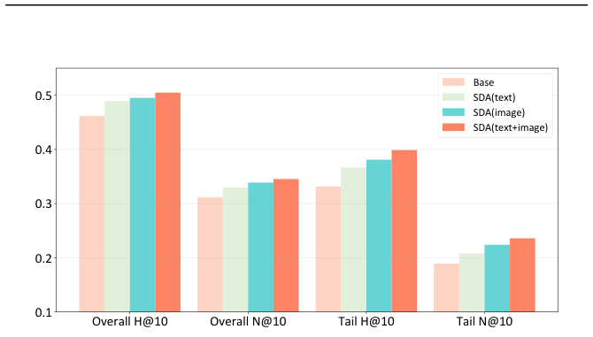

# Structural and Disentangled Adaptation of Large Vision Language Models for Multimodal Recommendation (面向多模态推荐的大视觉语言模型结构与解耦适配)

- **会议/期刊**: SIGIR 2026
- **推荐链路定位**: 召回/特征表征（作为多模态特征提取器，离线预计算后接入下游推荐模型）
- **研究方向**: 多模态推荐 / 序列推荐
- **论文原文**: [https://arxiv.org/abs/2512.06883v2](https://arxiv.org/abs/2512.06883v2)
- **开源代码**: [https://github.com/RaoZhongtao/SDA](https://github.com/RaoZhongtao/SDA)

## TL;DR (核心速览)

针对 LVLM 直接用于多模态推荐时的**表征错位**（领域鸿沟导致图文嵌入空间不对齐）与**梯度冲突**（共享 LoRA 适配器使视觉/文本梯度相互干扰）两大痛点，本文提出 SDA 轻量框架：CMSA 以模态内结构作为软教师做分布级跨模态对齐，MoDA 用专家化门控低秩路径解耦梯度流。在 Amazon 三数据集、四种骨干（SLMRec/VBPR/SASRec/BERT4Rec）上，H@10 平均提升 6.15%、N@10 提升 8.64%，长尾最高提升 12.83%/18.70%，推理开销极小。

## Background & Motivation (背景与动机)

- **领域背景与主流范式**: 多模态推荐早期依赖独立编码器（CNN/Transformer）或双塔 CLIP 提取图文特征，再与 ID 嵌入融合。LVLM（如 Qwen-VL、GPT-4o）凭借统一架构与深层跨模态注意力，在细粒度图文关系建模与世界知识迁移上更具潜力，被视为理想的多模态特征骨干。
- **现有方法局限 (Limitations of Prior Work)**:
  1. **表征错位 (C1)**：商品图片/短标题等域内数据与 LVLM 的通用预训练数据存在显著领域鸿沟，导致同一物品的图文嵌入空间不对齐（图 1(a)）。
  2. **梯度冲突 (C2)**：参数高效微调（如 LoRA）在视觉与文本间共享低秩适配器，造成梯度相互干扰，使视觉相似但功能不同的物品被错误聚类（图 1(b)）。
  3. 零样本 LVLM 特征并非"即插即用"：实验显示 vanilla QwenVL 在多数场景下甚至不如 CLIP 或原始 Base 特征（如 SLMRec 在 Sports 上 0.4337 vs. 0.4632 H@10），存在负迁移。
- **核心挑战 (Key Challenge)**: 简单特征拼接或加深网络无法解决——错位是分布层面的语义鸿沟，需在适配阶段对齐；冲突源于共享适配器的结构性缺陷，需从梯度路由层面解耦。
- **核心洞察与切入点 (Key Insight)**: 作者观察到，即便跨模态对齐丢失，**模态内关系结构仍然完好保留**，可将其作为软教师指导跨模态对齐；同时梯度冲突的根因是共享适配器，可用专家化门控低秩路径替代。

<figure class="paper-figure" markdown="span">
  <figcaption>图 1</figcaption>
</figure>

## Problem Formulation & Method (问题定义与方法架构)

### 1. 符号定义与输入表征 (Notations & Input Representations)

- 用户集 $\mathcal{U}$、物品集 $\mathcal{I}$，物品 $i$ 具有图像与文本模态。
- 文本提示：拼接标题、类别、品牌等字段并附指令 "The product has the following attributes:"；视觉提示："The product has the image:"。
- 两路提示输入预训练 LVLM，对最后一层隐状态做均值池化并投影，得到 $d_m$ 维文本/视觉嵌入 $\mathbf{e}^t_i, \mathbf{e}^v_i \in \mathbb{R}^{d_m}$。
- 下游推荐模型统一嵌入维度 $d=128$。

### 2. 整体流水线 (Overall Architecture)

两阶段流水线：先向 LVLM 插入 MoDA，仅优化其参数以最小化 $\mathcal{L}_{CL}$，得到适配后的图文嵌入；随后冻结 LVLM，离线预计算全部物品嵌入，通过拼接或适配器融合接入现有多模态/序列推荐器。

<figure class="paper-figure" markdown="span">
  <figcaption>图 2</figcaption>
</figure>

### 3. 核心模块设计与数学原理 (Key Designs & Formulations)

**模块一：跨模态结构对齐 (CMSA)**

给定批内 $N$ 个物品，先计算跨模态相似度矩阵：

$$S_{ij} = \frac{\mathbf{e}^t_i \cdot \mathbf{e}^v_j}{\tau}, \quad i,j \in \{1,\dots,N\}$$

再以模态内相似度均值构造结构软教师分布：

$$T_{ij} = \mathrm{Softmax}_j\left(\tau_2\left(\mathbf{e}^t_i \cdot \mathbf{e}^t_j + \mathbf{e}^v_i \cdot \mathbf{e}^v_j\right)\right)$$

其中 $\mathrm{Softmax}_j$ 为按行归一化。$T_{i,:}$ 编码了锚点物品 $i$ 在图文联合视角下的邻域结构。结构感知对比损失为双向 KL 匹配：

$$\mathcal{L}_{CL} = \frac{1}{2N}\sum_{i=1}^{N}\left[\mathrm{KL}(T_{i,:} \| P_{i,:}) + \mathrm{KL}(T_{:,i} \| P^\top_{:,i})\right]$$

其中 $P_{ij} = \mathrm{Softmax}_j(S_{ij})$。**物理直觉**：不直接对齐单个图文对，而是对齐整个相似度分布，从而把模态内关系知识迁移到联合空间，得到更具判别性、模态不变性的嵌入。

**模块二：模态解耦适配 (MoDA)**

标准 LoRA 更新 $\Delta W = BA$。MoDA 将低秩空间分解为 $N_e$ 个专家，各模态软组合：

$$\Delta W = \sum_{i=1}^{N_e} \omega_i B_i A_i, \quad B_i \in \mathbb{R}^{d_{in} \times r_e}, A_i \in \mathbb{R}^{r_e \times d_{out}}, r_e = r/N_e$$

每个模态 $m$ 引入可训练模态嵌入 $\mathrm{Emb}_m$，经小门控网络产生专家权重：

$$\omega^m = \mathrm{Gate}(\mathrm{Emb}_m) \in \mathbb{R}^{N_e}$$

前向计算为：

$$h = W_0 x + \sum_{i=1}^{N_e} \omega^m_i B_i A_i x$$

**物理直觉**：各模态共享同一专家池，但通过 $\omega^m$ 强调不同子集，无需维护完全独立的适配器，在保持总秩 $r$（参数量与标准 LoRA 相当）的前提下解耦视觉/文本梯度流。

### 4. 训练目标、负采样与推理复杂度 (Optimization, Negative Sampling & Complexity)

- **损失函数**: 仅使用结构感知对比损失 $\mathcal{L}_{CL}$（双向 KL 散度），温度系数 $\tau$ 与 $\tau_2$ 为超参；CMSA 本身不引入额外可训练参数。
- **训练负采样策略**: 采用批内对比（in-batch），批大小 $N=32$（训练），通过批内其他物品隐式构成负例，无需显式负采样。
- **时间与空间复杂度**: 仅向冻结 LVLM 添加少量低秩专家，可训练参数为骨干的极小比例；物品嵌入离线预计算，下游推荐器服务时复杂度基本不变。训练最多 4000 步，更新所有线性层但冻结 ViT 视觉编码器；专家数 $N_e=8$。

## Experimental Setup & Evaluation Protocol (实验设置与评估协议)

- **数据集统计与预处理**: 采用 Amazon Reviews 的 Beauty、Sports、Toys 三个类目：

<figure class="paper-figure" markdown="span">
  <figcaption>表 2</figcaption>
</figure>

| 数据集 (Dataset) | 用户数 (#Users) | 物品数 (#Items) | 交互数 (#Interactions) | 稀疏度 (Sparsity) | 模态/辅助特征说明 |
| :--- | :---: | :---: | :---: | :---: | :--- |
| Beauty | 50,498 | 57,019 | 391,956 | 99.986% | 图像 (AlexNet 特征) + 文本 (all-MiniLM-L6-v2) |
| Sports | 80,097 | 83,006 | 582,372 | 99.991% | 同上 |
| Toys | 53,983 | 68,556 | 404,955 | 99.989% | 同上 |

- **数据划分方式 (Splitting Strategy)**: 遵循标准 **Leave-One-Out (留一法)** 协议 [4,13,15]。原文未明确报告全局时间戳切分，存在一定未来信息泄露风险（LOO 常见问题）。
- **排名评测协议 (Ranking Protocol)**: **Sampled Ranking**——每个正样本物品与 100 个用户未交互的随机负样本共同排序（1 正配 100 负），非全库排序。
- **评价指标与显著性检验**: H@10、N@10；长尾定义为交互数少于 4 的物品，对应真值物品属长尾的用户构成长尾用户集，报告 TailH@10、TailN@10。所有模型嵌入维度统一为 128。采用配对 $t$ 检验，$p<0.05$ 标注为 ∗。

## Key Experimental Results (核心实验结果)

### 1. 主实验对比 (Main Results)

SDA 特征对比 Base、CLIP（clip-vit-large-patch14）、QwenVL（vanilla Qwen2.5-VL 7B）三种特征设置，接入四种骨干。以下摘取代表性结果：

<figure class="paper-figure" markdown="span">
  <figcaption>表 1</figcaption>
</figure>

| 数据集 | 指标 | Base | CLIP | QwenVL | 本文方法 (Ours) | 相对提升 (vs. 次优) |
| :--- | :--- | :---: | :---: | :---: | :---: | :---: |
| Beauty (SLMRec) | H@10 / N@10 | 0.4258 / 0.2852 | 0.4363 / 0.2887 | 0.4187 / 0.2652 | **0.4805 / 0.3295** | +10.13% / +14.13% (vs. CLIP) |
| Sports (SLMRec) | H@10 / N@10 | 0.4632 / 0.2962 | 0.4710 / 0.3024 | 0.4337 / 0.2636 | **0.5115 / 0.3367** | +8.60% / +11.34% (vs. CLIP) |
| Toys (SLMRec) | H@10 / N@10 | 0.4617 / 0.3115 | 0.4687 / 0.3107 | 0.4502 / 0.2900 | **0.5048 / 0.3453** | +7.70% / +11.14% (vs. CLIP) |
| Beauty (SASRec) | H@10 / N@10 | 0.4141 / 0.2760 | 0.5331 / 0.3524 | 0.5569 / 0.3675 | **0.5752 / 0.3951** | +3.29% / +7.51% (vs. QwenVL) |
| Beauty (VBPR) | H@10 / N@10 | 0.4572 / 0.3112 | 0.5093 / 0.3506 | 0.4379 / 0.2877 | **0.5375 / 0.3745** | +5.54% / +6.82% (vs. CLIP) |
| Beauty (BERT4Rec) | H@10 / N@10 | 0.3955 / 0.2349 | 0.5380 / 0.3468 | 0.4913 / 0.3027 | **0.5535 / 0.3521** | +2.88% / +1.53% (vs. CLIP) |

整体上 SDA 在四种骨干、三个数据集的所有 Overall 指标上均取得最优；长尾指标同样全面领先（如 Beauty SLMRec TailH@10 0.3191 vs. CLIP 0.2127）。值得注意的是 vanilla QwenVL 表现不稳定，多数场景不如 CLIP 甚至 Base，验证了表征错位诊断。

### 2. 消融实验与控制变量分析 (Ablation Study)

<figure class="paper-figure" markdown="span">
  <figcaption>表 3</figcaption>
</figure>

| 方法 | Overall H@10 | Overall N@10 | Δ | Tail H@10 | Tail N@10 | Δ |
| :--- | :---: | :---: | :---: | :---: | :---: | :---: |
| SDA (full) | 0.5752 | 0.3951 | 0.00% | 0.4692 | 0.3118 | 0.00% |
| w/o CMSA | 0.5517 | 0.3612 | -6.34% | 0.4266 | 0.2622 | -12.50% |
| w/o MoDA | 0.5604 | 0.3843 | -2.65% | 0.4496 | 0.2969 | -4.48% |
| w/o CMSA and MoDA | 0.4141 | 0.2760 | -29.08% | 0.0229 | 0.0462 | -90.15% |
| w/o Soft Target | 0.5485 | 0.3470 | -8.41% | 0.4291 | 0.2512 | -14.00% |

- **CMSA 贡献最大**（移除后 Overall 降 6.34%，长尾降 12.50%）；将结构软教师替换为标准 InfoNCE（w/o Soft Target）降幅更大（8.41%），证明保留细粒度模态内结构优于简单对齐。
- MoDA 替换为标准 LoRA 降 2.65%，验证专家化门控缓解梯度冲突的有效性。
- 两者同时移除性能崩塌（-29.08%，长尾 -90.15%），说明二者缺一不可。
- 消融未显式报告参数量对齐或图拓扑度数匹配的控制变量细节。

### 3. 稀疏度/冷启动分桶与超参敏感度 (Sparsity Buckets & Hyperparameters)

- **长尾表现**: 长尾物品（交互数 < 4）上 SDA 提升显著大于整体，最高相对增益 12.83%（H@10）与 18.70%（N@10），说明对稀疏/冷启动物品表征质量改善明显。
- **模态贡献分析**: 在 Toys + SLMRec 上（图 3），SDA 适配后的文本与视觉特征单独均优于原始 SLMRec 基线，视觉特征增益更大；两者组合在所有指标上最优，体现互补协同。
- **梯度冲突分析**: 在 Qwen2.5-VL 最后解码层 q_proj/k_proj 的 LoRA $B$ 矩阵上，标准 LoRA 的模态梯度余弦相似度为负（-0.0955 / -0.0705），MoDA 则为强正（0.4422 / 0.7096），直接证明解耦有效。
- **超参敏感度**: 固定 LoRA 秩为 8，专家数 $N_e \in \{0,2,4,8\}$（$N_e=0$ 即标准 LoRA），性能随专家数增加持续提升（图 4），$N_e=8$ 最佳。
- **线上 A/B 测试**: 原文仅包含离线实验，未报告线上结果。

<figure class="paper-figure" markdown="span">
  <figcaption>图 3</figcaption>
</figure>

## Highlights, Limitations & Critiques (亮点、局限与审稿级批判)

- **核心亮点与可迁移性**:
  1. **结构软教师对齐**思路具有普适性——利用模态内保留结构指导跨模态对齐，可迁移到其他跨模态检索/多模态融合任务。
  2. **MoDA 专家化门控低秩路径**在保持 LoRA 参数量级的同时解耦梯度流，可直接迁移到其他多模态 LLM 微调场景。
  3. 作为**即插即用特征提取器**，与四种异构骨干无缝集成，工程落地友好，离线预计算使服务开销几乎不变。
- **局限性与审稿视角批判 (Critical Limitations)**:
  1. **评估协议偏弱**：采用 1 正配 100 随机负样本的 Sampled Ranking，而非全库 Full-Ranking，可能高估绝对性能；LOO 划分未明确时间戳切分，存在未来信息泄露风险。
  2. **数据集单一**：仅 Amazon 三个类目，作者亦承认未覆盖短视频/新闻等场景，泛化性存疑。
  3. **对齐量化不足**：表征错位虽有经验证据（vanilla LVLM 表现差），但缺乏系统性量化指标或诊断工具，理论解释偏定性。
  4. **超参敏感**：专家数 $N_e$ 需调至 8 才最佳，训练步数上限 4000 防过拟合，实际部署调参成本未充分讨论。
  5. **基线对比**：QwenVL 零样本基线较弱，SDA 相对其提升部分源于适配本身，与 CLIP 的对比更能说明问题，但部分场景（如 BERT4Rec Beauty N@10）提升幅度有限（+1.53%）。

## Rating (四维评分)

- **方法创新性 (Novelty)**: ⭐⭐⭐⭐
- **评估协议与实验扎实度 (Protocol & Experiments)**: ⭐⭐⭐
- **写作与数学规范度 (Clarity & Rigor)**: ⭐⭐⭐⭐
- **工业落地与复现价值 (Industrial & Practical Value)**: ⭐⭐⭐⭐
