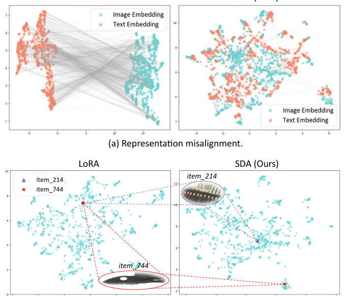
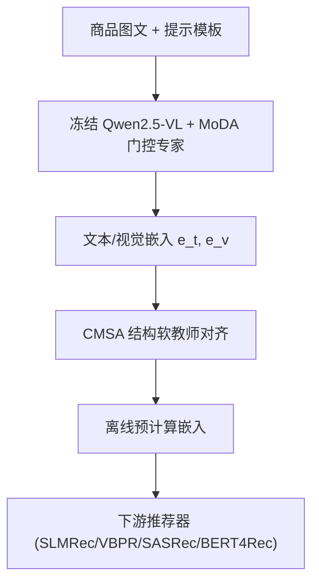
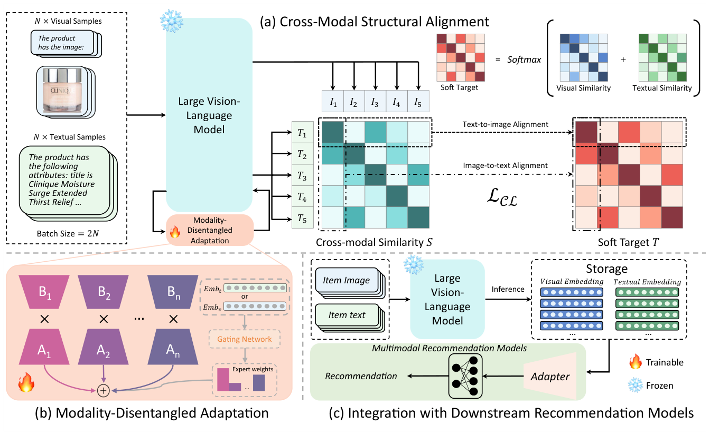

# Structural and Disentangled Adaptation of Large Vision Language Models for Multimodal Recommendation (面向多模态推荐的大视觉语言模型结构与解耦适配)

- **会议/期刊**: SIGIR 2026
- **作者与机构**: Zhongtao Rao, Peilin Zhou, Dading Chong, Zhiwei Chen, Shoujin Wang, Nan Tang (HKUST-GZ / NYU Abu Dhabi / PKU / UTS)
- **推荐链路定位**: 召回前的表征增强（离线预计算特征，供下游推荐模型使用）
- **研究方向**: 多模态推荐 / 冷启动与长尾推荐
- **论文原文**: [https://arxiv.org/abs/2512.06883v2](https://arxiv.org/abs/2512.06883v2)
- **开源代码**: [https://github.com/RaoZhongtao/SDA](https://github.com/RaoZhongtao/SDA)

## TL;DR (1分钟核心速览)

直接把 Qwen2.5-VL 7B 的零样本特征喂给推荐模型会**负迁移**（Sports 上 SLMRec 的 H@10 从 0.4632 掉到 0.4337），根源是商品图文与通用预训练语料存在域鸿沟（表征不对齐），而共享 LoRA 适配器又让视觉/文本梯度互相打架。本文提出 SDA：用**模态内结构软教师**做分布级跨模态对齐（CMSA），再用**专家化门控低秩路径**解耦梯度流（MoDA）。在 Amazon 三数据集、四种骨干上平均提升 H@10 6.15%、N@10 8.64%，长尾最高提升 12.83%/18.70%，且推理零额外开销。

## Background & Motivation (背景与核心矛盾)

- **主流范式**: 多模态推荐依赖 CNN/Transformer 或 CLIP 双塔抽取图文特征，再与 ID 嵌入融合；近期尝试用 LVLM 作为统一多模态特征提取器。
- **前人局限**: (i) 商品图片与短标题属强域内数据，与 LVLM 通用预训练分布差异大，同一商品的图文嵌入空间严重错位；(ii) 参数高效微调（LoRA）在视觉与文本间共享低秩适配器，两模态梯度相互干扰，导致"视觉相似但功能不同"的商品被错误聚簇。
- **核心洞察 (Key Insight)**: 跨模态对齐丢失时，**模态内**的邻域关系（图-图相似、文-文相似）依然完好，可作为"软教师"监督跨模态对齐；梯度冲突的根因是共享适配器，而非低秩本身。
- **本文切入点**: 用模态内结构做分布级软对齐 + 用模态专属门控专家拆分低秩子空间，两步分别对症 C1/C2。

<figure class="paper-figure" markdown="span">
  <figcaption>图1：将LVLM应用于推荐时两个关键挑战的示意图。</figcaption>
</figure>

## Method (核心方法设计)

### 1. 整体框架 (Overall Architecture)

两阶段流水线：第一阶段冻结 LVLM 主干，仅训练 MoDA 低秩专家，以 CMSA 的结构感知对比损失在商品数据上适配，得到文本/视觉嵌入 $\mathbf{e}^t_i,\mathbf{e}^v_i$；第二阶段冻结 LVLM、离线预计算全部商品嵌入，以拼接等方式注入下游多模态（SLMRec/VBPR）或序列（SASRec/BERT4Rec）推荐器。CMSA 本身不引入可训练参数，MoDA 仅增加少量低秩专家，故服务期开销与原始推荐器基本持平。

<figure class="paper-figure" markdown="span">
  <figcaption>图2：所提出的SDA框架概览。</figcaption>
</figure>

### 2. 关键设计拆解 (Key Designs)

1. **跨模态结构对齐 CMSA（用模态内邻域当软教师）**：痛点是对齐目标只有"配对正样本"，丢失了细粒度邻域结构。做法是先算跨模态相似度 $S_{ij}=\mathbf{e}^t_i\cdot\mathbf{e}^v_j/\tau$，再由图文各自模态内相似度均值构造软目标$T_{ij}=\mathrm{Softmax}_j\!\big(\tfrac{\tau}{2}(\mathbf{e}^t_i\cdot\mathbf{e}^t_j+\mathbf{e}^v_i\cdot\mathbf{e}^v_j)\big)$，最后双向 KL 对齐：
$$\mathcal{L}_{CL}=\frac{1}{2N}\sum_{i=1}^{N}\Big[\mathrm{KL}(T_{i,:}\|P_{i,:})+\mathrm{KL}(T_{:,i}\|P^{\top}_{:,i})\Big]$$
其中 $P_{ij}=\mathrm{Softmax}_j(S_{ij})$。直觉：把"谁和谁像"的模态内知识蒸馏进联合空间，比 InfoNCE 的 one-hot 正样本约束信息量更大（消融中换回 InfoNCE 掉 8.41%）。

2. **模态解耦适配 MoDA（专家化门控低秩路径）**：把标准 LoRA 的 $\Delta W=BA$分解为$N_e$个专家$\Delta W=\sum_{i=1}^{N_e}\omega_i B_iA_i$，每个专家秩$r_e=r/N_e$，总参数量与标准 LoRA 持平。每个模态$m$用可训练模态嵌入经门控网络产生权重$\boldsymbol{\omega}^m=\mathrm{Gate}(\mathrm{Emb}_m)$，前向为$h=W_0x+\sum_{i}\omega^m_i B_iA_ix$。视觉与文本共享专家池但走不同组合，从而在低秩子空间内解耦梯度流——实测 LoRA 的模态梯度余弦相似度为负（q_proj$-0.0955$），MoDA 转为强正（$0.4422$）。

3. **训练目标与推理效率**：总损失即 $\mathcal{L}_{CL}$，无负采样（批内全配对，batch size 32），训练最多 4000 步、ViT 冻结、仅更新线性层；专家数$N_e=8$、LoRA 秩$r=8$。推理阶段嵌入全部离线预计算，下游推荐器零额外延迟。

## Experimental Setup & Evaluation Protocol (实验设置与评估协议)

- **数据集与预处理**: Amazon Reviews 三个类目，未额外过滤（沿用原始划分）：

| 数据集 | #Users | #Items | #Interactions | 稀疏度 | 场景说明 |
| :--- | :---: | :---: | :---: | :---: | :--- |
| Beauty | 50,498 | 57,019 | 391,956 | 99.986% | 美妆 |
| Sports | 80,097 | 83,006 | 582,372 | 99.991% | 运动户外 |
| Toys | 53,983 | 68,556 | 404,955 | 99.989% | 玩具 |

- **数据划分与防穿越**: 标准 `Leave-One-Out` 协议（最后一件交互为测试、倒数第二为验证）。
- **排名评测协议**: `Sampled Ranking`，每个真值物品与 100 个用户未交互负样本共同排序；指标 H@10 / N@10，另设长尾子集（交互数 < 4 的物品）报告 TailH@10 / TailN@10。
- **对比基线与超参**: 四种骨干（SLMRec、VBPR、SASRec、BERT4Rec）× 三种特征源（Base 原生特征、CLIP `clip-vit-large-patch14`、QwenVL 零样本 Qwen2.5-VL 7B）；统一嵌入维度 $d=128$，配对 t 检验$p<0.05$。

## Key Experimental Results (实验关键数据)

### 1. 主实验对比 (Main Results)

| 骨干 | 特征源 | Beauty H@10 | Beauty N@10 | Sports H@10 | Toys H@10 | Toys TailH@10 |
| :--- | :--- | :---: | :---: | :---: | :---: | :---: |
| SLMRec | Base | 0.4258 | 0.2852 | 0.4632 | 0.4617 | 0.3315 |
| SLMRec | CLIP | 0.4363 | 0.2887 | 0.4710 | 0.4687 | 0.3319 |
| SLMRec | QwenVL | 0.4187 | 0.2652 | 0.4337 | 0.4502 | 0.2727 |
| SLMRec | **SDA** | **0.4805** | **0.3295** | **0.5115** | **0.5048** | **0.3988** |
| VBPR | CLIP | 0.5093 | 0.3506 | 0.5416 | 0.5329 | 0.4501 |
| VBPR | **SDA** | **0.5375** | **0.3745** | **0.5731** | **0.5556** | **0.4761** |
| SASRec | QwenVL | 0.5569 | 0.3675 | 0.5952 | 0.6106 | 0.5172 |
| SASRec | **SDA** | **0.5752** | **0.3951** | **0.6192** | **0.6125** | **0.5522** |
| BERT4Rec | CLIP | 0.5380 | 0.3468 | 0.5684 | 0.5843 | 0.5084 |
| BERT4Rec | **SDA** | **0.5535** | **0.3521** | **0.5847** | **0.6138** | **0.5288** |

相对最强基线（CLIP 或 QwenVL）提升：SLMRec 上 Beauty H@10 +10.1%、Sports +8.6%、Toys +7.7%；长尾 TailH@10 在 SLMRec/Beauty 上从 0.2127 升至 0.3191（+50.0%），全表平均 H@10 +6.15%、N@10 +8.64%。

### 2. 消融实验 (Ablation Study)

| 变体 (Beauty, SASRec 骨干) | H@10 | N@10 | Δ(平均) | TailH@10 | TailN@10 |
| :--- | :---: | :---: | :---: | :---: | :---: |
| SDA 完整 | **0.5752** | **0.3951** | 0.00% | **0.4692** | **0.3118** |
| w/o CMSA | 0.5517 | 0.3612 | -6.34% | 0.4266 | 0.2622 |
| w/o MoDA（换标准 LoRA） | 0.5604 | 0.3843 | -2.65% | 0.4496 | 0.2969 |
| w/o Soft Target（换 InfoNCE） | 0.5485 | 0.3470 | -8.41% | 0.4291 | 0.2512 |
| w/o CMSA & MoDA | 0.4141 | 0.2760 | -29.08% | 0.0229 | 0.0462 |

### 3. 关键实验发现 (Key Findings)

1. **零样本 LVLM 是负资产，适配才是关键**：QwenVL 零样本在 Sports 上比 Base 还低（0.4337 vs 0.4632），直接验证 C1 域鸿沟诊断；SDA 适配后同一骨干反超 CLIP 约 8.6%，说明增益来自对齐而非模型规模。
2. **结构软教师优于 one-hot 对比**：把 CMSA 的软目标换成标准 InfoNCE 掉 8.41%，比整块移除 CMSA（-6.34%）更惨，证明"保留模态内细粒度邻域"是核心增量，而非对比学习框架本身。
3. **长尾收益远超整体收益**：TailH@10 相对提升最高达 50%（SLMRec/Beauty），且移除双组件后长尾指标近乎崩塌（0.4692→0.0229，-90.15%），说明解耦后的多模态表征对稀疏物品的语义补全作用最显著。

## Highlights & Limitations (亮点、对比与审稿批判)

- **与代表作对比 (vs. Prior Work)**: 相比 CLIP 双塔（仅配对对齐、无域适配）与 LLMEmb 类工作（直接拿 LLM 嵌入喂序列模型），SDA 首次把"模态内结构"作为对齐监督信号，并用 MoE 式门控替代共享 LoRA，同时解决对齐与干扰两个独立病灶；相比通用 LoRA 微调，参数量持平但梯度余弦相似度由负转正。
- **可迁移亮点**: (i) "模态内结构当软教师"可直接迁移到跨域推荐、图文电商匹配中的任意双塔对齐；(ii) 门控专家低秩分解是一种通用的多模态梯度解耦手段，可套用到任意多编码器融合场景。
- **审稿级局限批判**: (i) 仅在 Amazon 三个类目验证，且评测为 100 负样本的 Sampled Ranking，未报告 Full-Ranking，绝对数值可能偏乐观；(ii) 依赖 Qwen2.5-VL 7B 离线预计算，商品库更新时需重跑全量嵌入，冷启动新品的实时性成本未讨论；专家数 $N_e$单调增至 8 才最优，超参敏感度与更大$N_e$ 的收益边界缺乏分析。

## Rating (四维评分)

- **方法创新性 (Novelty)**: ⭐⭐⭐⭐ （结构软教师 + 门控专家解耦的组合针对性强，梯度余弦相似度的实证支撑扎实，但单点技术均为已有模块的巧妙重组）
- **评估协议与实验扎实度 (Protocol & Experiments)**: ⭐⭐⭐⭐ （四骨干 × 三数据集 × 长尾分桶 + 消融 + 梯度分析完整，扣分在 Sampled Ranking 与单一数据域）
- **写作与数学规范度 (Clarity & Rigor)**: ⭐⭐⭐⭐ （CMSA/MoDA 公式简洁、动机图清晰，但缺复杂度定量分析与对齐程度的显式度量）
- **工业落地与复现价值 (Industrial & Practical Value)**: ⭐⭐⭐⭐⭐ （离线预计算、推理零开销、代码开源、即插即用兼容四类骨干，工程落地门槛极低）

