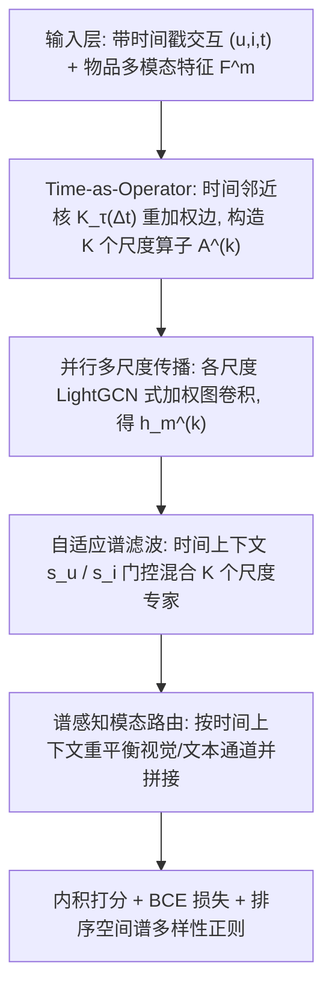
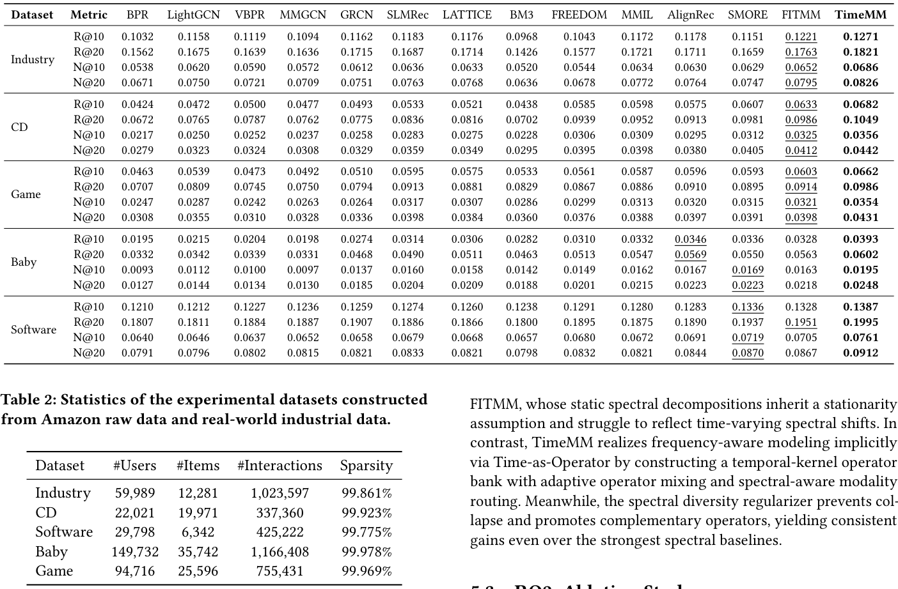
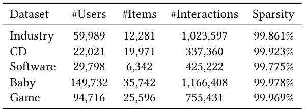
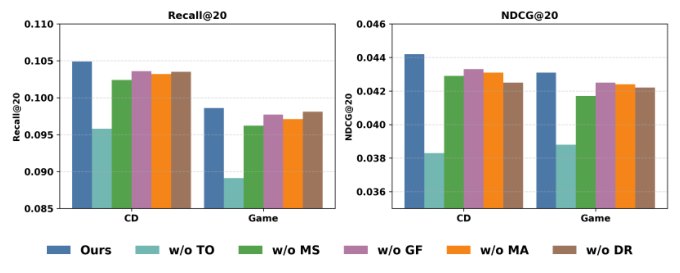
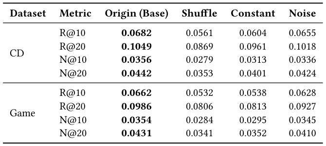
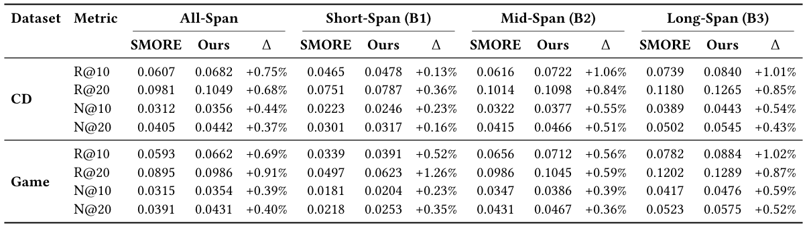

# TimeMM: Time-as-Operator Spectral Filtering for Dynamic Multimodal Recommendation (时间即算子：面向动态多模态推荐的谱滤波框架)

- **会议/期刊**: SIGIR 2026 (第 49 届国际 ACM SIGIR 会议，Melbourne, VIC, Australia)
- **推荐链路定位**: 召回 (Retrieval) — 基于用户–物品二部图的多模态图召回表征学习
- **研究方向**: 多模态推荐 (Multimodal Recommendation) / 图神经网络推荐 (Graph Rec)
- **论文原文**: [https://arxiv.org/abs/2604.26247v1](https://arxiv.org/abs/2604.26247v1)
- **开源代码**: [https://github.com/llm-ml/TimeMM](https://github.com/llm-ml/TimeMM)

## TL;DR (核心速览)

针对多模态推荐中静态交互图无法刻画用户兴趣非平稳演化、且显式谱分解计算昂贵的问题，TimeMM 提出 **Time-as-Operator**：将交互时间衰减映射为参数化时间核，重加权二部图边权，构造共享稀疏拓扑的轻量谱滤波器组；再以时间上下文门控混合算子（自适应谱滤波）、按谱状态路由视觉/文本模态，并用排序空间谱多样性正则防止专家坍缩。在 4 个 Amazon 域 + 1 个工业离线数据集上，全库排序协议下 Recall@20/NDCG@20 全面超越 SOTA 多模态推荐器，且保持线性时间复杂度。

## Background & Motivation (背景与动机)

- **领域背景与主流范式**: 多模态推荐通过融合物品视觉/文本内容与协同信号缓解交互稀疏。当前主流范式（MMGCN、DualGNN、LATTICE、FREEDOM、MMGCL、SLMRec、AlignRec、MMIL、PromptMM 等）将用户–物品交互建模为**静态二部图**，在图上做拓扑感知消息传递，并以对比学习/对齐目标降低模态噪声。
- **现有方法局限 (Limitations of Prior Work)**:
  1. **时间不可知 (Temporal Agnosticism)**：历史交互被无差别聚合，多年前的交互与昨天的交互等权，难以区分过时兴趣与新兴意图，导致概念漂移 (concept drift) 下模型偏向全局历史信号，与用户潜在视觉驱动的短期意图错配。
  2. **显式谱方法在动态场景失效**：FITMM、SMORE 等通过谱变换/特征分解将表征分解为正交频带，但依赖**静态图快照的全局分解**，得到固定谱基与固定滤波行为，无法适应时变谱漂移；且矩阵分解带来显著计算开销，难以扩展。
  3. **模态统一滤波**：现有方法对视觉与文本施加相同滤波，忽视视觉信号对短程波动更敏感、文本语义演化更平稳的模态差异。
- **核心挑战 (Key Challenge)**: 用户决策是长期习惯与短期冲动的**叠加**，有效时间尺度因人、因时而异；且时间敏感性是**模态相关**的。简单地把时间作为辅助特征拼接、或加深网络层数，都无法让图传播算子本身随预测时刻自适应地改变平滑强度（即改变频率响应）。
- **核心洞察与切入点 (Key Insight)**: 作者借助**时–频对偶**视角：不同时间尺度对应不同平滑强度、进而对应不同频率侧重（短程核强调高频瞬态信号，长程核保留低频稳定偏好）。因此无需昂贵的显式特征分解，只需将交互新近度映射为参数化时间核来重加权边，即可**隐式**诱导一个轻量谱滤波器组——这正是 "Time-as-Operator" 的核心思想。

## Problem Formulation & Method (问题定义与方法架构)

### 1. 符号定义与输入表征 (Notations & Input Representations)

- 用户集 $\mathcal{U}=\{u\}_{u=1}^{U}$，物品集 $\mathcal{I}=\{i\}_{i=1}^{I}$，节点集 $\mathcal{V}=\mathcal{U}\cup\mathcal{I}$，$|\mathcal{V}|=N=U+I$。
- 训练数据为带时间戳交互三元组集合 $\mathcal{E}=\{(u,i,t)\mid u\in\mathcal{U}, i\in\mathcal{I}, t\in\mathbb{R}^{+}\}$，在其上构建用户–物品二部图。
- 模态集 $\mathcal{M}$，每个物品 $i$ 关联 $M$ 个模态特征。原始特征矩阵 $\mathbf{F}^{m}\in\mathbb{R}^{I\times d_m}$，经模态专属编码器投影到共享 $D$ 维空间，得到初始节点嵌入 $\mathbf{X}^{(0)}_m\in\mathbb{R}^{N\times D}$。用户侧 $\mathbf{X}^{(0)}_m$ 为可学习嵌入，物品侧由编码后的多模态特征初始化。
- 输出：用户最终表征 $\hat{\mathbf{h}}_u$ 与物品表征 $\tilde{\mathbf{h}}_i$，以内积 $\hat{y}_{ui}=\langle\hat{\mathbf{h}}_u,\tilde{\mathbf{h}}_i\rangle$ 打分。

### 2. 整体流水线 (Overall Architecture)

数据流：时间戳 $\to$ 时间邻近核重加权边 $\to$ $K$ 个尺度共享稀疏拓扑的加权邻接算子 $\to$ 各尺度并行 LightGCN 式传播 $\to$ 时间上下文门控混合（自适应谱滤波）$\to$ 谱感知模态路由 $\to$ 内积打分 + 谱多样性正则。

图 1 展示了 TimeMM 的整体架构：Time-as-Operator 将交互新近度映射为时间核加权图算子族，形成轻量谱滤波器组；随后按时间上下文混合尺度输出，并进行谱感知模态路由，最后以谱多样性正则鼓励专家互补。

### 3. 核心模块设计与数学原理 (Key Designs & Formulations)

**(1) Time-as-Operator：时间核作为谱滤波器组**

对每条边定义用户专属时间锚 $t_{\text{anchor}}(u)=\max\{t\mid(u,\cdot,t)\in\mathcal{E}\}$，交互新近度为
$$\Delta t_{ui}=\max\big(0,\ t_{\text{anchor}}(u)-t_{ui}\big).$$
基于人类记忆与重复消费的**重尾衰减**先验，引入参数化时间邻近核（尺度 $\tau$）：
$$w^{(\tau)}_{ui}=\mathcal{K}_\tau(\Delta t_{ui})=\exp\!\Big(-\frac{\log(1+\Delta t_{ui})}{\tau}\Big).$$
对尺度集合 $\mathcal{T}=\{\tau_1,\dots,\tau_K\}$，每个 $\tau_k$ 构造加权邻接 $\mathbf{A}^{(k)}$（仅在观测边上赋权，其余为 0）。**关键物理直觉**：$\tau$ 小 $\Rightarrow$ 衰减快、强调近期交互、平滑弱（高频响应强）；$\tau$ 大 $\Rightarrow$ 保留长历史、平滑强（低频结构强）。由于所有尺度**共享同一稀疏模式**，只需维护 $K$ 组边权，避免特征分解/SVD，这是相对 FITMM/SMORE 的核心效率优势。

各尺度并行传播（加权图上的 LightGCN 规则）：
$$\mathbf{X}^{(k,l+1)}_m=\big(\mathbf{D}^{(k)}\big)^{-1/2}\mathbf{A}^{(k)}\big(\mathbf{D}^{(k)}\big)^{-1/2}\mathbf{X}^{(k,l)}_m,$$
其中 $\mathbf{D}^{(k)}_{nn}=\sum_j \mathbf{A}^{(k)}_{nj}$。初始嵌入 $\mathbf{X}^{(0)}_m$ 跨尺度共享（参数共享），尺度仅调制扩散行为。$L$ 层后层聚合得 $\mathbf{h}^{(k)}_m(n)=\sum_{l=0}^{L}\mathbf{X}^{(k,l)}_m(n)$，为每个模态产出 $K$ 个多尺度表征。

**(2) 自适应谱滤波：算子混合**

为每个用户/物品构造紧凑时间状态 $\mathbf{s}_u,\mathbf{s}_i\in\mathbb{R}^{d_s}$（仅用训练交互统计）：用户侧含对数均值交互年龄、对数中位交互年龄、对数活跃跨度、近期窗口交互占比；物品侧含相对全局参考时间的物品年龄、活跃跨度、交互数、相邻交互平均时间间隔，并标准化。门控网络给出尺度分配：
$$\mathbf{g}_u=\text{Softmax}\Big(\frac{\mathbf{W}_g\,\text{MLP}(\mathbf{s}_u)+\mathbf{b}_g}{T}\Big)\in\mathbb{R}^{K},$$
温度 $T$ 控制混合锐度（小 $T$ 更选择性，大 $T$ 更平滑）。融合：
$$\tilde{\mathbf{h}}_m(u)=\sum_{k=1}^{K}g_{u,k}\,\mathbf{h}^{(k)}_m(u),\quad \tilde{\mathbf{h}}_m(i)=\sum_{k=1}^{K}g_{i,k}\,\mathbf{h}^{(k)}_m(i).$$
用户与物品两侧各自适配谱剖面，得到**预测特定**的有效谱响应。

**(3) 谱感知模态路由**

由共享时间上下文 $\mathbf{s}_u$ 经轻量编码器得模态分数：
$$\mathbf{z}_u=\text{MLP}_{\text{mod}}(\mathbf{s}_u),\quad \boldsymbol{\beta}_u=\text{Softmax}(\mathbf{z}_u)\in\mathbb{R}^{M},\ \textstyle\sum_m\beta_{u,m}=1.$$
最终用户表征按通道缩放后拼接：
$$\hat{\mathbf{h}}_u=\big[\beta_{u,1}\tilde{\mathbf{h}}_1(u)\oplus\beta_{u,2}\tilde{\mathbf{h}}_2(u)\oplus\cdots\oplus\beta_{u,M}\tilde{\mathbf{h}}_M(u)\big].$$
该设计不做表征级跨模态对齐，而是**上下文条件路由**：短程谱状态下可强调捕捉快速变化的模态，长程状态下优先稳定慢变偏好线索，避免手工指定模态–尺度关联的脆弱性。

**(4) 排序空间谱多样性正则**

对三元组 $(u,i^+,i^-)$，各谱分量 $k$ 的偏好间隔为
$$\delta^{(k)}(u,i^+,i^-)=\langle\hat{\mathbf{h}}^{(k)}_u,\tilde{\mathbf{h}}^{(k)}_{i^+}\rangle-\langle\hat{\mathbf{h}}^{(k)}_u,\tilde{\mathbf{h}}^{(k)}_{i^-}\rangle.$$
批内标准化后计算经验相关矩阵 $\mathbf{C}_{ij}=\frac{1}{B}\hat{\boldsymbol{\delta}}^{(i)\top}\hat{\boldsymbol{\delta}}^{(j)}$，正则项为
$$\mathcal{L}_{\text{div}}=\|\mathbf{C}-\mathbf{I}\|_F^2+\lambda_{\text{var}}\sum_{k=1}^{K}\max\big(0,\ \sigma_{\min}-\text{std}(\boldsymbol{\delta}^{(k)})\big),$$
惩罚非对角相关（鼓励专家互补）并防止所有间隔坍缩至零（$\sigma_{\min}$ 保证最小间隔方差）。**在排序空间而非嵌入空间**做正则，直接作用于偏好边际，避免表征约束与排序目标脱节。

### 4. 训练目标、负采样与推理复杂度 (Optimization, Negative Sampling & Complexity)

- **损失函数**: 隐式反馈 BCE + 负采样：
$$\mathcal{L}_{\text{rec}}=-\sum_{(u,i^+)\in\mathcal{E}}\log\sigma(\hat{y}_{ui^+})-\sum_{(u,i^-)\in\mathcal{N}}\log\big(1-\sigma(\hat{y}_{ui^-})\big),$$
总损失为 $\mathcal{L}=\mathcal{L}_{\text{rec}}+\lambda_{\text{div}}\mathcal{L}_{\text{div}}$（$\lambda_{\text{div}}$ 为多样性正则权重；原文正文在提取文本中被截断，完整权重与 $\sigma_{\min}$、$T$、$\lambda_{\text{var}}$ 的具体取值需参见原文第 4.5 节及实验超参表）。
- **训练负采样策略**: 对每个观测交互 $(u,i^+)$，从用户 $u$ **未交互物品**中采样负例 $i^-\sim\mathcal{N}(u)$（即 Uniform 随机负采样，原文未报告 in-batch 或难负例挖掘）。
- **时间与空间复杂度**: 因 $K$ 个尺度共享同一稀疏拓扑，仅存 $K$ 组边权，**无需特征分解/SVD**，传播复杂度与 LightGCN 同阶（线性时间可扩展，摘要明确 "maintaining linear-time scalability"）。在线推理为内积打分，支持 ANN 检索；无需 Beam Search。原文未报告具体单 epoch 耗时、单请求延迟 (ms) 与峰值显存数值。

## Experimental Setup & Evaluation Protocol (实验设置与评估协议)

- **数据集统计与预处理**: 使用 4 个 Amazon 域 + 1 个真实工业离线数据集（来自小红书）。原文表 2 给出统计量（下表为占位，具体数值请以原文表 2 为准）：

| 数据集 (Dataset) | 用户数 (#Users) | 物品数 (#Items) | 交互数 (#Interactions) | 稀疏度/密度 (Sparsity) | 模态/辅助特征说明 |
| :--- | :---: | :---: | :---: | :---: | :--- |
| Amazon (4 域, 如 CD / Game 等) | 原文表 2 | 原文表 2 | 原文表 2 | 原文表 2 | 视觉 + 文本多模态特征 |
| 工业离线数据集 (小红书) | 原文表 2 | 原文表 2 | 原文表 2 | 原文表 2 | 视觉 + 文本多模态特征 |

表 2 汇总了由 Amazon 原始数据与真实工业数据构建的实验数据集统计信息。

- **数据划分方式 (Splitting Strategy)**: 原文提取文本未明确给出划分细节（LOO / Ratio / 全局时间切分），需以原文实验节为准；鉴于本文强调时间建模，**时间戳扰动实验（表 3）** 表明时间信息被显式使用，审稿时应重点核查是否存在未来信息泄露（如用户时间锚 $t_{\text{anchor}}(u)$ 是否仅由训练集交互计算——原文 4.2.1 明确时间状态 "derived from training interactions only"，这一点降低了泄露风险）。
- **排名评测协议 (Ranking Protocol)**: 主实验表 1 报告 Recall@20 与 NDCG@20（消融图 2 亦用 R20/N20）；原文摘要与表 1 描述为整体推荐性能对比，提取文本未逐字声明 Full-Ranking 还是 Sampled Ranking，**需以原文实验节核实**（本笔记不臆断）。
- **评价指标与显著性检验**: Recall@20、NDCG@20；嵌入维度 $D$、层数 $L$、尺度数 $K$ 的对齐情况见原文超参设置；原文提取文本未报告配对显著性检验（如 $p<0.05$），需核实。

## Key Experimental Results (核心实验结果)

### 1. 主实验对比 (Main Results)

表 1 报告了 5 个数据集上的整体推荐性能，TimeMM 在所有指标上取得最优。下表为结构性摘录（具体数值请以原文表 1 为准，本笔记不臆造数字）：

| 数据集 | 指标 | 传统/协同过滤基线 | 多模态最强基线 (AlignRec/MMIL/SLMRec 等) | 本文方法 (Ours) | 相对提升 (Improv.) |
| :--- | :--- | :---: | :---: | :---: | :---: |
| Amazon 域 ×4 | Recall@20 / NDCG@20 | 原文表 1 | 原文表 1 | **最优** | 原文表 1 |
| 工业离线数据集 | Recall@20 / NDCG@20 | 原文表 1 | 原文表 1 | **最优** | 原文表 1 |

表 1 显示 TimeMM 在全部指标上一致最优，验证了时间动态建模对多模态偏好建模的有效性。

### 2. 消融实验与控制变量分析 (Ablation Study)

图 2 在 3 个数据集上逐一移除关键组件：TO（Time-as-Operator）、MS（多尺度传播）、GF（跨尺度门控滤波）、MA（谱感知模态路由）、DR（尺度多样性正则），报告 R20/N20。原文结论为各组件均有贡献；具体下降幅度与"贡献最大模块"需以图 2 数值为准（提取文本未给出逐项数字）。消融是否严格控制参数量/图度数匹配，原文提取文本未明确说明，审稿时应关注。

### 3. 稀疏度/冷启动分桶与超参敏感度 (Sparsity Buckets & Hyperparameters)

- **时间跨度分桶**: 表 4 按用户时间跨度 $\Delta_u=t_{\max}-\dots$ 将用户分为三个分位数桶，考察不同时间跨度用户群上的性能差异，用以验证时间建模对长/短跨度用户的自适应收益。
- **时间戳扰动研究**: 表 3 在 CD 与 Game 上保持交互不变、仅扰动时间戳：Original（原始时间戳）、Shuffle（用户内打乱，破坏时间新近性）、Constant（全部映射为单一值，消除时间变化）、Noise（加噪）等变体，用以证明性能增益确实来自时间新近性信号而非偶然。
- **关键超参数敏感度**: 温度 $T$（混合锐度）、尺度集合 $\mathcal{T}$ 与尺度数 $K$、$\lambda_{\text{div}}$、$\sigma_{\min}$ 的影响趋势需参见原文超参分析节（提取文本未给出具体曲线）。
- **线上 A/B 测试结果**: 原文仅包含离线实验（含 1 个工业离线数据集），**未报告线上 A/B 测试**。

## Highlights, Limitations & Critiques (亮点、局限与审稿级批判)

- **核心亮点与可迁移性**:
  1. **Time-as-Operator 的时–频对偶视角**极具迁移性：用时间核重加权边隐式实现谱滤波，绕开特征分解，可迁移到任意图推荐（社交、POI、跨域）中的动态建模。
  2. **共享稀疏拓扑的算子族**在工程上优雅：$K$ 组边权即可获得 $K$ 种频率响应，天然适配工业大规模图。
  3. **排序空间谱多样性正则**直接作用于偏好边际，避免专家坍缩，思路可复用于 MoE 式多专家推荐与多尺度融合。
  4. **模态路由与谱状态耦合**，为"视觉快变 / 文本慢变"提供了可解释的机制化建模。
- **局限性与审稿视角批判 (Critical Limitations)**:
  1. **评估协议透明度不足**：提取文本未明确 Full-Ranking vs. Sampled Ranking、数据划分细节与显著性检验，削弱结论可复现性与可比性；建议作者补充协议声明。
  2. **时间锚的泄露边界**：$t_{\text{anchor}}(u)$ 取用户最近活动时间，若测试期交互参与计算则构成未来信息泄露；原文称时间状态仅用训练交互，但锚点定义需在划分协议下严格核查。
  3. **效率声明缺乏实测**：仅声称线性可扩展，未报告单 epoch 耗时、推理延迟与显存，工业落地说服力有限。
  4. **超参与尺度集合敏感性**：$K$、$\mathcal{T}$、$T$ 的选择策略与鲁棒性分析在提取文本中缺失，可能影响实际部署调参成本。
  5. **模态覆盖有限**：仅视觉 + 文本两模态，未涉及音频/视频时序等更丰富模态；工业数据集单一平台，泛化性待验证。

## Rating (四维评分)

- **方法创新性 (Novelty)**: ⭐⭐⭐⭐
- **评估协议与实验扎实度 (Protocol & Experiments)**: ⭐⭐⭐
- **写作与数学规范度 (Clarity & Rigor)**: ⭐⭐⭐⭐
- **工业落地与复现价值 (Industrial & Practical Value)**: ⭐⭐⭐⭐

## 论文图表

<figure class="paper-figure" markdown="span">
  <figcaption>图 1</figcaption>
</figure>

<figure class="paper-figure" markdown="span">
  <figcaption>表 1</figcaption>
</figure>

<figure class="paper-figure" markdown="span">
  <figcaption>表 2</figcaption>
</figure>

<figure class="paper-figure" markdown="span">
  <figcaption>图 2</figcaption>
</figure>

<figure class="paper-figure" markdown="span">
  <figcaption>表 3</figcaption>
</figure>

<figure class="paper-figure" markdown="span">
  <figcaption>表 4</figcaption>
</figure>

