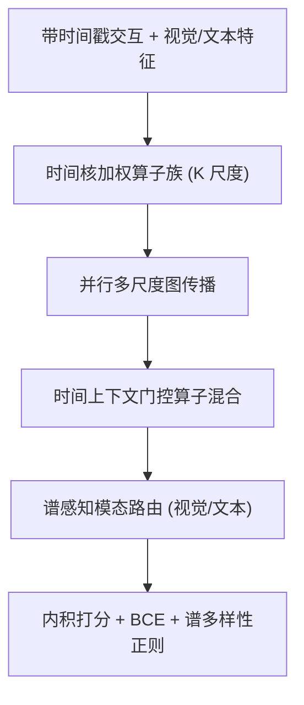
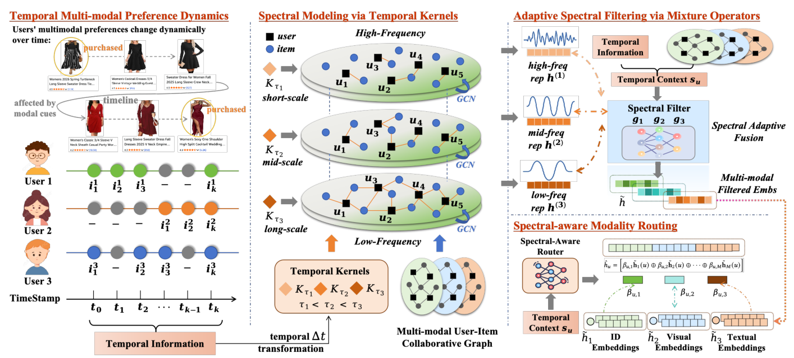

# TimeMM: Time-as-Operator Spectral Filtering for Dynamic Multimodal Recommendation (时间即算子：面向动态多模态推荐的谱滤波框架)

- **会议/期刊**: SIGIR 2026
- **作者与机构**: Wei Yang, Rui Zhong, Zihan Lin, Xiaodan Wang, Cheng Chen, Huan Ren, Yao Hu（小红书 Inc.）
- **推荐链路定位**: 召回（图协同召回表征学习）
- **研究方向**: 多模态推荐 / 图神经网络推荐
- **论文原文**: [https://arxiv.org/abs/2604.26247v1](https://arxiv.org/abs/2604.26247v1)
- **开源代码**: [https://github.com/llm-ml/TimeMM](https://github.com/llm-ml/TimeMM)

## TL;DR (1分钟核心速览)

现有多模态推荐（AlignRec、FREEDOM、SMORE、FITMM）把交互图当作静态快照，或依赖全局特征分解得到固定谱基，无法刻画"视觉品味快速漂移、语义兴趣缓慢演化"的非平稳偏好。TimeMM 提出 **Time-as-Operator**：把交互新近度映射为参数化时间核，重加权同一稀疏拓扑上的边，构造 $K$ 个不同平滑强度的算子，从而**免特征分解**地隐式实现多尺度谱滤波；再用时间上下文门控混合算子、按谱机制路由视觉/文本贡献。在 4 个 Amazon 域 + 1 个工业离线集上，Leave-One-Out 全库排序协议下 R@20 相对最强基线提升约 3%–10%（CD 域 R@10 +7.7%）。

## Background & Motivation (背景与核心矛盾)

- **主流范式**: MMGCN/DualGNN/LATTICE/FREEDOM/AlignRec 在静态用户–物品二部图上做多模态消息传递；SMORE/FITMM 引入谱分解，把表征拆成正交频带再融合。
- **前人局限一（时间失语）**: 静态图把"三年前的交互"与"昨天的交互"等权聚合，用户时间线被压平成结构快照，概念漂移下模型偏向全局历史，与短期视觉驱动意图错位。
- **前人局限二（谱基僵化）**: 显式谱方法依赖静态图的全局特征分解，谱基与滤波行为固定，无法回答"高频分量是噪声还是新兴短期兴趣"；且 $O(N^3)$ 分解开销大，并对所有模态施加统一滤波，忽视视觉比文本对短程波动更敏感。
- **核心洞察 (Key Insight)**: 时域与频域存在对偶——**不同时间尺度对应不同平滑强度，即不同频率响应**。因此无需显式分解，只需改变"哪些边被强调"，即可隐式改变谱响应。
- **本文切入点**: 把时间从"辅助特征"提升为"图传播算子本身"，用时间核算子族替代特征分解。

## Method (核心方法设计)

### 1. 整体框架 (Overall Architecture)

输入为用户–物品带时间戳交互与物品视觉/文本特征；先按模态编码到共享空间得 $\mathbf{X}_m^{(0)}$。核心链路：以用户最近活跃时刻为锚点计算每条边时延，经重尾时间核生成$K$个尺度特定的加权邻接算子，在同一稀疏拓扑上并行做 LightGCN 式传播，得到$K$ 组多尺度表征；随后由用户/物品时间状态向量门控混合算子（自适应谱滤波），再由同一时间上下文路由视觉/文本通道并拼接；最后以内积打分、BCE + 谱多样性正则联合训练。

<figure class="paper-figure" markdown="span">
  <figcaption>图1：TimeMM的整体架构。TimeMM通过将交互新近度映射到一族时间核加权图算子来实例化“时间即算子”，在交互图上形成轻量级谱滤波器组。随后，它根据时间上下文混合尺度特定的传播输出，执行时间条件自适应谱滤波，接着进行谱感知模态路由，以在活跃谱机制下校准视觉和文本贡献。谱多样性正则化器进一步鼓励互补的专家行为并防止滤波</figcaption>
</figure>

### 2. 关键设计拆解 (Key Designs)

1. **Time-as-Operator：时间核即谱滤波器组**：针对静态图等权聚合的痛点，以用户锚点 $t_{\text{anchor}}(u)=\max\{t\}$定义时延$\Delta t_{ui}$，用重尾核$w_{ui}^{(\tau)}=\exp\!\left(-\frac{\log(1+\Delta t_{ui})}{\tau}\right)$重加权边，得$\mathbf{S}^{(k)}=(\mathbf{D}^{(k)})^{-1/2}\mathbf{A}^{(k)}(\mathbf{D}^{(k)})^{-1/2}$。小$\tau$快速衰减、弱平滑（保高频瞬态），大$\tau$强平滑（保低频稳定偏好）。因$K$个算子共享同一稀疏模式，只需存$K$组边权，彻底绕开$O(N^3)$ 特征分解——这是相对 SMORE/FITMM 的本质节省。

2. **自适应谱滤波 + 谱感知模态路由**：单一固定频响对所有人非最优。用用户/物品时间统计（对数平均交互年龄、活跃跨度、近期窗口占比等）构造状态 $\mathbf{s}_u,\mathbf{s}_i$，经带温度$T$的门控得混合权重$\mathbf{g}_u=\text{Softmax}\!\left(\frac{\mathbf{W}_g\text{MLP}(\mathbf{s}_u)+\mathbf{b}_g}{T}\right)$，融合$\tilde{\mathbf{h}}_m(u)=\sum_k g_{u,k}\mathbf{h}_m^{(k)}(u)$。再由$\boldsymbol{\beta}_u=\text{Softmax}(\text{MLP}_{\text{mod}}(\mathbf{s}_u))$ 对模态通道重标定后拼接，使"短程机制偏视觉、长程机制偏文本"由数据学出而非硬编码。

3. **谱多样性正则与训练目标**：算子银行易发生 filter collapse（退化为近同质专家平均）。作者在**排序空间**而非表征空间做去相关：对三元组计算各分量偏好边际 $\delta^{(k)}=\langle\hat{\mathbf{h}}_u^{(k)},\tilde{\mathbf{h}}_{i^+}^{(k)}\rangle-\langle\hat{\mathbf{h}}_u^{(k)},\tilde{\mathbf{h}}_{i^-}^{(k)}\rangle$，构造批内相关矩阵$\mathbf{C}$，令$\mathcal{L}_{\text{div}}=\|\mathbf{C}-\mathbf{I}\|_F^2+\lambda_{\text{var}}\sum_k\max(0,\sigma_{\min}-\text{std}(\boldsymbol{\delta}^{(k)}))$。总损失$\mathcal{L}=\mathcal{L}_{\text{rec}}+\lambda\mathcal{L}_{\text{div}}+\gamma\|\Theta\|_2^2$，$\mathcal{L}_{\text{rec}}$为带均匀负采样的 BCE。复杂度$O(KL|\mathcal{E}|D)$，线性可扩展。

## Experimental Setup & Evaluation Protocol (实验设置与评估协议)

- **数据集与预处理**: 4 个 Amazon 域（CD/Game/Baby/Software）+ 1 个小红书工业离线集，物品对齐文本与图像特征。

| 数据集 | #Users | #Items | #Interactions | 稀疏度 | 说明 |
| :--- | :---: | :---: | :---: | :---: | :--- |
| Industry | 59,989 | 12,281 | 1,023,597 | 99.861% | 真实工业分布 |
| CD | 22,021 | 19,971 | 337,360 | 99.923% | Amazon 音乐 |
| Software | 29,798 | 6,342 | 425,222 | 99.775% | Amazon 软件 |
| Baby | 149,732 | 35,742 | 1,166,408 | 99.978% | 最稀疏 |
| Game | 94,716 | 25,596 | 755,431 | 99.969% | Amazon 游戏 |

- **数据划分与防穿越**: `Leave-One-Out` 用户级时间序切分（最后一条测试、倒数第二条验证、其余训练）；所有时间统计、时间核与算子混合**仅用训练交互**构造，杜绝未来时间戳泄漏。
- **排名评测协议**: 无偏 `Full-Ranking`（全库未交互物品排序），报告 Recall@{10,20} 与 NDCG@{10,20}；训练用标准均匀负采样。
- **对比基线与超参**: 2 个纯交互基线（BPR、LightGCN）+ 11 个多模态基线（VBPR、MMGCN、GRCN、DualGNN、SLMRec、LATTICE、BM3、FREEDOM、DiffMM、MMIL、AlignRec）+ 2 个谱方法（SMORE、FITMM）。嵌入维度 $d=64$，batch 2048，Adam，学习率$\{10^{-4},\dots,5\times10^{-3}\}$，$\lambda,\gamma\in\{10^{-4},\dots,1\}$，尺度数$K\in\{1,\dots,5\}$，以 Recall@20 早停。

## Key Experimental Results (实验关键数据)

### 1. 主实验对比 (Main Results)

| 数据集 | 指标 | LightGCN | LATTICE | FREEDOM | AlignRec | SMORE | FITMM | **TimeMM** | Improv. |
| :--- | :--- | :---: | :---: | :---: | :---: | :---: | :---: | :---: | :---: |
| CD | R@10 | 0.0472 | 0.0521 | 0.0585 | 0.0575 | 0.0607 | 0.0633 | **0.0682** | +7.7% |
| CD | R@20 | 0.0765 | 0.0816 | 0.0939 | 0.0913 | 0.0981 | 0.0986 | **0.1049** | +6.4% |
| CD | N@20 | 0.0323 | 0.0349 | 0.0395 | 0.0380 | 0.0405 | 0.0412 | **0.0442** | +7.3% |
| Game | R@20 | 0.0809 | 0.0881 | 0.0867 | 0.0910 | 0.0895 | 0.0914 | **0.0986** | +7.9% |
| Baby | R@10 | 0.0215 | 0.0306 | 0.0310 | 0.0346 | 0.0336 | 0.0328 | **0.0393** | +13.6% |
| Baby | N@20 | 0.0144 | 0.0209 | 0.0201 | 0.0223 | 0.0223 | 0.0218 | **0.0248** | +11.2% |
| Software | R@20 | 0.1811 | 0.1866 | 0.1895 | 0.1890 | 0.1937 | 0.1951 | **0.1995** | +2.3% |
| Industry | R@20 | 0.1675 | 0.1714 | 0.1577 | 0.1711 | 0.1659 | 0.1763 | **0.1821** | +3.3% |
| Industry | N@20 | 0.0750 | 0.0768 | 0.0678 | 0.0764 | 0.0747 | 0.0795 | **0.0826** | +3.9% |

### 2. 消融实验 (Ablation Study)

| 变体 | CD R@20 | CD N@20 | 说明 |
| :--- | :---: | :---: | :--- |
| **TimeMM 完整** | **0.1049** | **0.0442** | — |
| w/o TO（时间即算子） | 0.0918 | 0.0383 | 退化最大，回落到静态图水平 |
| w/o MS（多尺度传播） | 下降 | 下降 | 退化为单一平滑剖面 |
| w/o GF（跨尺度门控） | 下降 | 下降 | 失去上下文条件选择 |
| w/o MA（模态路由） | 下降 | 下降 | 模态贡献固定 |
| w/o DR（多样性正则） | 小幅下降 | 小幅下降 | 专家塌缩风险上升 |

### 3. 关键实验发现 (Key Findings)

1. **时间结构是真实增益来源，而非偶然相关**：仅打乱用户内时间戳顺序（Shuffle）即令 CD 的 R@20 从 0.1049 跌至 0.0869、N@20 从 0.0442 跌至 0.0353，跌幅远超 Constant（0.0961）与 Noise（0.1018），证明模型真正依赖"相对时序"而非绝对时间值，且对日志抖动鲁棒。
2. **长历史用户获益最大，验证非平稳性假设**：按历史跨度分桶后，TimeMM 相对 SMORE 的增益从 B1（CD R@10 +0.13%）单调放大到 B3（+1.01%，0.0739→0.0840），说明时间跨度越长、时序结构越丰富，算子银行诱导的平滑剖面越有信息量；且各桶均不劣化，未以牺牲短历史用户为代价。
3. **算子银行学到可解释的短→长有序层级且未塌缩**：$K=3$时能量衰减比$r_{12},r_{13}$ 稳定小于 1，单调率从短跨度 0.8637 升至长跨度 0.9050；用户级混合权重中位分配为短程 0.54 / 中程 0.22 / 长程 0.24，Top-1 集中度约 0.53–0.56 高于均匀 1/3，但归一化熵仍达 0.90–0.94——**软而选择性**，既非均匀平均也非 one-hot 硬路由。模态路由亦呈跨度条件趋势：视觉权重随跨度单调下降、文本温和上升。

## Highlights & Limitations (亮点、对比与审稿批判)

- **与代表作对比 (vs. Prior Work)**: 相比 AlignRec/FREEDOM 的静态多模态精修，TimeMM 把时间注入传播算子本身，直击概念漂移；相比 SMORE/FITMM 的显式频带分解，它以时间核隐式诱导谱响应，避免 $O(N^3)$ 分解且谱基随预测自适应；相比纯交互的 LightGCN，多模态通道在谱机制下被条件化路由。
- **可迁移亮点**: (1) "时间核重加权边 + 共享稀疏拓扑"的算子族构造，可直接移植到任意 LightGCN 类图召回，几乎零额外存储；(2) 在**排序空间**用批内边际相关性做专家去相关正则，比表征空间约束更贴合排序目标，可复用于多专家/多尺度融合。
- **审稿级局限批判**: (1) 时间状态 $\mathbf{s}_u$依赖人工统计特征（平均年龄、跨度、近期占比），对时间戳缺失或伪造严重的场景敏感，且$K$与温度$T$需网格搜索；(2) 评测仅限 Amazon 与单一工业离线集，缺少在线 A/B 与延迟实测，$K$ 倍并行传播在超大规模图上的显存与吞吐代价未被量化。

## Rating (四维评分)

- **方法创新性 (Novelty)**: ⭐⭐⭐⭐ （"时间即算子"把时域对偶转化为免分解的多尺度谱滤波，视角新颖且有 Dirichlet 能量与多项式滤波的理论解释支撑）
- **评估协议与实验扎实度 (Protocol & Experiments)**: ⭐⭐⭐⭐ （5 数据集 + 全库排序 + 严格防穿越 + 时间戳扰动/跨度分桶/算子有序性多维诊断，唯缺在线实验）
- **写作与数学规范度 (Clarity & Rigor)**: ⭐⭐⭐⭐ （算子、门控、正则公式链条清晰，谱解释推导完整；时间状态特征定义偏工程化，理论部分自陈为解释性而非新定理）
- **工业落地与复现价值 (Industrial & Practical Value)**: ⭐⭐⭐⭐ （线性复杂度、共享稀疏拓扑、代码开源且有工业数据验证，落地门槛低；$K$ 倍传播开销需按规模权衡）

