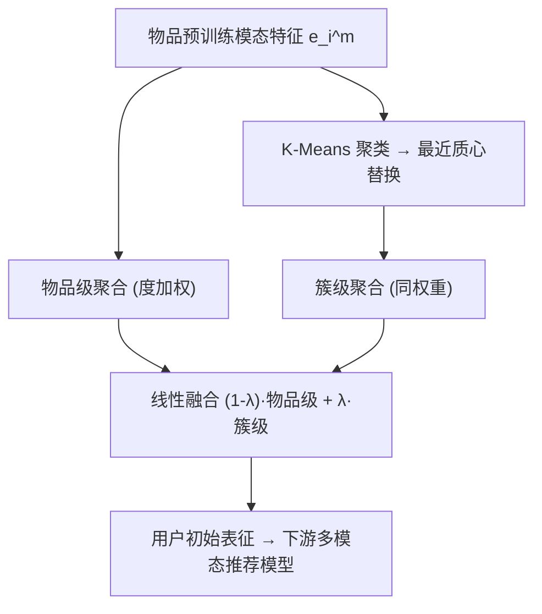
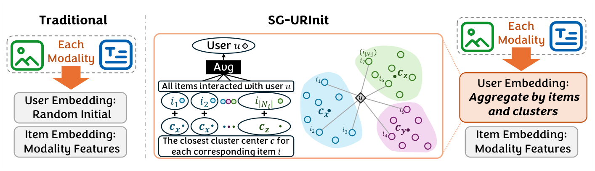

# Well Begun is Half Done: Training-Free and Model-Agnostic Semantically Guaranteed User Representation Initialization for Multimodal Recommendation (好的开始是成功的一半：免训练、模型无关的语义保障用户表征初始化)

- **会议/期刊**: SIGIR 2026
- **作者与机构**: Jinfeng Xu, Shuo Yang, Jinze Li, Edith C. H. Ngai (香港大学); Zheyu Chen, Xiping Hu (北京理工大学); Hewei Wang (CMU); Jianheng Tang (北京大学); Wei Wang (澳门理工大学)
- **推荐链路定位**: 召回（表征初始化层，可插拔至任意多模态推荐模型）
- **研究方向**: 多模态推荐 / 冷启动与长尾推荐
- **论文原文**: [https://arxiv.org/abs/2604.14839v1](https://arxiv.org/abs/2604.14839v1)
- **开源代码**: [https://github.com/Jinfeng-Xu/SG-URInit](https://github.com/Jinfeng-Xu/SG-URInit)

## TL;DR (1分钟核心速览)

多模态推荐中物品表征由预训练编码器（视觉/文本/音频）初始化，而用户表征却随机初始化，二者存在显著语义鸿沟，且该鸿沟在多层图卷积后依然残留（图 1 实证：随机初始化下用户/物品表征 L2 范数均值差 |Δμ| 在 20 epoch 后仍达 1.04–2.24）。本文提出 SG-URInit：用交互物品的模态特征做**物品级局部聚合**，再用 K-Means 聚类质心做**簇级全局聚合**，二者线性融合得到语义保障的用户初始表征。方法免训练、模型无关、零训练开销。在 4 个数据集 × 6 个 SOTA 模型上，Full-Ranking 协议下 Recall@5 相对提升 4.2%–36.4%，TikTok 上 MENTOR 提升最显著（+27.2%）。

## Background & Motivation (背景与核心矛盾)

- **主流范式**: 多模态推荐（MMGCN/SLMRec/FREEDOM/DRAGON/LGMRec/MENTOR）用预训练编码器抽取物品视觉/文本/音频特征作为物品初始表征，再经异质/同质图卷积与对比/对齐损失优化。
- **前人局限**: ① 物品有模态先验、用户无任何固有模态信息，业界惯例是**随机初始化用户表征**，造成初始语义鸿沟；② 由于 GCN 靠邻居聚合更新节点，随机用户表征在首层卷积即作为**噪声注入**到语义良好的物品表征中，且该污染沿训练持续存在（图 1 显示 20 epoch 后鸿沟未收敛）。
- **核心洞察 (Key Insight)**: 朴素地用交互物品均值初始化用户虽能缩小鸿沟，但会**局部过拟合**于已观测历史，丢失对簇内相似未交互物品的泛化兴趣；因此需要"局部+全局"双粒度语义。
- **本文切入点**: 在训练前一次性构造"物品级聚合 + 簇级质心聚合"融合的用户初始表征，从源头消除噪声注入。

## Method (核心方法设计)

### 1. 整体框架 (Overall Architecture)

对每个模态 $m$，先取物品预训练模态表征 $\mathbf{e}^m_i$；对用户 $u$ 的交互集 $N(u)$ 做度加权物品级聚合得 $\bar{\mathbf{e}}^m_u$；同时对全库物品模态表征做 K-Means 得 $K$ 个质心，将每个交互物品替换为其最近质心 $\tilde{\mathbf{e}}^m_i$ 后同权重聚合成簇级表征 $\tilde{\boldsymbol{e}}^m_u$；最后按 $\lambda$ 线性融合作为用户初始表征，直接喂入下游任意多模态推荐模型训练。整个初始化在训练前离线完成、可跨多次实验复用。

<figure class="paper-figure" markdown="span">
  <figcaption>图 2：用户表示初始化概览。左：传统用户表示初始化；右：我们的 SG-URInit。</figcaption>
</figure>

### 2. 关键设计拆解 (Key Designs)

1. **物品级度加权聚合（局部语义）**：痛点是用交互物品均值会过拟合历史；本文沿用 LightGCN 式度归一化权重，让低热度物品贡献更大：
$$\bar{\mathbf{e}}^m_u=\sum_{\tilde{i}\in N(u)}\frac{1}{|N(\tilde{i})|}\mathbf{e}^m_{\tilde{i}}$$
消融（表 5）证明该权重优于 bi-degree 与 equal 加权，因流行度加权在推荐中更符合物品重要性分布。

2. **簇级质心聚合（全局语义）**：痛点是纯局部聚合无法覆盖簇内未交互相似物品；先 K-Means 得质心集 $\mathcal{C}^m$，将物品映射到最近质心 $\tilde{\mathbf{e}}^m_i=\arg\min_{c^m_k}\|\mathbf{e}^m_i-c^m_k\|_2$，再同权重聚合得 $\tilde{\boldsymbol{e}}^m_u$。直觉：质心代表"同类兴趣原型"，把用户历史投影到原型空间即获得泛化偏好。

3. **融合与训练目标**：$\mathbf{e}^m_u=(1-\lambda)\bar{\mathbf{e}}^m_u+\lambda\tilde{\boldsymbol{e}}^m_u$，$\lambda$ 兼作尺度归一化因子，保证用户表征与物品表征同量级。**无新增损失、无负采样改动**——下游仍用各基线原有 BPR/对比/对齐损失；初始化离线耗时仅 4.75s–49.32s（表 6），训练阶段零额外开销，且实测加速收敛。

## Experimental Setup & Evaluation Protocol (实验设置与评估协议)

- **数据集与预处理**（沿用 MMRec 预处理）：

| 数据集 | #Users | #Items | #Interactions | 稀疏度 | 模态 |
| :--- | :---: | :---: | :---: | :---: | :--- |
| Baby | 19,445 | 7,050 | 160,792 | 99.88% | V, T |
| Sports | 35,598 | 18,357 | 296,337 | 99.95% | V, T |
| Clothing | 39,387 | 23,033 | 278,677 | 99.97% | V, T |
| TikTok | 9,319 | 6,710 | 59,541 | 99.90% | V, T, A |

- **数据划分与防穿越**: 遵循 FREEDOM/BM3 的 top-K 评测设定（用户交互按时间留出测试项，验证集用于早停，patience=20，最大 1000 epoch）；冷启动实验额外随机抽 20% 物品从训练集移除，10% 验证 + 10% 测试，属**冷启动划分**。
- **排名评测协议**: **Full-Ranking（全库未交互物品排序）**，指标 Recall@5/10、NDCG@5/10；所有结果对 10 次 K-Means 运行取平均以消除聚类随机性。
- **对比基线与超参**: 6 个基线 MMGCN / SLMRec / FREEDOM / DRAGON / LGMRec / MENTOR；batch=2048，Adam，RTX4090；$K\in\{2,4,8,16\}$，$\lambda\in\{0,10^{-4},10^{-3},10^{-2},0.1,1\}$ 网格搜索；显著性 $p<0.01$。

## Key Experimental Results (实验关键数据)

### 1. 主实验对比 (Main Results)

各基线 +SG-URInit 后全面提升（节选 Recall@5 / NDCG@5，加粗为各列最优）：

| 模型 | Baby R@5 | Baby N@5 | Sports R@5 | Clothing R@5 | TikTok R@5 | TikTok N@5 |
| :--- | :---: | :---: | :---: | :---: | :---: | :---: |
| MMGCN | 0.0240 | 0.0160 | 0.0216 | 0.0130 | 0.0250 | 0.0125 |
| +SG-URInit | 0.0263 (+9.58%) | 0.0171 (+6.88%) | 0.0268 (+24.07%) | 0.0147 (+13.08%) | 0.0341 (+36.40%) | 0.0162 (+29.60%) |
| SLMRec | 0.0343 | 0.0226 | 0.0429 | 0.0292 | 0.0309 | 0.0165 |
| +SG-URInit | 0.0360 (+4.96%) | 0.0235 (+3.98%) | 0.0454 (+5.83%) | 0.0312 (+6.85%) | 0.0344 (+11.33%) | 0.0182 (+10.30%) |
| FREEDOM | 0.0374 | 0.0243 | 0.0446 | 0.0388 | 0.0367 | 0.0250 |
| +SG-URInit | 0.0391 (+4.55%) | 0.0256 (+5.35%) | 0.0471 (+5.61%) | 0.0406 (+4.64%) | 0.0404 (+10.08%) | 0.0269 (+7.60%) |
| DRAGON | 0.0380 | 0.0249 | 0.0449 | 0.0401 | 0.0335 | 0.0228 |
| +SG-URInit | 0.0396 (+4.21%) | 0.0262 (+5.22%) | 0.0473 (+5.35%) | 0.0426 (+6.23%) | 0.0379 (+13.13%) | 0.0250 (+9.65%) |
| LGMRec | 0.0374 | 0.0249 | 0.0446 | 0.0371 | 0.0341 | 0.0235 |
| +SG-URInit | 0.0394 (+5.35%) | 0.0262 (+5.22%) | 0.0472 (+5.83%) | 0.0399 (+7.55%) | 0.0376 (+10.26%) | 0.0259 (+10.21%) |
| MENTOR | 0.0422 | 0.0281 | 0.0485 | 0.0411 | 0.0364 | 0.0247 |
| **+SG-URInit** | **0.0444 (+5.21%)** | **0.0296 (+5.34%)** | **0.0511 (+5.36%)** | **0.0432 (+5.11%)** | **0.0463 (+27.20%)** | **0.0292 (+18.22%)** |

### 2. 消融实验 (Ablation Study)

NDCG@10 上移除各组件（图 3，跨 6 模型 3 数据集趋势一致，此处给代表性方向）：

| 配置 | Baby (MENTOR) | Sports (MENTOR) | TikTok (MENTOR) | 结论 |
| :--- | :---: | :---: | :---: | :--- |
| w/o-Cluster（仅局部，≈AlphaRec） | 下降 | 下降 | 下降 | 全局语义有增益 |
| w/o-Item（仅全局） | 下降更多 | 下降更多 | 下降更多 | 局部语义为主导 |
| SG-URInit（完整） | 最优 | 最优 | 最优 | 双粒度互补 |

### 3. 关键实验发现 (Key Findings)

1. **模态越丰富收益越大**：TikTok（V+T+A 三模态）上 MMGCN 提升 36.40%、MENTOR 提升 27.20%，远高于双模态 Amazon 数据集的 4%–9%，说明随机初始化在模态多样性高时噪声更严重，SG-URInit 的边际价值随模态数上升。
2. **稀疏与冷启动双重受益**：按交互数分桶（1–5 至 21–25）后，SG-URInit 在**最稀疏桶**增益最大（图 5）；冷启动设定下 MENTOR 在 Baby 上 Recall@10 从 0.0391→0.0430、TikTok 从 0.0415→0.0459，验证语义一致性可替代部分交互数据。
3. **即插即用且可叠加**：与对抗训练 AMR、GPT-4o 数据增广叠加后进一步提升（MENTOR+S+A+G 在 Baby R@5 达 0.0452），且训练损失收敛更快（图 4），说明初始化与鲁棒训练/增广策略正交互补。

## Highlights, Limitations & Rating (亮点、对比与审稿评价)

- **与代表作对比 (vs. Prior Work)**: 与 AlphaRec 类"仅用交互物品均值初始化"相比，本文额外引入簇级质心聚合，避免局部过拟合；与 MENTOR/BM3 等改进**训练期对齐损失**的工作相比，本文不动损失、只改初始化，属正交增益；与 FREEDOM 稳定物品表征的思路互补——前者稳物品，本文稳用户起点。
- **可迁移亮点**: ① "预训练模态特征 + K-Means 质心投影"的双粒度初始化可直接迁移到跨域推荐的新用户冷启动；② 度加权聚合 + $\lambda$ 尺度归一化的融合技巧可复用于任何"异构先验 vs 随机初始化"的表征对齐场景。
- **审稿级局限批判**: ① 依赖 K-Means，需对 10 次运行取平均，聚类数 $K$ 需按数据集调（Clothing 需 $K=8$），跨模态动态 $K$ 仅带来边际增益且增加调参成本；② 初始化质量受物品模态编码器上限约束，若编码器本身噪声大则收益衰减；③ 仅在 top-K 全排序离线评测，缺少线上 A/B 与工业级延迟验证。
- **四维评分**: 创新性 ⭐⭐⭐ | 实验扎实度 ⭐⭐⭐⭐ | 方法清晰度 ⭐⭐⭐⭐⭐ | 落地价值 ⭐⭐⭐⭐

