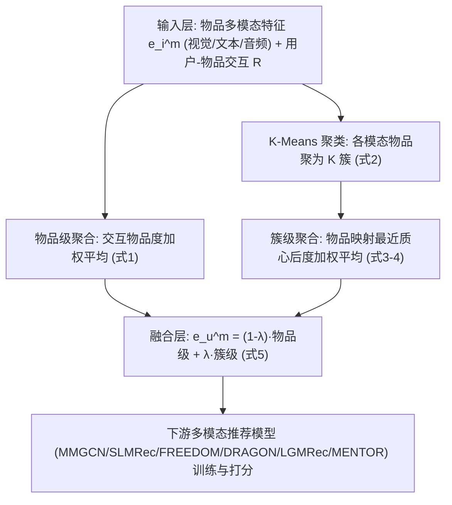
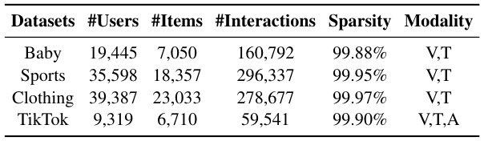
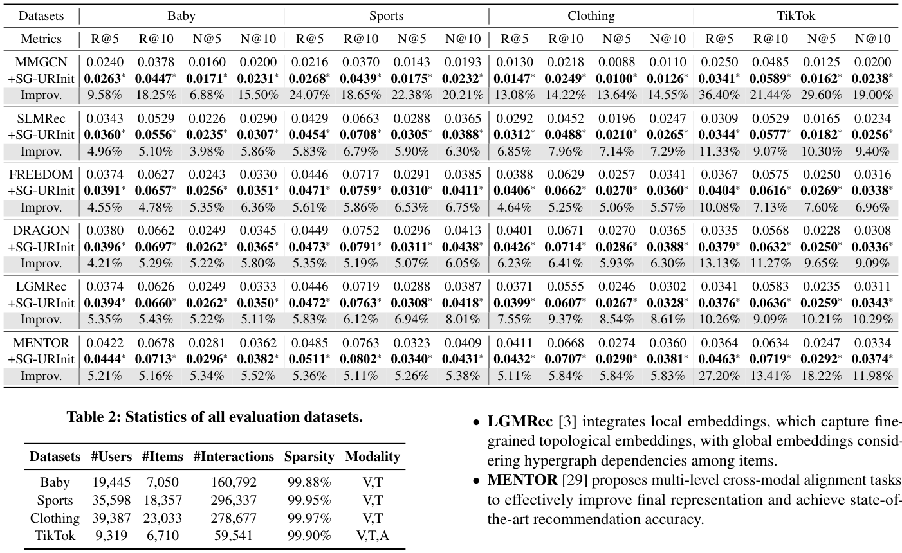
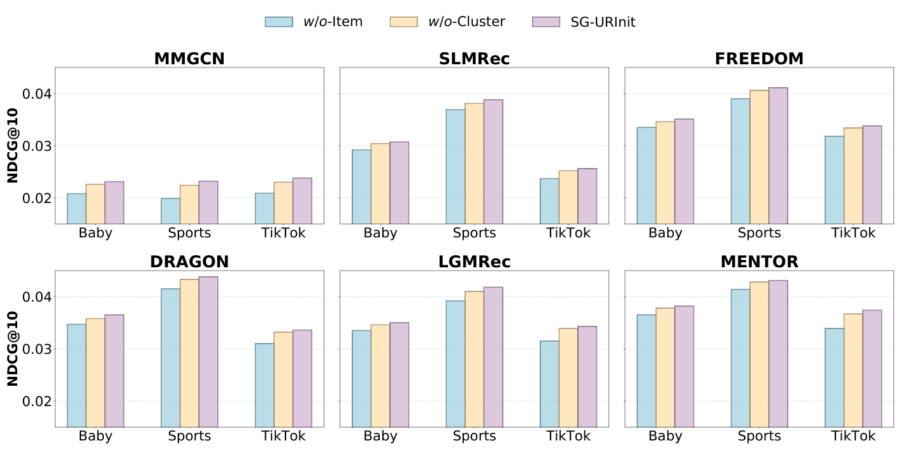
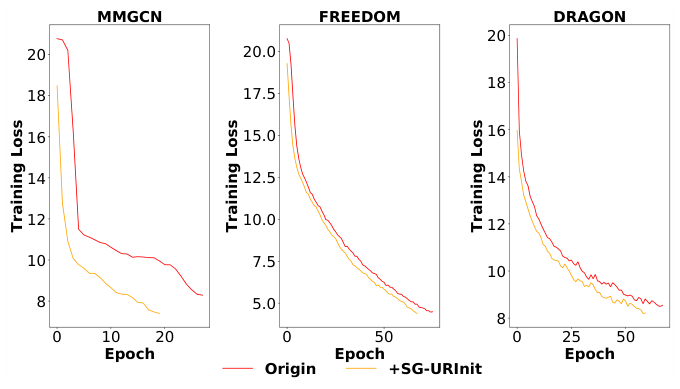
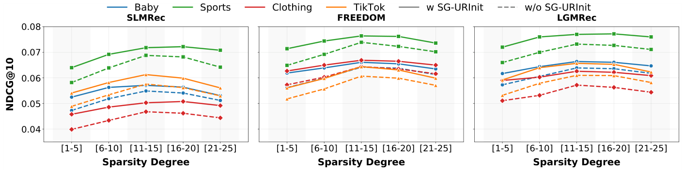
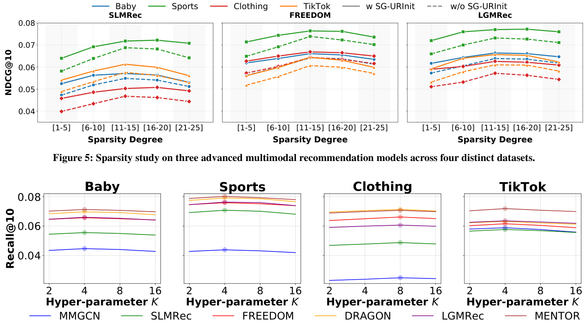
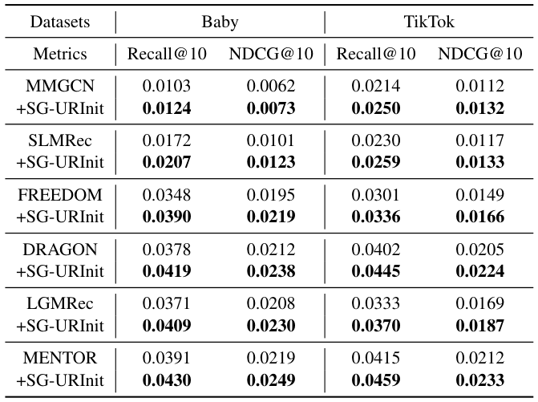

# Well Begun is Half Done: Training-Free and Model-Agnostic Semantically Guaranteed User Representation Initialization for Multimodal Recommendation (好的开始是成功的一半：面向多模态推荐的免训练、模型无关且语义有保证的用户表征初始化)

- **会议/期刊**: SIGIR 2026
- **推荐链路定位**: 召回 (Retrieval) — 作为多模态推荐模型（图卷积类）的通用初始化插件，作用于表征学习前端
- **研究方向**: 多模态推荐 / 冷启动与长尾推荐
- **论文原文**: [https://arxiv.org/abs/2604.14839v1](https://arxiv.org/abs/2604.14839v1)
- **开源代码**: [https://github.com/Jinfeng-Xu/SG-URInit](https://github.com/Jinfeng-Xu/SG-URInit)

## TL;DR (核心速览)

多模态推荐中物品由预训练编码器赋予丰富模态语义，而用户表征却随机初始化，二者存在显著语义鸿沟并在图卷积中注入噪声。本文提出免训练、模型无关的 SG-URInit：以交互物品模态特征做物品级（局部）聚合，再以 K-Means 聚类质心做簇级（全局）聚合，加权融合得到语义有保证的用户初始表征。在 4 个数据集、6 个多模态模型上（全库排序 Recall@5/10、NDCG@5/10）均取得显著提升，TikTok 上 MMGCN 的 Recall@5 相对提升达 36.40%。

## Background & Motivation (背景与动机)

- **领域背景与主流范式**: 多模态推荐通过引入图像、文本（乃至音频）特征缓解交互稀疏问题。主流范式为：物品表征由预训练编码器（视觉/文本/音频）初始化，用户表征随机初始化，随后经 MMGCN、LATTICE/FREEDOM、DRAGON、LGMRec（超图）、MENTOR（跨模态对齐）等图结构进行传播与融合，并以监督+自监督目标联合优化。
- **现有方法局限 (Limitations of Prior Work)**:
  1. **初始化不对称**：物品有模态语义，用户无固有模态信息，只能随机初始化，形成用户-物品语义鸿沟。
  2. **噪声传播**：GCN 通过聚合邻居更新节点，随机用户表征在早期训练中作为噪声注入到语义良好的物品表征中。
  3. **朴素平均的局部过拟合**：直接平均交互物品表征会把用户限制在历史观测内，忽略对相似未观测物品的潜在兴趣。
- **核心挑战 (Key Challenge)**: 简单增加网络深度或常规对比学习无法消除"起点"层面的语义错位——图卷积的聚合机制会把初始噪声逐层放大，而非消解。
- **核心洞察与切入点 (Key Insight)**: 作者在 TikTok 数据集上用 MENTOR 做验证实验（图 1），对比随机初始化与"基于交互物品初始化"两种设置下用户/物品表征 L2 范数分布在 0/5/10/20 epoch 的演化。结果显示：基于物品初始化的用户表征在各训练阶段都更接近物品表征（如视觉模态 |Δμ| 从 2.20 降至 1.04），且该差异经多层卷积后仍持续存在。由此提出：应在初始化阶段就弥合语义鸿沟，且需同时引入局部（物品级）与全局（簇级）语义。

## Problem Formulation & Method (问题定义与方法架构)

### 1. 符号定义与输入表征 (Notations & Input Representations)

- 用户集 $\mathcal{U}=\{u_1,\dots,u_{|\mathcal{U}|}\}$，物品集 $\mathcal{I}=\{i_1,\dots,i_{|\mathcal{I}|}\}$。
- 交互矩阵 $\mathbf{R}\in\{0,1\}^{|\mathcal{U}|\times|\mathcal{I}|}$，构成二部图 $\mathcal{G}=(\mathcal{U},\mathcal{I},\mathcal{E})$。
- 模态集合 $\mathcal{M}$（视觉/文本/音频），模态 $m$ 下物品表征 $\mathbf{E}^m_i=\{\mathbf{e}^m_{i_1},\dots\}\in\mathbb{R}^{d_m\times|\mathcal{I}|}$ 由预训练编码器提取；用户表征 $\mathbf{E}^m_u\in\mathbb{R}^{d_m\times|\mathcal{U}|}$ 传统上随机初始化。
- 输出：每个模态下语义有保证的用户初始表征 $\mathbf{e}^m_u$，可直接替换任意多模态模型的随机初始化。

### 2. 整体流水线 (Overall Architecture)

数据流：物品多模态特征提取 → 物品级聚合（按交互物品、度加权）→ K-Means 聚类得簇质心 → 簇级聚合（物品映射到最近质心后度加权）→ $\lambda$ 加权融合 → 注入下游多模态推荐模型训练。

### 3. 核心模块设计与数学原理 (Key Designs & Formulations)

**(1) 物品级聚合（局部语义）**：对用户 $u$ 交互过的物品做度加权平均：

$$\bar{\mathbf{e}}^m_u=\sum_{\tilde{i}\in N(u)}\frac{1}{|N(\tilde{i})|}\mathbf{e}^m_{\tilde{i}}$$

其中 $N(u)$、$N(\tilde{i})$ 分别为用户交互物品集与物品交互用户集。权重 $1/|N(\tilde{i})|$ 借鉴 LightGCN 思想，降低热门物品主导；消融（表 5）证明其优于 bi-degree 与等权。

**(2) 簇级聚合（全局语义）**：先对各模态全部物品特征做 K-Means 得 $K$ 个质心 $\mathcal{C}^m=\{\mathbf{c}^m_1,\dots,\mathbf{c}^m_K\}$；将每个物品映射到最近质心 $\tilde{\mathbf{e}}^m_i=\arg\min_{\mathbf{c}^m_k\in\mathcal{C}^m}\|\mathbf{e}^m_i-\mathbf{c}^m_k\|_2$，再以同样度加权方式聚合：

$$\tilde{\boldsymbol{e}}^m_u=\sum_{\tilde{i}\in N(u)}\frac{1}{|N(\tilde{i})|}\tilde{\mathbf{e}}^m_{\tilde{i}}$$

物理直觉：把用户偏好从"具体观测物品"泛化到"相似物品簇"，缓解局部过拟合。

**(3) 融合**：$\mathbf{e}^m_u=(1-\lambda)\bar{\mathbf{e}}^m_u+\lambda\tilde{\boldsymbol{e}}^m_u$，$\lambda\in[0,1]$。引入 $\lambda$ 是为保持与物品表征同一量级（直接相加会放大范数）。$\lambda=0$ 退化为 w/o-Cluster（等价 AlphaRec），$\lambda=1$ 退化为 w/o-Item。

<figure class="paper-figure" markdown="span">
  <figcaption>图2：用户表示初始化概览。左：传统用户表示初始化；右：我们的SG-URInit。</figcaption>
</figure>

### 4. 训练目标、负采样与推理复杂度 (Optimization, Negative Sampling & Complexity)

- **损失函数**: SG-URInit 本身**无训练目标**——它是纯预处理初始化，不引入额外损失项。下游模型沿用各自原有监督（BPR 类）+自监督目标，原文未改动。
- **训练负采样策略**: 原文未报告（沿用各基线默认设置，本文不涉及负采样设计）。
- **时间与空间复杂度**: 初始化完全在训练前完成且可跨多次运行复用。实测初始化耗时（表 6）：Baby $K{=}4$ 15.23s / $K{=}8$ 17.88s；Sports 37.02s / 42.30s；Clothing 43.01s / 49.32s；TikTok 4.75s / 5.40s。训练阶段零额外开销，且因收敛加速反而降低总训练时间。所有实验在单张 RTX4090 上完成。

## Experimental Setup & Evaluation Protocol (实验设置与评估协议)

- **数据集统计与预处理**: 采用 MMRec 的预处理流程，Amazon 三数据集（Baby/Sports/Clothing）含视觉+文本，TikTok 含视觉+文本+音频。

<figure class="paper-figure" markdown="span">
  <figcaption>表2：所有评估数据集的统计信息。</figcaption>
</figure>

| 数据集 (Dataset) | 用户数 (#Users) | 物品数 (#Items) | 交互数 (#Interactions) | 稀疏度 (Sparsity) | 模态/辅助特征说明 |
| :--- | :---: | :---: | :---: | :---: | :--- |
| Baby | 19,445 | 7,050 | 160,792 | 99.88% | 视觉 V + 文本 T |
| Sports | 35,598 | 18,357 | 296,337 | 99.95% | 视觉 V + 文本 T |
| Clothing | 39,387 | 23,033 | 278,677 | 99.97% | 视觉 V + 文本 T |
| TikTok | 9,319 | 6,710 | 59,541 | 99.90% | 视觉 V + 文本 T + 音频 A |

- **数据划分方式 (Splitting Strategy)**: 原文未显式声明划分细节，仅说明"遵循 MMRec 预处理"及沿用 FREEDOM/BM3 的评测设置；冷启动实验采用 MICRO 的设置（随机选 20% 物品，其交互从训练集移除，10% 验证、10% 测试，训练集完全未见）。**审稿提示**：由于未明确是否为全局时间戳切分，存在潜在未来信息泄露风险，需作者补充说明。
- **排名评测协议 (Ranking Protocol)**: 原文未明确标注 Full-Ranking 还是 Sampled Ranking，仅称"遵循先前工作 [30,37,38] 的设置"报告测试集全体用户平均分。**审稿提示**：这是评估协议透明度的短板，建议作者明确候选集构造方式。
- **评价指标与显著性检验**: Recall@5/10、NDCG@5/10；表 1 中 ∗ 表示 $p<0.01$ 的统计显著性；为消除 K-Means 不稳定性，所有结果对 **10 次 K-Means 运行取平均**。Embedding 维度 $d_m$ 原文未在正文给出具体数值（沿用各基线默认）。

## Key Experimental Results (核心实验结果)

### 1. 主实验对比 (Main Results)

在 6 个多模态模型上叠加 SG-URInit，全部数据集、全部指标均显著提升（表 1）。摘取代表性结果：

<figure class="paper-figure" markdown="span">
  <figcaption>表1：在全部数据集上，基线模型在使用或不使用SG-URInit时基于Recall@K（R@K）和NDCG@K（N@K）的性能比较。∗表示提升具有统计显著性，其中p值小于0.01。</figcaption>
</figure>

| 数据集 | 指标 | MMGCN (基线) | MENTOR (最强基线) | 本文 (MENTOR+SG-URInit) | 相对提升 (Improv.) |
| :--- | :--- | :---: | :---: | :---: | :---: |
| Baby | Recall@10 / NDCG@10 | 0.0378 / 0.0200 | 0.0678 / 0.0362 | **0.0713 / 0.0382** | +5.16% / +5.52% |
| Sports | Recall@10 / NDCG@10 | 0.0370 / 0.0193 | 0.0763 / 0.0409 | **0.0802 / 0.0431** | +5.11% / +5.38% |
| Clothing | Recall@10 / NDCG@10 | 0.0218 / 0.0110 | 0.0668 / 0.0360 | **0.0707 / 0.0381** | +5.84% / +5.83% |
| TikTok | Recall@10 / NDCG@10 | 0.0485 / 0.0200 | 0.0634 / 0.0334 | **0.0719 / 0.0374** | +13.41% / +11.98% |

- **最大增益**出现在 TikTok + MMGCN：Recall@5 从 0.0250 → 0.0341（+36.40%），NDCG@5 +29.60%。作者归因于 TikTok 模态更丰富（含音频），随机初始化的语义鸿沟更严重。
- 对已很强的 MENTOR，各数据集仍稳定获得约 5% 提升，说明增益并非来自弱基线。

### 2. 消融实验与控制变量分析 (Ablation Study)

<figure class="paper-figure" markdown="span">
  <figcaption>图3：SG-URInit关键组件在NDCG@10上的消融研究。</figcaption>
</figure>

- **w/o-Cluster**（仅局部，等价 AlphaRec）：性能下降，说明全局簇语义有独立贡献。
- **w/o-Item**（仅全局）：下降更明显，说明**物品级局部信息是主导因素**。
- **SG-URInit**（两者融合）在 6 个模型 × 3 数据集上均最优。
- **权重策略消融（表 5）**：SG-URInit 的度加权 > bi-degree 加权 > 等权，验证流行度加权的重要性。
- **动态 $K$ 消融（表 7）**：为不同模态设不同 $K$ 在除 Clothing 外均有额外收益（如 MENTOR+TikTok 的 Recall@5 从 0.0463 升至 0.0471），因文本比视觉含更细粒度信息。

### 3. 稀疏度/冷启动分桶与超参敏感度 (Sparsity Buckets & Hyperparameters)

- **稀疏度分桶（图 5）**: 按训练交互数将用户分为 [1-5]、[6-10]、[11-15]、[16-20]、[21-25] 五组，SLMRec/FREEDOM/LGMRec 在四数据集上叠加 SG-URInit 后**所有分桶均提升，且最稀疏的 [1-5] 组增益最显著**——良好初始化降低了对大量训练数据的依赖。
- **物品冷启动（表 4）**: 在 Baby 与 TikTok 上，20% 物品完全未见于训练集。MENTOR 在 Baby 上 Recall@10 从 0.0391 → 0.0430、NDCG@10 从 0.0219 → 0.0249；TikTok 上 0.0415 → 0.0459。所有 6 个模型均受益。
- **收敛速度（图 4）**: 在 TikTok 上，MMGCN/FREEDOM/DRAGON 叠加 SG-URInit 后训练损失下降更快，验证语义对齐加速优化。
- **兼容性（表 3）**: 与对抗训练 AMR（+A）和 GPT-4o 数据增强（+G）正交叠加，+S+A+G 组合最优（如 MENTOR+Baby Recall@5 从 0.0422 → 0.0452）。
- **超参敏感度（图 6、图 7）**: $K$ 在 {2,4,8,16} 中搜索，多数数据集 $K{=}4$ 最优，复杂场景 Clothing 取 $K{=}8$；$\lambda$ 在 {0,1e-4,1e-3,1e-2,0.1,1} 中搜索，含 item-item 图的模型（FREEDOM/DRAGON/MENTOR）最优 $\lambda{=}0.1$，其余 $\lambda{=}0.01$。作者据此给出调参指南。
- **线上 A/B 测试**: 原文仅包含离线实验，未报告线上结果。

<figure class="paper-figure" markdown="span">
  <figcaption>图4：在TikTok数据集上的收敛性研究。表3：三种数据集上各策略在Recall@5（R@5）和NDCG@5（N@5）下的性能比较。+S、+A和+G分别表示+SG-URInit、+AMR和+GPT-4o。</figcaption>
</figure>

<figure class="paper-figure" markdown="span">
  <figcaption>图5：三种先进多模态推荐模型在四个不同数据集上的稀疏性研究。</figcaption>
</figure>

<figure class="paper-figure" markdown="span">
  <figcaption>图6：关于超参数𝐾的性能。</figcaption>
</figure>

## Highlights, Limitations & Critiques (亮点、局限与审稿级批判)

- **核心亮点与可迁移性**:
  1. **"零成本"插件范式**：免训练、模型无关、训练期零开销、可跨运行复用，工程落地门槛极低，可直接迁移到任何以图卷积为核心的多模态/单模态推荐模型。
  2. **局部+全局双粒度初始化**：物品级聚合 + 簇级质心聚合的组合思路，可推广到跨域推荐、冷启动用户画像构建、LLM 语义 ID 初始化等场景。
  3. **验证充分**：6 个模型 × 4 个数据集 × 多组消融/稀疏度/冷启动/兼容性实验，10 次 K-Means 平均 + $p<0.01$ 显著性检验，统计严谨性较好。
  4. **加速收敛**是额外红利，与"免训练"卖点形成闭环。

- **局限性与审稿视角批判 (Critical Limitations)**:
  1. **评估协议透明度不足**：未明确数据划分方式（LOO / Ratio / 时间切分）与候选集打分协议（Full-Ranking vs Sampled），存在潜在数据泄露与结果不可比风险，是本文最需补强的部分。
  2. **创新深度有限**：本质是"用交互物品特征 + 聚类质心做加权平均初始化"，与 AlphaRec 的语义初始化思路高度接近（作者自认 w/o-Cluster 等价 AlphaRec），增量贡献主要在簇级全局项与系统性验证，方法新颖性偏弱。
  3. **K-Means 依赖与超参负担**：需为每个模态单独聚类，$K$ 与 $\lambda$ 需按数据集/模型类型调参（虽给出指南），且 K-Means 本身有随机性（需 10 次平均），在超大规模物品库上的聚类开销与稳定性未讨论。
  4. **理论分析偏定性**：第 3.3 节"类比图卷积"的讨论为直觉性论证，缺乏对噪声传播的定量理论刻画或收敛性证明。
  5. **缺少线上验证与延迟数据**：仅离线实验，未报告工业场景 CTR/留存收益，落地价值待验证。
  6. **Embedding 维度、负采样、训练细节**在正文缺失，复现需依赖代码仓库。

## Rating (四维评分)

- **方法创新性 (Novelty)**: ⭐⭐⭐
- **评估协议与实验扎实度 (Protocol & Experiments)**: ⭐⭐⭐⭐
- **写作与数学规范度 (Clarity & Rigor)**: ⭐⭐⭐⭐
- **工业落地与复现价值 (Industrial & Practical Value)**: ⭐⭐⭐⭐⭐

## 论文图表

<figure class="paper-figure" markdown="span">
  <figcaption>表4：在Baby和Tiktok数据集上的冷启动分析。</figcaption>
</figure>

