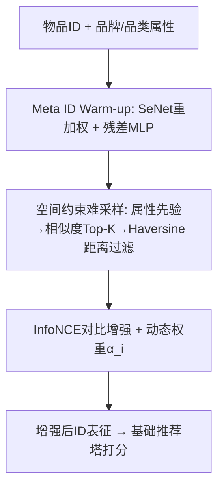
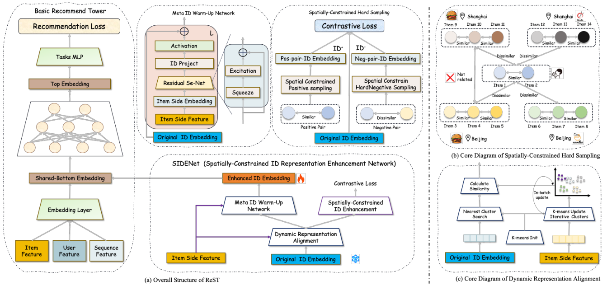

# ReST: A Plug-and-Play Spatially-Constrained Representation Enhancement Framework for Local-Life Recommendation (面向本地生活推荐的空间约束即插即用表征增强框架)

- **会议/期刊**: SIGIR 2026
- **作者与机构**: Hao Jiang, Long Zhang, Guoquan Wang, Sheng Yu, Yang Zeng, Wencong Zeng, Fei Pan, Peng Jiang, Guorui Zhou（快手科技）
- **推荐链路定位**: 精排（可插拔表征增强模块，兼容召回/排序骨干）
- **研究方向**: 时空轨迹与POI本地生活推荐 / 自监督对比学习与交互去噪
- **论文原文**: [https://arxiv.org/abs/2511.12947v2](https://arxiv.org/abs/2511.12947v2)
- **开源代码**: 暂未开源

## TL;DR (1分钟核心速览)

本地生活推荐中，空间约束把物品曝光限制在有限地理半径内，叠加马太效应导致长尾物品交互极度稀疏、ID 表征退化。本文提出 ReST，一个**以物品为中心**的即插即用框架：先用属性语义（品牌/品类）预热 ID 表征，再用「空间约束难负采样 + 动态表征对齐」的对比学习增强弱 ID。在 Eleme 与快手两个工业数据集上，AUC 分别达 0.5830 / 0.7436，冷启动场景显著优于 OFRS 等方法；作为插件接入 TRISAN 带来 AUC +5.90%，线上 A/B 测试 GMV +2.804%、订单 +1.285%。

## Background & Motivation (背景与核心矛盾)

- **主流范式**: 本地生活推荐普遍采用**以用户为中心**的深度建模（DIN、GNN/Transformer 序列建模），或引入时空信号的 StEN、BASM、OFRS 等空间约束方法，重点刻画用户的空间偏好与轨迹动态。
- **前人局限**: 其一，空间约束使候选池被地理半径截断，模型在陌生区域产生预测偏差；其二，马太效应让连锁品牌垄断曝光，小商户交互稀疏，标准长尾方案（重加权、元学习）忽略**空间邻域内的潜在物品关联**，无法修复长尾 ID 表征退化。
- **核心洞察 (Key Insight)**: 长尾问题的症结不在用户侧建模不足，而在**物品侧表征本身被空间约束"饿死"**——同一区域内、属性相近的物品本应共享交互模式，这一信号未被利用。
- **本文切入点**: 转向物品中心视角，用属性语义 + 空间邻域对比信号直接增强弱 ID 表征，且不改动骨干结构，实现即插即用。

## Method (核心方法设计)

### 1. 整体框架 (Overall Architecture)

ReST 由可替换的基础推荐塔与 SIDENet 增强网络解耦组成。物品 ID 先经 Meta ID Warm-up 网络，用 SeNet 重加权品牌/品类属性并经残差 MLP 注入，得到携带语义的初始表征；随后 SIDENet 以三阶段空间约束难采样构造正负对，用 InfoNCE 对比损失增强弱 ID，同时以 K-means 语义簇相似度动态调节增强强度，避免过正则化热门物品。训练采用推荐交叉熵主任务 + 对比辅助任务端到端联合优化，推理时仅需替换物品 embedding 表，无额外在线开销。

<figure class="paper-figure" markdown="span">
  <figcaption>图2：我们的ReST模型的整体架构。具体而言：(a)展示了ReST的架构，(b)描绘了空间约束采样的核心概念，(c)呈现了动态表示对齐策略。</figcaption>
</figure>

### 2. 关键设计拆解 (Key Designs)

1. **Meta ID Warm-up（属性语义预热）**：稀疏 ID 收敛远慢于稠密属性特征。用 SeNet 自适应重加权品牌与品类嵌入 $\mathbf{F}_i=\text{SeNet}(\mathbf{E}_b,\mathbf{E}_c)$，再经残差 MLP 注入协同空间：$\mathbf{E}_i^{warm}=\text{MLP}(\mathbf{F}_i)+\mathbf{E}_i$。直觉是让长尾物品在首次曝光前就具备可区分的语义起点，缓解冷启动的"零信息"困境。

2. **空间约束难负采样（三阶段过滤）**：标准共现采样受流行度偏置且无视地理关联。先按品牌/品类属性划分正负候选，再按嵌入相似度保留 Top-$K$难负样本$s_i=\text{sim}(\mathbf{E},\mathbf{E}_i^s)$，最后用 Haversine 距离$d_{ij}=\text{Haversine}(\text{GeoHash}_i,\text{GeoHash}_j)$ 过滤：同属性且空间邻近者为正对，异属性但高相似且空间邻近者为难负对。物理直觉是"同商圈内相似但不同类"的物品才是真正需要区分的决策边界。

3. **动态表征对齐与训练目标**：固定强度增强会过正则化已充分训练的热门物品。将属性投影后用 K-means 得簇心 $\mathbf{R}$，按 ID 与最近簇心的余弦相似度计算自适应权重$\alpha_i=1-\frac{1}{2}\left(\frac{\mathbf{E}_i^\top\mathbf{R}_{M}}{\|\mathbf{E}_i\|\|\mathbf{R}_M\|+\epsilon}+1\right)$，相似度高则权重小。总损失$\mathcal{L}_{total}=\mathcal{L}_{rec}+\alpha_2\cdot\bar{\alpha}\cdot\mathcal{L}_{cl}$，其中$\mathcal{L}_{cl}$为 InfoNCE，负样本来自上述难采样池（非 in-batch 均匀采样），温度$\tau$ 可调。

## Experimental Setup & Evaluation Protocol (实验设置与评估协议)

- **数据集与预处理**:

| 数据集 | #Users | #Items | #Interactions | 平均行为长度 | 特征/场景说明 |
| :--- | :---: | :---: | :---: | :---: | :--- |
| Eleme | 1,440,600 | 70,389 | 2,092,944 | 41.008 | 外卖基准，含丰富时空特征 |
| Kuaishou | 1,046,100 | 72,805 | 81,487 | 8.895 | 快手本地生活一年付费交易采样 |

- **数据划分与防穿越**: 工业采样数据，按平台交易日志构建训练/测试；额外构造 **Cold-start 划分**（交互次数 $<3$ 的物品）评估稀疏鲁棒性。
- **排名评测协议**: 采用 AUC、MRR、NDCG@5、NDCG@10；候选集为空间半径 $D$（如 5 km）内召回物品$\mathcal{V}_u^D$，属**空间约束下的全候选排序**，非全库 Full-Ranking。
- **对比基线与超参设置**: 表征学习类 DIN、RCL；空间约束类 TRISAN、OFRS、BASM。最优配置：正样本距离阈值 30 km、负样本 10 km，难负样本数 $k=9$，K-means 簇数$c=75$，对比损失权重$\alpha_2=10^{-3}$。

## Key Experimental Results (实验关键数据)

### 1. 主实验对比 (Main Results)

| 方法 | Kuaishou AUC | Kuaishou MRR | Kuaishou NDCG@5 | Eleme AUC | Eleme MRR | Eleme NDCG@5 |
| :--- | :---: | :---: | :---: | :---: | :---: | :---: |
| DIN | 0.6946 | 0.3977 | 0.3911 | 0.5653 | 0.1911 | 0.1615 |
| TRISAN | 0.7039 | 0.3968 | 0.3978 | 0.5283 | 0.2015 | 0.1753 |
| OFRS | 0.7216 | 0.4074 | 0.4101 | 0.5220 | 0.1920 | 0.1634 |
| BASM | 0.7193 | 0.4168 | 0.4187 | 0.5752 | **0.2318** | **0.2115** |
| RCL | 0.7078 | **0.4327** | **0.4332** | 0.5730 | 0.1542 | 0.1413 |
| **ReST** | **0.7436** | 0.4266 | 0.4345 | **0.5830** | 0.2194 | 0.1973 |
| Improv. | +3.05% | — | +0.30% | +1.36% | — | — |

冷启动场景（交互 $<3$）：ReST 在 Kuaishou 取得 AUC 0.6866、NDCG@5 0.3954，Eleme 取得 AUC 0.5824，均优于 BASM（0.6623 / 0.5714）；OFRS 在 Kuaishou 冷启动 AUC 从 0.7216 暴跌至 0.5409，暴露纯空间建模对稀疏物品的脆弱性。

### 2. 消融实验 (Ablation Study)

| 变体 | 移除内容 | AUC 变化 | 结论 |
| :--- | :--- | :---: | :--- |
| ReST-1 | 难负采样→随机 in-batch | −0.70% | 难负样本对判别性表征关键 |
| ReST-2 | 移除品牌约束 | −1.49% | 品牌是正样本选择的核心属性 |
| ReST-3 | 移除品类约束 | −1.99% | 品类约束贡献最大 |
| ReST-4 | 移除预热网络 | −0.17% | 预热为增益项，非必需 |

### 3. 关键实验发现 (Key Findings)

1. **空间约束是采样质量的命门**：完全去掉距离约束后 AUC 从 0.7436 跌至 0.6811（−8.4%），而 30 km 正 / 10 km 负的组合最优——正样本需覆盖足够广的商圈交互，负样本则须保持局部性以避免噪声。
2. **即插即用增益与骨干的空间建模能力负相关**：TRISAN 本身缺乏地理约束，接入 ReST 后 AUC +5.90%、NDCG@5 +12.57%；而 BASM 已内建空间建模，增益仅 +0.11% AUC，说明 ReST 主要补偿的是"空间信号缺失"。
3. **长尾收益远超整体收益**：线上 A/B 中整体 GMV +2.804%、订单 +1.285%，但长尾物品订单提升 100.0%–125.0%、GMV 最高 +1452.4%，验证了物品中心视角对马太效应的直接矫正作用。

## Highlights & Limitations (亮点、对比与审稿批判)

- **与代表作对比 (vs. Prior Work)**: 相比 BASM/OFRS 等以用户轨迹为中心的空间建模，ReST 首次将空间约束转化为**物品侧对比采样的归纳偏置**；相比 RCL 等通用长尾对比方案，其正负对构造显式引入 GeoHash 距离与品牌/品类先验，避免了跨区域伪负样本。
- **可迁移亮点**: ①「属性先验 → 相似度 Top-K → 地理距离」的三级难负采样漏斗可直接迁移到任何带地理/类目层级约束的召回增强；②用 K-means 簇心余弦相似度生成逐物品自适应增强权重 $\alpha_i$，是防止对比学习过正则化热门物品的轻量技巧。
- **审稿级局限批判**: ①评测候选集被限制在空间半径内，未报告全库 Full-Ranking，跨区域泛化能力缺乏直接证据；②K-means 需周期性重聚类，簇数 $c$与双距离阈值共 4 个敏感超参（$c$从 75 增至 100 即掉点），工业调参成本偏高；③冷启动定义仅用$<3$ 次交互，未覆盖严格零样本新物品。

## Rating (四维评分)

- **方法创新性 (Novelty)**: ⭐⭐⭐⭐ （物品中心视角 + 空间约束难采样的组合有新意，但各组件均为成熟技术的针对性改造，理论分析偏弱）
- **评估协议与实验扎实度 (Protocol & Experiments)**: ⭐⭐⭐⭐ （双工业数据集 + 冷启动分桶 + 插件泛化 + 线上 A/B 完整，但缺全库排序与显著性检验）
- **写作与数学规范度 (Clarity & Rigor)**: ⭐⭐⭐⭐ （公式简洁、算法伪代码清晰，但 Eq.6/7 中 $\mathbf{E}_i^{warm}$ 符号复用易混淆，复杂度分析缺失）
- **工业落地与复现价值 (Industrial & Practical Value)**: ⭐⭐⭐⭐⭐ （即插即用、推理零额外开销、线上 GMV 实证，工程价值极高；可惜未开源）
