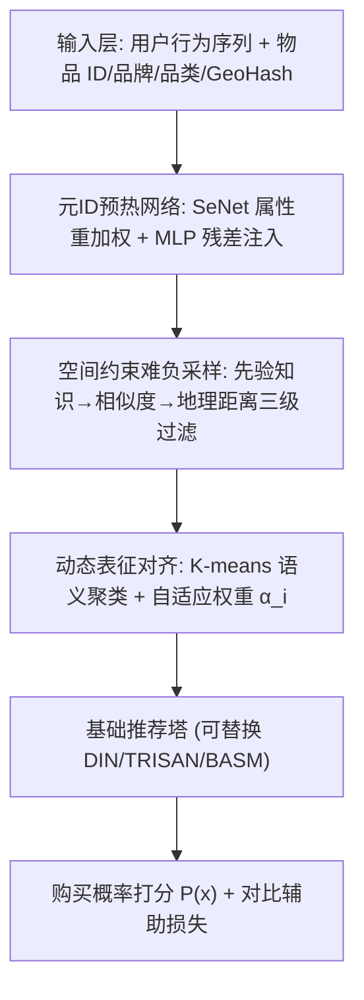
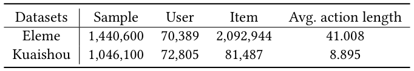
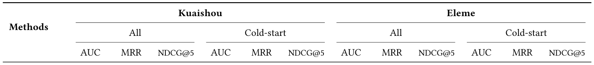
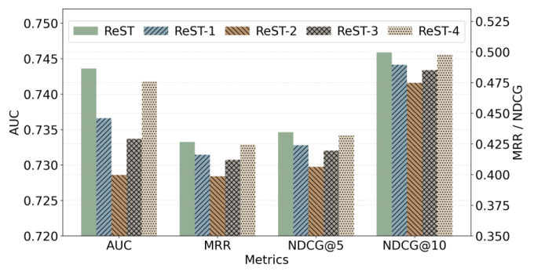
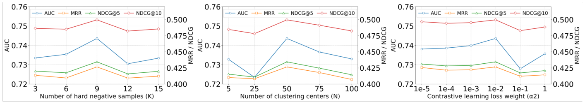
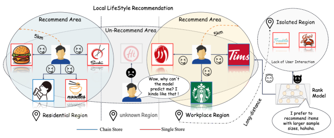

# ReST: A Plug-and-Play Spatially-Constrained Representation Enhancement Framework for Local-Life Recommendation (面向本地生活推荐的空间约束即插即用表征增强框架)

- **会议/期刊**: SIGIR 2026 (49th International ACM SIGIR Conference)
- **推荐链路定位**: 精排 (Ranking) — 作为即插即用模块嵌入基础排序塔
- **研究方向**: 时空轨迹与POI本地生活推荐 / 冷启动与长尾推荐
- **论文原文**: [https://arxiv.org/abs/2511.12947v2](https://arxiv.org/abs/2511.12947v2)
- **开源代码**: 暂未开源

## TL;DR (核心速览)

针对本地生活推荐中"空间约束导致曝光受限"与"长尾稀疏"两大痛点，本文提出以物品为中心（item-centric）的即插即用框架 ReST：先用元ID预热网络注入品牌/品类属性语义，再用空间约束难负采样 + 动态表征对齐的对比学习增强长尾物品 ID 表征。在 Kuaishou 与 Eleme 两工业数据集上，AUC 分别达 0.7436 / 0.5830，冷启动场景显著优于 OFRS 等方法；线上 A/B 测试 GMV +2.804%、订单量 +1.285%。

## Background & Motivation (背景与动机)

- **领域背景与主流范式**: 本地生活服务（快手、美团、饿了么）依赖用户当前地理位置与历史行为做上下文感知推荐，候选集由固定半径（如 5 km）内的物品构成。主流方法分为两类：表征学习类（DIN、RCL）建模用户-物品隐交互；空间约束类（TRISAN、OFRS、BASM）通过搜索策略或时空架构引入时空信号。
- **现有方法局限 (Limitations of Prior Work)**:
  1. **空间约束限制物品可见性**：物品仅在有限地理范围内曝光，候选池缩小，在陌生区域产生预测偏差（图 1）。
  2. **空间约束加剧长尾问题**：马太效应使连锁品牌（如麦当劳）垄断曝光，小商户数据稀疏，难以捕获物品间潜在关系。
  3. **现有方法均为用户中心（user-centric）视角**：即便引入时空信号，也难以适应动态本地服务，在稀疏交互下表现差；标准长尾方案又忽视了空间约束下的物品潜在关系。
- **核心挑战 (Key Challenge)**: 简单的用户侧深度建模（GNN/Transformer）无法解决"物品侧表征退化"这一根源问题——长尾物品的 ID embedding 因曝光不足而训练不充分，单纯加深网络或常规对比学习（如随机 in-batch 采样）会引入流行度偏差且忽略空间相关性。
- **核心洞察与切入点 (Key Insight)**: 作者主张转向**物品中心（item-centric）视角**，聚焦增强与空间约束特性对齐的长尾物品表征。关键先验观察是：稠密属性特征（品牌、品类）收敛远快于稀疏 ID embedding，可用来引导 ID 初始化；且固定半径内的物品共享相似交互模式，可作为高质量对比样本的筛选依据。

## Problem Formulation & Method (问题定义与方法架构)

### 1. 符号定义与输入表征 (Notations & Input Representations)

- 用户集 $\mathcal{U}$、物品集 $\mathcal{V}$；基于距离阈值 $D$ 过滤得到候选集 $\mathcal{V}_D$。
- 用户历史行为序列 $\mathcal{B}=(v_1,\dots,v_{|\mathcal{H}|})$，$v_i\in\mathcal{V}$，$|\mathcal{H}|$ 为序列长度。
- 模型在空间候选 $\mathcal{V}_D^u\subseteq\mathcal{V}_D$ 中召回并打分，输出 top-$k$ 推荐列表 $\{v_{i+1},\dots,v_{i+k}\}$。
- 物品侧输入：ID embedding $E_i\in\mathbb{R}^d$、品牌 embedding $E_b$、品类 embedding $E_c$、GeoHash 编码的地理位置。

### 2. 整体流水线 (Overall Architecture)

ReST 由两个解耦组件构成：可替换的基础推荐塔（Basic Recommendation Tower）与空间约束 ID 增强网络 SIDENet。SIDENet 内含元 ID 预热网络与空间约束 ID 增强（难负采样 + 动态对齐）两个子模块。

<figure class="paper-figure" markdown="span">
  <figcaption>图 2</figcaption>
</figure>

### 3. 核心模块设计与数学原理 (Key Designs & Formulations)

**(1) 元 ID 预热网络 (Meta ID Warm-up Network)**
动机：稠密属性特征收敛快于稀疏 ID，用其引导初始化。先用 Squeeze-and-Excitation 网络自适应重加权品牌与品类属性：
$$F_i = \text{SeNet}(E_b, E_c)$$
再经带残差连接的 MLP 投影进协同隐空间：
$$E_i^{warm} = \text{MLP}(F_i) + E_i$$
其中 $E_i^{warm}\in\mathbb{R}^d$ 为携带属性语义的增强初始化。物理直觉：让长尾物品在训练初期就获得有意义的语义起点，缓解 ID 冷启动。

**(2) 空间约束难负采样策略 (Spatially-Constrained Hard Sampling)**
标准共现采样在本地生活场景因流行度偏差与忽视空间相关性而失效，本文设计三级过滤（图 2(b)）：
- **先验知识难采样**：共享品牌或品类者为正样本，不同者为负样本，采样规模 $K$ 随数据分布动态调整。
- **相似度感知难采样**：对目标 embedding $E\in\mathbb{R}^d$ 与候选负样本 $E_s\in\mathbb{R}^{n\times d}$ 计算 $s_i=\text{sim}(E,E_i^s)$，保留 Top-$K$ 高相似样本作为难负例。
- **空间约束负采样**：用 Haversine 公式计算地理距离 $d_{ij}=\text{Haversine}(\text{GeoHash}_i,\text{GeoHash}_j)$，阈值内物品作为高质量难负例或正例。
- **最终配对**：正对 = 空间阈值内且共享属性；负对 = 属性不同但 embedding 相似且地理邻近的 Top-$K$ 难负例。

**(3) 动态表征对齐策略 (Dynamic Representation Alignment)**
动机：仅靠内在属性可能使相似物品表征不可区分，需自适应平衡协同信号与语义信号。先将属性特征投影到语义空间 $A=\text{MLP}(E_B\|E_c)\in\mathbb{R}^{n\times d}$，K-means 得到 $|N|$ 个聚类中心 $R\in\mathbb{R}^{|N|\times d}$；对物品 $i$ 找最近中心 $M=\text{NearestRep}(E_i,R)$，计算自适应增强权重：
$$\alpha_i = 1 - \frac{1}{2}\left(\frac{E_i^\top R_M}{\|E_i\|\cdot\|R_M\|+\varepsilon}+1\right)$$
余弦相似度越高（语义对齐越充分），$\alpha_i$ 越小，防止过度正则化。最终调制语义注入：
$$E_i^{warm} = \alpha_i\cdot\text{MLP}(S_i) + E_i$$
该机制按物品对齐程度差异化增强，既强化弱表征长尾物品，又保留热门物品性能（兼容性）。

### 4. 训练目标、负采样与推理复杂度 (Optimization, Negative Sampling & Complexity)

- **损失函数**: 多任务端到端优化。主推荐任务用交叉熵：
$$\mathcal{L}_{rec} = -\frac{1}{|\mathcal{S}|}\sum_{(x,y)\in\mathcal{S}}\left(y\log P(x)+(1-y)\log(1-P(x))\right)$$
辅助对比任务用 InfoNCE（温度系数 $\tau$）：
$$\mathcal{L}_{cl} = -\sum_{i\in\mathcal{O}}\log\frac{\exp(E_i\cdot E_{i^+}/\tau)}{\sum_{j\in\mathcal{K}}\exp(E_i\cdot E_j/\tau)+\exp(E_i\cdot E_{i^+}/\tau)}$$
总损失：
$$\mathcal{L}_{total} = \mathcal{L}_{rec} + \alpha_2\cdot\bar{\alpha}\cdot\mathcal{L}_{cl}$$
其中 $\bar{\alpha}$ 为式 (6) 的动态增强权重，$\alpha_2$ 为平衡超参（最优约 $1\times10^{-3}$）。
- **训练负采样策略**: 空间约束难负采样（先验属性 + 相似度 Top-$K$ + 地理距离三级过滤），最优难负例数 $k=9$。
- **时间与空间复杂度**: 原文未报告具体训练耗时、推理延迟（ms/request）与峰值显存。定性上，SIDENet 为训练期辅助模块，K-means 聚类与难采样为离线/周期性预处理；推理阶段仅需增强后的 ID embedding 查表，不引入额外在线开销（即插即用）。原文未给出复杂度理论分析。

## Experimental Setup & Evaluation Protocol (实验设置与评估协议)

- **数据集统计与预处理**: 两个大规模工业数据集（表 1）：

<figure class="paper-figure" markdown="span">
  <figcaption>表 1</figcaption>
</figure>

| 数据集 (Dataset) | 用户数 (#Users) | 物品数 (#Items) | 交互数 (#Interactions) | 平均行为序列长度 (Avg. action length) | 模态/辅助特征说明 |
| :--- | :---: | :---: | :---: | :---: | :--- |
| Eleme | 1,440,600 | 70,389 | 2,092,944 | 41.008 | 含丰富时空特征的外卖基准 |
| Kuaishou | 1,046,100 | 72,805 | 81,487 | 8.895 | 快手本地生活平台一年付费交易采样 |

- **数据划分方式 (Splitting Strategy)**: 原文未明确说明划分策略（未提及 LOO / Ratio / Global Temporal Split 细节），仅区分 All（全量）与 Cold-start（出现 < 3 次的物品）两种评测设置。**审稿视角提示：划分细节缺失，无法排除时间穿越风险，建议作者补充。**
- **排名评测协议 (Ranking Protocol)**: 原文未明确标注 Full-Ranking 还是 Sampled Ranking，仅报告 AUC、MRR、NDCG@k 指标。**此为评估协议透明度不足的短板。**
- **评价指标与显著性检验**: AUC、MRR、NDCG@5、NDCG@10。Embedding 维度 $d$ 原文未明确给出具体数值。**原文未报告多随机种子方差或配对显著性检验（如 $p<0.05$）。**

## Key Experimental Results (核心实验结果)

### 1. 主实验对比 (Main Results)

<figure class="paper-figure" markdown="span">
  <figcaption>表 2</figcaption>
</figure>

| 数据集 | 设置 | 指标 | 最强基线 (BASM/OFRS/RCL) | 本文方法 (Ours) | 相对提升 (Improv.) |
| :--- | :--- | :--- | :---: | :---: | :---: |
| Kuaishou | All | AUC | 0.7216 (OFRS) | **0.7436** | +3.05% |
| Kuaishou | All | MRR | 0.4327 (RCL) | 0.4266 | -1.41% (未超) |
| Kuaishou | All | NDCG@5 | 0.4332 (RCL) | 0.4345 | +0.30% |
| Kuaishou | Cold-start | AUC | 0.6741 (TRISAN) | **0.6866** | +1.85% |
| Kuaishou | Cold-start | NDCG@5 | 0.3953 (BASM) | 0.3954 | +0.03% |
| Eleme | All | AUC | 0.5752 (BASM) | **0.5830** | +1.36% |
| Eleme | All | MRR | 0.2318 (BASM) | 0.2194 | -5.35% (未超) |
| Eleme | Cold-start | AUC | 0.5736 (RCL) | **0.5824** | +1.53% |

注：ReST 在 AUC 上全面领先，但 MRR 在 Kuaishou All 与 Eleme All 上未超过 RCL/BASM，作者解释为"平衡排序质量与判别能力"。OFRS 在冷启动下 AUC 从 0.7216 暴跌至 0.5409，凸显稀疏鲁棒性问题。

**泛化性分析（表 3）**: ReST 作为即插即用模块对多种骨干均有增益——TRISAN 增益最大（AUC +5.90%、MRR +11.54%、NDCG@5 +12.57%），DIN +1.62% AUC / +4.55% NDCG@5，BASM +0.11% AUC / +1.41% MRR。

### 2. 消融实验与控制变量分析 (Ablation Study)

<figure class="paper-figure" markdown="span">
  <figcaption>图 3</figcaption>
</figure>

| 变体 | 移除内容 | AUC 下降 |
| :--- | :--- | :---: |
| ReST-1 | 难负采样→随机 in-batch 采样 | -0.70% |
| ReST-2 | 移除品牌约束 | -1.49% |
| ReST-3 | 移除品类约束 | -1.99% |
| ReST-4 | 移除预热网络 | -0.17% |

品类约束贡献最大（-1.99%），品牌次之（-1.49%），难负采样关键（-0.70%），预热网络贡献最小（-0.17%），说明核心表征增强机制即使无预热也有效。**审稿视角：消融未严格控制参数量对齐，且未报告方差。**

### 3. 稀疏度/冷启动分桶与超参敏感度 (Sparsity Buckets & Hyperparameters)

- **冷启动表现**: 在物品交互 < 3 次的冷启动设置下，ReST 保持高精度（Kuaishou AUC 0.6866、Eleme AUC 0.5824），显著优于 OFRS 的剧烈退化（0.7216→0.5409），验证框架缓解了 ID embedding 的冷启动局限。
- **关键超参数敏感度**:
  - **距离阈值（表 4）**: 正样本 30 km + 负样本 10 km 最优（AUC=0.7436, NDCG@5=0.4345）；完全移除距离约束 AUC 跌至 0.6811，证明地理邻近性对采样至关重要。
  - **难负例数 $k$（图 4 左）**: $k=9$ 最优（MRR=0.4266, NDCG@10=0.4996）；$k$ 过小（3/6）缺乏挑战性，过大（12/15）引入噪声。
  - **聚类中心数 $c$（图 4 中）**: $c=75$ 峰值（AUC=0.7366），$c\le25$ 欠拟合，$c=100$ 语义碎片化致性能下降。
  - **对比损失权重 $\alpha_2$（图 4 右）**: $1\times10^{-3}$ 最优（AUC=0.7399），$1\times10^{-1}$ 显著下降至 0.7279。

<figure class="paper-figure" markdown="span">
  <figcaption>图 4</figcaption>
</figure>

- **线上 A/B 测试结果 (Online A/B Test)**: 2025 年 3 月 14–26 日在快手本地生活短视频平台（百万级 DAU）部署。整体收益：GMV +2.804%、订单量 +1.285%、播放时长 +4.188%、点击 +1.226%。长尾表现（图 5）：热门物品订单 +0.3%–39.8%、GMV +8.7%–48.2%；长尾物品订单 +100.0%–125.0%、GMV +79.6%–1452.4%，长尾扶持效果显著。

## Highlights, Limitations & Critiques (亮点、局限与审稿级批判)

- **核心亮点与可迁移性**:
  1. **视角转换**：从 user-centric 转向 item-centric，直击长尾物品表征退化根源，思路清晰且与本地生活场景高度契合。
  2. **即插即用**：SIDENet 与基础塔解耦，对 DIN/TRISAN/BASM 均有稳定增益（TRISAN 上 AUC +5.90%），工程落地价值高。
  3. **三级难负采样 + 动态对齐**：将地理距离（Haversine/GeoHash）与属性语义（品牌/品类）结合进对比学习，且用 K-means 余弦相似度自适应调制增强强度，兼顾长尾与热门物品兼容性。
  4. **线上验证扎实**：GMV +2.804%、长尾 GMV 最高 +1452.4%，工业说服力强。
- **局限性与审稿视角批判 (Critical Limitations)**:
  1. **评估协议透明度不足**：未明确数据划分策略（LOO/Ratio/Temporal）与排名协议（Full vs Sampled），存在数据穿越与结果可比性风险；未报告多随机种子方差与显著性检验。
  2. **指标非全面领先**：MRR 在 Kuaishou All（0.4266 vs RCL 0.4327）与 Eleme All（0.2194 vs BASM 0.2318）上未超最强基线，作者以"AUC 平衡"解释略显单薄，缺乏深入分析。
  3. **超参敏感且工程成本高**：距离阈值（30/10 km）、难负例数 $k=9$、聚类中心 $c=75$、$\alpha_2$ 均需精细调优，且 K-means 需周期性重训，跨城市/跨业务迁移成本未讨论。
  4. **效率数据缺失**：未报告训练耗时、推理延迟、峰值显存，即插即用的在线开销仅有定性描述。
  5. **理论深度有限**：动态对齐权重的设计缺乏理论推导或收敛性分析，GeoHash 精度对距离计算的影响未讨论。

## Rating (四维评分)

- **方法创新性 (Novelty)**: ⭐⭐⭐⭐ (item-centric 视角 + 空间约束三级难采样 + 动态对齐，组合新颖但单点技术较常规)
- **评估协议与实验扎实度 (Protocol & Experiments)**: ⭐⭐⭐ (双工业数据集 + 线上 A/B 扎实，但划分/排名协议未明、缺显著性检验、MRR 未全面领先)
- **写作与数学规范度 (Clarity & Rigor)**: ⭐⭐⭐⭐ (公式与算法伪代码清晰，架构图完整，但部分符号与维度细节缺失)
- **工业落地与复现价值 (Industrial & Practical Value)**: ⭐⭐⭐⭐⭐ (即插即用、线上 GMV 实证、长尾扶持效果显著，落地价值极高；可惜暂未开源)

## 论文图表

<figure class="paper-figure" markdown="span">
  <figcaption>图 1</figcaption>
</figure>

