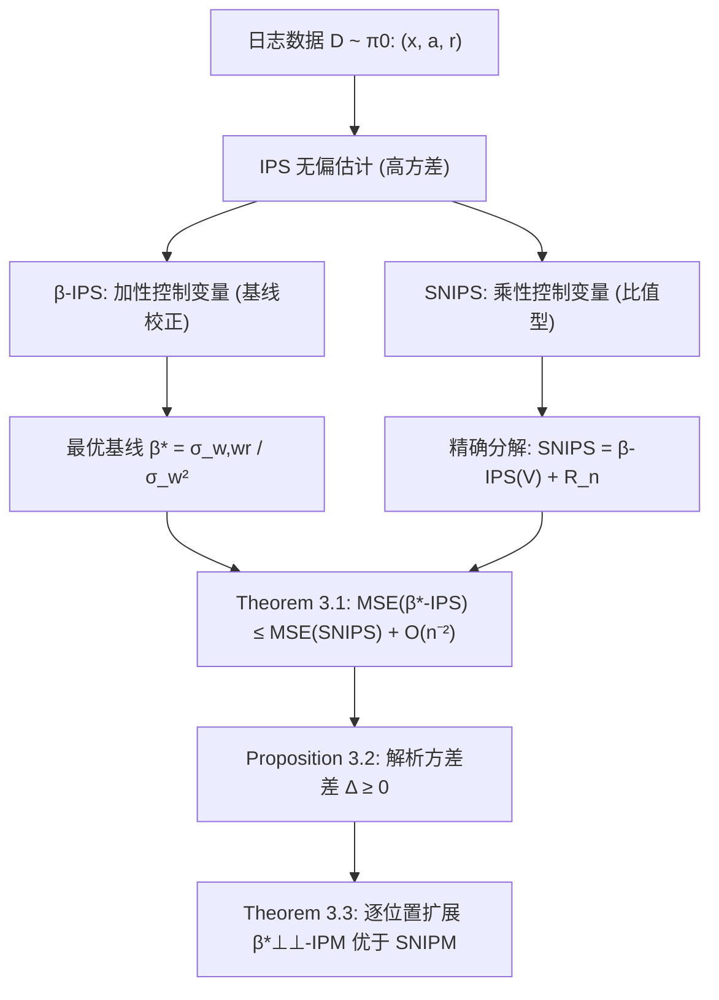

# Additive Control Variates Dominate Self-Normalisation in Off-Policy Evaluation (加性控制变量在离线策略评估中优于自归一化)

- **会议/期刊**: SIGIR 2026 (49th International ACM SIGIR Conference, Melbourne, VIC, Australia)
- **推荐链路定位**: 离线评估 (Off-Policy Evaluation) — 服务于召回/精排/重排全链路的离线 A/B 与策略价值估计
- **研究方向**: 强化学习与动态探索推荐 / 去偏公平、可信隐私与工业架构（因果去偏 OPE）
- **论文原文**: [https://arxiv.org/abs/2602.14914v3](https://arxiv.org/abs/2602.14914v3)
- **开源代码**: 暂未开源（原文与正则预提取均未发现代码链接）

## TL;DR (核心速览)

针对推荐/排序系统离线策略评估（OPE）中方差缩减的两大范式——自归一化 SNIPS（乘性控制变量）与加性基线校正 β-IPS——本文给出定论性理论回答：证明最优加性基线估计器 β\*-IPS 在均方误差（MSE）上渐近严格优于 SNIPS，并解析地揭示 SNIPS 等价于把基线固定为真实策略值 V(π) 的次优加性估计器；进一步在 Item-Position Model 下提出 β\*⊥⊥-IPM，证明其在每个排序位置上渐近优于 SNIPM。全文为纯理论工作，无离线/线上实验。

## Background & Motivation (背景与动机)

- **领域背景与主流范式**: 推荐与排序系统正日益采用"决策中心"视角，借助因果/反事实推断做离线策略评估与学习（OPE/OPL）。工业界 OPE 的基石是逆倾向得分（IPS，即 Horvitz–Thompson 估计器），其无偏但方差可能极大。为降方差，实践中广泛采用自归一化 IPS（SNIPS，即 Hájek 估计器），它通过一个**乘性控制变量**降低方差，代价是引入渐近消失的有限样本偏差；因其"免调参"特性，SNIPS 已成为 OPE 从业者的默认工具，并衍生出排序场景的 SNIPM（基于 Item-Position Model）。
- **现有方法局限 (Limitations of Prior Work)**:
  1. **理论空白**：Joachims et al. (2018) 指出优化 SNIPS 目标等价于优化带特定加性控制变量的 IPS；Gupta et al. (RecSys 2024) 据此提出广义无偏估计器 β-IPS 并推导出方差最小化的最优基线 β\*，但其工作仅**经验性**展示 β\*-IPS 的有效性，缺乏与 SNIPS 的**确定性理论保证**。
  2. **默认选择可能错位**：社区将 SNIPS 视为"免参默认"，但若其本质只是一个特定（且一般次优）的加性基线，则这一默认选择缺乏理论依据。
  3. **排序场景未覆盖**：SNIPM 在排序评估中已被提出，但加性控制变量在 IPM 下的对应扩展及其理论优势尚属空白。
- **核心挑战 (Key Challenge)**: SNIPS 是比值型（ratio）估计器，其有限样本偏差与方差相互纠缠，直接比较其与加性估计器的 MSE 需要精细的渐近展开；简单的"方差更小"直觉无法给出严格结论，必须解析地刻画二者差异的阶数。
- **核心洞察与切入点 (Key Insight)**: 作者的关键观察是——SNIPS 可**精确分解**为"基线取 V(π) 的加性估计器 + 一个余项 R_n"，而该余项在标准有界性假设下以 O(n⁻²) 衰减；由于主导的 O(n⁻¹) 方差项由 Proposition 3.2 的解析方差差 Δ ≥ 0 控制，故只要 β\* ≠ V(π)，β\*-IPS 就在充分大 n 下严格占优。这一"精确恒等式 + 余项阶数分析"是全文证明的技术骨架。

## Problem Formulation & Method (问题定义与方法架构)

### 1. 符号定义与输入表征 (Notations & Input Representations)

- 策略 π 定义在动作 A（排序列表、物品、token）上、以上下文 X（用户画像、会话信息、prompt）为条件：π(a|x) ≡ P(A=a | X=x, Π=π)。
- 策略价值：V(π) = E_{x∼P(X)}[ E_{a∼π(·|x)}[R] ]，奖励 R 可为显式/隐式反馈或多目标冲突信号。
- 日志数据 D = {(x_i, a_i, r_i)}_{i=1}^n，由日志策略 π₀ 采集；重要性权重 w_i = π(a_i|x_i)/π₀(a_i|x_i)。
- 排序场景：列表长度 k，向量化动作 a=(a₁,…,a_k)、逐位置奖励 r=(r₁,…,r_k)。

### 2. 整体流水线 (Overall Architecture)

本文为理论论文，无神经网络流水线；其"架构"是估计器族与证明链条的组织：

### 3. 核心模块设计与数学原理 (Key Designs & Formulations)

**(1) 估计器族与最优加性基线**

- IPS：V̂_IPS = (1/|D|) Σ w_i r_i（无偏）。
- SNIPS：V̂_SNIPS = Σ w_i r_i / Σ w_i（乘性控制变量，有限样本有偏）。
- β-IPS：V̂_{β-IPS} = β + (1/|D|) Σ w_i (r_i − β)，对任意**数据无关**的固定 β 严格无偏；最优（方差最小）基线为

  β\* = σ_{w,wr} / σ_w² = (E[w²r] − E[wr]) / (E[w²] − 1)，

  其中 σ_w² = Var(w_i)、σ_{w,wr} = Cov(w_i, w_i r_i)。该式可由日志数据解析估计。

**(2) 精确分解与余项阶数（Theorem 3.1 证明核心）**

记 X̄ = (1/n)Σ w_i r_i、W̄ = (1/n)Σ w_i，则 V̂_SNIPS = X̄/W̄，且 V̂_{β-IPS}(V) = V + X̄ − V·W̄。令 L_n = X̄ − V·W̄，可得**精确恒等式**：

  V̂_SNIPS − V̂_{β-IPS}(V) = L_n · (1 − W̄)/W̄ ≜ R_n。

在 |r_i| ≤ R、0 ≤ w_i ≤ W、E[w_i]=1、E[w_i²]<∞ 假设下，用 Hoeffding 不等式控制事件 E={W̄ ≥ 1/2} 的失败概率（≤ exp(−n/(2W²))），再对中心化变量 U_i = w_i(r_i − V)、T_i = w_i − 1 用 Rosenthal 不等式与 Cauchy–Schwarz 得 E[L_n⁴] ≤ C_U/n²、E[(1−W̄)⁴] ≤ C_T/n²，从而 E[R_n²] = O(n⁻²)；交叉项 2E[L_n R_n] 经三重求和展开后仅剩 n 个对角项，亦为 O(n⁻²)。于是

  MSE(V̂_SNIPS) = MSE(V̂_{β-IPS}(V)) + O(n⁻²)。

再由 β\* 在加性控制变量族内最小化 MSE，得 MSE(V̂_{β\*-IPS}) ≤ MSE(V̂_SNIPS) + O(n⁻²)；当 β\* ≠ V(π) 且 Var(w_i)>0 时，两加性估计器方差差为 O(n⁻¹) 而余项为 O(n⁻²)，故对充分大 n **严格占优**。

**(3) 解析方差差（Proposition 3.2）**

Var(V̂_{β-IPS}(β)) = (1/n)(σ²_{wr} − 2βσ_{w,wr} + β²σ_w²)，在 β\* 处取最小 (1/n)(σ²_{wr} − σ²_{w,wr}/σ_w²)。SNIPS 的渐近方差（Delta 方法）为 AVar = (1/n)(σ²_{wr} − 2V(π)σ_{w,wr} + V(π)²σ_w²)。二者之差精确为

  Δ = AVar(V̂_SNIPS) − Var(V̂_{β\*-IPS}) = (1/(nσ_w²))·(V(π)σ_w² − σ_{w,wr})² ≥ 0，

当且仅当 V(π) = β\* 时取零。**物理直觉**：SNIPS 等价于把加性基线钉死在 V(π)，而最优基线应为 β\*；二者偏差的平方（经 σ_w² 归一）即为 SNIPS 多付出的方差。

**(4) 排序扩展 β\*⊥⊥-IPM（Theorem 3.3）**

SNIPM 定义为逐位置 SNIPS 之和：V̂_SNIPM = Σ_{j=1}^k V̂^{(j)}_SNIPS。对应地定义局部 β-IPM：V̂_{β-IPM} = Σ_j [β_j + (1/|D|)Σ w_j(r_j − β_j)]，其中 w_j = π(a_j|x,j)/π₀(a_j|x,j)。全局最优 β\* 需建模位置间依赖（作者留作未来工作），本文采用忽略位置依赖的稳健近似：

  β\*⊥⊥,j = Cov(w_j, w_j r_j)/Var(w_j) = (E[w_j² r_j] − E[w_j r_j])/(E[w_j²] − 1)。

对每个位置 j 独立套用 Theorem 3.1，即得 MSE(V̂^{(j)}_{β\*⊥⊥,j-IPS}) ≤ MSE(V̂^{(j)}_SNIPS) + O(n⁻²)，从而 β\*⊥⊥-IPM 在**每个排序位置**上渐近占优 SNIPM。

### 4. 训练目标、负采样与推理复杂度 (Optimization, Negative Sampling & Complexity)

- **损失函数**: 本文不涉及模型训练损失；核心"目标"是估计器的 MSE = Bias² + Var。关键量为最优基线 β\* = σ_{w,wr}/σ_w²（及其逐位置版本 β\*⊥⊥,j）。
- **训练负采样策略**: 不适用（无模型训练、无负采样）。数据由日志策略 π₀ 采集，重要性权重 w 由 π 与 π₀ 的比值给出。
- **时间与空间复杂度**: 原文未报告具体耗时/显存。从估计式可见，β\*-IPS 相对 SNIPS 的额外开销仅为对日志数据做一次 O(n) 的加权一阶/二阶矩统计（E[w²r]、E[wr]、E[w²]），与 IPS/SNIPS 同阶，**无需超参调优**；排序场景下为逐位置 O(nk) 统计。若需严格有限样本无偏，可采用 k-fold cross-fitting（在 1 折上估 β̂\*、其余 k−1 折上估值并平均），代价是方差估计有效样本量轻微下降。

## Experimental Setup & Evaluation Protocol (实验设置与评估协议)

- **数据集统计与预处理**: 原文未使用任何数据集，**无实验章节**。本文为 5 页纯理论短文（SIGIR 2026 short paper），全部贡献为定理与证明。
- **数据划分方式 (Splitting Strategy)**: 不适用。理论设定为 i.i.d. 日志数据 D ~ π₀。
- **排名评测协议 (Ranking Protocol)**: 不适用（无 Full-Ranking / Sampled Ranking 实验）。理论分析覆盖单动作 IPS 与 IPM 排序两类估计器。
- **评价指标与显著性检验**: 理论评价准则为 **MSE**（及其渐近分解 Bias² + Var）与**渐近方差 AVar**；未做任何配对显著性检验（无实验）。原文明确说明其结论为渐近结果，有限样本下"充分大 n"的具体阈值依赖问题本身：当 π 与 π₀ 接近时 Var(w) 小、二者差异可忽略；当策略失配严重（正是方差缩减最关键的场景）时方差差 Δ 可很大，β\*-IPS 在中等样本量下即取得更低 MSE。

## Key Experimental Results (核心实验结果)

### 1. 主实验对比 (Main Results)

**原文未报告任何实验表格或数值结果**。本文的核心"结果"为三条理论结论：

| 结论 | 对象 | 理论保证 | 条件 |
| :--- | :--- | :--- | :--- |
| Theorem 3.1 | β\*-IPS vs. SNIPS | MSE(β\*-IPS) ≤ MSE(SNIPS) + O(n⁻²)，且当 β\* ≠ V(π)、Var(w)>0 时对大 n 严格占优 | 奖励有界、权重有界、E[w]=1、E[w²]<∞ |
| Proposition 3.2 | 解析方差差 | Δ = (V(π)σ_w² − σ_{w,wr})²/(nσ_w²) ≥ 0，当且仅当 V(π)=β\* 时为零 | 同上 |
| Theorem 3.3 | β\*⊥⊥-IPM vs. SNIPM | 每个排序位置 j 上 MSE(β\*⊥⊥,j-IPS) ≤ MSE(SNIPS^{(j)}) + O(n⁻²) | IPM 假设 + 逐位置独立 |

### 2. 消融实验与控制变量分析 (Ablation Study)

原文未做消融实验。理论层面的"对照"体现为：将 SNIPS 精确改写为 β-IPS(V(π)) + R_n，从而把二者的差异**归因**为"基线选择 V(π) vs. β\*"这一单一因素，并用 Proposition 3.2 量化该因素造成的方差差 Δ；余项 R_n 的 O(n⁻²) 阶数则说明其不构成主导。这一分解在数学上等价于严格控制了其他变量。

### 3. 稀疏度/冷启动分桶与超参敏感度 (Sparsity Buckets & Hyperparameters)

- **分桶表现**: 原文未报告（无实验）。
- **关键超参数敏感度**: 本文方法**无超参数**（β\* 由数据解析估计）。理论上的"敏感度"体现在策略失配程度：Var(w) 越大（π 与 π₀ 差异越大），Δ 越大，β\*-IPS 的优势越显著；反之在极小样本或策略接近时 SNIPS 仍是稳定便捷的默认。
- **线上 A/B 测试结果**: 原文未包含任何线上实验；作者仅引用 Gupta et al. (RecSys 2024) 与 Jeunen & Ustimenko (RecSys 2024, Δ-OPE) 的经验结果作为旁证。

## Highlights, Limitations & Critiques (亮点、局限与审稿级批判)

- **核心亮点与可迁移性**:
  1. **定论性理论闭环**：以"精确恒等式 + 余项阶数"的简洁证明，一举厘清了 SNIPS 与加性基线校正的优劣关系，并给出 SNIPS 的**等价刻画**（基线固定为 V(π) 的加性估计器），这一视角极具解释力，可直接迁移到任何比值型估计器（如双稳健 DR、switch-DR）的方差分析。
  2. **解析方差差 Δ 的闭式表达**：为从业者提供了可在线计算的"是否值得从 SNIPS 切换到 β\*-IPS"的判据（Δ 的大小），工程可操作性极强。
  3. **排序场景的自然扩展**：β\*⊥⊥-IPM 以逐位置独立近似绕开位置依赖的组合爆炸，仍保有逐位置渐近占优保证，对基于 IPM 的排序离线评估（如 SNIPM 用户）具有直接替换价值。
  4. **零超参、O(n) 额外开销**：β\* 可由日志数据一阶/二阶矩解析估计，落地成本极低。
- **局限性与审稿视角批判 (Critical Limitations)**:
  1. **纯理论、零实验**：作为 SIGIR 短文可接受，但缺少哪怕合成数据（synthetic simulation）的数值验证来佐证"中等样本量下即占优"的论断，削弱了说服力；"充分大 n"的有限样本边界未被量化。
  2. **渐近结论的有限样本落差**：Theorem 3.1 的严格占优仅在 n→∞ 时成立；小样本区间 SNIPS 可能因偏差-方差权衡而更稳，作者虽在 Discussion 中承认，但未给出切换阈值。
  3. **β̂\* 的 plug-in 偏差**：用同一数据集估计 β̂\* 会引入 O(n⁻¹) 有限样本偏差（与 SNIPS 同阶），作者建议 k-fold cross-fitting 修复，但未分析 cross-fitting 下方差估计的损失与最优折数选择。
  4. **排序扩展的近似性**：β\*⊥⊥ 忽略位置间依赖，全局最优 β\* 未解；对存在强位置交互（如级联点击、位置偏置耦合）的真实排序场景，逐位置独立假设可能失效。
  5. **假设较强**：要求权重有界 0 ≤ w_i ≤ W，在倾向得分极低（π₀ 对某动作几乎不曝光）的真实日志中常被违反，此时 IPS 族本身方差爆炸，理论保证的实际意义受限。
  6. **未覆盖多目标/ slate 级奖励**：作者自述分析限于标量策略评估，多目标（Jeunen et al. RecSys 2024）与 slate 级（Vlassis et al. NeurIPS 2021）场景的扩展留待未来。

## Rating (四维评分)

- **方法创新性 (Novelty)**: ⭐⭐⭐⭐（"SNIPS = 固定基线 V(π) 的加性估计器"这一等价刻画与严格占优证明具有定论性价值，但加性控制变量本身并非全新，属对既有经验观察的理论收口）
- **评估协议与实验扎实度 (Protocol & Experiments)**: ⭐⭐（纯理论、无任何数据集/仿真/线上实验，理论证明本身严谨，但缺乏数值佐证）
- **写作与数学规范度 (Clarity & Rigor)**: ⭐⭐⭐⭐⭐（符号清晰、证明链条完整、假设显式列出、Discussion 对有限样本含义的讨论克制而准确）
- **工业落地与复现价值 (Industrial & Practical Value)**: ⭐⭐⭐⭐（β\* 零超参、O(n) 开销、可直接替换 SNIPS/SNIPM，落地门槛极低；扣分在于缺少开源实现与真实日志上的验证）
