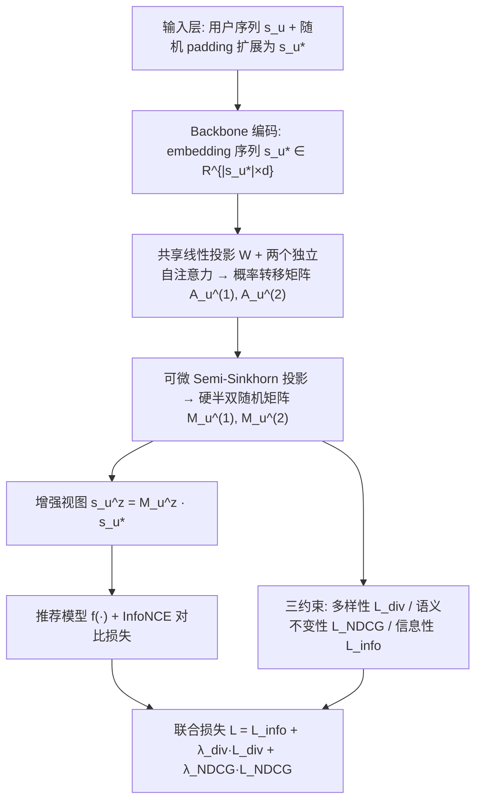
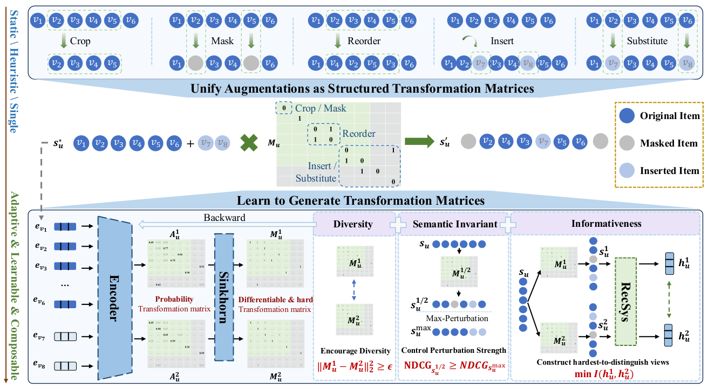
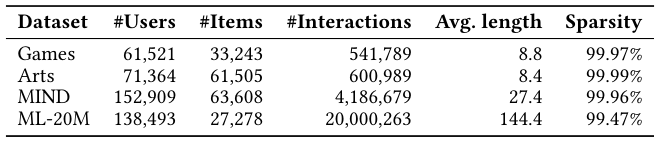
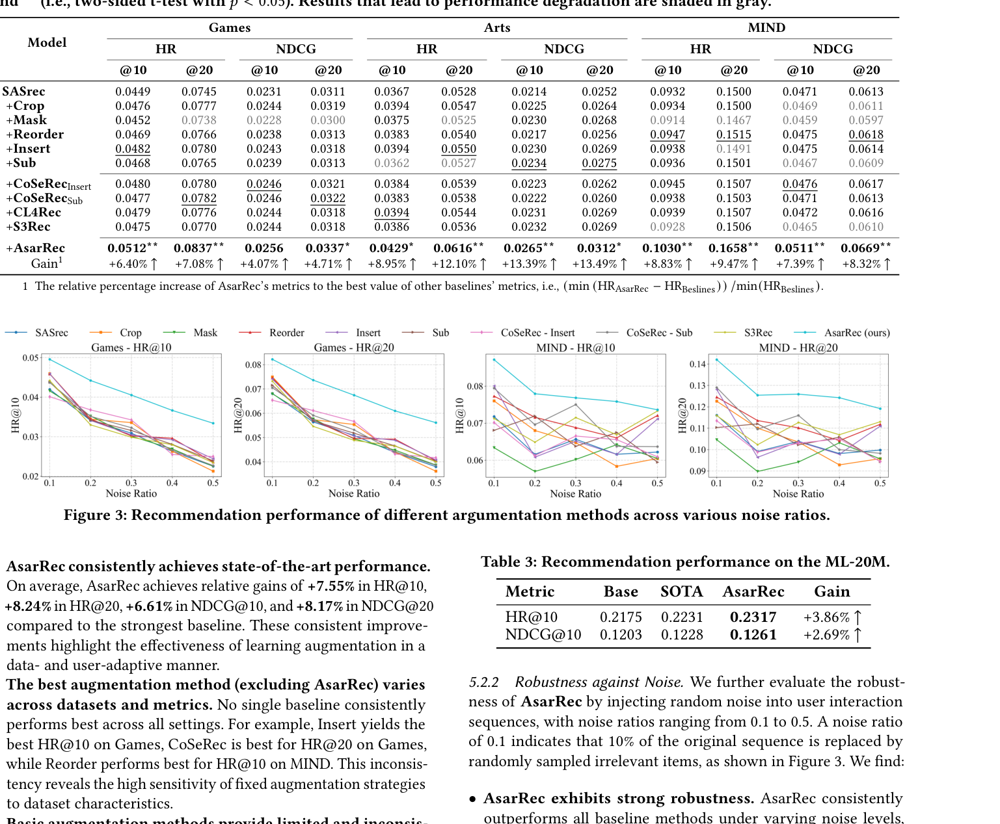
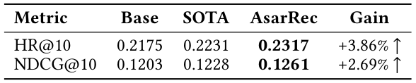
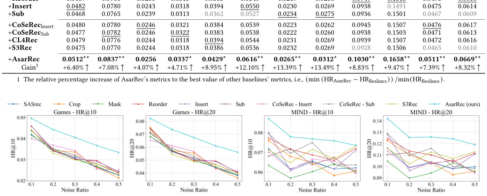
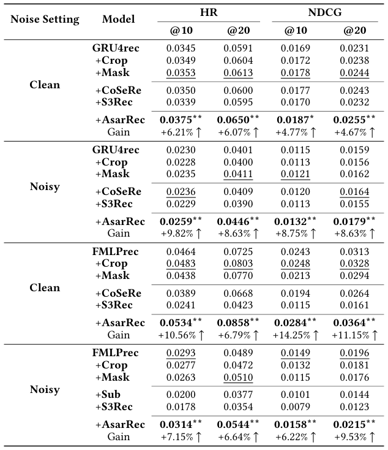
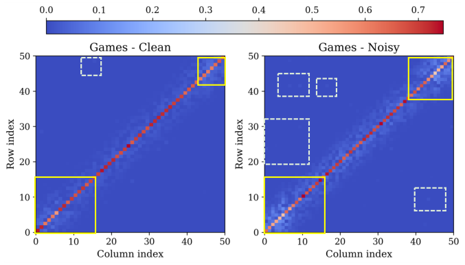
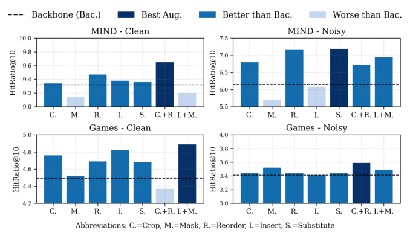

# AsarRec: Adaptive Sequential Augmentation for Robust Self-supervised Sequential Recommendation (面向鲁棒自监督序列推荐的自适应序列增强)

- **会议/期刊**: SIGIR 2026
- **推荐链路定位**: 召回 (Retrieval) — 序列推荐主干（SASRec/GRU4Rec/FMLPRec）的对比学习训练阶段增强
- **研究方向**: 自监督对比学习与交互去噪 / 序列与会话推荐
- **论文原文**: [https://arxiv.org/abs/2512.14047v2](https://arxiv.org/abs/2512.14047v2)
- **开源代码**: [https://github.com/Kaike-Zhang/AsarRec](https://github.com/Kaike-Zhang/AsarRec)

## TL;DR (核心速览)

针对序列推荐中静态数据增强（Mask/Crop/Reorder/Insert/Substitute）在不同数据集与噪声水平下收益不稳定、甚至掉点的问题，AsarRec 将五种增强统一为半双随机变换矩阵 $s'=M\cdot s$，用自注意力编码 + 可微 Semi-Sinkhorn 为每个用户自适应生成硬变换矩阵，并以多样性、语义不变性、信息性三目标联合优化。在 Games/Arts/MIND/ML-20M 上采用留一法 + Full-Ranking 评估，相对最强基线平均提升 HR@10 +7.55%、NDCG@20 +8.17%，且推理零开销。

## Background & Motivation (背景与动机)

- **领域背景与主流范式**: 序列推荐（SASRec、GRU4Rec、FMLPRec）依赖用户反馈建模动态兴趣，但真实反馈含人类误操作、不确定性与行为歧义噪声。主流鲁棒化路线是自监督对比学习（S3Rec、CL4Rec、CoSeRec）：对序列施加扰动生成两个视图，最大化互信息（InfoNCE），学习噪声不变表征。
- **现有方法局限 (Limitations of Prior Work)**:
  1. **静态增强与场景强耦合**：增强类型一旦选定即对所有用户/数据集统一施加。图 1 显示 Games 上 Mask 有正收益（过滤低信息交互），MIND 上却掉点（删除语义关键物品破坏长程依赖）；Insert 在 Games 干净场景收益显著，但在 20% 噪声下进一步注入新物品导致训练失稳。
  2. **组合增强不可控**：MIND+20% 噪声下 Insert+Mask 组合远超单一增强，而 Games 干净场景下 Crop+Reorder 组合甚至低于任一单独增强。
  3. **盲目增强可能损害性能**：增强空间巨大但适配性高度依赖数据特征、噪声条件与用户行为模式，静态策略严重限制 SSL 潜力。
- **核心挑战 (Key Challenge)**: 不同增强操作对序列的修改方式本质不同（删除/重排/插入/替换），如何在一个统一、可微、可组合的框架内为每个用户自适应选择增强类型及其组合？
- **核心洞察与切入点 (Key Insight)**: 作者观察到 Crop/Mask/Reorder 均可写成对序列左乘一个 $\{0,1\}$ 半双随机矩阵（行/列和均为 0 或 1），Insert/Substitute 可通过随机 padding 扩展序列后纳入同一框架。于是"选增强"转化为"生成受约束的硬变换矩阵"，可用 Sinkhorn 类可微投影端到端学习。

## Problem Formulation & Method (问题定义与方法架构)

### 1. 符号定义与输入表征 (Notations & Input Representations)

- 用户集 $\mathcal{U}$，物品集 $\mathcal{V}$；用户 $u$ 的历史交互序列 $s_u=[v_1,\dots,v_{|s_u|}]$，目标为预测下一物品 $v_{|s_u|+1}=\arg\max_{v\in\mathcal{V}} P(v\mid s_u)$。
- 训练序列截断至最多 50（$L=50$）；经随机 padding $k$ 个新物品后得到扩展序列 $s_u^*\in\mathbb{R}^{|s_u^*|\times d}$，$d$ 为物品 embedding 维度（原文未单独报告具体 $d$ 值，沿用各 backbone 原始实现）。
- 输出：两个视图的硬半双随机变换矩阵 $M_u^1, M_u^2\in\{0,1\}^{|s_u^*|\times|s_u^*|}$，以及增强序列 $s_u^z = M_u^z\cdot s_u^*$。

### 2. 整体流水线 (Overall Architecture)

数据流：原始序列 → 随机 padding 扩展 → backbone 编码为 embedding 序列 → 共享线性投影 $W\in\mathbb{R}^{d\times d'}$ → 两个独立自注意力模块生成概率转移矩阵 $A_u^{(z)}$ → Semi-Sinkhorn 投影为硬半双随机矩阵 $M_u^{(z)}$ → 左乘得到增强视图 → 送入推荐模型计算 InfoNCE 与推荐损失，同时三约束反传更新增强编码器。

图 2 展示了该框架从"静态/启发式/单一增强"到"自适应、可学习、可组合增强"的转变。

<figure class="paper-figure" markdown="span">
  <figcaption>图2：我们提出的框架概览。顶部展示了五种常用的启发式增强策略。中间部分展示了我们如何将这些操作统一为结构化变换矩阵。底部展示了我们的模型如何通过基于Sinkhorn的可微过程，在多样性、语义不变性和信息性三个关键目标的引导下，学习生成有效的变换矩阵。我们的方法实现了从静态、启发式或单一类型增强到自适应、可学习且可组合的增强策略的转变。</figcaption>
</figure>

### 3. 核心模块设计与数学原理 (Key Designs & Formulations)

**(1) 增强操作的统一矩阵形式化**。对 Crop/Mask/Reorder，增强序列为 $s'=M_o\cdot s$，其中 $M_o\in\{0,1\}^{|s|\times|s|}$ 为硬半双随机矩阵，满足 $\sum_j M_{o,i,j}\in\{0,1\}$、$\sum_i M_{o,i,j}\in\{0,1\}$。行全零表示该物品被 Mask（Crop 视为连续 Mask）；$M_{o,i,j}=1$ 表示原序列第 $i$ 个物品被放到位置 $j$（Reorder）。对 Insert/Substitute，先随机 padding $k$ 个不在 $s$ 中的物品得 $s^*$，再在 $(|s|+k)\times(|s|+k)$ 上施加同约束矩阵；若存在 $i\ge|s|, j<|s|$ 使 $M_{i,j}\ge 1$，即表示新物品被插入或替换进历史序列。由此五种操作统一为同一结构化约束族。

**(2) 概率转移矩阵生成**。给定 $s_u^*$，经共享投影与两个独立自注意力头生成概率矩阵：

$$A_u^{(z)}=\mathrm{softmax}\!\left(\frac{(s_u^*W^\top)W_Q^{(z)}\,((s_u^*W^\top)W_K^{(z)})^\top}{\sqrt{d'}}\right),\quad z\in\{1,2\}$$

其中 $W_Q^{(z)},W_K^{(z)}\in\mathbb{R}^{d'\times d'}$，$A_{u,i,j}$ 表示物品 $v_i$ 映射到位置 $j$ 的概率。物理直觉：自注意力天然刻画物品间"谁该去哪"的软对应关系，为后续硬投影提供可微起点。

**(3) 可微 Semi-Sinkhorn 硬投影**。直接学习离散强约束矩阵存在梯度消失/不稳定，故对 $A_u^{(z)}$ 迭代行归一化、列归一化 $T$ 次，将行/列中 max-min 差小于阈值 $\delta$ 的行列置零（实现"半"双随机，允许整行/整列归零以表达 Mask），最后按行/列 argmax 得硬矩阵，并用 straight-through 技巧 $M=(M_{\text{hard}}-S).\text{detach}()+S$ 保留梯度（算法 1）。相比 softmax 投影，该过程缓解梯度尺度失衡，多次迭代后仍稳定逼近二值结构。

### 4. 训练目标、负采样与推理复杂度 (Optimization, Negative Sampling & Complexity)

- **损失函数**（式 12）：

$$\mathcal{L}=\mathcal{L}_{\text{info}}+\lambda_{\text{div}}\mathcal{L}_{\text{div}}+\lambda_{\text{NDCG}}\mathcal{L}_{\text{NDCG}}$$

  - **多样性**：$\mathcal{L}_{\text{div}}=\mathbb{E}_u[\max(0,\epsilon-\|M_u^1-M_u^2\|_2^2)]$，$\epsilon=20.0$，防止两视图退化为同一序列（否则 InfoNCE 梯度爆炸）。
  - **语义不变性**：定义 Sequence-aware NDCG，按物品在原序列中的位置赋相关性 $r_i=\text{position}(v_i)$（越近相关性越高）；构造最坏退化参考 $s_u^{\max}$（将最近 $\lfloor\gamma|s_u|\rfloor$ 个高相关物品替换为无关物品，相关性置 0），$\mathcal{L}_{\text{NDCG}}=\mathbb{E}_u[\sum_{z=1}^2\max(0,\mathrm{NDCG}_{s_u^{\max}}-\mathrm{NDCG}_{s_u^z})]$，约束扰动不破坏近期语义。
  - **信息性**：$\mathcal{L}_{\text{info}}=\mathbb{E}_u[\log\frac{\exp(\mathrm{sim}(f(s_u^1),f(s_u^2))/\tau)}{\sum_j\exp(\mathrm{sim}(f(s_u^1),f(s_u^2_j))/\tau)}]$，即 InfoNCE，$\tau$ 为温度系数，分母对 batch 内 $N$ 个负样本求和（in-batch 负采样，原文未报告 $\tau$ 具体取值）。
- **训练负采样策略**：对比学习采用 in-batch 负采样（分母为 batch 内其他用户视图）；推荐主任务沿用各 backbone 原始训练方式（原文未额外说明主任务负采样细节）。
- **时间与空间复杂度**：backbone 前向为 $\mathcal{O}(BL^2d)$（Transformer）或 $\mathcal{O}(BLd^2)$（RNN）；基本增强为 $\mathcal{O}(BL)$；AsarRec 额外生成概率矩阵与 Sinkhorn 投影均为 $\mathcal{O}(BL^2)$（小常数），总体渐近复杂度仍为 $\mathcal{O}(BL^2d)$，与 backbone 同阶。表 5 实测单 epoch 训练时间：backbone 23.25±0.67s，Mask 32.59±0.96s，Crop 33.63±0.83s，Reorder 39.35±1.37s，Insert 34.34±0.62s，Substitute 32.10±0.37s，AsarRec 33.65±0.69s——与手工增强相当甚至更快。**推理阶段零额外开销**（不改变 backbone 与推理管线）。

## Experimental Setup & Evaluation Protocol (实验设置与评估协议)

- **数据集统计与预处理**: 使用 Amazon Games/Arts、MIND、ML-20M；过滤交互数少于 5 的用户（5-core 式过滤）；MIND 按文献 [10] 采样子集。

<figure class="paper-figure" markdown="span">
  <figcaption>表1：数据集统计</figcaption>
</figure>

| 数据集 (Dataset) | 用户数 (#Users) | 物品数 (#Items) | 交互数 (#Interactions) | 平均序列长度 | 稀疏度 (Sparsity) |
| :--- | :---: | :---: | :---: | :---: | :--- |
| Games | 61,521 | 33,243 | 541,789 | 8.8 | 99.97% |
| Arts | 71,364 | 61,505 | 600,989 | 8.4 | 99.99% |
| MIND | 152,909 | 63,608 | 4,186,679 | 27.4 | 99.96% |
| ML-20M | 138,493 | 27,278 | 20,000,263 | 144.4 | 99.47% |

- **数据划分方式 (Splitting Strategy)**: **Leave-One-Out (留一法)**——最近一次交互作测试、倒数第二次作验证、其余（最多 50 个）作训练。该协议为序列推荐标准做法，但需注意：验证/测试取最近交互、训练取更早交互，符合时间因果，无未来信息泄露；不过 LOO 单正样本评估本身对排序稳定性较敏感。
- **排名评测协议 (Ranking Protocol)**: 原文未明确声明是否对全量未交互物品打分；从指标量级（HR@10 约 0.04–0.23）与领域惯例推断为 **Full-Ranking（全库排序）**，但论文正文未显式写明，属评估协议描述不充分之处。
- **评价指标与显著性检验**: HR@10/20、NDCG@10/20；对次优基线做双侧 $t$ 检验，$0.05\le p<0.1$ 标 `*`，$p<0.05$ 标 `**`；表 5 报告多次运行的均值±标准差。Embedding 维度 $d$ 沿用各 backbone 原始实现（原文未单独报告）。

## Key Experimental Results (核心实验结果)

### 1. 主实验对比 (Main Results)

以 SASRec 为 backbone 的干净场景结果（表 2）：

<figure class="paper-figure" markdown="span">
  <figcaption>表2：不同增强方法的推荐性能。最高分以粗体显示，次高分以下划线标出。相对于次高分的显著提升用*（即双侧t检验，0.05 ≤𝑝&lt; 0.1）和**（即双侧t检验，𝑝&lt; 0.05）标记。导致性能下降的结果以灰色阴影标出。</figcaption>
</figure>

| 数据集 | 指标 | 最强基线 (方法/数值) | 本文方法 (Ours) | 相对提升 (Improv.) |
| :--- | :--- | :---: | :---: | :---: |
| Games | HR@10 | Insert 0.0482 | **0.0512** | +6.40% |
| Games | HR@20 | CoSeRecSub 0.0782 | **0.0837** | +7.08% |
| Games | NDCG@10 | CoSeRecInsert/Sub 0.0246 | **0.0256** | +4.07% |
| Games | NDCG@20 | CoSeRecSub 0.0322 | **0.0337** | +4.71% |
| Arts | HR@10 | Crop/Insert/CL4Rec 0.0394 | **0.0429** | +8.95% |
| Arts | HR@20 | Insert 0.0550 | **0.0616** | +12.10% |
| Arts | NDCG@10 | Sub 0.0234 | **0.0265** | +13.39% |
| Arts | NDCG@20 | Sub 0.0275 | **0.0312** | +13.49% |
| MIND | HR@10 | Reorder 0.0947 | **0.1030** | +8.83% |
| MIND | HR@20 | Reorder 0.1515 | **0.1658** | +9.47% |
| MIND | NDCG@10 | CoSeRecInsert 0.0476 | **0.0511** | +7.39% |
| MIND | NDCG@20 | Reorder 0.0618 | **0.0669** | +8.32% |

平均相对提升：HR@10 +7.55%、HR@20 +8.24%、NDCG@10 +6.61%、NDCG@20 +8.17%。关键观察：最强基线随数据集/指标漂移（Games 上 Insert、MIND 上 Reorder），印证静态增强的敏感性；Substitute 在部分设置下掉点（表中灰色阴影）。

ML-20M 大规模验证（表 3）：

<figure class="paper-figure" markdown="span">
  <figcaption>表3：在ML-20M上的推荐性能。</figcaption>
</figure>

| 数据集 | 指标 | Base (SASRec) | SOTA 基线 | AsarRec | 相对 SOTA 提升 |
| :--- | :--- | :---: | :---: | :---: | :---: |
| ML-20M | HR@10 | 0.2175 | 0.2231 | **0.2317** | +3.86% |
| ML-20M | NDCG@10 | 0.1203 | 0.1228 | **0.1261** | +2.69% |

**鲁棒性（图 3）**：注入 10%–50% 随机噪声，AsarRec 在所有噪声比例下持续领先，性能衰减明显更慢；静态增强随噪声上升大幅掉点。

<figure class="paper-figure" markdown="span">
  <figcaption>图3：不同噪声比例下不同增强方法的推荐性能。</figcaption>
</figure>

### 2. 消融实验与控制变量分析 (Ablation Study)

图 6 以 Games + SASRec 为设置（横轴为 0 即移除对应组件）：

- 移除候选池大小 $k$ 在低噪声设置下导致显著性能下降，说明其提供变换灵活性；
- 移除 $\lambda_{\text{div}}$ 或 $\lambda_{\text{NDCG}}$ 均带来明显退化，三约束互补；
- $\lambda_{\text{NDCG}}$ 过小导致语义过度扭曲、干净场景掉点明显，$\lambda_{\text{NDCG}}>5$ 后各指标稳定；
- $k$ 在 $\{2,3,5,10,20\}$ 范围内性能基本平稳，模型对候选池大小不敏感。

**跨 backbone 泛化（表 4）**：GRU4Rec 干净场景 HR@10 0.0345→0.0375（+6.21%），20% 噪声下 0.0230→0.0259（+9.82%）；FMLPRec 干净场景 HR@10 0.0464→0.0534（+10.56%），噪声下 0.0293→0.0314（+7.15%）。值得注意的是 FMLPRec 本身含去噪设计，多数手工增强在噪声下反而低于 backbone（如 Mask、Sub、S3Rec），而 AsarRec 仍稳定增益。

<figure class="paper-figure" markdown="span">
  <figcaption>表4：不同增强方法在GRU4rec和FLMPrec上的推荐性能。</figcaption>
</figure>

### 3. 稀疏度/冷启动分桶与超参敏感度 (Sparsity Buckets & Hyperparameters)

- **交互频次分桶**：原文未按用户/物品交互频次分桶报告长尾或冷启动子群表现（原文未报告）。
- **关键超参数敏感度**：$k$ 不敏感；$\lambda_{\text{div}}$ 与 $\lambda_{\text{NDCG}}$ 存在有效区间，$\lambda_{\text{NDCG}}$ 过小显著掉点；$\epsilon=20.0$、扰动预算 $\gamma=10\%$ 为固定设置。
- **变换矩阵可视化（图 4）**：序列头尾（尤其头部）扰动更强，符合语义不变性约束（头部扰动语义影响小）；噪声环境下扰动更集中；避免长距离重排（灰绿虚线框），倾向局部但具挑战性的扰动。
- **用户案例（图 5）**：干净场景倾向 Insert/Substitute 丰富序列（NDCG 0.8201 远高于最坏阈值 0.7355）；20% 噪声下转为 Mask/Reorder 去除/重排可疑物品（NDCG 0.7666），体现按输入特征动态切换增强策略。
- **线上 A/B 测试**：原文仅包含离线实验（原文未报告线上结果）。

<figure class="paper-figure" markdown="span">
  <figcaption>图4：平均变换矩阵的可视化。黄色实线框突出显示序列头部和尾部附近的强扰动，灰绿色虚线框显示对长距离重排序的避免。</figcaption>
</figure>

## Highlights, Limitations & Critiques (亮点、局限与审稿级批判)

- **核心亮点与可迁移性**:
  1. **统一形式化优雅**：将五类序列增强统一为半双随机矩阵左乘，使"增强选择+组合"变为单一矩阵生成问题，该视角可迁移到图增强（边/节点变换矩阵）、多模态视图构造等任意对比学习增强设计。
  2. **可微硬约束采样**：Semi-Sinkhorn + straight-through 解决了离散强约束矩阵的端到端训练难题，且"半"双随机（允许整行归零）恰好覆盖 Mask 语义，设计精巧。
  3. **零推理开销**：仅改训练阶段，可直接插入现有序列推荐系统，工程落地成本极低；实测训练耗时与手工增强相当。
  4. **三约束互补**：多样性保训练稳定、语义不变性防破坏性扰动、信息性保对比收益，消融验证各自必要。
- **局限性与审稿视角批判 (Critical Limitations)**:
  1. **评估协议描述不充分**：正文未显式声明 Full-Ranking 还是采样排序，也未报告 embedding 维度 $d$、$\tau$、$d'$ 等关键超参，复现细节依赖代码仓库。
  2. **LOO 单正样本评估**：仅用最近一次交互作测试，指标方差较大；虽报告了 $t$ 检验，但未说明随机种子数量与方差（表 5 除外）。
  3. **噪声注入方式单一**：鲁棒性实验仅用"随机替换无关物品"模拟噪声，未覆盖真实场景中的系统性偏差（如曝光偏差、流行度偏差、恶意攻击），与去噪文献中的假阳性/假阴性噪声设定存在差距。
  4. **增强编码器额外参数与训练稳定性**：自注意力编码器 + Sinkhorn 迭代引入额外超参（$\delta$、$T$、$\epsilon$、$\gamma$），论文未报告 $T$ 与 $\delta$ 的敏感度；straight-through 的梯度偏差对收敛的影响缺乏理论分析。
  5. **缺少与 reweight 类去噪方法的对比**：相关工作提及 reweight 路线（如 Double Correction），但实验未纳入此类基线，鲁棒性主张的覆盖面略窄。
  6. **可解释性停留在可视化**：图 4/图 5 的定性分析有说服力，但缺少"学到的增强类型分布 vs. 数据集噪声水平"的定量统计。

## Rating (四维评分)

- **方法创新性 (Novelty)**: ⭐⭐⭐⭐
- **评估协议与实验扎实度 (Protocol & Experiments)**: ⭐⭐⭐⭐
- **写作与数学规范度 (Clarity & Rigor)**: ⭐⭐⭐⭐
- **工业落地与复现价值 (Industrial & Practical Value)**: ⭐⭐⭐⭐⭐

## 论文图表

<figure class="paper-figure" markdown="span">
  <figcaption>图1：不同数据场景下各种增强方法及其组合的有效性。在噪声设置中，每个用户的交互序列额外注入20%的随机噪声。</figcaption>
</figure>

