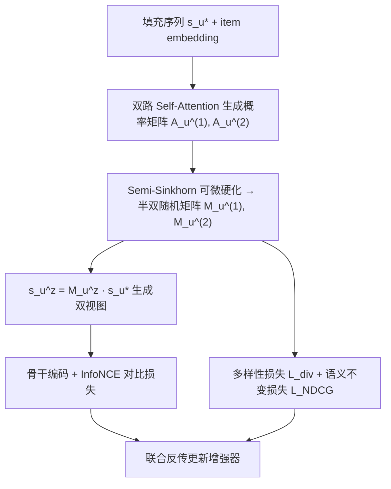

# AsarRec: Adaptive Sequential Augmentation for Robust Self-supervised Sequential Recommendation (面向鲁棒自监督序列推荐的自适应序列增强)

- **会议/期刊**: SIGIR 2026
- **作者与机构**: Kaike Zhang, Qi Cao, Fei Sun, Xinran Liu, Huawei Shen, Xueqi Cheng（中科院计算所 AI 安全全国重点实验室 / 国科大）
- **推荐链路定位**: 召回（序列召回骨干的对比式训练阶段）
- **研究方向**: 自监督对比学习与交互去噪 / 序列推荐
- **论文原文**: [https://arxiv.org/abs/2512.14047v2](https://arxiv.org/abs/2512.14047v2)
- **开源代码**: [https://github.com/Kaike-Zhang/AsarRec](https://github.com/Kaike-Zhang/AsarRec)

## TL;DR (1分钟核心速览)

现有序列对比学习（CL4Rec/S3Rec/CoSeRec）依赖**静态、预定义**的增强算子，而作者实证发现：同一算子在 Games 上有效、在 MIND 上反而掉点，组合增强甚至可能劣于单算子。AsarRec 把 Crop/Mask/Reorder/Insert/Substitute 五种算子统一为**半双随机变换矩阵** $s'=M\cdot s$，用自注意力编码序列生成概率转移矩阵，再经**可微 Semi-Sinkhorn** 投影为硬 0/1 矩阵，并以多样性、语义不变性、信息量三目标联合优化。在 Games/Arts/MIND/ML-20M 四数据集、Leave-One-Out + Full-Ranking 协议下，相对最强基线平均提升 HR@10 +7.55%、NDCG@20 +8.17%，且推理零开销。

## Background & Motivation (背景与核心矛盾)

- **主流范式**: 序列推荐用对比学习提升鲁棒性——对用户序列施加两种增强生成双视图，最大化互信息（InfoNCE），迫使模型学到噪声不变表征。
- **前人局限**: ①增强类型一旦选定即对**所有用户、所有数据集、所有噪声水平**统一施加，而最优增强高度依赖场景（图 1：Mask 在 Games 增益、在 MIND 掉点；Insert 在干净 Games 大涨、在 20% 噪声下剧烈失稳）；②某些组合（Crop+Reorder）甚至低于任一单算子，盲目增强会**反向伤害**对比学习。
- **核心洞察 (Key Insight)**: 五种算子本质上都是对序列位置的**置换/保留/丢弃/引入**操作，可被同一类受约束矩阵统一表达；因此"选增强"可转化为"学一个矩阵"，从而把离散的算子选择变成可端到端优化的连续问题。
- **本文切入点**: 用可微 Sinkhorn 在硬约束下生成用户级变换矩阵，并用三个目标保证学到的增强"够不同、不毁语义、够有挑战"。

## Method (核心方法设计)

### 1. 整体框架 (Overall Architecture)

输入为用户填充后序列 $s_u^*$（原序列 + $k$ 个随机 padding 物品）；先用推荐骨干的 item embedding 序列经共享线性层与两路独立 self-attention 生成两个概率转移矩阵 $A_u^{(1)},A_u^{(2)}$；再经 Semi-Sinkhorn 迭代行列归一化并硬化为半双随机矩阵 $M_u^{(1)},M_u^{(2)}$；用 $s_u^{z}=M_u^{(z)}\cdot s_u^*$ 得到双视图送入骨干编码，计算 InfoNCE 对比损失，同时用多样性损失与 Sequence-aware NDCG 语义损失反传梯度更新增强生成器。增强器**仅在训练期存在**，推理管线与骨干完全不变。

### 2. 关键设计拆解 (Key Designs)

1. **统一矩阵化增强（Unified Matrix Formulation）**：解决"算子异构、无法统一优化"的痛点。将 Crop/Mask/Reorder 表达为 $s'=M_o\cdot s$，$M_o\in\{0,1\}^{|s|\times|s|}$ 且每行每列和 ∈{0,1}（行和为 0 即删除=Mask/Crop，$M_{o,i,j}=1$ 即把 $v_i$ 放到位置 $j$=Reorder）；Insert/Substitute 通过随机 padding 扩展为 $s^*$ 后在同尺寸矩阵上表达（存在 $i\ge|s|,j<|s|$ 的置 1 即引入新物品）。直觉：所有增强都成了同一约束族内的采样，组合增强自然成为矩阵的复合。
2. **可微 Semi-Sinkhorn 硬化（Differentiable Hard Projection）**：直接学离散强约束矩阵梯度不稳。先由 $A_u^{(z)}=\mathrm{softmax}\big((s_u^*W^\top)W_Q^{(z)}((s_u^*W^\top)W_K^{(z)})^\top/\sqrt{d'}\big)$ 得连续概率矩阵，再迭代行列归一化，对极差小于阈值 $\delta$ 的行/列置零（实现"半"双随机，允许整行整列全零），最后用 straight-through 技巧 $M=(M_{\text{hard}}-S).\text{detach}()+S$ 保留梯度。相比 softmax 投影，Sinkhorn 多轮迭代后仍能稳定逼近硬二值结构，避免梯度尺度失衡。
3. **三目标联合优化与训练开销**：总损失
$$\mathcal{L}=\mathcal{L}_{\text{info}}+\lambda_{\text{div}}\mathcal{L}_{\text{div}}+\lambda_{\text{NDCG}}\mathcal{L}_{\text{NDCG}}$$
其中 $\mathcal{L}_{\text{div}}=\mathbb{E}_u[\max(0,\epsilon-\|M_u^1-M_u^2\|_2^2)]$ 防止双视图退化为同一序列（否则 InfoNCE 梯度爆炸）；$\mathcal{L}_{\text{NDCG}}$ 以位置为相关性（越近相关性越高），构造"替换最近 $\lfloor\gamma|s|\rfloor$ 个物品"的最坏序列 $s_u^{\max}$ 作为下界，惩罚 $\mathrm{NDCG}_{s^{\max}}-\mathrm{NDCG}_{s^z}$ 的正部，从而约束语义失真；$\mathcal{L}_{\text{info}}$ 为标准 InfoNCE（in-batch 负样本，温度 $\tau$）。复杂度：增强器额外 $O(BL^2)$，与骨干 $O(BL^2d)$ 同阶，实测 33.65 s/epoch，甚至快于 Reorder（39.35 s）。

## Experimental Setup & Evaluation Protocol (实验设置与评估协议)

- **数据集与预处理**（过滤交互数 < 5 的用户）：

| 数据集 | #Users | #Items | #Interactions | 平均长度 | 稀疏度 |
| :--- | :---: | :---: | :---: | :---: | :---: |
| Games | 61,521 | 33,243 | 541,789 | 8.8 | 99.97% |
| Arts | 71,364 | 61,505 | 600,989 | 8.4 | 99.99% |
| MIND | 152,909 | 63,608 | 4,186,679 | 27.4 | 99.96% |
| ML-20M | 138,493 | 27,278 | 20,000,263 | 144.4 | 99.47% |

- **数据划分与防穿越**: `Leave-One-Out`——最后 1 次交互测试、倒数第 2 次验证、其余（截断至 50）训练。
- **排名评测协议**: `Full-Ranking`（全库未交互物品排序），指标 HR@{10,20}、NDCG@{10,20}；噪声鲁棒性实验按比例 0.1–0.5 用随机无关物品替换原序列片段。
- **对比基线与超参**: 基线含 5 种基础算子（Crop/Mask/Reorder/Insert/Substitute）与 CoSeRec、CL4Rec、S3Rec；骨干为 SASRec（主）、GRU4Rec、FMLPRec；扰动预算 $\gamma=10\%$，$\epsilon=20.0$，$\lambda_{\text{div}}\in\{1,2,5,50,100\}$，$\lambda_{\text{NDCG}}\in\{0.1,\dots,5\}$，候选数 $k\in\{2,3,5,10,20\}$；显著性用双侧 t 检验（$p<0.05$ 标 **）。

## Key Experimental Results (实验关键数据)

### 1. 主实验对比 (Main Results)

SASRec 骨干，干净设置（节选 HR@10 / NDCG@20）：

| 方法 | Games HR@10 | Games NDCG@20 | Arts HR@10 | Arts NDCG@20 | MIND HR@10 | MIND NDCG@20 |
| :--- | :---: | :---: | :---: | :---: | :---: | :---: |
| SASRec | 0.0449 | 0.0311 | 0.0367 | 0.0252 | 0.0932 | 0.0613 |
| +Crop | 0.0476 | 0.0319 | 0.0394 | 0.0264 | 0.0934 | 0.0611 |
| +Mask | 0.0452 | 0.0300 | 0.0375 | 0.0268 | 0.0914 | 0.0597 |
| +Reorder | 0.0469 | 0.0313 | 0.0383 | 0.0256 | 0.0947 | 0.0618 |
| +Insert | 0.0482 | 0.0318 | 0.0394 | 0.0269 | 0.0938 | 0.0614 |
| +CoSeRec | 0.0480 | 0.0321 | 0.0384 | 0.0262 | 0.0945 | 0.0617 |
| +CL4Rec | 0.0479 | 0.0318 | 0.0394 | 0.0269 | 0.0939 | 0.0616 |
| +S3Rec | 0.0475 | 0.0318 | 0.0386 | 0.0269 | 0.0928 | 0.0610 |
| **+AsarRec** | **0.0512** | **0.0337** | **0.0429** | **0.0312** | **0.1030** | **0.0669** |
| Improv. | +6.40% | +4.71% | +8.95% | +13.49% | +8.83% | +8.32% |

ML-20M 大规模验证：HR@10 0.2175→**0.2317**（+3.86%），NDCG@10 0.1203→**0.1261**（+2.69%）。

### 2. 消融实验 (Ablation Study)

Games 数据集，横轴取 0 表示移除该组件（图 6）：

| 配置 | 现象 | 结论 |
| :--- | :--- | :--- |
| w/o 候选池 $k$ | 低噪声下显著掉点 | 变换灵活性是增益前提 |
| w/o $\mathcal{L}_{\text{div}}$（$\lambda_{\text{div}}=0$） | 整体明显退化，双视图趋于相同 | 多样性兼有稳定训练作用 |
| w/o $\mathcal{L}_{\text{NDCG}}$（$\lambda_{\text{NDCG}}=0$） | 干净设置下掉点最重 | 语义保真是干净场景关键 |
| $\lambda_{\text{NDCG}}>5$ | 各指标趋于稳定 | 语义约束存在饱和阈值 |

### 3. 关键实验发现 (Key Findings)

1. **静态增强的"最优算子"随数据集漂移，而 AsarRec 稳定最优**：Games 上最佳基线为 Insert（HR@10 0.0482），MIND 上为 Reorder（0.0947），Arts 上为 Crop/Insert/CL4Rec 并列（0.0394）；AsarRec 在三者上分别达 0.0512/0.1030/0.0429，说明"学增强"确实规避了算子选择风险，而非简单集成。
2. **噪声越大优势越明显**：噪声比例 0.1→0.5 时基线性能快速下滑，AsarRec 衰减最缓；在 GRU4Rec 的 20% 噪声下相对提升达 HR@10 +9.82%、NDCG@10 +8.75%，在本身已含去噪模块的 FMLPRec 上仍有 +7.15%/+6.22%，证明增益不是与骨干去噪能力重复。
3. **学到的增强呈现可解释的"边界扰动 + 短程重排"模式**：平均变换矩阵（图 4）显示序列头尾扰动最强（头部语义影响小、尾部噪声易聚集），且回避长距离重排；案例研究（图 5）中干净场景倾向 Insert/Substitute 丰富序列（NDCG 0.8201 远高于下界 0.7355），20% 噪声场景转为 Mask/Reorder 剔除可疑项（0.7666），即模型自动完成了"干净时增广、脏时去噪"的策略切换。

## Highlights, Limitations & Rating (亮点、对比与审稿评价)

- **与代表作对比 (vs. Prior Work)**: CL4Rec 固定 Mask+Reorder 双视图、S3Rec 用掩码重建做预测式自监督、CoSeRec 依赖外部相似物品做 Insert/Substitute——三者都是"人选算子"，AsarRec 是"模型学算子"且支持算子组合；相较基于重加权（reweight）的去噪路线，本文不改样本权重而改视图构造，二者正交可叠加。
- **可迁移亮点**: ①"把离散增强/离散结构选择写成受约束矩阵 + Sinkhorn 硬化"的范式可直接迁移到图增强（边删/边加）与多模态模态丢弃策略学习；②用位置相关性构造 Sequence-aware NDCG 作为语义失真上界，是一个轻量且无需人工标注的正则化技巧。
- **审稿级局限批判**: ①语义约束以"位置=相关性"为假设，对兴趣漂移剧烈或长周期序列（ML-20M 平均长度 144）可能过于保守，这也解释了 ML-20M 上增益（+2.69%~+3.86%）明显小于短序列数据集；②增强器为每用户生成 $|s^*|\times|s^*|$ 矩阵，长序列下显存与 $O(BL^2)$ 开销会放大，论文仅报告了 SASRec 单卡 epoch 时间，缺少长序列/工业级规模的可扩展性验证；③三目标权重 $\lambda_{\text{div}},\lambda_{\text{NDCG}}$ 需逐数据集网格搜索，实际部署调参成本未讨论。
- **四维评分**: 创新性 ⭐⭐⭐⭐ | 实验扎实度 ⭐⭐⭐⭐ | 方法清晰度 ⭐⭐⭐⭐⭐ | 落地价值 ⭐⭐⭐⭐

