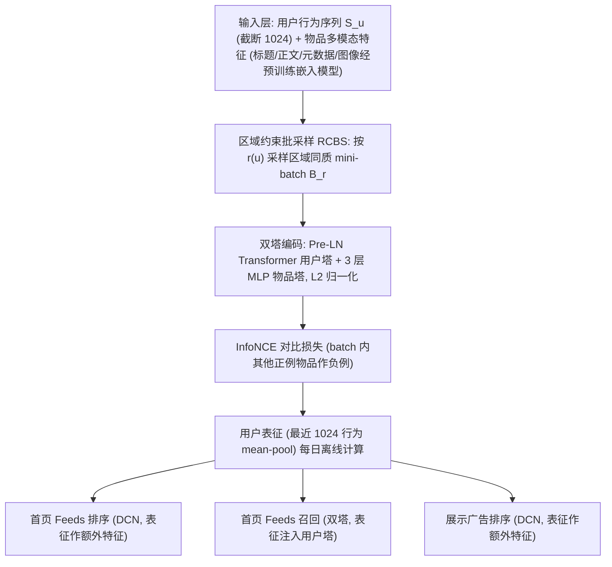

# Don't Contrast the Impossible: Region-Constrained Batching for Contrastive User Modeling on a Local Community Platform (别拿不可能的去对比：本地社区平台上区域约束批采样的对比用户建模)

- **会议/期刊**: SIGIR 2026 (Industry Track)
- **推荐链路定位**: 召回 (Retrieval) — 用户表征预训练，服务于首页 Feeds 召回/排序与展示广告排序
- **研究方向**: 自监督对比学习与交互去噪 / 冷启动与长尾推荐（地理约束下的曝光可行性）
- **论文原文**: [https://arxiv.org/abs/2607.28971v1](https://arxiv.org/abs/2607.28971v1)
- **开源代码**: 暂未开源（原文与预提取均未发现开源仓库）

## TL;DR (核心速览)

本地社区平台（Karrot）的曝光受地理半径硬约束，标准 in-batch 负采样把“平台根本不会曝光”的用户-物品对当作负例，产生大量**不可能负例 (impossible negatives)**，稀释对比信号。本文提出 **Region-Constrained Batch Sampling (RCBS)**：仅改变 mini-batch 的构造方式（按区域同质采样用户），不改模型架构与 InfoNCE 损失，把不可能负例比例 $\rho_{train}$ 从 0.98 降到 0.30，等价于自动引入更难的可行负例。离线 R@10 从 0.100 提升至 0.149（+49%），下游首页召回 R@10 +7.56%、广告排序 PR-AUC +3.38%，线上 A/B 点击 +10.0%、广告 CTR +7.46%，已全量上线。

## Background & Motivation (背景与动机)

- **领域背景与主流范式**: 大规模推荐系统的用户表征学习已形成“行为序列 + 双塔 + InfoNCE 对比预训练”的标准范式（PinnerFormer、PinFM、Meta 用户表征 scaling 等）。其隐含假设是 **universal exposure**：任意用户都可能被曝光任意物品，因此 batch 内其他正例物品可安全地当作负例。
- **现有方法局限 (Limitations of Prior Work)**:
  1. **曝光可行性被忽略**：Karrot 上 86% 以上交易发生在 5km 半径内，用户只能看到同区域或相邻区域的物品；随机 batch 中绝大多数负例是“平台策略决定永不曝光”的物品，非参与并不反映偏好。
  2. **IPS 类去偏方法失效**：IPS 需要 positivity assumption（每个 user-item 对曝光概率严格为正），而地理策略造成**结构性 positivity violation**（不可能对的曝光概率恒为 0），没有可重加权的观测交互。
  3. **显式难负例挖掘成本高**：现有 hard-negative mining（VSE++、SimCSE、RocketQA、混合负采样、跨 batch 负采样）需要额外检索/合成/维护负例池，工业落地代价大。
- **核心挑战 (Key Challenge)**: 在曝光受地理硬约束的场景下，如何在不改模型、不加算力的前提下，让对比学习的负例分布与真实曝光分布对齐？
- **核心洞察与切入点 (Key Insight)**: 作者将负例二分为 **feasible negatives**（可曝光但用户未交互，携带真实偏好信号）与 **impossible negatives**（因平台规则永不曝光，信号≈噪声）。关键观察是：**可行负例天然比不可能负例更难**——因为可行负例与正例同区域、特征更相似，模型必须学得更细才能区分。因此只需把 batch 构造成区域同质，即可“免费”获得难负例。

## Problem Formulation & Method (问题定义与方法架构)

### 1. 符号定义与输入表征 (Notations & Input Representations)

- 用户集 $\mathcal{U}$，物品集 $\mathcal{I}$；用户 $u$ 的行为序列 $S_u=\{s_{u,1},\dots,s_{u,T}\}$，其中 $s_{u,t}=(a_{u,t},\tau_{u,t},i_{u,t})$ 分别为动作类型（点击/观看/聊天）、时间戳、交互物品，$i_{u,t}\in\mathcal{I}$。
- 用户塔 $f_{\text{user}}$（Pre-LN Transformer）输出 $H_u=\{h_{u,t}\}_{t=1}^{T}=f_{\text{user}}(S_u)\in\mathbb{R}^{T\times d}$；物品塔 $f_{\text{item}}$（3 层 MLP）输出 $v_i=f_{\text{item}}(i)\in\mathbb{R}^d$。
- 双方 $\ell_2$ 归一化，亲和度 $s(h_{u,t},v_i)=h_{u,t}^\top v_i$。
- 区域划分：地理空间离散为区域单元 $r\in\mathcal{R}$，映射函数 $r(u)$、$r(i)$；用户特定曝光半径 $\delta_u\in\{0,1,2,\dots\}$（由平台策略/用户配置决定）。

### 2. 整体流水线 (Overall Architecture)

### 3. 核心模块设计与数学原理 (Key Designs & Formulations)

**(1) 曝光可行性定义 (Exposure Feasibility)**

$$\text{feas}(u,i)=\mathbb{1}\left[\text{dist}\big(r(u),r(i)\big)\le \delta_u\right]$$

其中 $\text{dist}(\cdot,\cdot)$ 为区域单元间非负对称距离，$\delta_u$ 为用户特定曝光半径（以区域单元计）。$\delta_u=0$ 要求精确同区域，$\delta_u>0$ 纳入相邻区域。**不可能负例**定义为 $\text{feas}(u,i)=0$ 的负例物品。物理直觉：把“平台策略”从“用户偏好”中剥离出来。

**(2) 区域约束批采样 (RCBS)**

$$\mathcal{B}_r=\{(u_b,S_{u_b})\}_{b=1}^{M},\quad u_b\sim\text{Uniform}(U_r),\ U_r=\{u\in\mathcal{U}\mid r(u)=r\}$$

即每个 mini-batch 只从单一区域 $r$ 的用户池中采样。由于同 batch 用户共享曝光约束，batch 内绝大多数物品对每个用户都是可行负例。

**(3) 不可能负例比例的理论刻画**

精确区域匹配（$\delta_u=0$）下，batch 内不可能负例期望比例为：

$$\rho=1-\sum_{r\in\mathcal{R}}p_r^2$$

其中 $p_r$ 为 batch 中用户属于区域 $r$ 的概率。随机采样时 $p_r$ 近似均匀，$\rho\approx 1-\frac{1}{\min(|\mathcal{B}|,|\mathcal{R}|)}$，**随系统规模增大而恶化**；RCBS 将概率质量集中于单一区域（$p_r\approx 1$），$\rho\to 0$，且**与 batch size 和区域数无关**。这是本文最漂亮的理论论证：随机 batch 的负例质量会随平台扩张而系统性退化，RCBS 则免疫。

实践中 $\rho$ 不会严格为 0，原因有二：(i) 用户 $\delta_u$ 不同，大半径用户的可行物品对小半径用户可能不可行；(ii) 用户搬迁导致历史交互跨区域。

**(4) 与 IPS 的关系（互补而非替代）**

IPS 是 **loss 级**校正（按逆曝光概率重加权观测交互），要求 $p(o=1\mid u,i)>0$；RCBS 是 **data 级**校正（改变 Eq.(4) 分母中出现哪些物品）。不可能对曝光概率恒为 0，IPS 无从重加权；RCBS 先保证 batch 由可行对构成，IPS 再在区域同质 batch 内校正残余曝光不均衡。二者可叠加。

### 4. 训练目标、负采样与推理复杂度 (Optimization, Negative Sampling & Complexity)

- **损失函数**: 标准 InfoNCE（温度 $\tau>0$），**未做任何修改**：

$$\mathcal{L}_{\text{NCE}}=-\frac{1}{BT}\sum_{b=1}^{B}\sum_{t=1}^{T}\log\frac{\exp\!\big(s(h_{b,t},v^+_{b,t})/\tau\big)}{\sum_{b'=1}^{B}\sum_{t'=1}^{T}\exp\!\big(s(h_{b,t},v^+_{b',t'})/\tau\big)}$$

- **训练负采样策略**: **In-batch 负采样**，但负例池由 RCBS 的区域同质 batch 决定。batch size $B=18$，序列长度 $T=1024$，每 mini-batch 共 $18\times1024=18{,}432$ 个候选。原文未报告 $\tau$ 的具体取值。
- **时间与空间复杂度**: 原文未报告训练单 epoch 耗时、峰值显存或在线推理延迟（ms/request）。RCBS 仅改变采样器，**理论复杂度与随机 batch 完全一致**（无额外前向/反向、无额外负例池存储），这是其工业价值的核心。用户表征每日离线计算（最近 1024 行为过用户塔后 mean-pool），下游以特征/塔注入方式使用。

## Experimental Setup & Evaluation Protocol (实验设置与评估协议)

- **数据集统计与预处理**:

| 数据集 (Dataset) | 用户数 (#Users) | 物品数 (#Items) | 交互数 (#Interactions) | 稀疏度/密度 (Sparsity) | 模态/辅助特征说明 |
| :--- | :---: | :---: | :---: | :---: | :--- |
| 用户建模预训练（生产日志，2 年） | ~25M | 原文未报告 | ~15B actions | 原文未报告 | 物品标题/正文/元数据/图像经预训练嵌入模型编码；序列截断至 1024 |
| 首页 Feeds 排序（下游，3 周） | 原文未报告 | 原文未报告 | 原文未报告 | 原文未报告 | 与预训练期不重叠 |
| 首页 Feeds 召回（下游，1 周） | 原文未报告 | 原文未报告 | 原文未报告 | 原文未报告 | 与预训练期不重叠 |
| 展示广告排序（下游，4 周） | 原文未报告 | 原文未报告 | 原文未报告 | 原文未报告 | 与预训练期不重叠 |

- **数据划分方式 (Splitting Strategy)**: 预训练按**用户划分** 95% 训练 / 5% 评估；下游任务使用**与预训练期不重叠的时间窗**（3 周 / 1 周 / 4 周），评估集为**时间切分**（排序与广告 24 小时，召回 6 小时）。时间不重叠设计有效规避了未来信息泄露。
- **排名评测协议 (Ranking Protocol)**: 原文未明确说明是 Full-Ranking 还是 Sampled Ranking；用户建模评估在两种评估期 batch 构造下报告（Random-Eval 与 RCBS-Eval），Recall 的分母候选池规模原文未报告。
- **评价指标与显著性检验**: 用户建模用 R@10、R@100 及不可能负例比例 $\rho_{train}$；首页排序用 NDCG@10 (N@10) 与 Ordered-Pair Accuracy (OPA)；召回用 R@10、R@100；广告排序用 ROC-AUC (R-A)、PR-AUC (P-A)。因保密，下游仅报告**相对提升**。**原文未报告多随机种子方差或配对显著性检验**（工业 track 常见短板）。

## Key Experimental Results (核心实验结果)

### 1. 主实验对比 (Main Results)

**用户建模预训练（Table 1，训练期 × 评估期 batch 组合）**:

| 训练方法 | Random-Eval R@10 | Random-Eval R@100 | RCBS-Eval R@10 | RCBS-Eval R@100 | $\rho_{train}$ |
| :--- | :---: | :---: | :---: | :---: | :---: |
| Random-Train | 0.100 | 0.422 | 0.082 | 0.349 | 0.98 |
| RCBS-Train (coarse) | 0.125 | 0.456 | 0.112 | 0.403 | 0.79 |
| **RCBS-Train (fine)** | **0.149** | **0.474** | **0.139** | **0.435** | **0.30** |

相对 Random-Train，fine 粒度在 Random-Eval 下 R@10 **+49.0%**、R@100 **+12.3%**；RCBS-Eval 下 R@10 **+69.5%**、R@100 **+24.6%**。注意 RCBS-Eval 分数系统性低于 Random-Eval，恰好佐证“可行负例更难”。

**下游离线任务（Table 2，相对生产基线）**:

| 方法 | 首页排序 ΔN@10 | 首页排序 ΔOPA | 广告排序 ΔR-A | 广告排序 ΔP-A | 首页召回 ΔR@10 | 首页召回 ΔR@100 |
| :--- | :---: | :---: | :---: | :---: | :---: | :---: |
| Random-Train | +0.22% | +0.17% | +0.25% | +1.21% | +4.44% | +2.36% |
| **RCBS-Train (fine)** | **+1.18%** | **+1.07%** | **+0.53%** | **+3.38%** | **+7.56%** | **+4.61%** |

召回任务收益最大（+7.56% vs +4.44%），作者归因于召回与预训练目标的结构相似性；排序任务上 Random-Train 几乎无增益（+0.22%），凸显 RCBS 的必要性。

**线上 A/B（Table 3，RCBS-Train fine 作额外特征 vs 不加）**:

| 场景 | 指标 | 提升 |
| :--- | :--- | :---: |
| 首页 Feeds（召回+排序） | ΔClicks | **+10.0%** |
| 首页 Feeds（召回+排序） | ΔImpressions | +5.12% |
| 首页 Feeds（召回+排序） | ΔDAV (日活观看者) | +1.91% |
| 展示广告排序 | ΔeCPM | +6.01% |
| 展示广告排序 | ΔAd CTR | +7.46% |

### 2. 消融实验与控制变量分析 (Ablation Study)

原文未设传统“逐模块移除”消融，而是以**批采样粒度**作为核心控制变量：

- **Random-Train → RCBS-Train (coarse) → RCBS-Train (fine)**：$\rho_{train}$ 从 0.98 → 0.79 → 0.30，R@10 从 0.100 → 0.125 → 0.149，**单调对应**，直接验证“不可能负例比例越低、表征越好”的核心假设。
- **控制变量严格性**：batch size (18)、序列长度 (1024)、所有超参与训练步数**完全固定**，仅改变采样器，是干净的对照。但**未做参数量对齐/图度数匹配类消融**（本文无图结构，不适用）。
- **评估期 batch 作为额外探针**：RCBS-Eval 分数低于 Random-Eval，构成对“可行负例更难”的间接消融证据。

### 3. 稀疏度/冷启动分桶与超参敏感度 (Sparsity Buckets & Hyperparameters)

- **长尾/冷启动分桶**: **原文未报告**按用户交互频次或物品热度分桶的细分结果。
- **关键超参数敏感度**: 仅报告区域粒度（coarse vs fine）的影响，fine 显著优于 coarse；温度 $\tau$、batch size、序列长度的敏感度**原文未报告**。
- **线上 A/B 测试结果**: 见上表，首页点击 +10.0%、广告 CTR +7.46%，已跨多个应用全量部署。

## Highlights, Limitations & Critiques (亮点、局限与审稿级批判)

- **核心亮点与可迁移性**:
  1. **问题定义精准且具普适性**：将“曝光可行性”形式化为 $\text{feas}(u,i)$，把 impossible negatives 从“难负例”话语中独立出来，可迁移到外卖/生鲜（服务区约束）、约会（距离阈值）、招聘（地域）等一切 location-aware 推荐。
  2. **零成本工业方案**：不改模型、不改损失、不加算力，仅改 DataLoader 采样器，理论复杂度不变，这是 Industry Track 最看重的属性。
  3. **理论刻画有说服力**：$\rho=1-\sum_r p_r^2$ 揭示了随机 batch 的负例质量随平台规模**系统性退化**，而 RCBS 免疫，给出了“为什么现在必须做”的论证。
  4. **与 IPS 的互补性论述清晰**：data-level vs loss-level 校正的分工，为后续“RCBS + IPS”组合留出接口。
- **局限性与审稿视角批判 (Critical Limitations)**:
  1. **评估协议披露不足**：Recall 的候选池规模、是否 Full-Ranking、$\tau$ 取值、训练耗时/显存均未报告，复现性受限（虽为工业保密可理解，但削弱学术说服力）。
  2. **无统计显著性检验**：离线与线上均未报告置信区间、多随机种子方差或配对检验，+0.53% 这类小幅增益（广告 R-A）的可靠性存疑。
  3. **区域同质 batch 的副作用未讨论**：batch 内用户高度同质会降低负例的**跨区域多样性**，可能损害跨区域泛化；对冷启动/搬迁用户（$\rho$ 无法降为 0 的两类情形）缺乏专门分析。
  4. **粒度选择依赖人工**：coarse/fine 区域划分是手工设定，作者在结论中也承认“自适应区域分组”是未来工作，当前缺少自动选择机制。
  5. **baseline 偏弱**：仅对比 Random-Train，未与显式 hard-negative mining（如跨 batch 负采样、混合负采样）或 IPS+CL 组合对比，无法证明 RCBS 优于“已有难负例方案”。
  6. **理论假设较强**：$\rho$ 公式假设 $\delta_u=0$ 且区域分布均匀，实际 $\delta_u$ 异构时理论界不再紧。

## Rating (四维评分)

- **方法创新性 (Novelty)**: ⭐⭐⭐⭐（问题定义新颖、洞察漂亮，但方法本身是采样器改动，技术增量偏轻）
- **评估协议与实验扎实度 (Protocol & Experiments)**: ⭐⭐⭐（离线+线上闭环完整、控制变量干净，但缺显著性检验、候选池与超参披露不足、baseline 偏弱）
- **写作与数学规范度 (Clarity & Rigor)**: ⭐⭐⭐⭐（$\rho$ 的理论推导与 IPS 互补性论述清晰，5 页短文结构紧凑；部分实现细节缺失）
- **工业落地与复现价值 (Industrial & Practical Value)**: ⭐⭐⭐⭐⭐（零成本、已全量上线、线上点击 +10%，对 location-aware 平台可直接复用；但无开源代码，复现需自建区域采样器）
