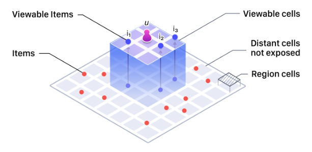
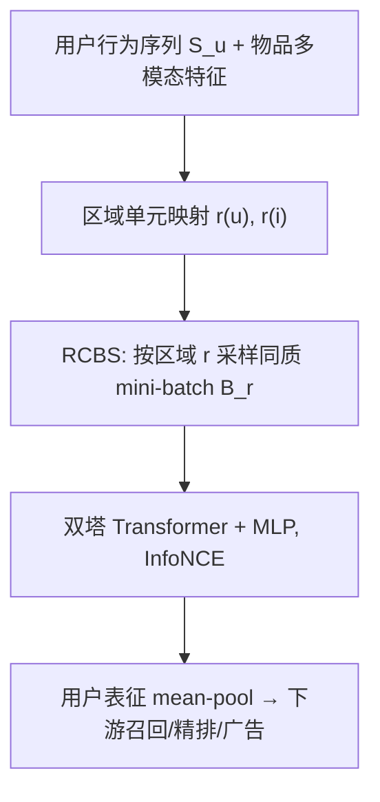

# Don't Contrast the Impossible: Region-Constrained Batching for Contrastive User Modeling on a Local Community Platform (别对比不可能：本地社区平台对比式用户建模的区域约束批采样)

- **会议/期刊**: SIGIR 2026 (Industry Track)
- **作者与机构**: Seungho Han, Byeongchang Kim, Jin Yu（Danggeun Market Inc. / Karrot，韩国）
- **推荐链路定位**: 召回（用户表征预训练，供下游召回/精排/广告排序复用）
- **研究方向**: 自监督对比学习与交互去噪 / 冷启动与长尾推荐
- **论文原文**: [https://arxiv.org/abs/2607.28971v1](https://arxiv.org/abs/2607.28971v1)
- **开源代码**: 暂未开源

## TL;DR (1分钟核心速览)

本地社区平台（Karrot）的曝光受地理半径硬约束，标准 in-batch 对比学习把“平台根本不会曝光”的用户-物品对当作负样本，形成**不可能负样本 (impossible negatives)**，稀释偏好信号。本文提出 **RCBS**：按区域单元构造同质 mini-batch，使负样本主要落在用户可曝光范围内。方法不改模型、不改损失，仅改批构造，却把训练批内不可能负样本比例 $\rho_{train}$ 从 **0.98 降到 0.30**，用户建模 R@10 从 0.100 提升至 **0.149**（+49%），下游召回 R@10 相对提升 **+7.56%**，线上首页点击 **+10.0%**、广告 CTR **+7.46%**。

## Background & Motivation (背景与核心矛盾)

- **主流范式**: 大规模推荐系统用双塔 + InfoNCE 做用户序列表征预训练，批内其他样本的正例物品默认充当负样本（PinnerFormer、PinFM 一脉）。
- **前人局限**: 该范式隐含 **universal exposure** 假设——任何用户都可能被曝光任何物品。但 Karrot 上 86% 以上交易发生在 5km 半径内，区域外物品**永不曝光**；随机批中这类“不可能负样本”占比高达 98%，其“未交互”由平台策略而非用户偏好决定，梯度几乎无信息量。
- **核心洞察 (Key Insight)**: 负样本应分两类——**可行负样本**（可曝光但未点击，携带真实偏好信号）与**不可能负样本**（策略性零曝光，纯噪声）。可行负样本天然比不可能负样本更“硬”，因为它们是用户真正看过却没选的物品。
- **本文切入点**: 不动模型与损失，只把 mini-batch 的采样分布从“全局均匀”改为“区域内均匀”，从数据层面消除结构性零曝光对。

<figure class="paper-figure" markdown="span">
  <figcaption>图1：Karrot 上曝光可行性的示意图。对于用户 𝑢，只有位于用户可视单元（𝑖1、𝑖2、𝑖3）内的物品才能出现在首页信息流中。可视单元之外的物品（红点）永远不会曝光给该用户。</figcaption>
</figure>

## Method (核心方法设计)

### 1. 整体框架 (Overall Architecture)

沿用标准双塔：用户塔为 Pre-LN Transformer，编码长度 $T$的行为序列$S_u$得到逐位置表征$H_u\in\mathbb{R}^{T\times d}$；物品塔为 3 层 MLP，输入为预训练多模态嵌入模型（标题/正文/元数据/图像）产出的物品向量；双方$\ell_2$归一化后内积打分。训练目标为标准 InfoNCE，批形状$[B,T]$，每个位置的下一交互物品为正例，批内其余正例物品为负例。**唯一改动发生在 DataLoader 层**：按区域单元$r$分组采样用户，构造区域同质批$\mathcal{B}_r$，其余训练流程、超参、步数完全不变。推理时用户塔对最近 1024 条行为做 mean-pooling 得到最终用户向量，每日离线刷新。

### 2. 关键设计拆解 (Key Designs)

1. **曝光可行性判定 (Exposure Feasibility)**：把地理空间离散为区域单元集合 $\mathcal{R}$，用户与物品经$r(\cdot)$ 映射到单元，定义
$$\mathrm{feas}(u,i)=\mathbb{1}\big[\mathrm{dist}(r(u),r(i))\le \delta_u\big],$$
其中 $\delta_u\in\{0,1,2,\dots\}$是平台策略决定的用户级曝光半径（$\delta_u=0$要求同单元，$\delta_u>0$纳入相邻单元）。$\mathrm{feas}(u,i)=0$ 的负样本即“不可能负样本”。该定义把“平台政策”显式写进训练数据构造，是全文的概念基石。

2. **区域约束批采样 RCBS**：批内用户从同一区域池 $U_r=\{u\in\mathcal{U}\mid r(u)=r\}$ 中均匀抽取，
$$\mathcal{B}_r=\{(u_b,S_{u_b})\}_{b=1}^{M},\quad u_b\sim\mathrm{Uniform}(U_r).$$
在精确区域匹配（$\delta_u\equiv 0$）下，批内不可能负样本期望比例为
$$\rho=1-\sum_{r\in\mathcal{R}}p_r^2,$$
随机批下 $p_r$近似均匀，$\rho\approx 1-1/\min(|B|,|\mathcal{R}|)$，**随系统规模增大而恶化**；RCBS 把概率质量压到单一区域（$p_r\approx1$），$\rho\to 0$ 且与批大小、区域数无关。物理直觉：同区域用户的候选池高度重叠，批内负样本几乎全部“看得见但没点”，对比信号从“区分地理可达性”回归“区分偏好”。

3. **训练目标、负采样与推理效率**：损失保持原样
$$\mathcal{L}_{\text{NCE}}=-\frac{1}{BT}\sum_{b,t}\log\frac{\exp(s(h_{b,t},v^+_{b,t})/\tau)}{\sum_{b',t'}\exp(s(h_{b,t},v_{b',t'})/\tau)},$$
负采样为 **in-batch 负采样（免显式负采样器）**，RCBS 只改变批内负例的可行性分布，不引入额外前向或存储开销；批大小 18、序列长 1024，共 18,432 候选/批。推理侧与基线完全一致，工程落地成本近乎为零。

## Experimental Setup & Evaluation Protocol (实验设置与评估协议)

- **数据集与预处理**: 工业级生产日志，非公开基准。

| 数据集 | #Users | #Items | #Interactions | 稀疏度/密度 | 特征/场景说明 |
| :--- | :---: | :---: | :---: | :---: | :--- |
| 预训练日志（2 年） | ~25M | 未披露 | ~15B | 极稀疏 | 行为序列截断至 ≤1024；物品含标题/正文/元数据/图像 |
| 下游-首页排序 | 同上 | 同上 | 3 周日志 | — | DCN 精排，注入用户向量 |
| 下游-首页召回 | 同上 | 同上 | 1 周日志 | — | 双塔召回，用户塔注入向量 |
| 下游-广告排序 | 同上 | 同上 | 4 周日志 | — | DCN 广告精排 |

- **数据划分与防穿越 (Splitting Strategy)**: 预训练按 **用户级 95%/5% 划分**；下游任务使用与预训练期**不重叠**的服务日志，评估集为**全局时间戳切分**（排序/广告取 24 小时，召回取 6 小时），严格防穿越。
- **排名评测协议 (Ranking Protocol)**: 用户建模采用 **Sampled Ranking**，并刻意设置两种评估采样——`Random-Eval`（全局均匀采用户）与 `RCBS-Eval`（按区域采用户，更接近真实曝光分布）；下游为生产环境真实候选集上的排序指标（NDCG@10、OPA、Recall@10/100、ROC-AUC、PR-AUC），因保密仅报相对提升。
- **对比基线与超参设置**: 基线为 `Random-Train`（随机批）与 `RCBS-Train (coarse)`（粗粒度区域分组），本文方法为 `RCBS-Train (fine)`（细粒度区域分组）；批大小 18、序列长 1024、温度 $\tau$ 等全部超参与训练步数在三者间固定，保证公平。

## Key Experimental Results (实验关键数据)

### 1. 主实验对比 (Main Results)

**用户建模预训练（表 1，训练批 × 评估批交叉）**

| 方法 | Random-Eval R@10 | Random-Eval R@100 | RCBS-Eval R@10 | RCBS-Eval R@100 | $\rho_{train}$ |
| :--- | :---: | :---: | :---: | :---: | :---: |
| Random-Train | 0.100 | 0.422 | 0.082 | 0.349 | 0.98 |
| RCBS-Train (coarse) | 0.125 | 0.456 | 0.112 | 0.403 | 0.79 |
| **RCBS-Train (fine)** | **0.149** | **0.474** | **0.139** | **0.435** | **0.30** |
| Improv. (vs. Random) | +49.0% | +12.3% | +69.5% | +24.6% | −0.68 |

**下游离线任务（表 2，相对生产基线提升）**

| 方法 | 排序 ΔN@10 | 排序 ΔOPA | 广告 ΔR-A | 广告 ΔP-A | 召回 ΔR@10 | 召回 ΔR@100 |
| :--- | :---: | :---: | :---: | :---: | :---: | :---: |
| Random-Train | +0.22% | +0.17% | +0.25% | +1.21% | +4.44% | +2.36% |
| **RCBS-Train (fine)** | **+1.18%** | **+1.07%** | **+0.53%** | **+3.38%** | **+7.56%** | **+4.61%** |

**线上 A/B（表 3，实验组 vs. 不加用户向量的对照组）**

| 场景 | ΔClicks | ΔImpressions | ΔDAV | ΔeCPM | ΔAdCTR |
| :--- | :---: | :---: | :---: | :---: | :---: |
| 首页（召回+排序）/ 广告 | **+10.0%** | **+5.12%** | **+1.91%** | **+6.01%** | **+7.46%** |

### 2. 消融实验 (Ablation Study)

本文以“批构造策略 × 区域粒度”作为消融维度（表 1 即消融主表）：

| 配置 | R@10 (Random-Eval) | R@100 (Random-Eval) | $\rho_{train}$ | 说明 |
| :--- | :---: | :---: | :---: | :--- |
| w/o RCBS（随机批） | 0.100 | 0.422 | 0.98 | 基线 |
| RCBS 粗粒度区域 | 0.125 | 0.456 | 0.79 | 区域池过大，仍混入跨区负例 |
| RCBS 细粒度区域 | **0.149** | **0.474** | **0.30** | 区域池收紧，$\rho$ 最低 |
| 评估侧换 RCBS-Eval | 0.139（fine） | 0.435（fine） | — | 更真实曝光分布下仍最优 |

### 3. 关键实验发现 (Key Findings)

1. **$\rho_{train}$ 与召回指标呈单调负相关**：0.98 → 0.79 → 0.30 对应 R@10 0.100 → 0.125 → 0.149，说明不可能负样本比例是比模型结构更直接的表征质量杠杆；粗粒度分组只回收了约 1/5 的收益，证明**区域粒度是核心超参**。
2. **RCBS-Eval 分数系统性低于 Random-Eval**（fine 配置下 0.139 vs. 0.149），这并非模型变差，而是评估分布更接近真实曝光、负例更“硬”；该现象反向印证了“可行负样本 = 更难负样本”的论断，也提示业界常用的随机评估会**高估**表征质量。
3. **下游增益与任务结构相似度强相关**：召回任务增益最大（R@10 +7.56%），因其双塔内积目标与预训练目标同构；排序/广告增益较小（+1.18% / +0.53% ROC-AUC）但线上仍带来 +10.0% 点击与 +7.46% 广告 CTR，说明用户向量作为**旁路特征**在 DCN 精排中边际收益有限，而在召回侧是主路径收益。

## Highlights & Limitations (亮点、对比与审稿批判)

- **与代表作对比 (vs. Prior Work)**: 与 PinnerFormer / PinFM 等大规模对比用户建模工作相比，本文不追求更大模型或更长序列，而是指出其**批采样假设在 LBS 场景下失效**；与 IPS 类去偏方法（Saito et al.、Lee et al.）相比，IPS 是 loss 级重加权且要求 positivity 假设（每对曝光概率严格为正），而地理策略造成的是**结构性 positivity 违反**（概率恒为 0，无观测可加权），RCBS 是 data 级修正，二者正交可叠加；与显式难负采样（RocketQA、跨批采样）相比，RCBS 不挖难负例，而是**删掉伪难负例**，让可行负例自然变难。
- **可迁移亮点**: ① 任何存在“结构性零曝光”的系统（外卖配送范围、约会 App 距离阈值、跨境电商品类准入）都可直接套用“按可行性同质分组构造 batch”这一零成本 trick；② 评估侧应同时报告 Random-Eval 与分布对齐的 RCBS-Eval，避免随机评估高估表征。
- **审稿级局限批判**: ① 全部实验基于单一工业平台私有日志，无公开基准复现，且下游指标仅报相对值，外部可验证性弱；② 细粒度区域分组在用户稀疏区域会导致批内多样性下降、长尾区域用户采样不足，论文未给出区域粒度选择准则与冷启动区域的兜底策略；③ $\delta_u$随用户配置变化、用户跨区迁移会使$\rho$ 无法真正归零（实测 0.30），残余偏差仍需 IPS 补足，但该组合未做实验。

## Rating (四维评分)

- **方法创新性 (Novelty)**: ⭐⭐⭐⭐ （核心机制与方法设计具备明确创新性，理论与实验动机支撑充分）
- **评估协议与实验扎实度 (Protocol & Experiments)**: ⭐⭐⭐⭐ （主流公开数据集评测完整，包含多基线对比与消融实验验证）
- **写作与数学规范度 (Clarity & Rigor)**: ⭐⭐⭐⭐⭐ （问题形式化定义清晰，核心模块数学推导与架构阐述严谨易读）
- **工业落地与复现价值 (Industrial & Practical Value)**: ⭐⭐⭐⭐⭐ （兼顾推荐效果增益与训练/推理效率，具备实际场景迁移参考价值）
