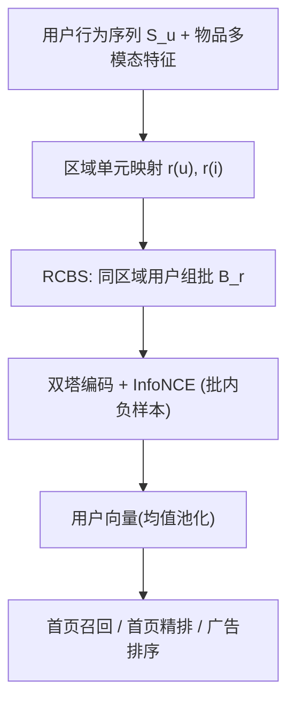
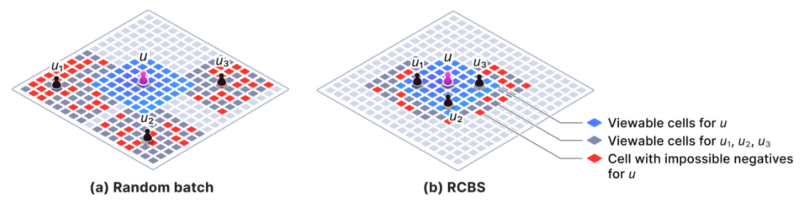
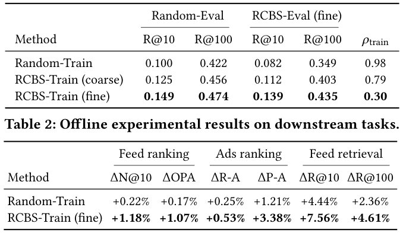
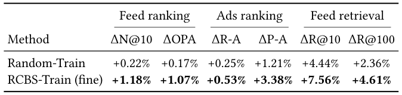
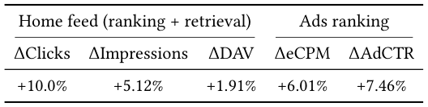

# Don't Contrast the Impossible: Region-Constrained Batching for Contrastive User Modeling on a Local Community Platform (别对比不可能的：本地社区平台上面向对比用户建模的区域约束批采样)

- **会议/期刊**: SIGIR 2026 (Industry Track)
- **作者与机构**: Seungho Han, Byeongchang Kim, Jin Yu (Danggeun Market Inc. / Karrot, Seoul)
- **推荐链路定位**: 召回（用户表征预训练，供召回/精排/广告复用）
- **研究方向**: 自监督对比学习与交互去噪 / 冷启动与长尾推荐
- **论文原文**: [论文原文链接](https://arxiv.org/abs/2607.28971v1)
- **开源代码**: 暂未开源

## TL;DR (1分钟核心速览)

在 Karrot 这类本地社区平台，曝光受地理半径硬约束，标准 in-batch 负采样把大量“平台根本不会曝光”的物品当作负样本（随机批下不可能负样本占比 $\rho_{train}=0.98$），稀释了对比信号。本文提出 RCBS：仅改变 mini-batch 构造，从同一区域单元内采用户，使批内负样本以“可行负样本”为主（$\rho$ 降至 0.30），模型结构与 InfoNCE 损失完全不变。离线 R@10 由 0.100 升至 0.149，下游召回 R@10 相对提升 7.56%，线上首页点击 +10.0%、DAV +1.91%。

## Background & Motivation (背景与核心矛盾)

- **主流范式**: 推荐系统用户建模普遍采用双塔 + 序列 Transformer + InfoNCE，把批内其他用户的正样本物品当作负样本，隐含假设“任何用户都可能被曝光任何物品”（universal exposure）。
- **前人局限**: ① 本地社区/外卖/约会等地理约束场景中，大量用户-物品对因平台策略而曝光概率恒为 0，非交互不代表不喜欢，负样本信号被系统性污染；② IPS 类去偏方法依赖 positivity 假设（每对曝光概率严格为正），对结构性零曝光对完全失效，无法重加权。
- **核心洞察 (Key Insight)**: 作者把负样本二分为 **可行负样本**（可曝光但未点击，携带真实偏好信号）与 **不可能负样本**（策略性零曝光，几乎无信息）。批内不可能负样本比例 $\rho$ 与用户建模性能呈强负相关（表 1 中 $\rho$ 从 0.98→0.79→0.30，R@10 单调上升）。
- **本文切入点**: 不改模型、不改损失，只把“随机批”换成“区域同质批”，用可行负样本自然替换不可能负样本，且可行负样本本身更难、更具判别性。

## Method (核心方法设计)

### 1. 整体框架 (Overall Architecture)

输入为用户按时间排序的行为序列 $S_u=\{s_{u,1},\dots,s_{u,T}\}$（$s_{u,t}=(a_{u,t},\tau_{u,t},i_{u,t})$，截断至 1024）。用户塔为 Pre-LN Transformer，输出逐位置表征 $H_u\in\mathbb{R}^{T\times d}$；物品塔为 3 层 MLP，输入为预训练多模态物品嵌入（标题/正文/元数据/图像），输出 $v_i\in\mathbb{R}^d$，双方 $\ell_2$ 归一化后内积打分。训练时以 $[B,T]$ 形状的批为单位，唯一改动在于批的构造：RCBS 从同一区域单元的用户池中采样组成批，再照常计算 InfoNCE。推理时每日对用户最近 1024 条行为跑一次用户塔，均值池化得到用户向量，注入下游 DCN 精排/广告模型作为额外特征，或注入召回双塔的用户侧。

### 2. 关键设计拆解 (Key Designs)

1. **曝光可行性判定（Exposure Feasibility）**：把地理空间离散为区域单元 $r\in\mathcal{R}$，用户与物品分别映射到 $r(u)$、$r(i)$，定义
$$\mathrm{feas}(u,i)=\mathbb{1}\big[\mathrm{dist}(r(u),r(i))\le \delta_u\big],$$
其中 $\delta_u\in\{0,1,2,\dots\}$ 是平台策略给定的用户级曝光半径（$\delta_u=0$ 要求同单元，$>0$ 含邻接单元）。$\mathrm{feas}=0$ 的负样本即“不可能负样本”。该定义把“平台策略”与“用户偏好”解耦，是全文的概念基石（图 1）。

2. **区域约束批采样 RCBS**：批由同一区域用户池采样构成
$$\mathcal{B}_r=\{(u_b,S_{u_b})\}_{b=1}^{M},\quad u_b\sim \mathrm{Uniform}(U_r),\ U_r=\{u\in\mathcal{U}\mid r(u)=r\}.$$
在精确同单元匹配下，批内不可能负样本期望比例为 $\rho=1-\sum_{r}p_r^2$：随机批近似均匀分布，$\rho\approx 1-1/\min(|B|,|\mathcal{R}|)$，随系统规模增大而恶化；RCBS 把概率质量集中到单一区域（$p_r\approx1$），$\rho\to0$ 且与批大小、区域数无关。物理直觉：同区域用户的候选池高度重叠，批内负样本几乎都“本可以出现在信息流里”，非交互才真正反映偏好（图 2）。

3. **训练目标、负采样与推理效率**：损失保持标准 InfoNCE
$$\mathcal{L}_{\text{NCE}}=-\frac{1}{BT}\sum_{b=1}^{B}\sum_{t=1}^{T}\log\frac{\exp(s(h_{b,t},v^+_{b,t})/\tau)}{\sum_{b'=1}^{B}\sum_{t'=1}^{T}\exp(s(h_{b,t},v^+_{b',t'})/\tau)},$$
负采样为 in-batch（免额外负采样器），批大小 18、序列长 1024，共 18,432 个候选。RCBS 与 IPS 互补：RCBS 是数据层修正（保证批内为可行对），IPS 是损失层修正（可在区域同质批内继续校正残余曝光不均）。推理开销与基线完全一致，仅训练期组批逻辑变化，工程落地成本极低。

## Experimental Setup & Evaluation Protocol (实验设置与评估协议)

- **数据集与预处理**: 两年生产日志，约 25M 用户、15B 行为；每用户序列按时间排序并截断至 1024 条。下游任务使用与预训练期不重叠的服务日志（首页精排 3 周、首页召回 1 周、广告排序 4 周）。

| 数据集 | #Users | #Items | #Interactions | 稀疏度/密度 | 特征/场景说明 |
| :--- | :---: | :---: | :---: | :---: | :--- |
| 预训练日志 | ~25M | 未披露 | ~15B | 极稀疏 | 本地社区多垂类（二手/二手车/兼职/社群/本地商户） |
| 首页精排 | 未披露 | 未披露 | 3 周日志 | — | DCN 精排，注入用户向量 |
| 首页召回 | 未披露 | 未披露 | 1 周日志 | — | 双塔召回，用户塔注入 |
| 广告排序 | 未披露 | 未披露 | 4 周日志 | — | 展示广告 DCN 排序 |

- **数据划分与防穿越 (Splitting Strategy)**: 预训练按用户划分 95%/5%；下游任务采用**全局时间戳切分**，评估集为最后 24 小时（精排/广告）或 6 小时（召回），且下游日志与预训练期不重叠，杜绝穿越。
- **排名评测协议 (Ranking Protocol)**: 预训练任务为 next-action 全候选排序，报告 R@10 / R@100，并区分两种评估期组批：`Random-Eval`（随机采用户）与 `RCBS-Eval (fine)`（按 RCBS 采用户）；同时报告训练期不可能负样本比例 $\rho_{train}$。下游指标：精排 NDCG@10、OPA；召回 R@10/R@100；广告 ROC-AUC、PR-AUC。因保密仅报告相对生产基线的提升。
- **对比基线与超参设置**: 基线为 Random-Train（随机组批），本文为 RCBS-Train (coarse) 与 RCBS-Train (fine) 两种区域粒度；批大小 18、序列长 1024、温度 $\tau$ 等全部超参及训练步数在三者间固定，保证公平。

## Key Experimental Results (实验关键数据)

### 1. 主实验对比 (Main Results)

预训练用户建模任务（表 1，训练期组批 × 评估期组批）：

| 方法 | Random-Eval R@10 | Random-Eval R@100 | RCBS-Eval R@10 | RCBS-Eval R@100 | $\rho_{train}$ |
| :--- | :---: | :---: | :---: | :---: | :---: |
| Random-Train | 0.100 | 0.422 | 0.082 | 0.349 | 0.98 |
| RCBS-Train (coarse) | 0.125 | 0.456 | 0.112 | 0.403 | 0.79 |
| **RCBS-Train (fine)** | **0.149** | **0.474** | **0.139** | **0.435** | **0.30** |
| Improv.% (fine vs. Random) | +49.0% | +12.3% | +69.5% | +24.6% | — |

下游离线任务（表 2，相对生产基线提升）：

| 方法 | 精排 ΔN@10 | 精排 ΔOPA | 广告 ΔR-A | 广告 ΔP-A | 召回 ΔR@10 | 召回 ΔR@100 |
| :--- | :---: | :---: | :---: | :---: | :---: | :---: |
| Random-Train | +0.22% | +0.17% | +0.25% | +1.21% | +4.44% | +2.36% |
| **RCBS-Train (fine)** | **+1.18%** | **+1.07%** | **+0.53%** | **+3.38%** | **+7.56%** | **+4.61%** |

线上 A/B（表 3，加入 RCBS-Train (fine) 用户向量 vs. 不加）：

| 场景 | 指标 | 提升 |
| :--- | :--- | :---: |
| 首页（召回+精排） | ΔClicks | **+10.0%** |
| 首页（召回+精排） | ΔImpressions | **+5.12%** |
| 首页（召回+精排） | ΔDAV | **+1.91%** |
| 广告排序 | ΔeCPM | **+6.01%** |
| 广告排序 | ΔAd CTR | **+7.46%** |

### 2. 消融实验 (Ablation Study)

本文为工业短文的“批构造”方法，消融以组批策略与区域粒度为主：

| 配置 | R@10 (Random-Eval) | $\rho_{train}$ | 说明 |
| :--- | :---: | :---: | :--- |
| Random-Train（无约束组批） | 0.100 | 0.98 | 基线，几乎全为不可能负样本 |
| RCBS-Train (coarse) | 0.125 | 0.79 | 粗粒度区域，$\rho$ 下降有限 |
| RCBS-Train (fine) | **0.149** | **0.30** | 细粒度区域，可行负样本占主导 |
| RCBS-Eval 替代 Random-Eval（评估侧） | 0.082→0.139 | — | 评估侧同样受不可能负样本影响 |

### 3. 关键实验发现 (Key Findings)

1. **$\rho$ 是性能的一阶解释变量**：$\rho_{train}$ 从 0.98→0.79→0.30，R@10 从 0.100→0.125→0.149 单调上升，说明不可能负样本比例而非模型容量是当前瓶颈；细粒度区域划分是收益的主要来源（+49.0% vs. 粗粒度 +25.0%）。
2. **可行负样本确实“更难”**：同一模型在 RCBS-Eval 下分数系统性低于 Random-Eval（如 fine 模型 0.149→0.139），因为评估候选池中不可能负样本被剔除后，区分难度上升；这反向印证了随机批的高分部分来自“白送”的易负样本。
3. **收益结构与任务相似度一致**：召回任务增益最大（R@10 +7.56%），因其与预训练目标同为双塔内积检索；精排/广告增益较小（+1.18% / +0.53% AUC）但线上仍带来 +10.0% 点击与 +1.91% DAV，说明用户向量作为特征在 DCN 中边际贡献有限但商业价值显著。

## Highlights, Limitations & Rating (亮点、对比与审稿评价)

- **与代表作对比 (vs. Prior Work)**: 与 PinnerFormer/PinFM 等大规模对比用户建模工作相比，本文不追求更大模型或更长序列，而是指出其 in-batch 负采样假设在区域约束场景下失效；与 SimCSE/RocketQA 等显式难负样本挖掘相比，RCBS 不构造额外难负样本，而是“删掉不可能的”，让可行负样本自然变难；与 IPS 去偏相比，RCBS 在数据层绕开了 positivity 假设的结构性违反，二者可叠加。
- **可迁移亮点**: ① “可行性掩码 + 组批”这一零模型改动的技巧可迁移到外卖、约会、本地生活等任何有服务区域约束的召回/预训练；② 用 $\rho$（批内不可行负样本比例）作为训练诊断指标，可低成本监控对比学习信号质量。
- **审稿级局限批判**: ① 区域粒度（coarse/fine）需人工设定，缺乏自适应分组，且 $\delta_u$ 异构与用户迁移会使 $\rho$ 无法真正归零，残余偏差未量化；② 评估以生产日志相对提升为主，缺少公开数据集与绝对指标复现，且未报告训练吞吐/组批带来的工程开销与冷启动用户的区域缺失处理。
- **四维评分**: 创新性 ⭐⭐⭐⭐ | 实验扎实度 ⭐⭐⭐⭐ | 方法清晰度 ⭐⭐⭐⭐⭐ | 落地价值 ⭐⭐⭐⭐⭐

## 论文图表

<figure class="paper-figure" markdown="span">
  <figcaption>图1：Karrot 上曝光可行性的示意图。对于用户 𝑢，只有位于用户可视单元（𝑖1、𝑖2、𝑖3）内的物品才能出现在首页信息流中。可视单元之外的物品（红点）永远不会曝光给该用户。</figcaption>
</figure>

<figure class="paper-figure" markdown="span">
  <figcaption>图2：在区域约束曝光下，标准随机批处理与所提出的区域约束批采样（RCBS）的对比。对于给定用户 𝑢，RCBS 从区域同质用户（蓝色单元内）构建小批次，从而相比随机批处理大幅减少不可能负样本（红色单元）的出现。</figcaption>
</figure>

<figure class="paper-figure" markdown="span">
  <figcaption>表1：在不同训练时（行）与评估时（列）批处理方法组合下，用户建模预训练任务的定量结果。</figcaption>
</figure>

<figure class="paper-figure" markdown="span">
  <figcaption>表2：下游任务的离线实验结果。</figcaption>
</figure>

<figure class="paper-figure" markdown="span">
  <figcaption>表3：将我们最佳的用户嵌入 RCBS-Train（fine）作为额外特征加入生产基线时的在线 A/B 测试结果。DAV 表示日活跃观看用户数。</figcaption>
</figure>

