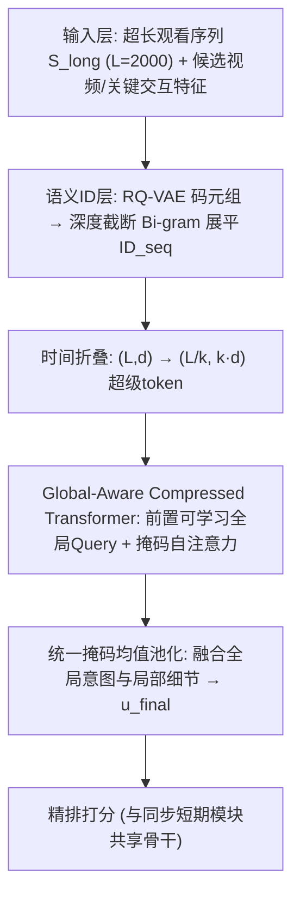
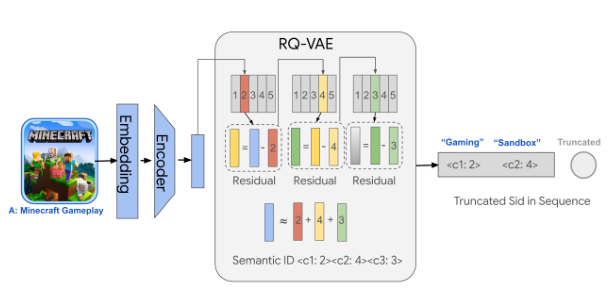
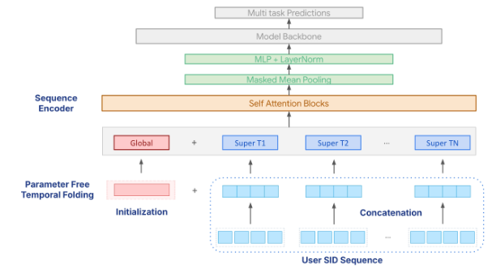
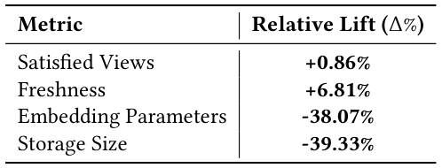
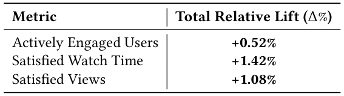
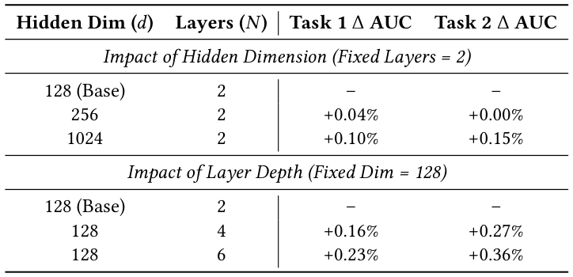
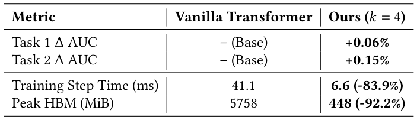
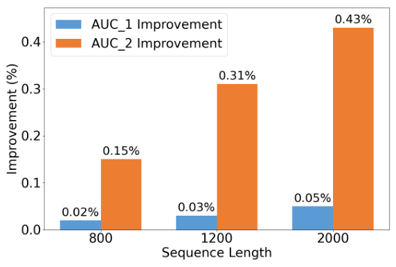
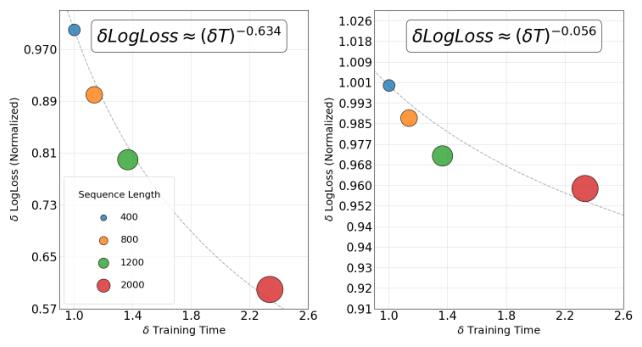

# Beyond Item IDs: Scaling Short-Form-Video Recommendation via Semantic-Native Long Sequence Modeling (超越物品ID：基于语义原生表征的短视频超长序列推荐扩展)

- **会议/期刊**: SIGIR 2026 (Melbourne, VIC, Australia, July 20–24, 2026)
- **推荐链路定位**: 精排 (Ranking) — 异步长序列兴趣建模模块 (Asynchronous Long-Term Module)，与同步短期模块共享骨干
- **研究方向**: 序列与会话推荐 (主) / 生成式推荐与离散语义ID (次)
- **论文原文**: [https://arxiv.org/abs/2606.07546v1](https://arxiv.org/abs/2606.07546v1)
- **开源代码**: 暂未开源（原文与预提取均未发现代码链接）

## TL;DR (核心速览)

针对短视频推荐中"正交 Video ID 语义稀疏 + Transformer 二次复杂度"双重瓶颈，本文提出生产级框架：用 RQ-VAE 生成的**深度截断 Bi-gram 语义ID (SID)** 替代原子 Video ID，将嵌入表规模与语料基数解耦；并用**无参时间折叠 (Temporal Folding)** 把序列从 $(L,d)$ 重塑为 $(L/k, k\cdot d)$ 的"超级 token"，配合全局 Query 融合，在 $L=2000$ 下实现训练步时 -83.9%、峰值显存 -92.2%。线上 A/B（$L{=}2000$ SID vs. $L{=}800$ Video ID）报告 Satisfied Watch Time +1.42%、Satisfied Views +1.08%、活跃用户 +0.52%（均 $p<0.05$）。

## Background & Motivation (背景与动机)

- **领域背景与主流范式**: 短视频 feed 需要 $L>10^3$ 的观看历史才能同时刻画长期稳定偏好与即时短期意图。工业界主流路线从 RNN 演进到 self-attention（BST、BERT4Rec），但二次复杂度迫使两阶段方案：target-aware attention（DIN/DIEN）之上叠加启发式过滤（SIM、TWIN）或层次聚类（TWIN-V2）；近期则转向端到端全序列建模（LONGER、HyFormer、HSTU、DV365、VISTA）。
- **现有方法局限 (Limitations of Prior Work)**:
  1. **语义碎片化**：TDM / Deep Retrieval 等哈希 ID 把物品当作正交 token，模型只能"记忆"交互，对冷启动内容泛化极差；
  2. **存储与稀疏性**：哈希 ID 的嵌入表随语料规模无界增长，参数量与物理存储成为硬约束；
  3. **序列扩展壁垒**：self-attention 的 $O(L^2)$ 复杂度在严格毫秒级延迟与显存预算下封死了序列长度上限；而 SIM/TWIN 类解耦策略要么丢弃信号造成信息损失，要么依赖昂贵的离线预计算。
- **核心挑战 (Key Challenge)**: 表征瓶颈与计算瓶颈是**耦合**的——不压缩 ID 词表就无法腾出参数预算加深模型，不压缩序列就无法在同等算力下延长历史窗口。简单拼接特征或加深网络只会同时放大两个瓶颈。
- **核心洞察与切入点 (Key Insight)**: 作者的关键判断是"**用语义换分辨率**"——(i) 序列侧只需类别级语义（"Gaming-Sandbox" vs. "Gaming-Shooter"）即可聚类交互，无需全深度码本；(ii) 序列侧只需粗时间分辨率，把 $k$ 个相邻 token 通道拼接成超级 token，可**无损地**（零参数、不丢 token）把长度换成分辨率。两者叠加释放的算力余量再反哺模型容量与序列长度。

## Problem Formulation & Method (问题定义与方法架构)

### 1. 符号定义与输入表征 (Notations & Input Representations)

- 用户集 $\mathcal{U}$（十亿级活跃用户），物品（视频）集 $\mathcal{V}$，码本词表大小 $|V|$。
- 超长行为序列 $\mathcal{S}_{long}=\{v_1,\dots,v_L\}$，$L\in\{400,800,1200,2000\}$；实时尾部序列 $\mathcal{S}_{short}$。
- 每个视频经上游 RQ-VAE 得到离散码元组 $s_v=(c_1,c_2,\dots,c_D)$，由粗到细编码语义层级。
- 序列侧统一 ID：$ID_{seq}=c_1\cdot|V|+c_2$（深度截断 Bi-gram）；目标侧与关键交互特征（如 last-watched ID）保留扩展层级（细粒度）。
- 隐藏维度 $d$（实验取 128/256/1024），Transformer 层数 $N$（2/4/6），全局 Query token 数 $N_g$，折叠窗口 $k$（最优 4）。

### 2. 整体流水线 (Overall Architecture)

系统采用 Hybrid Synchronous-Asynchronous 框架：同步短期模块实时编码 $\mathcal{S}_{short}$；异步长期模块离线/异步编码 $\mathcal{S}_{long}$，二者**共享骨干与优化目标**，保证异步表征天然映射到同一隐空间，避免长短期特征错位。长期模块内部：SID 查表 → 时间折叠压缩 → 前置全局 Query 的 Transformer → 统一掩码均值池化 → 与精排特征拼接打分。

<figure class="paper-figure" markdown="span">
  <figcaption>图1：语义ID生成。原始视频经RQ-VAE量化，随后通过Bi-gram截断将路径展平为统一整数ID，为序列建模保留类别级语义。</figcaption>
</figure>
<figure class="paper-figure" markdown="span">
  <figcaption>图2：全局感知压缩Transformer概览。</figcaption>
</figure>

### 3. 核心模块设计与数学原理 (Key Designs & Formulations)

**(1) 非对称粒度语义建模 (Asymmetric Semantic Modeling)**。全深度码元用于超长序列会引发词表爆炸，因此采用非对称策略：目标侧/非序列侧保留细粒度层级以做精确判别匹配；序列侧仅保留 $(c_1,c_2)$ 并展平为单一整数 $ID_{seq}=c_1\cdot|V|+c_2$。物理直觉：嵌入表规模由**层级深度**而非语料基数决定，且共享语义前缀使冷启动内容可借"同 sub-vertical"邻居获得泛化。图 1 展示了该生成流程。

**(2) 无参时间折叠 (Parameter-Free Temporal Folding)**。将输入 $X\in\mathbb{R}^{L\times d}$ 切分为长度 $k$ 的窗口并通道拼接：

$$H^{super}_i=\mathrm{Concat}\big(x_{(i-1)k+1},\dots,x_{ik}\big),\quad X\to H^{super}\in\mathbb{R}^{(L/k)\times(k\cdot d)}$$

与池化类有损聚合不同，这是**非破坏性重塑**：不丢任何 token，仅以时间分辨率换特征维度，使注意力在"超级事件"间捕捉稠密局部依赖，等效隐维度放大 $k$ 倍。

**(3) 全局-局部表征融合 (Global-Local Fusion)**。在压缩序列前前置可学习全局 Query $G_{init}\in\mathbb{R}^{N_g\times d}$，且刻意设为**特征无关锚点**（不用用户画像初始化），强制注意力仅从动态交互中推导表征；同时它充当 attention sink 吸收低熵信号以稳定优化。设输出 $H_{out}\in\mathbb{R}^{(L'+N_g)\times d}$（索引 0 对应 $g_{final}$），统一掩码均值池化：

$$u_{final}=\frac{\sum_{j=1}^{L'+N_g}\big(H_{out}[j]\cdot M'_j\big)}{\sum_{j=1}^{L'+N_g}M'_j+\epsilon},\quad M'\in\{0,1\}^{L'+N_g},\ M'[1{:}N_g]=1$$

分母归一化保证不同历史长度下的幅值不变性。

### 4. 训练目标、负采样与推理复杂度 (Optimization, Negative Sampling & Complexity)

- **损失函数**: 原文未给出显式损失公式，仅说明长短期模块"共享优化目标"，并以 LogLoss 作为离线评估与缩放律分析对象（图 4 中 $\delta LogLoss$ 相对 $L=400$ 归一化）。**原文未报告**具体损失形式、温度系数或分项权重。
- **训练负采样策略**: **原文未报告**（工业精排场景，推测为曝光样本上的 CTR/观看二分类，但论文未明示，不做臆断）。
- **时间与空间复杂度**:
  - 标准 self-attention：$O(L^2 d)$；折叠后注意力在长度 $L/k$、维度 $kd$ 上运行，序列组件计算量约降为 $1/k$ 量级（原文以实测给出）。
  - 实测（$L=800$，64 芯片）：训练步时 41.1 ms → 6.6 ms（**-83.9%**），峰值 HBM 5758 MiB → 448 MiB（**-92.2%**），同时 Task 1 AUC +0.06%、Task 2 AUC +0.15%。
  - 嵌入侧：参数量 -38.07%、存储 -39.33%（$L=160$ 消融设定）。
  - 在线推理：异步模块离线计算，不进入实时关键路径；**原文未报告**单请求在线延迟 (ms/request) 数值。

## Experimental Setup & Evaluation Protocol (实验设置与评估协议)

- **数据集统计与预处理**: 全部实验在**某大型短视频平台生产流量**上进行，**原文未报告**用户数/物品数/交互数/稀疏度等统计量，亦未说明 5-core 等过滤规则（工业全量流量，无公开基准数据集）。

| 数据集 (Dataset) | 用户数 (#Users) | 物品数 (#Items) | 交互数 (#Interactions) | 稀疏度/密度 (Sparsity) | 模态/辅助特征说明 |
| :--- | :---: | :---: | :---: | :---: | :--- |
| 生产短视频平台流量 | 十亿级活跃用户（未给精确值） | 原文未报告 | 原文未报告 | 原文未报告 | 多模态内容嵌入经 RQ-VAE 量化；序列长度 $L\in\{160,400,800,1200,2000\}$ |

- **数据划分方式 (Splitting Strategy)**: **原文未报告**。工业在线 A/B 与离线 AUC 评估并存，离线部分未说明 LOO / Ratio / 全局时间戳切分，无法判断数据穿越风险——这是本文评估协议的最大不透明点。
- **排名评测协议 (Ranking Protocol)**: **原文未报告** Full-Ranking 或 Sampled Ranking。离线以 AUC / ΔAUC 与 LogLoss 报告，属逐样本二分类判别度量，不涉及候选集构造。
- **评价指标与显著性检验**: 离线用 AUC、ΔAUC、LogLoss（缩放律）；线上用 Satisfied Views、Satisfied Watch Time、Freshness、Actively Engaged Users、嵌入参数量、存储大小。表 1 与表 4 明确标注所有增益 $p<0.05$；**原文未报告**多随机种子方差、配对检验类型（$t$-test / Wilcoxon / Bootstrap）及 Embedding 维度对齐的消融控制细节。

## Key Experimental Results (核心实验结果)

### 1. 主实验对比 (Main Results)

本文为工业系统论文，主结果以**相对基线（Video ID）的线上增益**与**系统级 A/B** 呈现，而非公开数据集上的横向 SOTA 对比。

| 数据集 | 指标 | 基线 (Video ID, $L{=}160$) | 本文方法 (Bi-gram SID, $L{=}160$) | 相对提升 (Improv.) |
| :--- | :--- | :---: | :---: | :---: |
| 线上消融 | Satisfied Views | – | – | **+0.86%** |
| 线上消融 | Freshness | – | – | **+6.81%** |
| 线上消融 | Embedding Parameters | – | – | **-38.07%** |
| 线上消融 | Storage Size | – | – | **-39.33%** |

全系统生产影响（基线 $L{=}800$ Video ID vs. 完整优化系统 $L{=}2000$ SID）：

| 数据集 | 指标 | 基线 ($L{=}800$ Video ID) | 本文方法 ($L{=}2000$ SID) | 相对提升 (Improv.) |
| :--- | :--- | :---: | :---: | :---: |
| 线上 A/B | Actively Engaged Users | – | – | **+0.52%** |
| 线上 A/B | Satisfied Watch Time | – | – | **+1.42%** |
| 线上 A/B | Satisfied Views | – | – | **+1.08%** |

<figure class="paper-figure" markdown="span">
  <figcaption>表1：在线消融测试（𝐿=160）。语义ID带来正向的顶层指标和显著的冷启动增益（所有𝑝&lt;0.05）。</figcaption>
</figure>
<figure class="paper-figure" markdown="span">
  <figcaption>表4：全系统生产影响。基线（𝐿=800 Video ID）与完全优化系统（𝐿=2000 SID）的对比。系统升级报告的所有累计增益均具有统计显著性（𝑝&lt;0.05）。</figcaption>
</figure>

### 2. 消融实验与控制变量分析 (Ablation Study)

- **语义ID消融**（表 1）：Video ID → Bi-gram SID 在 $L=160$ 下 Satisfied Views +0.86%、Freshness +6.81%，同时参数量 -38.07%、存储 -39.33%。结论：压缩 SID 保留了 Video ID 曾捕获的具体交互信号，且冷启动泛化增益（Freshness）远大于顶层指标增益，说明收益主要来自语义前缀共享。
- **压缩策略消融**（表 3）：$k=4$ 相对 vanilla Transformer 为 Pareto 改进（步时 -83.9%、显存 -92.2%、AUC 双任务均正）；$k=6$ 时 Task 1 AUC 转负（-0.04%），确认 $k=4$ 是效率-分辨率最优折中。作者将 $k=4$ 的精度增益归因于局部去噪与折叠带来的有效隐维度扩张。
- **模型容量消融**（表 2，$L=800$）：固定 2 层时，$d$ 从 128→1024 带来 Task 1 +0.10% / Task 2 +0.15%；固定 $d=128$ 时，层数 2→6 带来 Task 1 +0.23% / Task 2 +0.36%——**加深比加宽更有效**。
- **控制变量说明**: 原文未报告参数量对齐或图度数匹配类控制实验（本文无图结构）；容量消融以 128 维/2 层为 Base，属同架构内比较，未与基线模型做等参对齐。

<figure class="paper-figure" markdown="span">
  <figcaption>表2：模型容量扩展（𝐿=800）。该架构在各任务上均持续受益于宽度和深度的扩展。</figcaption>
</figure>
<figure class="paper-figure" markdown="span">
  <figcaption>表3：效率与成本概况（𝐿=800）。时间折叠（𝑘=4）大幅降低序列组件的计算成本，同时在多个任务上略微提升AUC。</figcaption>
</figure>

### 3. 稀疏度/冷启动分桶与超参敏感度 (Sparsity Buckets & Hyperparameters)

- **冷启动表现**: 未做显式分桶，但以 Freshness（近期上传内容的满足观看）作为冷启动代理指标，SID 带来 +6.81% 提升，是全文最大的单项相对增益，直接支撑"语义前缀泛化冷启动"的核心论点。
- **序列长度敏感度**（图 3）：$L\in\{400,800,1200,2000\}$ 上离线 AUC 单调上升；$L=1200\to2000$ 仍有增益，说明超长历史含短窗未覆盖的信号，但作者亦承认存在训练速度拖累 (training speed drawdown)。
- **缩放律**（图 4）：相对 LogLoss 服从幂律 $\delta LogLoss\propto(\delta T)^k$，Task 1 与 Task 2 的指数分别为 **-0.634** 与 **-0.056**，即两任务对训练算力的敏感度差异极大。
- **折叠窗口 $k$ 敏感度**: $k=4$ 最优，$k=6$ 出现 Task 1 回退，说明过度压缩损失细粒度时序分辨能力。
- **线上 A/B 测试结果**: 有。真实业务为十亿用户级短视频推荐，对比 $L{=}800$ Video ID 基线 vs. $L{=}2000$ SID 全系统升级，报告活跃用户 +0.52%、满足观看时长 +1.42%、满足观看 +1.08%，均 $p<0.05$。实验周期与流量占比**原文未报告**。

<figure class="paper-figure" markdown="span">
  <figcaption>图3：AUC提升与序列长度的关系。</figcaption>
</figure>
<figure class="paper-figure" markdown="span">
  <figcaption>图4：经验归一化缩放律分析：幂律拟合（虚线）遵循𝛿𝐿𝑜𝑔𝐿𝑜𝑠𝑠∝(𝛿𝑇)𝑘，缩放指数为𝑘，相对损失𝛿𝐿𝑜𝑔𝐿𝑜𝑠𝑠= 𝐿𝑜𝑔𝐿𝑜𝑠𝑠𝐿 𝐿𝑜𝑔𝐿𝑜𝑠𝑠400 ，𝛿𝑇=</figcaption>
</figure>

## Highlights, Limitations & Critiques (亮点、局限与审稿级批判)

- **核心亮点与可迁移性**:
  1. **非对称粒度**是极实用的工程洞察——序列侧粗、目标侧细，把"词表规模"从语料基数解耦为层级深度，可直接迁移到电商、新闻、广告等任何 ID 词表爆炸的场景。
  2. **时间折叠**零参数、不丢 token、可调 $k$，比 pooling / 稀疏注意力更易落地，且"以分辨率换维度"的思路对任何长序列精排模块都通用。
  3. **特征无关全局 Query + attention sink** 的设计简洁，避免了用户画像初始化带来的先验污染，值得作为长序列池化的默认组件。
  4. 十亿用户级线上验证 + 显存/步时实测 + 幂律缩放律分析，工业说服力强。

- **局限性与审稿视角批判 (Critical Limitations)**:
  1. **评估协议严重不透明**：无公开数据集、无数据划分说明、无候选集构造说明、无负采样与损失函数公式。作为 SIGIR 论文，离线部分几乎不可复现，AUC 增益（+0.06%/+0.15%）缺少方差与显著性标注，读者无法判断是否在噪声范围内。
  2. **增益归因混淆**：表 4 的线上收益来自"$L{=}800$→$L{=}2000$ + Video ID→SID + 模型容量加大"三重变化的**叠加**，未做逐项拆分的线上消融，无法判断 SID 与折叠各自贡献多少；表 1 的 SID 消融又固定在 $L=160$，与生产配置脱节。
  3. **$k=4$ 精度增益的解释偏弱**："局部去噪 + 有效维度扩张"仅为事后归因，缺少针对性验证实验（如对比等参的宽 MLP 或 mean-pooling 基线）。
  4. **缩放律指数差异未解释**：Task 1 的 $k=-0.634$ 与 Task 2 的 $-0.056$ 相差一个数量级，论文未讨论任务异质性来源，削弱了"缩放律"结论的普适性。
  5. **RQ-VAE 上游依赖被黑箱化**：码本层数、码本大小、量化训练成本均未报告，SID 质量对最终效果的影响无法评估。
  6. **无开源代码**，工业系统论文的复现门槛天然偏高。

## Rating (四维评分)

- **方法创新性 (Novelty)**: ⭐⭐⭐⭐（非对称粒度 SID 与无参时间折叠组合新颖且实用，但单点技术均有先例）
- **评估协议与实验扎实度 (Protocol & Experiments)**: ⭐⭐⭐（线上规模与显著性标注可信，但离线协议、数据划分、损失与负采样全部缺失，归因不干净）
- **写作与数学规范度 (Clarity & Rigor)**: ⭐⭐⭐⭐（公式与维度交代清晰，架构图完整；扣分在损失函数与训练细节留白）
- **工业落地与复现价值 (Industrial & Practical Value)**: ⭐⭐⭐⭐⭐（十亿用户生产部署 + 显存/步时实测 + 明确的最优 $k$，工程参考价值极高；但无代码，复现需自行补齐大量细节）
