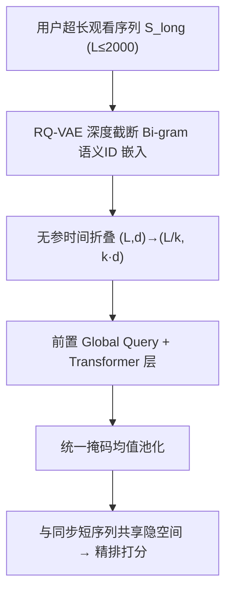

# Beyond Item IDs: Scaling Short-Form-Video Recommendation via Semantic-Native Long Sequence Modeling (超越物品 ID：以语义原生表征驱动短视频推荐的长序列扩展)

- **会议/期刊**: SIGIR 2026
- **作者与机构**: Ruixiao Sun, Diego Uribe Mora, Zhimeng Jiang, Yuanzhen Lin, Jiarui Wang, Yuening Li, Danfeng Guo, Zhizhong Chen, Chuan He, Liang Liu（Google）
- **推荐链路定位**: 精排（异步长序列兴趣建模模块）
- **研究方向**: 序列与会话推荐 / 生成式推荐与离散语义 ID
- **论文原文**: [https://arxiv.org/abs/2606.07546v1](https://arxiv.org/abs/2606.07546v1)
- **开源代码**: 暂未开源

## TL;DR (1分钟核心速览)

短视频推荐要把用户历史拉到 $10^3$ 量级，却卡在两个瓶颈：正交 Video ID 语义稀疏、嵌入表随语料无界膨胀；标准自注意力 $O(L^2)$ 复杂度在毫秒级延迟下无法承受。本文提出「语义原生」框架：序列侧改用 RQ-VAE 深度截断 Bi-gram 语义 ID（嵌入参数 -38.07%、存储 -39.33%），架构侧用无参时间折叠 + 全局 Query 的压缩 Transformer（训练步时 -83.9%、峰值显存 -92.2%），从而把序列从 800 扩到 2000。十亿用户级线上 A/B 中满意观看时长 +1.42%、满意播放 +1.08%、活跃用户 +0.52%（$p<0.05$）。

## Background & Motivation (背景与核心矛盾)

- **主流范式**: 工业长序列建模走两条路——启发式过滤/层次聚类（SIM、TWIN、TWIN-V2）做两阶段截断，或端到端改造架构（LONGER、HyFormer、HSTU）直接吃全序列；物品表征则从哈希 ID（TDM、Deep Retrieval）转向 RQ-VAE 语义 ID（PLUM、TRM）。
- **前人局限**: 其一，正交 Video ID 把每个视频当独立 token，模型只能"记忆"交互，冷启内容零泛化，且嵌入表规模与语料基数线性绑定；其二，过滤式长序列方案以丢弃信号换效率，聚类方案依赖昂贵离线预计算，二者都存在信息损失或工程耦合。
- **核心洞察 (Key Insight)**: 语义 ID 的层级前缀天然把交互聚到"游戏-沙盒 / 游戏-射击"这类子垂类，粗粒度截断即可保留语义主旨；而注意力的二次复杂度本质是"时间分辨率"过细，若把相邻 $k$ 个 token 折叠进特征维，则可在不丢信息的前提下把序列长度除以 $k$。
- **本文切入点**: 把语义 ID 的泛化力与无参序列压缩的效率红利叠加，在同一个共享骨干里同时解决表征瓶颈与算力瓶颈，从而"省下的算力全部换成序列长度与模型容量"。

## Method (核心方法设计)

### 1. 整体框架 (Overall Architecture)

系统采用同步-异步混合框架：同步短序列模块实时编码交互尾部 $S_{short}$ 捕捉即时兴趣；异步长序列模块对 $S_{long}=\{v_1,\dots,v_L\}$（$L$ 可达 2000）做离线/异步编码。两个模块共享骨干与优化目标，保证异步表征与实时排序特征落在同一隐空间，避免特征错位。长序列侧先经语义 ID 嵌入层（Bi-gram 截断词表），再进入 Global-Aware Compressed Transformer：时间折叠把 $(L,d)$ 重塑为 $(L/k, k\cdot d)$，前置可学习 Global Query 后过若干层 Transformer，最后用统一掩码均值池化融合全局意图与局部细节，输出用户长兴趣向量供精排拼接。

<figure class="paper-figure" markdown="span">
  <figcaption>图2：全局感知压缩Transformer概览。</figcaption>
</figure>

### 2. 关键设计拆解 (Key Designs)

1. **深度截断 Bi-gram 语义 ID（Asymmetric Semantic Modeling）**：痛点是用全深度 SID 建模超长序列会引发词表爆炸。本文对序列侧只保留 RQ-VAE 的前两级码 $(c_1,c_2)$，并展平为统一整数
$$\mathrm{ID}_{seq}=c_1\cdot|\mathcal{V}|+c_2,$$
而候选物品与关键交互特征（如最近一次观看 ID）仍保留细粒度全层级。这样嵌入表规模由层级深度而非语料基数决定，且共享语义前缀使冷启内容天然获得可泛化的表示——本质是把"记忆式 ID"换成"类别级先验 + 细粒度匹配"的非对称分工。

2. **无参时间折叠（Parameter-Free Temporal Folding）**：针对 $O(L^2)$ 注意力，本文不做池化式有损聚合，而是把输入按窗口 $k$ 切分后通道拼接成 super-token：
$$H^{super}_i=\mathrm{Concat}\big(x_{(i-1)k+1},\dots,x_{ik}\big).$$
零参数地把序列压到 $L/k$、隐维升到 $k\cdot d$，显式用时间分辨率换特征表达力，使注意力在"超级事件"层面捕捉稠密局部依赖，同时顺带起到局部去噪作用。

3. **全局 Query 与统一掩码池化 + 训练目标**：在压缩序列前拼接 $N_g$ 个特征无关的可学习 Global Query $G_{init}$，它既作为注意力汇聚点（attention sink 吸收低熵信号、稳定优化），又强制表征只从动态交互中推导。最终表示为
$$u_{final}=\frac{\sum_{j=1}^{L'+N_g} H_{out}[j]\cdot M'_j}{\sum_{j=1}^{L'+N_g} M'_j+\epsilon},$$
其中 $M'$ 为扩展有效掩码（Global Query 位恒为 1），归一化保证不同历史长度下量级不变。训练沿用精排主任务的排序损失（共享骨干、共享目标），序列侧无需额外负采样；推理侧长序列异步计算，在线仅做拼接，延迟可控。

## Experimental Setup & Evaluation Protocol (实验设置与评估协议)

- **数据集与预处理**: 全部实验在真实生产流量上进行（十亿级用户短视频平台），未使用公开学术数据集，故无 #Users/#Items 统计表；序列长度基准 $L=160$（语义 ID 消融）、$L=800$（容量与效率剖析）、$L\in\{400,800,1200,2000\}$（长度扩展）、$L=2000$（全系统上线）。

| 实验场景 | 序列长度 | 对照基线 | 说明 |
| :--- | :---: | :--- | :--- |
| 语义 ID 在线消融 | 160 | Video ID | 线上分流 A/B |
| 容量/效率剖析 | 800 | Vanilla Transformer | 64 芯片离线 profiling |
| 长度扩展 | 400→2000 | 各长度自身 | 离线 AUC / LogLoss |
| 全系统上线 | 2000 (SID) | 800 (Video ID) | 线上累计 A/B |

- **数据划分与防穿越 (Splitting Strategy)**: 工业在线 A/B 分流 + 离线按时间先后构造训练/评估样本（历史序列严格早于标签交互），属时间切分范式，无随机泄漏。
- **排名评测协议 (Ranking Protocol)**: 离线采用全量曝光样本上的 AUC 与 LogLoss（非采样负例排序）；线上采用满意观看时长、满意播放、活跃用户、新鲜度等业务指标，显著性 $p<0.05$。
- **对比基线与超参设置**: 基线为线上 SOTA 生产系统（Video ID + 800 长序列）与 Vanilla Transformer；压缩窗口 $k\in\{4,6\}$，隐藏维 $d\in\{128,256,1024\}$，层数 $N\in\{2,4,6\}$，Global Query 数 $N_g$ 未在正文披露。

## Key Experimental Results (实验关键数据)

### 1. 主实验对比 (Main Results)

线上语义 ID 消融（$L=160$，相对 Video ID 基线）：

| 指标 | 相对提升 $\Delta\%$ |
| :--- | :---: |
| Satisfied Views | **+0.86%** |
| Freshness（新内容满意播放） | **+6.81%** |
| Embedding Parameters | **-38.07%** |
| Storage Size | **-39.33%** |

全系统上线（基线 $L=800$ Video ID → 新系统 $L=2000$ SID）：

| 指标 | 累计相对提升 $\Delta\%$ |
| :--- | :---: |
| Actively Engaged Users | **+0.52%** |
| Satisfied Watch Time | **+1.42%** |
| Satisfied Views | **+1.08%** |

### 2. 消融实验 (Ablation Study)

效率与精度权衡（$L=800$，64 芯片 profiling）：

| 配置 | Task 1 $\Delta$AUC | Task 2 $\Delta$AUC | 训练步时 (ms) | 峰值 HBM (MiB) |
| :--- | :---: | :---: | :---: | :---: |
| Vanilla Transformer | 基线 | 基线 | 41.1 | 5758 |
| Ours ($k=4$) | **+0.06%** | **+0.15%** | **6.6 (-83.9%)** | **448 (-92.2%)** |
| Ours ($k=6$) | -0.04% | — | — | — |

模型容量扩展（$L=800$）：

| 配置 | Task 1 $\Delta$AUC | Task 2 $\Delta$AUC |
| :--- | :---: | :---: |
| $d=128, N=2$（基线） | — | — |
| $d=256, N=2$ | +0.04% | +0.00% |
| $d=1024, N=2$ | +0.10% | +0.15% |
| $d=128, N=4$ | +0.16% | +0.27% |
| $d=128, N=6$ | **+0.23%** | **+0.36%** |

### 3. 关键实验发现 (Key Findings)

1. **语义 ID 的收益主要来自泛化而非记忆**：满意播放仅 +0.86% 说明记忆能力基本持平，但新鲜度 +6.81% 是前者的近 8 倍，证明共享语义前缀确实把冷启内容从"零样本"拉到了"类别先验可迁移"的状态，同时嵌入参数与存储各降约 38–39%。
2. **压缩不是精度妥协而是帕累托改进**：$k=4$ 在步时降 83.9%、显存降 92.2% 的同时 AUC 反升 +0.06%/+0.15%，归因于折叠带来的局部去噪与 $k$ 倍有效隐维；但 $k=6$ 时 Task 1 转为 -0.04%，说明时间分辨率存在硬下限，$k=4$ 是效率-分辨率的最优点。
3. **深度比宽度更划算，长度扩展服从幂律**：同为加参，$N:2\to6$ 带来 +0.23%/+0.36%，远高于 $d:128\to1024$ 的 +0.10%/+0.15%；序列从 1200 扩到 2000 时 AUC 仍单调上升，相对 LogLoss 服从 $(\delta T)^k$ 幂律（两任务指数 -0.634 与 -0.056），说明超长历史中仍有未被短窗覆盖的信号，且扩展收益可按幂律外推预算。

## Highlights, Limitations & Rating (亮点、对比与审稿评价)

- **与代表作对比 (vs. Prior Work)**: 相比 SIM/TWIN-V2 的"先过滤/聚类再建模"，本文不丢任何交互、无离线预计算，端到端吃全序列；相比 LONGER/HSTU 纯架构侧扩展，本文同时改造表征层，用语义 ID 把嵌入表与语料规模解耦；相比 PLUM/TRM 只做层级 SID，本文首次把 SID 与超长序列压缩架构在十亿用户生产系统中联合验证。
- **可迁移亮点**: ①「非对称粒度」策略——序列侧粗、目标侧细，可低成本迁移到任何词表爆炸的序列建模场景（电商 item、搜索 query）；②无参时间折叠是即插即用的算子，可在不改动注意力实现的前提下把任意 Transformer 序列模型的显存降一个数量级。
- **审稿级局限批判**: ①全部结论基于单一平台私有流量，无公开数据集复现，且 Global Query 数量、异步刷新周期、特征拼接方式等关键超参未披露，可复现性弱；②$k$ 的最优值强依赖业务的时间粒度（短视频 4 个连续观看约数十秒），换到长视频或电商场景需重新调参，且折叠后序列位置编码如何保持时序一致性文中未讨论。
- **四维评分**: 创新性 ⭐⭐⭐⭐ | 实验扎实度 ⭐⭐⭐⭐ | 方法清晰度 ⭐⭐⭐⭐ | 落地价值 ⭐⭐⭐⭐⭐

