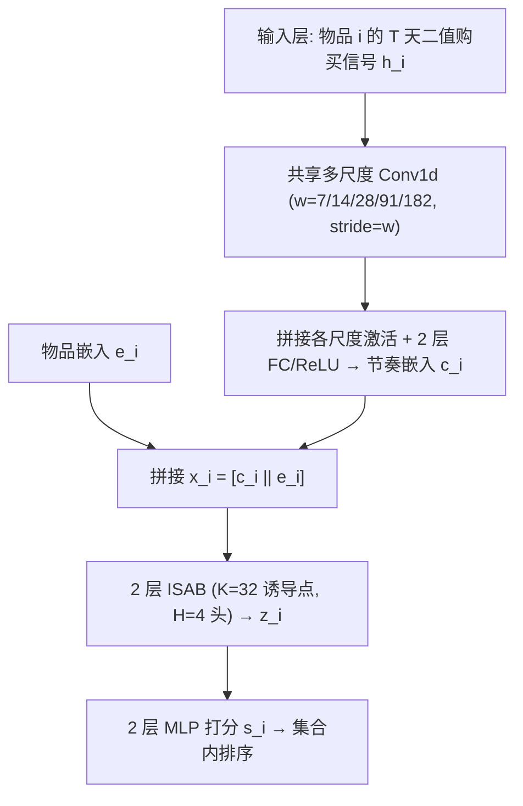
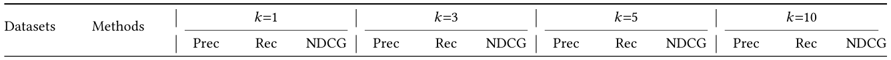
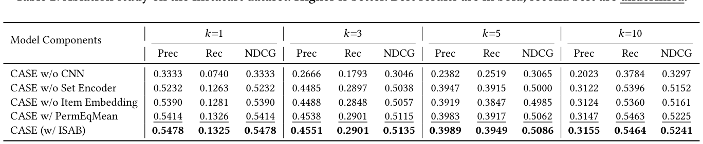
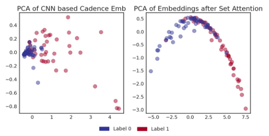
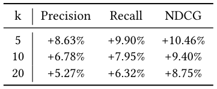

# CASE: Cadence-Aware Set Encoding for Large-Scale Next Basket Repurchase Recommendation (面向大规模下一篮复购推荐的节奏感知集合编码)

- **会议/期刊**: SIGIR 2026 (Industry Track)
- **推荐链路定位**: 召回 (Retrieval) — 在用户历史复购候选集 $\mathcal{I}_u$ 内做集合级打分排序
- **研究方向**: 序列与会话推荐 / 生成式推荐（集合式时序预测）
- **论文原文**: [https://arxiv.org/abs/2604.06718v3](https://arxiv.org/abs/2604.06718v3)
- **开源代码**: 暂未开源

## TL;DR (核心速览)

针对下一篮复购推荐 (NBRR) 中"篮子序号无法表达真实日历时间、两次购买之间打分静止"的结构性痛点，CASE 将每个物品的购买历史编码为 $T$ 天二值日历信号，用**共享多尺度时序卷积**（周/双周/月/季/趋势五种核）提取物品级复购节奏，再用 **ISAB 诱导集合注意力**以 $O(nK)$ 亚二次复杂度建模跨物品依赖，最终 MLP 输出复购分。在 4 个数据集（3 公开 + 1 工业）的留一法全候选排序协议下，Precision/Recall/NDCG@1/3/5/10 全面领先；生产环境 top-5 相对提升 Precision +8.63%、Recall +9.90%。

## Background & Motivation (背景与动机)

- **领域背景与主流范式**: 零售补货场景中，下一篮的相当比例物品是历史已购品，且复购间隔呈稳定的物品级节奏（牛奶按周、清洁用品按月）。主流 NBRR 方法（DNNTSP、BERT4NBR、TIFUKNN、PIETSP）将用户历史建模为**按访问顺序索引的离散篮子事件序列**，时间仅以篮子序号隐式表达。
- **现有方法局限**:
  1. **时间语义失真**：第 1/8/36 天的三篮与第 1/2/3 天的三篮在三步表示下完全相同，模型无法区分"已到期"与"尚未到期"，且两次交易之间打分完全静止，无法随天数推移刷新排序。
  2. **KNN 类方法不可扩展**：TIFUKNN 在推理时需对全量用户库计算用户相似度并聚合邻居历史，千万级用户规模下每次查询的 $O(|\mathcal{U}|\cdot d)$ 检索不可行（实测 Instacart 测试集 3,744 用户：CASE 19s vs. TIFUKNN 318s）。
  3. **已有日历时间方案各有短板**：文献 [3] 用卷积学习复购周期但采用**用户专属卷积核参数化**，无法规模化；PIETSP [7] 通过置换等变聚合实现可扩展集合建模，但**未在物品级显式提取多尺度节奏**。
- **核心挑战**: 如何在显式建模日历时间节奏的同时，保持推理复杂度与用户总量无关、且不引入 per-user 参数？
- **核心洞察与切入点**: 复购节奏是**群体共享**的（周/月/季等周期具有普适性），因此时序卷积核可在全体用户间共享；而用户候选物品天然是**无序集合**而非序列，应使用置换不变的集合编码而非自注意力序列建模。

## Problem Formulation & Method (问题定义与方法架构)

### 1. 符号定义与输入表征 (Notations & Input Representations)

- 用户 $u$ 的有序篮子序列 $\mathcal{B}_u = (B_1, B_2, \dots, B_L)$，其中 $B_l \subseteq \mathcal{I}$ 于日历日期 $d_l$ 购买。
- 复购候选集 $\mathcal{I}_u = \bigcup_{l} B_l$（仅限历史已购物品），任务为对 $\mathcal{I}_u$ 排序以预测其出现在 $B_{L+1}$ 中的可能性。
- 对每个 $i \in \mathcal{I}_u$ 构造滚动 $T$ 天二值购买指示向量 $\mathbf{h}_i \in \{0,1\}^T$，$h_{i,t}=1$ 表示物品 $i$ 在第 $t$ 天被购买。
- 维度设定：物品嵌入 $d_e = 128$，CNN 输出 $d_c = 128$，ISAB 隐层 $d_h = 256$，诱导点数 $K=32$，注意力头数 $H=4$。

### 2. 整体流水线 (Overall Architecture)

数据流：日历时间二值信号 $\mathbf{h}_i$ → 五尺度共享 Conv1d（stride = 核宽，非重叠窗口）→ 各尺度激活拼接 → 两层 FC+ReLU 得节奏嵌入 $\mathbf{c}_i$ → 与物品嵌入拼接 $\mathbf{x}_i = [\mathbf{c}_i \| \mathbf{e}_i]$ → 两层 ISAB → 集合编码 $\mathbf{z}_i$ → 两层 MLP 输出标量分 $s_i$ → 按 $s_i$ 排序。

<figure class="paper-figure" markdown="span">
  <figcaption>图1：CASE 概览。商品购买历史被转换为二值的 𝑇 天日历时间信号，从而能够建模经过时间和复购节奏。共享的多尺度时间卷积学习群体层面的重复模式并生成节奏嵌入 c𝑖，其与商品嵌入 e𝑖 拼接后，由 Induced Set Attention Blocks（ISAB）处理以建模跨商品依赖关系。最终 MLP 输出每个商品的复购分数。</figcaption>
</figure>

### 3. 核心模块设计与数学原理 (Key Designs & Formulations)

**(1) 日历时间历史表征与多尺度时序 CNN**

对 $\mathbf{h}_i \in \{0,1\}^T$ 施加五个预定义核宽的共享 Conv1d：周 $w=7$、双周 $w=14$、月 $w=28$、季 $w=91$、趋势 $w=182$，每个尺度 stride 等于核宽（非重叠窗口），产生 $\lfloor T/w \rfloor$ 个激活。所有尺度激活拼接后经两层 FC + ReLU 投影为 $\mathbf{c}_i \in \mathbb{R}^{d_c}$。

物理直觉：小核捕捉细粒度周期性重复（每周补货），大核捕捉慢变趋势与季节性；**卷积核在全体用户间共享**，因此参数量与用户数无关，且节奏模式可从数据稀疏用户处借力群体统计。

**(2) 诱导集合注意力 (ISAB)**

候选物品构成无序集合，故采用 Set Transformer 的 ISAB：以 $K$ 个可学习诱导点先对物品集合做注意力汇聚，再让物品回注诱导点，将全对注意力的 $O(n^2)$ 降为 $O(nK)$。两层 ISAB（$K=32$，$H=4$）输出 $\mathbf{z}_i \in \mathbb{R}^{d_h}$，建模跨物品共购依赖（如买面包时牛奶的相关性）而不引入任意物品顺序假设。

**(3) 打分与训练**

$\mathbf{z}_i$ 经两层 MLP 得标量 $s_i$；训练最小化二元交叉熵，正样本为 $B_{l+1} \cap \mathcal{I}_u$，负样本为 $\mathcal{I}_u \setminus B_{l+1}$。

### 4. 训练目标、负采样与推理复杂度 (Optimization, Negative Sampling & Complexity)

- **损失函数**: 二元交叉熵 (BCE)
  $$\mathcal{L} = -\frac{1}{|\mathcal{I}_u|}\sum_{i \in \mathcal{I}_u} \Big[ y_i \log \sigma(s_i) + (1-y_i)\log(1-\sigma(s_i)) \Big]$$
  其中 $y_i = \mathbb{1}[i \in B_{l+1}]$。原文未报告额外的温度系数或辅助损失项。
- **训练负采样策略**: **免负采样**——在用户复购候选集 $\mathcal{I}_u$ 内部做全集合 BCE，正负样本由真实下一篮自然划分，无 Uniform / In-batch / Hard Negative 采样。
- **时间与空间复杂度**: 对含 $n$ 个候选、$T$ 天窗口的用户，多尺度时序编码 + ISAB 合计 $O(n(T+K))$，**与用户总量 $|\mathcal{U}|$ 无关**；TIFUKNN 每查询需 $O(|\mathcal{U}|\cdot d)$。实测 Instacart 测试集（3,744 用户）推理耗时 19s vs. TIFUKNN 318s。训练配置：PyTorch，30 epochs，Adam（lr $10^{-3}$，weight decay $10^{-5}$），batch size 64，ISAB 后与 MLP 打分器均加 0.1 dropout。原文未报告峰值显存与单 epoch 训练耗时。

## Experimental Setup & Evaluation Protocol (实验设置与评估协议)

- **数据集统计与预处理**（四个杂货域数据集，覆盖不同目录规模与篮子密度）：

| 数据集 (Dataset) | 用户数 (#Users) | 物品数 (#Items) | 交互数 (#Interactions) | 稀疏度/密度 (Sparsity) | 模态/辅助特征说明 |
| :--- | :---: | :---: | :---: | :---: | :--- |
| Instacart | 18,739 | 37,522 | 原文未报告总交互数（人均 16.7 篮 × 10.07 件/篮） | - | 无日历时间戳，由订单间隔重建相对日期 |
| TaFeng | 7,227 | 18,703 | 原文未报告总交互数（人均 7.52 篮 × 6.58 件/篮） | - | 保留原始日历时间戳；历史短、篮子小，节奏建模困难 |
| DC (Dunnhumby Carbo-Loading) | 123,935 | 852 | 原文未报告总交互数（1.60 件/篮） | - | 无日历时间戳，由订单间隔重建；篮子极小 |
| Proprietary (Walmart 内部) | 10,308 | 88,812 | 原文未报告总交互数（人均 43 篮 × 11.72 件/篮） | - | 保留原始日历时间戳；历史最丰富 |

- **数据划分方式 (Splitting Strategy)**: **用户级 train–test 划分 + 留一法 (Leave-One-Out)**，每个用户的最后一篮作为目标篮。原文未采用全局时间戳切分，但目标篮严格取时间上最后一篮，**不存在未来信息泄露**；候选集限定为用户历史已购物品，属"复购候选内排序"而非全库排序。
- **排名评测协议 (Ranking Protocol)**: 在用户复购候选集 $\mathcal{I}_u$ 内做**全候选排序**（非负采样排序，也非全物品库排序），候选规模随用户历史增长。
- **评价指标与显著性检验**: Precision@$k$、Recall@$k$、NDCG@$k$，$k \in \{1,3,5,10\}$；采用**配对 $t$ 检验**（$\alpha = 0.05$，$p<0.05$ 视为显著）。原文未报告多随机种子方差。

## Key Experimental Results (核心实验结果)

### 1. 主实验对比 (Main Results)

<figure class="paper-figure" markdown="span">
  <figcaption>表1：下一篮复购推荐中 Top-𝐾 性能的比较。数值越高越好。每个数据集和 metric@K 的最佳结果以粗体显示；次佳结果以下划线显示。我们使用配对 𝑡 检验对指标分数进行统计显著性验证（𝛼= 0.05），当 𝑝&lt; 0.05 时认为差异显著。</figcaption>
</figure>

| 数据集 | 指标 | 传统/协同过滤基线 (PersonalTop) | 序列/图/集合最强基线 | 本文方法 (Ours) | 相对提升 (Improv.) |
| :--- | :--- | :---: | :---: | :---: | :---: |
| TaFeng | Prec@1 / Rec@1 / NDCG@1 | 0.1771 / 0.0988 / 0.1771 | PIETSP 0.2507 / 0.1752 / 0.2507 | **0.2897 / 0.1877 / 0.2897** | +15.6% / +7.1% / +15.6% (vs. PIETSP) |
| TaFeng | Prec@10 / Rec@10 / NDCG@10 | 0.0795 / 0.3839 / 0.2612 | PIETSP 0.1094 / 0.5853 / 0.3801 | **0.1157 / 0.5953 / 0.4021** | +5.8% / +1.7% / +5.8% |
| DC | Prec@1 / Rec@1 / NDCG@1 | 0.3434 / 0.2879 / 0.3434 | PIETSP 0.3886 / 0.3291 / 0.3886 | **0.3904 / 0.3296 / 0.3904** | +0.5% / +0.2% / +0.5% |
| DC | Prec@10 / Rec@10 / NDCG@10 | 0.1059 / 0.7838 / 0.5000 | PIETSP 0.1092 / 0.8443 / 0.5467 | **0.1143 / 0.8468 / 0.5487** | +4.7% / +0.3% / +0.4% |
| Instacart | Prec@1 / Rec@1 / NDCG@1 | 0.5019 / 0.1173 / 0.5019 | TIFUKNN 0.5489 / 0.1340 / 0.5489 | 0.5478 / 0.1325 / 0.5478 | −0.2% / −1.1% / −0.2%（略低于 TIFUKNN） |
| Instacart | Prec@10 / Rec@10 / NDCG@10 | 0.2819 / 0.4821 / 0.4671 | TIFUKNN 0.3115 / 0.5371 / 0.5189 | **0.3155 / 0.5464 / 0.5241** | +1.3% / +1.7% / +1.0% |
| Proprietary | Prec@1 / Rec@1 / NDCG@1 | 0.3672 / 0.0921 / 0.3672 | TIFUKNN 0.3856 / 0.0971 / 0.3856 | **0.3871 / 0.1007 / 0.3871** | +0.4% / +3.7% / +0.4% |
| Proprietary | Prec@10 / Rec@10 / NDCG@10 | 0.1766 / 0.2962 / 0.3121 | TIFUKNN 0.2038 / 0.3547 / 0.3543 | **0.2017 / 0.3448 / 0.3514** | −1.0% / −2.8% / −0.8%（@10 略低于 TIFUKNN） |

关键观察：CASE 在**稀疏场景**（TaFeng 短历史、DC 小篮子）优势最大，说明日历节奏信号在交易频次低、篮子上下文有限时比邻居聚合更可靠；在丰富数据集（Instacart、Proprietary）上与 TIFUKNN 互有胜负但整体接近或略优。DNNTSP 与 BERT4NBR 在 DC/Instacart/Proprietary 上甚至低于 PersonalTop，佐证篮子序号表示的结构性缺陷——更复杂的图/Transformer 架构无法弥补缺失的日历时间建模。

### 2. 消融实验与控制变量分析 (Ablation Study)

<figure class="paper-figure" markdown="span">
  <figcaption>表2：在 Instacart 数据集上的消融研究。数值越高越好。最佳结果以粗体显示；次佳结果以下划线显示。</figcaption>
</figure>

Instacart 上消融（$k=10$ 为例）：

| 变体 | Prec@10 | Rec@10 | NDCG@10 | 结论 |
| :--- | :---: | :---: | :---: | :--- |
| CASE w/o CNN | 0.2023 | 0.3784 | 0.3297 | **降幅最大**（相对完整模型 NDCG −37%），节奏建模是主导贡献 |
| CASE w/o Set Encoder | 0.3122 | 0.5396 | 0.5152 | 各 cutoff 一致下降，跨物品依赖有互补价值 |
| CASE w/o Item Embedding | 0.3124 | 0.5360 | 0.5161 | 仅温和下降，说明日历编码是主要驱动，可降低对大嵌入表的依赖 |
| CASE w/ PermEqMean | 0.3147 | 0.5463 | 0.5225 | 置换等变均值池化已具竞争力，ISAB 进一步带来一致增益 |
| CASE (w/ ISAB) | **0.3155** | **0.5464** | **0.5241** | 完整模型 |

<figure class="paper-figure" markdown="span">
  <figcaption>图2：商品嵌入的 PCA 可视化（正/负样本各 50 个）。左：节奏嵌入 c𝑖；右：集合编码表示 z𝑖。CNN 诱导基于节奏的分离，而 ISAB 通过跨商品交互细化边界。</figcaption>
</figure>

图 2 的 PCA 可视化进一步佐证：时序 CNN 已按节奏相位将正负样本分离，ISAB 在此基础上通过跨物品交互锐化决策边界。消融对照未显式做参数量对齐，但 PermEqMean 与 ISAB 的对比属于同输入表征下的编码器替换，控制相对干净。

### 3. 稀疏度/冷启动分桶与超参敏感度 (Sparsity Buckets & Hyperparameters)

- **稀疏场景表现**: 原文未做严格的用户/物品交互频次分桶，但通过数据集层面的稀疏性对比给出结论——TaFeng（7.52 篮/人、6.58 件/篮）与 DC（1.60 件/篮）上 CASE 领先幅度最大，作者归因于共享时序编码在低交易频次下仍能跨用户泛化，而邻居聚合变得不可靠。
- **关键超参数敏感度**: 原文**未报告**核宽组合、$T$ 窗口长度、$K$ 诱导点数、$d_c/d_h$ 维度的敏感度分析；作者在结论中明确将"固定多尺度核与固定时间窗口"列为局限，并建议未来探索自适应时间参数化。
- **线上 A/B 测试结果**: 原文仅报告**生产模型对比（离线/回放式评估）**，非在线 A/B。<figure class="paper-figure" markdown="span">
  <figcaption>表3：CASE 相对于生产模型的相对提升（%）。</figcaption>
</figure> 显示 CASE 相对生产 LTR 模型（含人工复购特征）在相同数据规模与候选管道下：$k=5$ 时 Precision +8.63%、Recall +9.90%、NDCG +10.46%；$k=10$ 时 +6.78% / +7.95% / +9.40%；$k=20$ 时 +5.27% / +6.32% / +8.75%。作者明确说明**在线 A/B 测试尚在计划中**，CTR/GMV/留存等业务指标原文未报告。

## Highlights, Limitations & Critiques (亮点、局限与审稿级批判)

- **核心亮点与可迁移性**:
  1. **"日历时间二值信号 + 共享多尺度卷积"** 是一种极轻量、与用户数解耦的节奏表征，可直接迁移到补货电商、订阅续费、内容周期性消费（如周更剧集）等任何具有物品级周期性的推荐场景。
  2. **ISAB 替代全自注意力** 将集合建模从 $O(n^2)$ 降至 $O(nK)$，配合"候选集为无序集合"的任务先验，是工业级集合排序的实用范式。
  3. **消融显示去掉物品嵌入仅温和下降**，意味着可显著缩减需高频刷新的嵌入表规模，对目录快速增长的工业系统有直接工程价值。
- **局限性与审稿视角批判**:
  1. **评估协议偏窄**：候选集限定为用户历史已购物品，属"复购候选内排序"，未与"全物品库召回"或"新物品发现"任务对比；对 NBRR 中非复购的新品推荐完全未覆盖。
  2. **基线强度与调参公平性存疑**：DNNTSP、BERT4NBR 在多个数据集上低于 PersonalTop 这一简单频率基线，虽作者归因于篮子序号表示的结构性缺陷，但也可能反映基线调参不足（仅统一 30 epochs、同一优化器），削弱了对比说服力。
  3. **超参敏感度缺失**：五种固定核宽 $\{7,14,28,91,182\}$ 与固定 $T$ 窗口缺乏消融与敏感度分析，作者自认这是局限；对复购周期极长（如 >182 天）的物品，趋势核可能失效。
  4. **非平稳节奏未处理**：模型假设历史节奏相对稳定，对渠道外购买、生活习惯突变等非平稳信号的处理能力未经检验。
  5. **生产评估非在线 A/B**：+8.63%/+9.90% 的提升来自与生产 LTR 模型的离线对比，作者明确在线 A/B 尚在计划中，业务收益尚未闭环验证。
  6. **统计严谨性一般**：虽报告配对 $t$ 检验，但未报告多随机种子方差；Instacart 与 Proprietary 上部分 cutoff 实际略低于 TIFUKNN，摘要中"consistently improves"的措辞略有夸大。

## Rating (四维评分)

- **方法创新性 (Novelty)**: ⭐⭐⭐（日历时间表征与 ISAB 均为已有组件的合理组合，创新在于"物品级节奏与跨物品交互解耦"的架构取舍与工业可扩展性论证）
- **评估协议与实验扎实度 (Protocol & Experiments)**: ⭐⭐⭐（四数据集 + 留一法 + 配对 $t$ 检验较规范，但候选集受限、基线调参公平性存疑、缺超参敏感度与多 seed 方差）
- **写作与数学规范度 (Clarity & Rigor)**: ⭐⭐⭐⭐（问题动机清晰、复杂度分析到位、消融与可视化互相印证，公式与维度交代完整）
- **工业落地与复现价值 (Industrial & Practical Value)**: ⭐⭐⭐⭐⭐（千万级用户生产验证、推理 19s vs. 318s、参数量与用户数解耦、降低嵌入表依赖，工业价值突出；但代码未开源，复现需自行实现）
