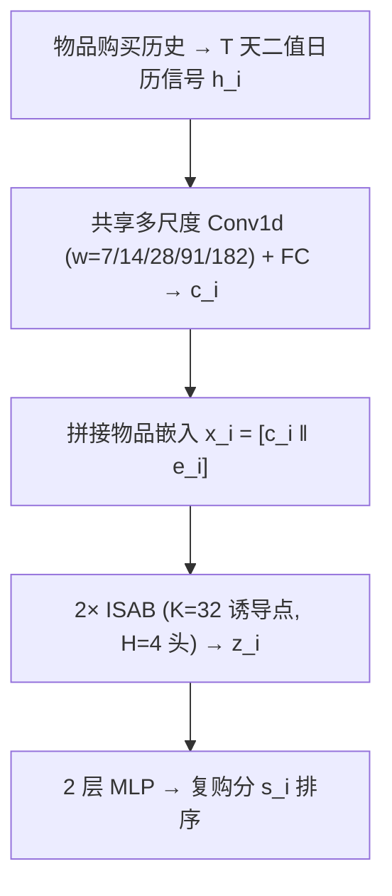
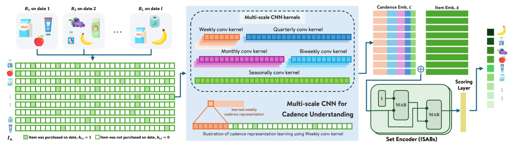

# CASE: Cadence-Aware Set Encoding for Large-Scale Next Basket Repurchase Recommendation (面向大规模下一篮复购推荐的节奏感知集合编码)

- **会议/期刊**: SIGIR 2026 (Industry Track)
- **作者与机构**: Yanan Cao, Ashish Ranjan, Sinduja Subramaniam, Evren Korpeoglu, Kaushiki Nag, Kannan Achan (Walmart Global Tech)
- **推荐链路定位**: 召回（复购候选集打分排序）
- **研究方向**: 序列与会话推荐 / 冷启动与长尾推荐
- **论文原文**: [https://arxiv.org/abs/2604.06718v3](https://arxiv.org/abs/2604.06718v3)
- **开源代码**: 暂未开源

## TL;DR (1分钟核心速览)

下一篮复购推荐（NBRR）中，主流模型把历史压缩为"篮序索引"序列，无法表达真实日历时间流逝，导致两次交易之间打分静止、无法判断物品"该买了还是没到点"；KNN 类方法虽强但推理需全用户检索，千万级用户下不可行。CASE 将每个物品历史转为固定 $T$ 天二值日历信号，用**共享**多尺度时序卷积提取周/双周/月/季/趋势节奏，再以 ISAB 做亚二次复杂度的跨物品集合建模。在 TaFeng/DC/Instacart/Proprietary 四数据集 Leave-One-Out 全候选排序下全面领先，生产系统上 Top-5 Precision 相对提升 8.6%、Recall 提升 9.9%。

## Background & Motivation (背景与核心矛盾)

- **主流范式**: 神经 NBRR 将用户历史建模为按访问顺序排列的篮序列（DNNTSP 图聚合+篮序时间注意力、BERT4NBR 双向自注意力），时间仅由篮索引隐式表达；TIFUKNN 则以时间衰减的物品向量做用户级 KNN 聚合。
- **前人局限**: ① 篮序表示下"第 1/8/36 天"与"第 1/2/3 天"的三步序列完全同构，模型无法感知真实间隔，两次交易之间打分冻结，无法对"已逾期/未到期"给出自适应信号；② TIFUKNN 每次查询需 $O(|\mathcal{U}|\cdot d)$ 的全用户相似度检索，千万级用户下推理不可承受（Instacart 测试集 19s vs 318s 的实测差距）。
- **核心洞察**: 杂货补货场景中复购时机服从**物品级稳定节奏**（牛奶按周、清洁用品按月），且该节奏是群体共享的——无需用户个性化参数即可学到。
- **本文切入点**: 把"节奏学习"与"跨物品交互"解耦：前者用共享多尺度 CNN 在日历时间轴上做，后者用诱导集合注意力做，从而同时获得显式时间建模与线性推理开销。

## Method (核心方法设计)

### 1. 整体框架 (Overall Architecture)

对用户 $u$ 的复购候选集 $\mathcal{I}_u=\bigcup_l B_l$ 中每个物品 $i$，在滚动 $T$ 天窗口上构造二值购买指示向量 $h_i\in\{0,1\}^T$；共享多尺度 Conv1d 在五个核尺度上提取节奏特征并投影为节奏嵌入 $c_i$；与可学习物品嵌入 $e_i$ 拼接后送入两层 ISAB 得到集合编码 $z_i$；最终两层 MLP 输出标量复购分 $s_i$ 排序。全流程无用户级参数，支持批量推理。

<figure class="paper-figure" markdown="span">
  <figcaption>图1：CASE 概览。物品购买历史被转换为二值化的 𝑇 天日历时间信号，从而能够对经过时间和复购节奏进行建模。共享的多尺度时间卷积学习群体层面的周期性模式并生成节奏嵌入 c𝑖，其与物品嵌入 e𝑖 拼接后由 Induced Set Attention Blocks（ISAB）处理，以建模跨物品依赖关系。最终由 MLP 输出每个物品的复购分数。</figcaption>
</figure>

### 2. 关键设计拆解 (Key Designs)

1. **日历时间二值信号 + 共享多尺度时序卷积**：痛点是用篮索引编码时间会丢失真实间隔。CASE 令 $h_{i,t}=\mathbb{1}[i \text{ 在日 } t \text{ 被购买}]$，用五个非重叠步长（stride $=w$）的 Conv1d 并行卷积，各尺度 $\lfloor T/w\rfloor$ 个激活拼接后经两层 FC+ReLU 得 $c_i\in\mathbb{R}^{d_c}$。物理直觉：小核捕捉周级补货重复、大核捕捉季节性与慢变趋势，且**群体共享权重**使稀疏用户也能借他人节奏泛化——这正是其在 TaFeng/DC 稀疏场景增益最大的原因。
2. **诱导集合注意力 (ISAB) 建模跨物品依赖**：复购候选天然是无序集合，全自注意力 $O(n^2)$ 在候选集大时不可扩展。ISAB 引入 $K$ 个可学习诱导点，先让诱导点 attend 物品集、再让物品 attend 回诱导点，将复杂度降至 $O(nK)$；两层、$K=32$、$H=4$ 头输出 $z_i\in\mathbb{R}^{d_h}$。直觉：诱导点充当"共购模式原型"的低秩瓶颈，以极小代价捕获互补品/替代品的集合级共现。
3. **训练目标、负采样与推理效率**：损失为候选集内二分类交叉熵
$$\mathcal{L}=-\sum_{i\in B_{l+1}\cap\mathcal{I}_u}\log \sigma(s_i)-\sum_{i\in \mathcal{I}_u\setminus B_{l+1}}\log(1-\sigma(s_i)),$$
即**免负采样**——负例直接取用户历史中未复购的物品（in-history negatives），与推理候选空间严格一致。推理复杂度 $O(n(T+K))$，与用户总量 $|\mathcal{U}|$ 无关；$d_e=d_c=128$、$d_h=256$，Adam $10^{-3}$、30 epoch、batch 64。

## Experimental Setup & Evaluation Protocol (实验设置与评估协议)

- **数据集与预处理**: 四个杂货域数据集，覆盖不同目录规模与篮密度：

| 数据集 | #Users | #Items | 篮数/用户 | 物品数/篮 | 特征/场景说明 |
| :--- | :---: | :---: | :---: | :---: | :--- |
| TaFeng | 7,227 | 18,703 | 7.52 | 6.58 | 中文杂货，历史短、稀疏，节奏建模最难的设定 |
| DC | 123,935 | 852 | — | 1.60 | Dunnhumby Carbo-Loading，用户多、目录极小、篮极浅 |
| Instacart | 18,739 | 37,522 | 16.7 | 10.07 | 公开在线杂货，历史丰富 |
| Proprietary | 10,308 | 88,812 | 43 | 11.72 | Walmart 内部采样，长历史、大目录 |

- **数据划分与防穿越**: 用户级 train–test 划分 + `Leave-One-Out`，每用户最后一篮为目标篮；TaFeng/Proprietary 保留真实日历时间戳，Instacart/DC 无时间戳，用订单间隔（days-since-prior-order）重建相对日期以构造 $T$ 天二值表示。
- **排名评测协议**: 候选**严格限制在用户历史购买过的物品** $\mathcal{I}_u$ 内（in-history 全排序，非全库），报告 Precision/Recall/NDCG@{1,3,5,10}；显著性用配对 $t$ 检验（$\alpha=0.05$）。
- **对比基线与超参**: PersonalTop（频次）、TIFUKNN（时间衰减 KNN）、DNNTSP（共现图 GNN+篮序注意力）、BERT4NBR（篮序双向自注意力）、PIETSP（时间步集合均值池化）；基线统一同套优化配置训练 30 epoch 取验证最优。

## Key Experimental Results (实验关键数据)

### 1. 主实验对比 (Main Results)

代表性结果（Precision / Recall / NDCG，加粗为最优）：

| 数据集 | 方法 | P@1 | R@1 | P@5 | R@5 | NDCG@5 | P@10 | R@10 | NDCG@10 |
| :--- | :--- | :---: | :---: | :---: | :---: | :---: | :---: | :---: | :---: |
| TaFeng | TIFUKNN | 0.2146 | 0.1201 | 0.1332 | 0.3443 | 0.2769 | 0.0995 | 0.5007 | 0.3228 |
| TaFeng | PIETSP | 0.2507 | 0.1752 | 0.1421 | 0.4223 | 0.3317 | 0.1094 | 0.5853 | 0.3801 |
| TaFeng | **CASE** | **0.2897** | **0.1877** | **0.1539** | **0.4361** | **0.3559** | **0.1157** | **0.5953** | **0.4021** |
| DC | TIFUKNN | 0.3843 | 0.3245 | 0.1843 | 0.7229 | 0.5387 | 0.1140 | 0.8442 | 0.5473 |
| DC | PIETSP | 0.3886 | 0.3291 | 0.1841 | 0.7229 | 0.5389 | 0.1092 | 0.8443 | 0.5467 |
| DC | **CASE** | **0.3904** | **0.3296** | **0.1846** | **0.7230** | **0.5401** | **0.1143** | **0.8468** | **0.5487** |
| Instacart | TIFUKNN | 0.5489 | 0.1340 | 0.3930 | 0.3878 | 0.5037 | 0.3115 | 0.5371 | 0.5189 |
| Instacart | PIETSP | 0.5210 | 0.1222 | 0.3838 | 0.3773 | 0.4891 | 0.2986 | 0.5429 | 0.5155 |
| Instacart | **CASE** | 0.5478 | 0.1325 | **0.3989** | **0.3949** | **0.5086** | **0.3155** | **0.5464** | **0.5241** |
| Proprietary | TIFUKNN | 0.3856 | 0.0971 | 0.2615 | 0.2550 | 0.3503 | 0.2038 | 0.3547 | 0.3543 |
| Proprietary | PIETSP | 0.3803 | 0.0959 | 0.2422 | 0.2311 | 0.3301 | 0.1822 | 0.3094 | 0.3245 |
| Proprietary | **CASE** | **0.3871** | **0.1007** | **0.2661** | **0.2550** | **0.3509** | **0.2017** | **0.3448** | **0.3514** |

TaFeng 上 CASE 相对最强基线 PIETSP 的 P@1 提升 **+15.6%**、NDCG@10 提升 **+5.8%**；DNNTSP 与 BERT4NBR 在 DC/Instacart/Proprietary 上甚至低于 PersonalTop（如 DC 上 DNNTSP P@1=0.3264 vs PersonalTop 0.3434），印证篮序表示的结构性缺陷。

**生产系统对比（相对提升）**：k=5 时 Precision **+8.63%**、Recall **+9.90%**、NDCG **+10.46%**；k=10 时 +6.78%/+7.95%/+9.40%；k=20 时 +5.27%/+6.32%/+8.75%。

### 2. 消融实验 (Ablation Study)

Instacart 数据集：

| 变体 | P@1 | R@1 | P@5 | R@5 | NDCG@5 | P@10 | R@10 | NDCG@10 |
| :--- | :---: | :---: | :---: | :---: | :---: | :---: | :---: | :---: |
| w/o CNN | 0.3333 | 0.0740 | 0.2382 | 0.2519 | 0.3065 | 0.2023 | 0.3784 | 0.3297 |
| w/o Set Encoder | 0.5232 | 0.1263 | 0.3947 | 0.3915 | 0.5000 | 0.3122 | 0.5396 | 0.5152 |
| w/o Item Embedding | 0.5390 | 0.1281 | 0.3919 | 0.3847 | 0.4985 | 0.3124 | 0.5360 | 0.5161 |
| w/ PermEqMean | 0.5414 | 0.1326 | 0.3983 | 0.3917 | 0.5062 | 0.3147 | 0.5463 | 0.5225 |
| **CASE (ISAB)** | **0.5478** | 0.1325 | **0.3989** | **0.3949** | **0.5086** | **0.3155** | **0.5464** | **0.5241** |

### 3. 关键实验发现 (Key Findings)

1. **节奏建模是绝对主导项**：去掉多尺度 CNN 后 P@1 从 0.5478 暴跌至 0.3333（−39.2%），NDCG@10 从 0.5241 降至 0.3297，跌幅远超其他任何组件；PCA 可视化（图 2）显示 CNN 已按节奏相位将正负样本分离，ISAB 仅在此基础上锐化边界。
2. **物品嵌入近乎冗余，是生产可扩展性的关键红利**：去掉 $e_i$ 仅使 P@1 降 1.6%（0.5478→0.5390），说明日历节奏本身已承载主要判别信号，可大幅降低对大规模高频刷新 embedding 表的依赖。
3. **集合编码有效但注意力增益温和**：去掉集合编码器 P@1 降至 0.5232（−4.5%）；与排列等变均值池化 PermEqMean（0.5414）相比，ISAB 仅再提升 1.2%，说明收益主要来自"集合级聚合"这一范式而非注意力本身，但 ISAB 在 $O(nK)$ 下仍优于全注意力的可扩展性。

## Highlights, Limitations & Rating (亮点、对比与审稿评价)

- **与代表作对比 (vs. Prior Work)**: 与 TIFUKNN 的本质区别是**抛弃用户级 KNN 检索**，改为群体共享的时序滤波器，推理从 $O(|\mathcal{U}|d)$ 降至 $O(n(T+K))$（19s vs 318s）；与 PIETSP 的区别在于后者只做时间步集合的排列等变均值池化，缺少物品级多尺度节奏抽取，故在稀疏的 TaFeng 上被拉开 15.6% 的 P@1 差距；与 DNNTSP/BERT4NBR 的区别是彻底放弃篮序索引，改用真实日历时间轴。
- **可迁移亮点**: ① "二值日历信号 + 多尺度非重叠卷积"是一种极轻量的周期模式编码器，可直接迁移到复购间隔预测、订阅续费、周期性内容推送等任务；② "共享权重 + 无用户参数"的设计思路对任何需要控制 embedding 表规模的大规模工业系统都有参考价值。
- **审稿级局限批判**: ① 候选集被限制在用户历史购买物品内，未评估新品/跨类目推荐的召回能力，任务定义偏窄；② 固定五档卷积核与固定时间窗 $T$ 对非平稳节奏（跨渠道购买、生活规律突变）鲁棒性未验证，且论文自承线上 A/B 测试尚未完成，工业收益仍属离线口径；③ 在 Instacart 上 P@1 实际略低于 TIFUKNN（0.5478 vs 0.5489），"全面领先"的表述在富历史场景下需谨慎解读。
- **四维评分**: 创新性 ⭐⭐⭐⭐ | 实验扎实度 ⭐⭐⭐⭐ | 方法清晰度 ⭐⭐⭐⭐⭐ | 落地价值 ⭐⭐⭐⭐⭐

