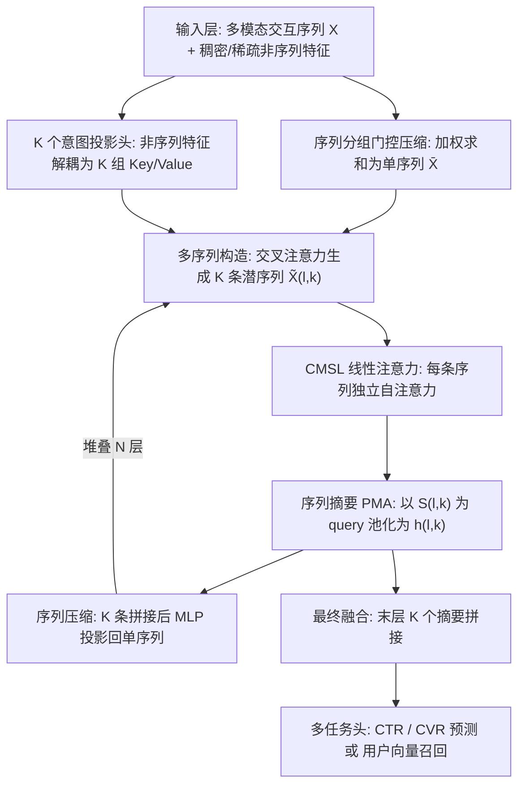

# CMSL: Constructive Multi-Sequence Learning for Recommendation Systems (构造式多序列学习推荐系统)

- **会议/期刊**: SIGIR 2026
- **推荐链路定位**: 精排 (CTR/CVR Ranking) + 召回 (U2U Retrieval，两阶段异步用户模型)
- **研究方向**: 序列与会话推荐 / CTR 预估与特征交叉
- **论文原文**: [https://arxiv.org/abs/2606.28533v2](https://arxiv.org/abs/2606.28533v2)
- **开源代码**: 暂未开源（原文与预提取均未发现代码链接）

## TL;DR (核心速览)

针对序列推荐中"用户历史被当作 LLM 单句 prompt"导致的**上下文污染 (Context Pollution)** 问题，CMSL 提出"上下文工程"新范式：用可学习的多序列构造模块（K 个意图投影头 + 交叉注意力）把原始交互历史在潜空间解耦为 K 条主题一致的潜序列，再用线性时间注意力（SiLU 的二次多项式核近似 + 稀疏大项修正）分别建模，最后经 PMA 摘要与序列压缩回单序列以控制层间爆炸。在 Meta 四个大规模场景的离线 NE 上取得 0.06%–0.62% 的显著下降（>0.03% 即统计显著），并在 surface 5 的 U2U 召回线上 A/B 四项指标全部显著正向（+0.092%~+0.171%）。

## Background & Motivation (背景与动机)

- **领域背景与主流范式**: 工业序列推荐已从 DLRM 类聚合类别特征范式（Covington 2016、DCN、DLRM）转向"history-as-prompt"范式——把用户交互历史编码为 item ID token 序列，送入自注意力骨干，将 next-item 预测视为自回归续写（HSTU、OneTrans、Longer、InterFormer、OneRec）。该范式统一、易扩展，且随模型规模与上下文长度增长而受益。
- **现有方法局限 (Limitations of Prior Work)**:
  1. **结构统一性缺失**：文本受严格句法与线性语义依赖约束，而用户数字足迹是"噪声马赛克"——重叠兴趣、探索性点击、误触混杂，item 间连贯性远弱于 LLM 训练语料。
  2. **注意力预算竞争**：单序列建模中，无关行为与当前意图争夺同一注意力预算，语义干扰（如"编程教程"与"烹饪视频"被强制计算依赖）制造伪相关与表征瓶颈。
  3. **现有改进方向错位**：HSTU 的 target-aware attention、OneTrans/Longer 的架构与效率优化、InterFormer 的异构特征融合，均在"单条 monolithic 序列"前提下增强注意力/融合/窗口，未触及污染根源。
- **核心挑战 (Key Challenge)**: 为何简单加深网络或常规对比学习无效？因为污染不是随机噪声而是**语义干扰**，增加深度只会让冲突意图在同一 softmax 上下文内继续竞争；且 item ID 是无显式语义的抽象 token，人工按主题切分历史不可行。
- **核心洞察与切入点 (Key Insight)**: 作者用 Pilot Study（图 1a）证明：向用户历史注入低信号事件会降低性能，而专家驱动的去噪可提升性能；图 1b 进一步显示，即便仅由专家手工切成两条连贯序列，也优于单序列基线。由此提出关键问题——能否把用户历史不当作"待读取的原始 prompt"，而当作"待构造的上下文"？答案是在潜空间做**隐式上下文工程 (Implicit Context Engineering)**。

## Problem Formulation & Method (问题定义与方法架构)

### 1. 符号定义与输入表征 (Notations & Input Representations)

- 用户 $u$ 的交互历史定义为多模态序列集合 $\mathcal{X}=\{X^{(1)},X^{(2)},\dots,X^{(B)}\}$，其中 $X^{(b)}=\{x^{(b)}_1,\dots,x^{(b)}_n\}$ 对应一种交互模态（点击/点赞/评论等），$n$ 为序列长度，token 经共享 embedding 层映射到 $d$ 维。
- 非序列特征分两类：稠密特征 $v_{\text{dense}}\in\mathbb{R}^m$ 经归一化与线性投影 $S_{\text{dense}}=W_d\cdot\text{Norm}(v_{\text{dense}})$，$W_d\in\mathbb{R}^{d\times m}$；稀疏特征 $j$ 各配 embedding 表 $T_j\in\mathbb{R}^{V_j\times d}$，多值特征取 embedding 求和。
- 多序列分组压缩：同 surface 的相关序列组 $\mathcal{X}_g=\{X^{(1)},\dots,X^{(M)}\}$ 先经序列专属 MLP 打分 $s^{(m)}_i=\sigma(\text{MLP}^{(m)}(x^{(m)}_i))$，再加权求和压缩为单序列 $\bar{X}=\sum_{m=1}^{M}(s^{(m)}\cdot X^{(m)})\in\mathbb{R}^{n\times d}$，以控制后续计算开销。
- 输出：最终表征 $H$ 送入多任务头做 CTR/CVR 预测；召回侧输出用户 embedding 用于 U2U 检索。

### 2. 整体流水线 (Overall Architecture)

数据流：非序列特征经 K 个意图投影头解耦为 K 组上下文键值 $\to$ 以当前序列表征为 query 做交叉注意力构造 K 条潜序列 $\to$ 每条序列独立做线性时间自注意力 $\to$ PMA 摘要为定长向量并回流至下一层非序列特征 $\to$ 序列压缩回单序列 $\to$ 堆叠 $N$ 层 $\to$ 末层摘要拼接后接多任务头。

### 3. 核心模块设计与数学原理 (Key Designs & Formulations)

**模块一：多序列构造 (Multi-Sequence Construction)**。第 $l$ 层用 K 个投影头把非序列表征投影为 K 组上下文特定集合 $S^{(l,k)}$，各自再投影为 key $K_{l,k}$ 与 value $V_{l,k}$；对当前序列表征 $\bar{X}$ 投影得 query $Q_l$，对每个 $(K_{l,k},V_{l,k})$ 做多头注意力生成新序列 $\tilde{X}^{(l,k)}$。物理直觉：同一段原始历史被 K 个"上下文透镜"重读，每个透镜只保留与某类意图相关的 token 权重，从而在进入自注意力前就完成意图分流，避免冲突意图共享 softmax 预算。这是与 HSTU 等 target-aware 单序列注意力的本质区别——后者仍在同一序列内竞争。

**模块二：CMSL 线性注意力 (Linear-Time Attention)**。HSTU 注意力无行归一化，形式为 $\text{SiLU}(M\circ QK^\top)V$，其中 $M\in\{0,1\}^{n\times n}$ 为因果掩码。多序列构造使计算量再乘 K，故需线性化。作者利用 SiLU 的 Taylor 展开：
$$\text{SiLU}(x^\top y)\approx \tfrac{1}{2}(x^\top y)+\tfrac{1}{4}(x^\top y)^2-\tfrac{1}{48}(x^\top y)^4+\cdots$$
并构造二次多项式核特征映射 $\phi(x)=[x_1,\dots,x_d,x_1x_2,\dots,x_ix_j,\dots,x_dx_d]\in\mathbb{R}^{d^2+d}$，可证：
$$\phi(x)^\top\phi(y)\le \text{SiLU}(x^\top y)\le \phi(x)^\top\phi(y)+\mathcal{O}\big((x^\top y)^3\big)$$
即 $\text{SiLU}(QK^\top)V\approx \phi(Q)\phi(K)^\top V+AV$，其中 $A$ 为仅保留 $QK^\top$ 中大值的稀疏矩阵。前项用线性注意力（复杂度 $O(n)$），后项借鉴 native sparse attention 的 kernel 捕获大值项。设计直觉：SiLU 的二次项主导中等相似度交互，可用核技巧线性化；而少数极大相似度项（强信号）若被核近似平滑会失真，故单独用稀疏路径精确保留。

**模块三：序列摘要与压缩 (Summarization & Compression)**。用 PMA 以当前上下文非序列特征 $S^{(l,k)}$ 为 query、$\bar{X}^{(l,k)}$ 为 K/V 做池化：
$$h^{(l,k)}=\text{PMA}\big(Q=S^{(l,k)},\,K=\bar{X}^{(l,k)},\,V=\bar{X}^{(l,k)}\big)$$
摘要向量 $h^{(l,k)}$ 作为下一层非序列特征的一部分，实现跨层上下文传播；同时显式摘要抑制原始序列噪声向深层传递。随后将 K 条序列拼接后 MLP 投影回单序列：
$$\bar{X}^{(l)}=\text{MLP}\big([\bar{X}^{(l-1,1)}\|\bar{X}^{(l-1,2)}\|\cdots\|\bar{X}^{(l-1,K)}]\big)\in\mathbb{R}^{n\times d}$$
保证每层序列数恒为 1，避免 $K^L$ 爆炸，从而可堆叠 $N$ 层学习层次化交互。

### 4. 训练目标、负采样与推理复杂度 (Optimization, Negative Sampling & Complexity)

- **损失函数**: 原文未给出显式损失公式，仅说明最终表征 $H$ 送入多任务头做 CTR/CVR 预测（工业多任务范式，推测为 BCE/多任务加权，**原文未报告具体损失形式与权重**）。
- **训练负采样策略**: 原文未报告（工业排序任务通常为全曝光样本 + 多任务标签，召回侧 U2U 检索的负采样细节亦未披露）。
- **时间与空间复杂度**: 单序列自注意力为 $O(n^2d)$；CMSL 构造 K 条序列后若用标准注意力为 $O(Kn^2d)$，线性注意力将其降至 $O(Knd^2)$（核映射维度 $d^2+d$ 带来常数项，实际以自定义 kernel 优化）。序列压缩保证层间序列数不增长。训练侧：128 张 NVIDIA H100、混合精度、自定义 kernel，每实验 300–500 亿样本。推理侧：surface 2/3/4 采用两阶段架构，将长上下文 CMSL 卸载为**异步上游用户模型**，主排序路径仅消费其产出的用户 embedding，显著降低延迟；surface 1 直接训练 CMSL 排序模型。**原文未报告单次推理延迟 (ms/request) 与峰值显存数值**。

## Experimental Setup & Evaluation Protocol (实验设置与评估协议)

- **数据集统计与预处理**: 原文未使用公开学术基准，全部为 Meta 生产流量。**原文未报告用户数/物品数/交互数/稀疏度等统计量**，仅说明每实验从生产流量采样 300–500 亿样本，训练于 128×H100。

| 数据集 (Dataset) | 用户数 (#Users) | 物品数 (#Items) | 交互数 (#Interactions) | 稀疏度/密度 (Sparsity) | 模态/辅助特征说明 |
| :--- | :---: | :---: | :---: | :---: | :--- |
| Meta Surface 1（排序） | 原文未报告 | 原文未报告 | 300–500 亿训练样本 | 原文未报告 | 点击/点赞/评论多模态序列 + 稠密/稀疏特征 |
| Meta Surface 2/3/4（两阶段排序） | 原文未报告 | 原文未报告 | 同上 | 原文未报告 | 同上，CMSL 作为异步上游用户模型 |
| Meta Surface 5（U2U 召回） | 原文未报告 | 原文未报告 | 同上 | 原文未报告 | 用户 embedding 用于 U2U 检索 |

- **数据划分方式 (Splitting Strategy)**: 采用**全局时间戳切分**（生产流量按时间划分 train/eval，Table 1 同时报告 Train NE 与 Eval NE），符合工业防数据穿越惯例；具体切分比例**原文未报告**。
- **排名评测协议 (Ranking Protocol)**: 排序任务用 **NE (Normalized Entropy)**，越小越好，作者强调 NE 在 Meta 内部与 A/B 指标高度一致，且 >0.03% 的 NE 改进即视为统计显著。召回任务因离线-线上不一致性强，**直接以线上 A/B 测试评估**，不做离线采样排序。
- **评价指标与显著性检验**: 排序 NE（Train/Eval）；召回为 4 项线上参与度指标（Metric 1–4，**原文以匿名代号给出，未披露具体名称**）。显著性以 NE 阈值 0.03% 与 A/B 统计显著为准；**未报告多随机种子方差或配对检验细节**。Embedding 维度 $d$、层数 $N$、序列数 $K$、序列长度 $n$ 的具体取值**原文均未报告**。

## Key Experimental Results (核心实验结果)

### 1. 主实验对比 (Main Results)

原文未给出与传统/学术基线的同表对比，仅报告相对生产基线的 NE 变化（负值代表更优）：

| 数据集/场景 | 指标 | 生产基线 | 本文方法 (Ours) | 相对变化 |
| :--- | :--- | :---: | :---: | :---: |
| Surface 1 · Comment | Train NE | 0（基线） | -0.54% | -0.54% |
| Surface 1 · Comment | Eval NE | 0（基线） | -0.62% | -0.62% |
| Surface 1 · Like | Train NE | 0（基线） | -0.31% | -0.31% |
| Surface 1 · Like | Eval NE | 0（基线） | -0.33% | -0.33% |
| Surface 2 · CTR / CVR | Eval NE | 0（基线） | -0.12% / -0.10% | -0.12% / -0.10% |
| Surface 3 · CTR / CVR | Eval NE | 0（基线） | -0.09% / -0.06% | -0.09% / -0.06% |
| Surface 4 · CTR / CVR | Eval NE | 0（基线） | -0.10% / -0.13% | -0.10% / -0.13% |

召回侧 Surface 5 线上 A/B（U2U 检索，CMSL 用户 embedding）：Metric 1 **+0.116%**、Metric 2 **+0.158%**、Metric 3 **+0.171%**、Metric 4 **+0.092%**，四项均统计显著。

### 2. 消融实验与控制变量分析 (Ablation Study)

**原文未提供标准消融表格**。可提取的对照证据为图 1 的 Pilot Study：(a) 向历史注入低信号事件导致性能下降、专家去噪带来提升，佐证上下文污染真实存在；(b) 专家手工切成两条连贯序列即优于单序列基线，佐证多序列构造方向有效。但 K 值、线性注意力 vs. 精确 HSTU 注意力、PMA 摘要、序列压缩等模块的逐项消融**均未报告**，亦未做参数量对齐或图度数匹配类控制变量。

### 3. 稀疏度/冷启动分桶与超参敏感度 (Sparsity Buckets & Hyperparameters)

- **用户/物品交互频次分桶表现**: 原文未报告长尾/冷启动分桶分析。
- **关键超参数敏感度**: 序列数 $K$、层数 $N$、核映射维度、稀疏注意力阈值等均**未报告敏感度分析**。
- **线上 A/B 测试结果**: 有。Surface 5 U2U 召回线上 A/B 四项参与度指标全部显著正向（+0.092%~+0.171%）；Surface 2/3/4 以两阶段异步架构在线评估 NE 收益（-0.06%~-0.13%）。具体实验周期、流量占比、CTR/CVR/GMV/留存等业务指标**原文未披露**。

## Highlights, Limitations & Critiques (亮点、局限与审稿级批判)

- **核心亮点与可迁移性**:
  1. **问题重构有价值**："上下文污染"从 LLM 迁移到序列推荐，并用 Pilot Study 量化验证，为长异构历史建模提供了新诊断视角。
  2. **隐式上下文工程算子可迁移**：K 头意图投影 + 交叉注意力构造潜序列的"查询时自适应切分"不依赖 item 语义，可迁移到多兴趣召回、会话推荐、跨域序列建模。
  3. **线性注意力近似有理论支撑**：基于 SiLU Taylor 展开的二次核上下界（式 4）+ 稀疏大项修正，是工业级 HSTU 加速的实用方案，可独立复用于其他 SiLU 注意力骨干。
  4. **序列压缩控制层间爆炸**的设计简洁有效，是深层多序列堆叠的必要工程约束。
- **局限性与审稿视角批判 (Critical Limitations)**:
  1. **评估协议不可复现**：无公开数据集、无基线同表对比、无数据集统计量、无超参与架构细节（$d$、$N$、$K$、$n$ 全缺），学术审稿视角下可复现性极低；NE 与匿名 Metric 1–4 使结论难以外部核验。
  2. **消融缺失**：核心模块（多序列构造、线性注意力、PMA、压缩）无逐项消融，无法判断收益来自"多序列"还是"更深/更大模型"；未做参数量对齐，存在容量混淆风险。
  3. **理论近似落差**：式 4 仅给出上下界，$\mathcal{O}((x^\top y)^3)$ 误差项在长序列高相似度场景的累积影响未分析；稀疏大项 kernel 的召回率与阈值选择未披露。
  4. **K 的语义可解释性未验证**：K 条潜序列是否真对应可辨识主题（如"职业学习"vs"娱乐"）缺乏可视化或探针实验，"纯主题 strand"更多是动机叙事而非实证结论。
  5. **两阶段异步架构的收益归因不清**：Surface 2/3/4 的 NE 增益混合了 CMSL 表征质量与异步用户模型带来的信息时序差，二者未解耦。

## Rating (四维评分)

- **方法创新性 (Novelty)**: ⭐⭐⭐⭐（问题视角与线性注意力近似有巧思，但多兴趣/多序列思路在学术界已有先声）
- **评估协议与实验扎实度 (Protocol & Experiments)**: ⭐⭐（工业规模真实但完全不可复现，无公开基准、无消融、无统计细节）
- **写作与数学规范度 (Clarity & Rigor)**: ⭐⭐⭐（动机与架构叙述清晰，但关键超参、损失、复杂度数值大量缺失）
- **工业落地与复现价值 (Industrial & Practical Value)**: ⭐⭐⭐⭐（四场景 + 召回线上验证，线性注意力 kernel 与两阶段异步架构对工业界有直接参考价值；但无开源代码，复现门槛高）
