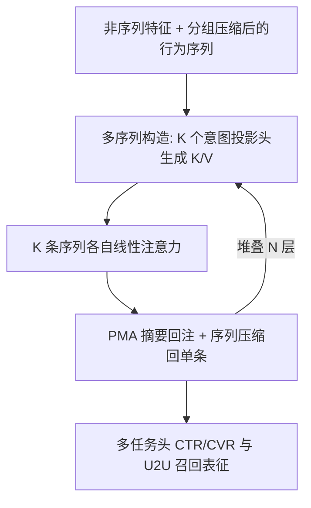

# CMSL: Constructive Multi-Sequence Learning for Recommendation Systems (构造式多序列学习)

- **会议/期刊**: SIGIR 2026
- **作者与机构**: Zikun Cui, Renzhi Wu, Junjie Yang 等（Meta MRS / Meta PyTorch / Meta FB Monetization）
- **推荐链路定位**: 精排（CTR/CVR）+ 召回（U2U Retrieval）
- **研究方向**: 序列与会话推荐 / CTR 预估与特征交叉
- **论文原文**: [https://arxiv.org/abs/2606.28533v2](https://arxiv.org/abs/2606.28533v2)
- **开源代码**: 暂未开源

## TL;DR (1分钟核心速览)

现有序列推荐把用户历史当作 LLM 中的"一句话"做单体建模，但推荐数据缺乏文本的线性语义连贯性，多兴趣混杂导致 **上下文污染 (Context Pollution)**：无关行为争夺同一注意力预算、稀释高意图信号。CMSL 提出"上下文工程"范式——用可学习的多序列构造模块把原始历史在隐空间解耦为 $K$条主题纯净的潜在序列，各自做自注意力，并用线性注意力近似 HSTU 注意力以控制$K$ 倍开销。在 Meta 四个十亿级 DAU 场景上，精排 NE 相对下降 0.31%–0.62%（>0.03% 即显著），召回 A/B 四项指标提升 0.09%–0.17%。

## Background & Motivation (背景与核心矛盾)

- **主流范式**: HSTU、OneTrans、Longer、InterFormer、OneRec 等沿 LLM 路线，把用户历史表示为单一时间序 token 序列，靠更强的 target-aware 注意力、更长上下文窗口或异构特征融合来"从噪声里捞信号"。
- **前人局限**: ① 文本有严格句法与线性语义依赖，而用户足迹是"噪声马赛克"——重叠兴趣、探索性点击、误触混杂，条目间连贯性远弱于 LLM 训练语料；② 单体注意力被迫在同一预算内调和冲突意图（如"编程教程"与"烹饪视频"），产生虚假相关与表征瓶颈，长异构历史上尤为严重。
- **核心洞察 (Key Insight)**: 图 1(a) 的实证显示，向历史注入低信号事件会掉点，而专家手工去噪反而涨点；图 1(b) 进一步表明，即便仅由专家切成两条连贯序列，也已优于单序列基线——说明**瓶颈不在注意力容量，而在上下文的组织方式**。
- **本文切入点**: 把"读一段原始 prompt"改为"构造上下文"：条目 ID 无显式语义、无法人工切分，故用可学习模块在隐空间做**隐式上下文工程**，按 query 自适应地生成多条上下文条件序列。

## Method (核心方法设计)

### 1. 整体框架 (Overall Architecture)

输入分两路：非序列特征（稠密特征归一化后线性投影、稀疏特征查表求和）与按模态分组的多条行为序列（click/like/comment 等）。同组序列先经序列专属 MLP 打分做门控求和压缩为单条 $\bar{X}=\sum_{m=1}^{M}(s^{(m)}\cdot X^{(m)})$，避免逐序列独立建模的开销。随后堆叠$N$层 CMSL Block，每层依次执行：多序列构造（由非序列意图投影出$K$组 K/V，对当前序列生成$K$ 条潜在序列）→ 每条序列内部独立自注意力 → PMA 摘要出定长向量回注下一层非序列特征 → 序列压缩回单条以防序列数逐层爆炸。末层摘要向量拼接后送入多任务头做 CTR/CVR 预测，同一用户表征亦可用于 U2U 召回。

### 2. 关键设计拆解 (Key Designs)

1. **意图感知的多序列构造 (Multi-Sequence Construction)**：痛点是单体序列无法分离冲突意图。做法是用 $K$个投影头把第$l$层非序列表征切成$K$组上下文集合$S^{(l,k)}$，各自投影为$K_{l,k},V_{l,k}$，再以当前序列表征为 query 做多头注意力生成$\tilde{X}^{(l,k)}$。直觉是：非序列特征（场景、人口属性、实时上下文）承载"用户此刻处于哪种意图模式"的先验，用它作透镜去"重读"同一段历史，比在序列内部硬切分更可靠，且天然支持 query-time 自适应策展。

2. **HSTU 注意力的线性化近似 (Linear-Time Attention)**：痛点是 $K$条序列使二次复杂度再乘$K$。HSTU 注意力无行归一化，形式为$\mathrm{SiLU}(M\circ QK^{\top})V$。作者利用 SiLU 的泰勒展开$\mathrm{SiLU}(x^{\top}y)\approx\frac{1}{2}(x^{\top}y)+\frac{1}{4}(x^{\top}y)^2-\frac{1}{48}(x^{\top}y)^4+\cdots$，构造二次多项式核$\phi(x)=[x_1,\dots,x_d,x_1x_2,\dots,x_ix_j,\dots,x_dx_d]\in\mathbb{R}^{d^2+d}$，得到双边界$\phi(x)^{\top}\phi(y)\le\mathrm{SiLU}(x^{\top}y)\le\phi(x)^{\top}\phi(y)+O((x^{\top}y)^3)$。据此把注意力拆成线性项加稀疏大项：$\mathrm{SiLU}(QK^{\top})V\approx\phi(Q)\phi(K)^{\top}V+AV$，其中$A$仅保留$QK^{\top}$ 中的大条目（借鉴 native sparse attention 的核来捕获）。物理直觉：SiLU 的主导贡献来自低阶项，可用核技巧线性化；少数极端大条目单独走稀疏通路，既保住精度又把复杂度降到线性。

3. **摘要与压缩的双向信息流 + 训练目标**：PMA 以当前上下文 $S^{(l,k)}$为 query 从序列中抽取与用户当前状态最相关的行为模式，$h^{(l,k)}=\mathrm{PMA}(Q=S^{(l,k)},K=\bar{X}^{(l,k)},V=\bar{X}^{(l,k)})$，抑制冗余历史向下一层传播；压缩则用$\bar{X}^{(l)}=\mathrm{MLP}([\bar{X}^{(l-1,1)}\|\cdots\|\bar{X}^{(l-1,K)}])$把$K$ 条并回一条，保证每层序列数恒为 1。总损失为多任务加权（CTR/CVR/评论/点赞等）的交叉熵之和，负样本沿用工业流式训练的自然曝光分布（无额外负采样设计），推理侧在 surface 2/3/4 采用**两阶段异步架构**：长上下文 CMSL 用户模型离线/异步产出用户 embedding，主排序路径只做轻量拼接，从而把重计算移出时延敏感链路。

## Experimental Setup & Evaluation Protocol (实验设置与评估协议)

- **数据集与预处理**: 全部为 Meta 生产流量，每实验采样 300–500 亿样本，128 张 H100 混合精度训练并配自定义 kernel。无公开数据集统计表（工业论文特性），序列按共享属性分组后门控压缩。

| 场景 | 任务 | 评估方式 | 架构 |
| :--- | :--- | :--- | :--- |
| Surface 1 | Comment / Like 参与预测 | 离线 Train/Eval NE | 端到端直接训练 CMSL |
| Surface 2/3/4 | CTR / CVR | 线上生产模型 Eval NE | 两阶段异步用户模型 |
| Surface 5 | U2U 召回 | 线上 A/B 四项指标 | CMSL 用户 embedding |

- **数据划分与防穿越 (Splitting Strategy)**: 采用工业标准的**时间切分**（按样本时间先后划分训练/评估），未使用 Leave-One-Out 或比例随机划分。
- **排名评测协议 (Ranking Protocol)**: 精排侧用 **NE (Normalized Entropy)**，越小越好，作者明确说明 Meta 内部 NE 与 A/B 指标高度一致，且 **NE 改善 >0.03% 即视为统计显著**；召回侧因离线-线上一致性差，**直接以线上 A/B 为准**，不做离线采样排序。
- **对比基线与超参设置**: 基线为各场景的**生产环境强序列基线**（HSTU 系单体序列模型），非公开学术基线；序列数 $K$、层数$N$、embedding 维度$d$未在正文披露（工业保密），显著性以 NE 阈值判定而非$p$ 值检验。

## Key Experimental Results (实验关键数据)

### 1. 主实验对比 (Main Results)

表 1：Surface 1 相对生产基线的 NE 变化（%，负值为改善）

| 任务 | Train NE | Eval NE |
| :--- | :---: | :---: |
| Comment | **-0.54** | **-0.62** |
| Like | **-0.31** | **-0.33** |

表 2：Surface 2/3/4 注入 CMSL 用户 embedding 后的 Eval NE 变化（%）

| 场景 | CTR | CVR |
| :--- | :---: | :---: |
| Surface 2 | **-0.12** | **-0.10** |
| Surface 3 | **-0.09** | **-0.06** |
| Surface 4 | **-0.10** | **-0.13** |

表 3：Surface 5 U2U 召回线上 A/B（相对提升）

| Metric 1 | Metric 2 | Metric 3 | Metric 4 |
| :---: | :---: | :---: | :---: |
| **+0.116%** | **+0.158%** | **+0.171%** | **+0.092%** |

### 2. 消融实验 (Ablation Study)

原文**未提供标准消融表**，仅以图 1 的动机实验替代组件级验证：

| 配置 | 效果趋势 | 说明 |
| :--- | :--- | :--- |
| 单序列基线 | 基准 | 单体历史 + 标准注意力 |
| 注入低信号事件 | 下降 | 直接印证上下文污染 |
| 专家手工切两条连贯序列 | 优于基线 | 证明"构造"本身有效，与具体模块无关 |
| 完整 CMSL（可学习 $K$ 序列） | 最优（表 1–3） | 隐式上下文工程替代人工切分 |

### 3. 关键实验发现 (Key Findings)

1. **收益随任务"意图纯度"变化**：Comment 任务 NE 改善 -0.62%，显著大于 Like 的 -0.33%，说明评论行为背后意图更集中、解耦后纯度提升更大；而点赞本身噪声高、多意图混杂，解耦红利被摊薄。
2. **两阶段异步部署几乎不损失信号**：把 CMSL 移出主排序链路后，Surface 2/3/4 的 CTR/CVR 仍稳定取得 -0.06% 至 -0.13% 的 NE 改善，全部超过 0.03% 显著阈值，证明长上下文用户建模可以"离线重算、在线轻拼"而不牺牲效果。
3. **召回侧泛化成立**：同一套用户表征迁移到 U2U 召回，四项线上指标全部显著为正（最高 +0.171%），说明多序列解耦学到的是可迁移的用户意图结构，而非仅拟合精排标签。

## Highlights & Limitations (亮点、对比与审稿批判)

- **与代表作对比 (vs. Prior Work)**: HSTU 用 target-aware 注意力在**单序列内部**挑相关历史，OneTrans/Longer 靠架构与效率扩展上下文窗口，InterFormer 靠异构特征融合增强表达——三者都在"如何更好地读同一条序列"上加码；CMSL 则换瓶颈，在注意力之前**先把一条序列构造成多条**，属于正交且可叠加的改进。相较 SGL/SimGCL 类对比学习增广，本文的"多视图"不是训练期正则，而是推理期真实的多路前向结构。
- **可迁移亮点**: ① 用非序列上下文作 query 生成 K/V 去"重读"历史的构造范式，可直接移植到多场景/跨域序列建模；② SiLU 泰勒展开 + 稀疏大项补偿的线性化思路，对任何无行归一化的注意力变体（如 HSTU 系工业 backbone）都适用。
- **审稿级局限批判**: ① **可复现性薄弱**——无公开数据集、无开源代码、$K$/$N$/$d$与基线细节均未披露，表 1–3 仅有相对 NE 变化而无绝对值，学术侧无法独立验证；② **缺少组件级消融与复杂度实测**，线性注意力近似误差$O((x^{\top}y)^3)$的实际影响、$K$的敏感度曲线、以及$K$ 倍构造带来的显存/吞吐开销均未量化，仅以"已上线"作为工程可行性论据。

## Rating (四维评分)

- **方法创新性 (Novelty)**: ⭐⭐⭐⭐ （"从建模序列到构造上下文"的范式转换清晰有力，多序列构造 + SiLU 核线性化组合新颖，但缺少理论层面的解耦可辨识性分析）
- **评估协议与实验扎实度 (Protocol & Experiments)**: ⭐⭐⭐ （十亿级工业数据与线上 A/B 极具说服力，但无公开数据集、无标准消融表、无绝对值指标，学术可检验性偏弱）
- **写作与数学规范度 (Clarity & Rigor)**: ⭐⭐⭐⭐ （上下文污染的动机论证与图 1 实证到位，线性注意力近似推导链条完整；但关键超参与基线定义留白较多）
- **工业落地与复现价值 (Industrial & Practical Value)**: ⭐⭐⭐⭐ （四场景精排 + 召回全链路落地、两阶段异步架构对时延友好，工程价值极高；可惜未开源，复现门槛高）

