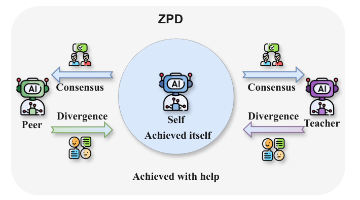
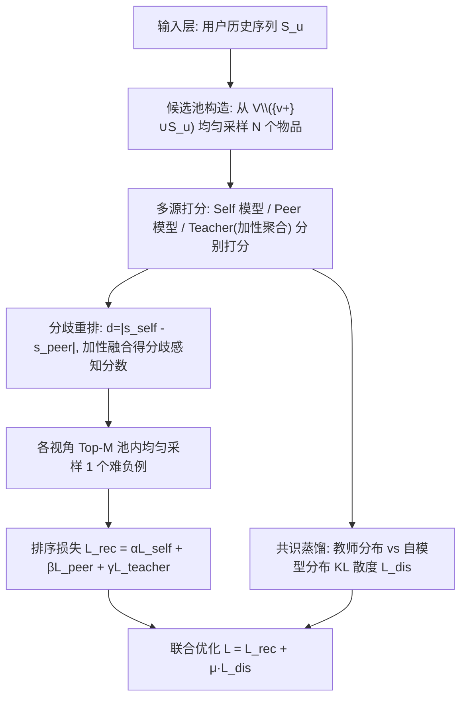
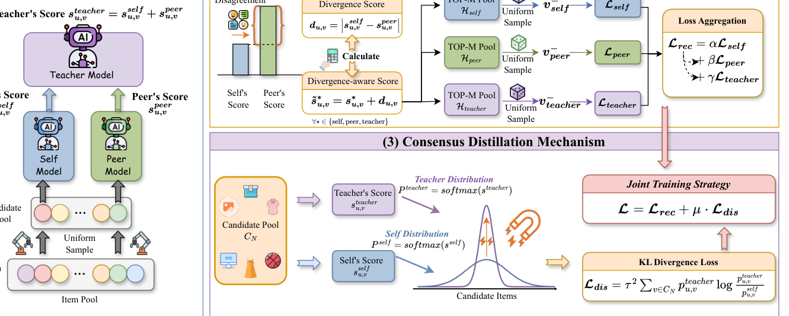
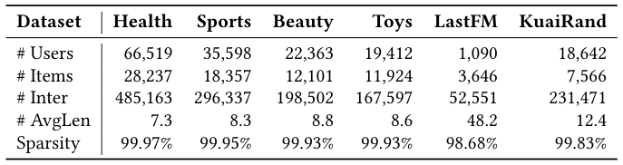
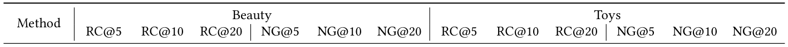
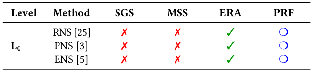
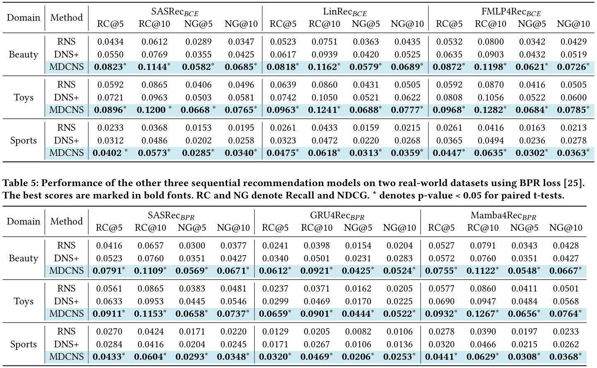

# Divergence Meets Consensus: A Multi-Source Negative Sampling Framework for Sequential Recommendation (分歧遇见共识：面向序列推荐的多源负采样框架)

- **会议/期刊**: SIGIR 2026 (第 49 届国际 ACM SIGIR 会议，Melbourne, VIC, Australia)
- **推荐链路定位**: 召回 (Retrieval) —— 面向序列推荐 Next-Item 预测的训练阶段负采样策略，属于召回/表征学习环节
- **研究方向**: 序列与会话推荐 / 自监督对比学习与交互去噪（负采样与难负例挖掘）
- **论文原文**: [https://arxiv.org/abs/2605.19651v1](https://arxiv.org/abs/2605.19651v1)
- **开源代码**: [https://github.com/Lyz103/SIGIR26-MDCNS](https://github.com/Lyz103/SIGIR26-MDCNS)

## TL;DR (核心速览)

针对序列推荐隐式反馈训练中自引导难负采样 (L1) 的三大痛点——负样本自强化死循环、采样多样性收缩、全候选池打分资源浪费，本文借鉴 Vygotsky 最近发展区 (ZPD) 理论提出 MDCNS：以 Self/Peer/Teacher 三视角多源打分打破闭环，用 Self-Peer 分歧分重排候选以提升多样性，再用 KL 共识蒸馏复用被丢弃的打分信号。在 6 个真实数据集、5 种骨干上一致超越 SOTA 负采样方法，且理论复杂度与 DNS+/MixGCF 同为 $O(Nd)$。

## Background & Motivation (背景与动机)

- **领域背景与主流范式**: 序列推荐 (SR) 以用户历史交互序列 $S_u=[v_1,\dots,v_{|S_u|}]$ 预测下一交互，主流训练依赖隐式反馈（点击/浏览），因此负采样成为构造对比监督的核心机制。作者将现有负采样分为两级：**L0 启发式**（RNS 均匀采样、PNS 流行度采样、ENS 曝光日志采样）与 **L1 自引导难负采样**（DNS、MixGCF、AdaSIR、GNNO、DNS+、SRNS），后者用模型当前参数实时挖掘难负例。
- **现有方法局限 (Limitations of Prior Work)**:
  1. **负样本自强化死循环**：采样策略与模型当前状态紧耦合，选到坏负例 → 梯度更新退化判别力 → 后续采样质量更差，陷入局部最优；
  2. **采样多样性受限**：仅依赖当前参数，负例被限制在模型当前关注的局部物品空间，采样分布逐轮收缩，泛化受损；
  3. **资源分配低效**：为选 1 个难负例需对整池候选打分，绝大多数分数被丢弃，计算开销与信息增益严重不匹配。
- **核心挑战 (Key Challenge)**: 简单增加候选池规模或加深网络无法解决——问题根源在于"采样器与模型"的闭环耦合本身，而非采样容量；单纯引入随机性又会削弱难负例的信息量。
- **核心洞察与切入点 (Key Insight)**: 作者借用教育心理学的 **最近发展区 (ZPD)** 理论（图 1）：最优学习发生在 "Teacher-Peer-Self" 协作三元组中，其驱动力是"拓展边界（分歧）"与"巩固知识（共识）"的动态交互。将这一哲学映射到负采样：多源打分提供外部信号打破闭环（分歧），共识蒸馏把被浪费的打分转化为软监督（共识），从而把学习能力从"自达区"扩展到"潜在区"。

<figure class="paper-figure" markdown="span">
  <figcaption>图 1</figcaption>
</figure>

## Problem Formulation & Method (问题定义与方法架构)

### 1. 符号定义与输入表征 (Notations & Input Representations)

- 用户集 $\mathcal{U}$、物品集 $\mathcal{V}$；用户 $u$ 的时序交互序列 $S_u=[v_1,v_2,\dots,v_{|S_u|}]$，$v_t\in\mathcal{V}$。
- 目标：$\arg\max_{v^*\in\mathcal{V}} P(v_{|S_u|+1}=v^*\mid S_u)$。
- 自模型 $M_{self}$（如 SASRec）、同伴模型 $M_{peer}$（如 Mamba4Rec），二者互为 peer 且训练流程相同；教师模型 $M_{teacher}$ 由二者加性聚合而成。
- 序列表征 $h^{self}_u$、$h^{peer}_u$；物品嵌入 $e_v$（维度 $d$，原文未单独报告具体 $d$ 取值，沿用各骨干默认配置）。

### 2. 整体流水线 (Overall Architecture)

数据流：候选池构造（均匀采样 $N$ 个未观测物品）→ 三视角打分（Self/Peer/Teacher）→ 分歧分重排 → 各视角 Top-$M$ 池内均匀采样 1 个负例 → 排序损失聚合 → 教师分布对候选池做 KL 共识蒸馏 → 联合优化。

<figure class="paper-figure" markdown="span">
  <figcaption>图 2</figcaption>
</figure>

### 3. 核心模块设计与数学原理 (Key Designs & Formulations)

**（1）多源打分 (Multi-source Scoring)**：候选池 $C_N\sim\text{Uniform}(\mathcal{V}\setminus(\{v^+_u\}\cup S_u),N)$；对每个 $v\in C_N$ 计算 $s^{self}_{u,v}=h^{self}_u\cdot e_v$、$s^{peer}_{u,v}=h^{peer}_u\cdot e_v$；教师分数定义为加性聚合 $s^{teacher}_{u,v}=s^{self}_{u,v}+s^{peer}_{u,v}$。物理直觉：引入外部视角注入负信号，切断"采样-更新"闭环，使模型跳出次优态。

**（2）分歧重排 (Divergence Re-ranking)**：分歧分 $d_{u,v}=|s^{self}_{u,v}-s^{peer}_{u,v}|$，分歧感知分数 $\tilde{s}^{*}_{u,v}=s^{*}_{u,v}+d_{u,v},\ \forall *\in\{self,peer,teacher\}$。直觉：两模型打分差异大的物品是"不确定样本"，同时具备高相关性与高视角分歧的候选被排到前面，从而兼顾难度与多样性。随后各视角取 Top-$M$ 池 $\mathcal{H}_*=\text{Top-}M(\{\tilde{s}^{*}_{u,k}\})$，并在池内均匀采样 1 个负例 $v^-_*\sim\text{Uniform}(\mathcal{H}_*)$，以缓解严格难挖掘带来的假阴性问题并注入随机性。

**（3）共识蒸馏 (Consensus Distillation)**：温度缩放 Softmax 得分布 $p^{*}_{u,v}=\exp(s^{*}_{u,v}/\tau)/\sum_{j\in C_N}\exp(s^{*}_{u,j}/\tau)$，$*\in\{self,teacher\}$；以 KL 散度对齐：$\mathcal{L}_{dis}=\tau^2\sum_{v\in C_N}p^{teacher}_{u,v}\log\frac{p^{teacher}_{u,v}}{p^{self}_{u,v}}$。直觉：难采样只用了 1 个样本，其余 $N-1$ 个打分被浪费；蒸馏把教师在整个候选池上的全局排序信号作为软标签保留下来，实现"计算成本的高效利用"。

### 4. 训练目标、负采样与推理复杂度 (Optimization, Negative Sampling & Complexity)

- **损失函数**：$\mathcal{L}_{rec}=\alpha\mathcal{L}_{self}+\beta\mathcal{L}_{peer}+\gamma\mathcal{L}_{teacher}$，其中 $\mathcal{L}_*=\ell(h^{self}_u,e_{v^+_u},e_{v^-_*})$，$\ell(\cdot)$ 可为 BPR 或 BCE；最终 $\mathcal{L}=\mathcal{L}_{rec}+\mu\cdot\mathcal{L}_{dis}$。超参 $\alpha,\beta,\gamma,\mu,\tau$ 及候选池 $N$、Top-$M$ 的具体取值原文正文未完整给出（详见原文附录/超参节）。
- **训练负采样策略**：多源分歧感知难负例挖掘——三视角各自 Top-$M$ 池内均匀采样（非纯贪心 Top-1），兼顾难度、多样性与假阴性抑制；同时以 KL 蒸馏提供免采样的分布级监督。
- **时间与空间复杂度**：多源打分 $O(Nd)$，分歧重排 $O(N\log M)$，蒸馏 $O(N)$；因 $\log M\ll d$，总复杂度 $O(Nd)$，与 DNS+、MixGCF 同阶，**不引入额外渐近开销**。推理阶段仅需自模型单塔打分，不涉及 Beam Search 或额外 ANN 结构（原文未报告具体 ms/request 与峰值显存）。

## Experimental Setup & Evaluation Protocol (实验设置与评估协议)

- **数据集统计与预处理**: 6 个真实数据集，Amazon 系列（Sports/Beauty/Toys/Health）与 KuaiRand、LastFM 均按与先前工作 [16,48] 一致的 **5-core 过滤**（每个 user/item 至少 5 次交互）；LastFM 以用户给艺术家打的标签作为物品属性。

<figure class="paper-figure" markdown="span">
  <figcaption>表 2</figcaption>
</figure>

| 数据集 (Dataset) | 用户数 (#Users) | 物品数 (#Items) | 交互数 (#Interactions) | 稀疏度 (Sparsity) | 平均序列长 (#AvgLen) |
| :--- | :---: | :---: | :---: | :---: | :---: |
| Health | 66,519 | 28,237 | 485,163 | 99.97% | 7.3 |
| Sports | 35,598 | 18,357 | 296,337 | 99.95% | 8.3 |
| Beauty | 22,363 | 12,101 | 198,502 | 99.93% | 8.8 |
| Toys | 19,412 | 11,924 | 167,597 | 99.93% | 8.6 |
| LastFM | 1,090 | 3,646 | 52,551 | 98.68% | 48.2 |
| KuaiRand | 18,642 | 7,566 | 231,471 | 99.83% | 12.4 |

- **数据划分方式 (Splitting Strategy)**: 原文正文（所提供节选）**未明确报告**划分策略；按序列推荐领域惯例应为 Leave-One-Out（末位预测）或时间序切分，具体以原文完整版为准。需注意：候选池构造显式排除 $S_u$ 与 $v^+_u$，从协议上规避了把历史/正样本当负例的泄露。
- **排名评测协议 (Ranking Protocol)**: 原文节选**未明确标注**是 Full-Ranking 还是 Sampled Ranking（正负例比例），需以原文实验节完整描述为准；训练阶段候选池为 $N$ 个均匀采样负例（Eq. 2）。
- **评价指标与显著性检验**: 使用 **Recall (RC)** 与 **NDCG (NG)**；表 3/表 4 中 "*" 表示配对 $t$-检验 $p$-value $<0.05$，即进行了统计显著性检验。Embedding 维度 $d$ 沿用各骨干默认设置（原文未在节选中单列对齐说明）。

## Key Experimental Results (核心实验结果)

### 1. 主实验对比 (Main Results)

原文表 3 报告了 6 个数据集上的性能对比（最优加粗、次优下划线），表 4 报告了不同序列推荐骨干 + BCE 损失下的对比。由于所提供正文节选未包含表 3/表 4 的具体数值单元格，以下仅给出结论性归纳，**具体数值请以原文表格为准，本文不臆造数据**：

<figure class="paper-figure" markdown="span">
  <figcaption>表 3</figcaption>
</figure>

- MDCNS 在 6 个数据集上**一致优于** SOTA 负采样基线（L0：RNS/PNS/ENS；L1：DNS/MixGCF/AdaSIR/GNNO/DNS+/SRNS），最优与次优分别以加粗/下划线标注，且带 "*" 的结果通过配对 $t$-检验 ($p<0.05$)。
- 表 1 的特性对比显示：MDCNS 是唯一同时具备 SGS（自引导采样）、MSS（多源打分）、ERA（高效资源分配）三项能力的方法（L2 级），PRF 列获得三颗 ❍，而 L0 仅 ERA、L1 仅 SGS。

<figure class="paper-figure" markdown="span">
  <figcaption>表 1</figcaption>
</figure>

### 2. 消融实验与控制变量分析 (Ablation Study)

原文以 RQ3 提出组件消融问题，但所提供节选未包含消融表格数值。从方法结构可推断消融应覆盖：去除 Peer/Teacher 多源打分（退化为 L1 自引导）、去除分歧重排项 $d_{u,v}$、去除共识蒸馏 $\mathcal{L}_{dis}$ 三个变体。**具体下降幅度原文节选未报告**；是否严格控制参数量/图度数等对照变量亦需以原文完整消融节为准。

### 3. 稀疏度/冷启动分桶与超参敏感度 (Sparsity Buckets & Hyperparameters)

- **稀疏度分桶**: 原文节选**未报告**按用户/物品交互频次分桶的长尾分析；但数据集稀疏度跨度大（98.68%–99.97%），跨 6 数据集的一致性提升可间接说明对稀疏场景的鲁棒性。
- **关键超参数敏感度**: 涉及温度 $\tau$（控制蒸馏分布锐度与梯度幅值）、蒸馏权重 $\mu$、三视角损失权重 $\alpha/\beta/\gamma$、候选池 $N$ 与 Top-$M$；原文以 RQ4 讨论训练过程中损失演化，但节选未给出敏感度曲线数值。
- **线上 A/B 测试结果**: 原文仅包含离线实验，**未报告线上 A/B 测试**。

## Highlights, Limitations & Critiques (亮点、局限与审稿级批判)

- **核心亮点与可迁移性**:
  1. **"分歧-共识"双驱动范式**具有强普适性：分歧分 $|s^{self}-s^{peer}|$ 作为"不确定性/信息量"代理，可迁移到对比学习数据增广、跨域蒸馏、多模态对齐中的样本筛选；
  2. **计算复用思想**：把难采样本要丢弃的 $N-1$ 个打分通过 KL 蒸馏转为软监督，是"零额外渐近开销换性能"的优雅设计，对工业训练效率友好；
  3. **模型无关性**：在 5 种骨干（SASRec、Mamba4Rec 等）与 BPR/BCE 两种损失下均有效，泛化证据较充分。
- **局限性与审稿视角批判 (Critical Limitations)**:
  1. **双模型训练成本被复杂度分析"掩盖"**：$O(Nd)$ 的渐近阶虽与 DNS+ 相同，但 MDCNS 需同时维护 Self 与 Peer 两个完整序列模型（外加教师聚合），实际显存与单 epoch 墙钟时间约为单模型的 2 倍，原文未报告实际耗时/显存对比，这是审稿人最可能追问的点；
  2. **Peer 模型选择缺乏原则性指导**：为何选 Mamba4Rec 作 peer？peer 与 self 的架构差异度如何影响分歧分质量？原文未做 peer 选择的敏感性分析；
  3. **评估协议透明度不足**：节选未明确 Full-Ranking vs Sampled Ranking、数据划分方式与 embedding 维度，削弱了结果的可复现性与跨论文可比性；
  4. **理论包装偏重**：ZPD 教育学类比提供了叙事美感，但方法本质是"双模型分歧 + 集成蒸馏"的标准集成学习思路，理论贡献更多是视角而非新定理；
  5. **假阴性风险仅靠 Top-$M$ 内随机采样缓解**，缺乏对负例真实标签的显式校验机制。

## Rating (四维评分)

- **方法创新性 (Novelty)**: ⭐⭐⭐⭐（多源分歧重排 + 共识蒸馏的组合有巧思，但组件本身在集成学习/蒸馏中不算全新）
- **评估协议与实验扎实度 (Protocol & Experiments)**: ⭐⭐⭐⭐（6 数据集 × 5 骨干 × 2 损失 + 配对 $t$-检验较扎实，但划分/排序协议披露不足、缺实际开销对比）
- **写作与数学规范度 (Clarity & Rigor)**: ⭐⭐⭐⭐（公式与算法 1 清晰完整，复杂度分析规范；ZPD 类比略冗余）
- **工业落地与复现价值 (Industrial & Practical Value)**: ⭐⭐⭐⭐（代码已开源、模型无关、无额外渐近开销；但双模型训练成本是落地主要门槛）

## 论文图表

<figure class="paper-figure" markdown="span">
  <figcaption>表 4</figcaption>
</figure>

