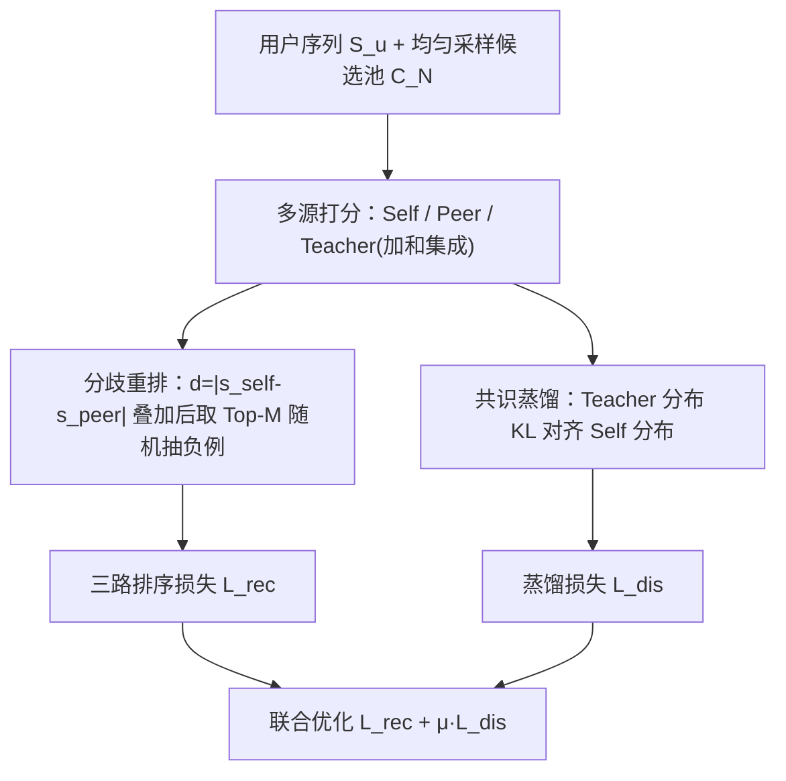

# Divergence Meets Consensus: A Multi-Source Negative Sampling Framework for Sequential Recommendation (分歧遇见共识：面向序列推荐的多源负采样框架)

- **会议/期刊**: SIGIR 2026
- **作者与机构**: Yuanzi Li, Lingjie Wang, Jingyu Zhao, Zihang Tian, Yuhan Wang, Lei Wang, Xu Chen（中国人民大学、山东大学、北京大学）
- **推荐链路定位**: 召回（序列下一物品预测的训练阶段）
- **研究方向**: 序列与会话推荐 / 自监督对比学习与交互去噪
- **论文原文**: [https://arxiv.org/abs/2605.19651v1](https://arxiv.org/abs/2605.19651v1)
- **开源代码**: [https://github.com/Lyz103/SIGIR26-MDCNS](https://github.com/Lyz103/SIGIR26-MDCNS)

## TL;DR (1分钟核心速览)

隐式反馈序列推荐中，主流 L1 级"自引导难负采样"（DNS/DNS+/MixGCF）存在三大痼疾：采样与参数更新耦合形成负向自强化死循环、仅依赖当前模型导致采样多样性坍缩、为选一个负例却要打分整个候选池造成算力浪费。本文提出 MDCNS，以 Vygotsky "最近发展区"理论为隐喻构建 Teacher-Peer-Self 三视角：多源打分注入外部信号打破闭环，分歧重排用 Self-Peer 打分差提升多样性，共识蒸馏用 KL 把教师在全候选池上的分布作为软目标回收算力。在 6 个真实数据集、5 种骨干、BCE/BPR 两种损失下，采用 70/20/10 比例划分 + Full-Ranking 协议，Recall@20 相对最强基线最高提升 27.29%（Beauty），NDCG@20 提升 36.44%。

## Background & Motivation (背景与核心矛盾)

- **主流范式**: 序列推荐在隐式反馈下依赖负采样构造对比监督。L0 启发式（RNS/PNS/ENS）高效但负例信息量低、梯度易消失；L1 自引导难负采样（DNS、MixGCF、AdaSIR、GNNO、DNS+、SRNS）用当前参数实时挑"最难"候选，成为事实标准。
- **前人局限**: 其一，采样策略与模型状态紧耦合，选到坏负例→梯度退化→后续采样更差，形成**负向自强化死循环**并陷入局部最优；其二，仅凭当前参数在模型已关注的局部物品空间内采样，**分布逐轮收缩、多样性丧失**；其三，为挑 1 个负例需对整池打分，**绝大多数分数被丢弃**，算力与信息增益严重失衡。
- **核心洞察 (Key Insight)**: 作者借 ZPD 教育学理论指出，最优学习不来自孤立自学，而来自"教师-同伴-自我"协作中**边界扩张（分歧）与知识巩固（共识）**的动态张力；L1 的病灶恰是"只有自我、没有他者"。
- **本文切入点**: 用同伴模型与集成教师模型引入外部视角打破闭环，用视角间分歧定义"不确定样本"扩充多样性，用教师分布蒸馏把被丢弃的打分转化为训练信号。

## Method (核心方法设计)

### 1. 整体框架 (Overall Architecture)

MDCNS 以 SASRec 为 Self 模型、Mamba4Rec 为 Peer 模型（二者互为同伴、训练流程相同），Teacher 定义为二者打分的加和集成。每步训练先对用户序列均匀采样 $N$个未交互物品构成候选池，三视角分别打分；随后计算 Self 与 Peer 的打分绝对差作为分歧分，叠加到三视角原始分上重排，各视角从 Top-$M$ 中均匀抽 1 个负例构成三路排序损失；同时把 Teacher 与 Self 在候选池上的温度 Softmax 分布做 KL 对齐，作为辅助蒸馏损失联合优化。推理阶段仅用 Self 模型，无额外开销。

<figure class="paper-figure" markdown="span">
  <figcaption>图2：MDCNS的整体框架。(1) 多源评分，构建候选池并从自我、同伴和教师视角生成相关性评分信号；(2) 分歧重排序，量化自我模型与同伴模型之间的视图分歧分数以对候选重新排序，并从Top-M列表中采样多样化的难负例；以及(3) 共识蒸馏，利用教师在整个候选池上的分布作为软目标来指导自我模型，有效获取共识知识，同时缓解资源低效问题</figcaption>
</figure>

### 2. 关键设计拆解 (Key Designs)

1. **多源打分（Multi-source Scoring，打破自强化闭环）**：痛点在于单模型自采样形成闭环反馈。本文对候选池 $C_N \sim \mathrm{Uniform}(\mathcal{V}\setminus(\{v_u^+\}\cup S_u), N)$分别用 Self 与 Peer 编码打分$s^{self}_{u,v}=h^{self}_u\cdot e_v$、$s^{peer}_{u,v}=h^{peer}_u\cdot e_v$，并令教师为加和集成$s^{teacher}_{u,v}=s^{self}_{u,v}+s^{peer}_{u,v}$。直觉上，异构架构（Transformer vs. SSM）的归纳偏置差异天然提供"他者视角"，使负例不再由单一模型的偏置主导。

2. **分歧重排（Divergence Re-ranking，恢复采样多样性）**：痛点在于难负例集中在模型已高分的狭窄区域。本文把两视角打分绝对差定义为分歧分 $d_{u,v}=|s^{self}_{u,v}-s^{peer}_{u,v}|$，并构造分歧感知分数$\tilde{s}^{*}_{u,v}=s^{*}_{u,v}+d_{u,v},\ \forall *\in\{self,peer,teacher\}$，再对每个视角取 Top-$M$后**均匀随机抽 1 个**：$v^-_* \sim \mathrm{Uniform}(\mathrm{Top\text{-}}M(\{\tilde{s}^{*}_{u,k}\}))$。分歧大意味着两模型"意见不合"，即决策边界附近的**不确定样本**，既难又有信息量；Top-$M$ 内随机化则缓解严格难挖掘带来的假阴性风险。

3. **共识蒸馏与训练目标（Consensus Distillation，回收算力）**：痛点在于候选池打分只用一个负例、其余分数全废。本文用温度 Softmax 把教师与自我打分转为分布 $p^{*}_{u,v}=\exp(s^{*}_{u,v}/\tau)/\sum_{j\in C_N}\exp(s^{*}_{u,j}/\tau)$，以 KL 散度对齐：$\mathcal{L}_{dis}=\tau^2\sum_{v\in C_N}p^{teacher}_{u,v}\log\frac{p^{teacher}_{u,v}}{p^{self}_{u,v}}$。总损失为$\mathcal{L}=\mathcal{L}_{rec}+\mu\mathcal{L}_{dis}$，其中$\mathcal{L}_{rec}=\alpha\mathcal{L}_{self}+\beta\mathcal{L}_{peer}+\gamma\mathcal{L}_{teacher}$，$\ell(\cdot)$可为 BPR 或 BCE。负采样为"候选池均匀采样 + 分歧重排 Top-$M$随机抽取"，无需全库打分；整体复杂度$O(Nd)$，与 DNS+/MixGCF 同阶，无渐近额外开销。

## Experimental Setup & Evaluation Protocol (实验设置与评估协议)

- **数据集与预处理**: 四个 Amazon 品类（5-core 过滤）+ LastFM + KuaiRand，均经相同预处理：

| 数据集 | #Users | #Items | #Interactions | 稀疏度 | 特征/场景说明 |
| :--- | :---: | :---: | :---: | :---: | :--- |
| Beauty | 22,363 | 12,101 | 198,502 | 99.93% | Amazon 美妆评论 |
| Sports | 35,598 | 18,357 | 296,337 | 99.95% | Amazon 运动户外 |
| Toys | 19,412 | 11,924 | 167,597 | 99.93% | Amazon 玩具游戏 |
| Health | 66,519 | 28,237 | 485,163 | 99.97% | Amazon 健康个护 |
| LastFM | 1,090 | 3,646 | 52,551 | 98.68% | 音乐艺人标签，平均序列长 48.2 |
| KuaiRand | 18,642 | 7,566 | 231,471 | 99.83% | 快手随机曝光日志 |

- **数据划分与防穿越 (Splitting Strategy)**: 采用**比例划分**，70% 训练 / 20% 验证 / 10% 测试；验证集早停（patience=30），测试集报告三次独立运行均值。
- **排名评测协议 (Ranking Protocol)**: 无偏 **Full-Ranking（全库未交互物品排序）**，指标 Recall@K 与 NDCG@K，$K\in\{5,10,20\}$；推理仅用 Self 模型。
- **对比基线与超参设置**: 基线含 RNS（L0）与 DNS、MixGCF、AdaSIR、GNNO、DNS+、MixGCF+、SRNS（L1）；骨干覆盖 FMLP4Rec、GRU4Rec、SASRec、LinRec、Mamba4Rec；Embedding 维度 $d=64$，batch=1024，Adam(lr=0.001)，候选池$N=100$，$M\in\{1,\dots,5\}$，$\alpha,\beta,\gamma\in[0.5,3.0]$步长 0.5，$\tau\in\{0.7,1.0,10.0\}$，$\mu=1$；配对 t 检验$p<0.05$。

## Key Experimental Results (实验关键数据)

### 1. 主实验对比 (Main Results)

SASRec(BCE) + Mamba4Rec(Peer) 配置下（节选 Beauty / Toys / Sports / LastFM / KuaiRand）：

| 数据集 | 方法 | R@5 | R@10 | R@20 | N@5 | N@10 | N@20 |
| :--- | :--- | :---: | :---: | :---: | :---: | :---: | :---: |
| Beauty | SRNS（最强基线） | 0.0487 | 0.0742 | 0.1180 | 0.0334 | 0.0416 | 0.0527 |
| Beauty | **MDCNS** | **0.0823** | **0.1144** | **0.1502** | **0.0582** | **0.0685** | **0.0775** |
| Beauty | Improv. | +39.49% | +33.95% | +27.29% | +39.56% | +37.83% | +36.44% |
| Toys | SRNS | 0.0772 | 0.0978 | 0.1308 | 0.0521 | 0.0586 | 0.0668 |
| Toys | **MDCNS** | **0.0896** | **0.1200** | **0.1447** | **0.0668** | **0.0765** | **0.0828** |
| Toys | Improv. | +16.06% | +21.33% | +7.66% | +28.21% | +30.55% | +22.49% |
| Sports | DNS+ | 0.0312 | 0.0486 | 0.0713 | 0.0202 | 0.0258 | 0.0316 |
| Sports | **MDCNS** | **0.0402** | **0.0573** | **0.0806** | **0.0285** | **0.0340** | **0.0398** |
| Sports | Improv. | +23.31% | +17.18% | +13.04% | +32.46% | +26.39% | +25.18% |
| LastFM | GNNO | 0.1185 | 0.1879 | 0.2692 | 0.0790 | 0.1013 | 0.1218 |
| LastFM | **MDCNS** | **0.1363** | **0.2033** | **0.2869** | **0.0915** | **0.1131** | **0.1342** |
| LastFM | Improv. | +15.02% | +8.20% | +6.58% | +15.82% | +11.65% | +10.18% |
| KuaiRand | DNS+ | 0.0542 | 0.0923 | 0.1416 | 0.0344 | 0.0459 | 0.0592 |
| KuaiRand | **MDCNS** | **0.0617** | **0.0992** | **0.1592** | **0.0368** | **0.0487** | **0.0637** |
| KuaiRand | Improv. | +12.59% | +7.48% | +11.64% | +6.98% | +6.10% | +7.60% |

跨骨干泛化（BCE，Beauty）：LinRec 上 R@5 从 DNS+ 的 0.0617 升至 **0.0818**，FMLP4Rec 上从 0.0635 升至 **0.0872**；BPR 下 GRU4Rec 在 Toys 上 R@5 从 0.0299 升至 **0.0659**，Mamba4Rec 在 Beauty 上从 0.0572 升至 **0.0755**，全部 $p<0.05$。

### 2. 消融实验 (Ablation Study)

| 变体 | Beauty R@5 | Beauty N@5 | Toys R@5 | Toys N@5 | Sports R@5 | Sports N@5 |
| :--- | :---: | :---: | :---: | :---: | :---: | :---: |
| MDCNS（完整） | **0.0823** | **0.0582** | **0.0896** | **0.0668** | **0.0402** | **0.0285** |
| w/o CD | 0.0697 | 0.0491 | 0.0860 | 0.0600 | 0.0368 | 0.0256 |
| w/o CD-DR | 0.0599 | 0.0434 | 0.0819 | 0.0585 | 0.0343 | 0.0226 |
| w/o CD-DR-MS（退化为 DNS+） | 0.0550 | 0.0355 | 0.0721 | 0.0503 | 0.0312 | 0.0202 |

### 3. 关键实验发现 (Key Findings)

1. **三组件呈"叠加式"贡献，MS 是地基**：Beauty 上去掉 CD 掉 15.31%（R@5），再去掉 DR 掉 27.22%，全部退化为 DNS+ 后掉 33.17%；说明多源打分打破闭环是主要增益来源，分歧重排与蒸馏在其上继续放大收益，三者缺一不可。
2. **弱同伴也能打，鲁棒性来自机制而非同伴强度**：以 GRU4Rec 替代 Mamba4Rec 作 Peer（MDCNSwts），在 Sports（R@5 0.0433 vs. 0.0402）与 LastFM（0.1384 vs. 0.1363）上甚至反超完整版，Beauty/Toys 略降但仍远超基线——证明分歧重排引入的多样性与难度不依赖强同伴。
3. **蒸馏损失不收敛反而是好事**：图 3 显示 BCE 与总损失单调下降并稳定，但 KD 损失全程保持显著量级甚至扩大；作者归因于分歧重排持续阻止 Teacher 与 Self 表征同质化，使教师能长期提供有信息量的梯度，从优化动力学角度反证了分歧机制的有效性。

## Highlights & Limitations (亮点、对比与审稿批判)

- **与代表作对比 (vs. Prior Work)**: 与 DNS/DNS+ 的本质区别在于负例不再由单一模型自产——DNS+ 仅靠 Top-$M$随机化缓解假阴性，仍困于自强化闭环；与 MixGCF 的图混合增广相比，MDCNS 不依赖交互图且天然支持异构骨干；与 GNNO/SRNS 的假阴性抑制路线相比，本文同时解决闭环、多样性与算力浪费三个正交问题，且复杂度同为$O(Nd)$。
- **可迁移亮点**: ①"分歧分叠加进相关性分"是一个极轻量的不确定性度量，可直接移植到 CTR 精排的难样本挖掘或主动学习；②把候选池打分的"废料"用 KL 蒸馏回收，可迁移到任何需要池化打分的采样框架（如对比学习负采样、重排蒸馏）。
- **审稿级局限批判**: ①训练期需同时维护 Self/Peer/Teacher 三套前向，显存与算力开销约为单模型 2 倍，论文仅在结论中承认"未来探索更轻量替代"，缺少训练 wall-clock 与显存实测；②教师定义为简单加和集成，缺乏对加权/学习式集成的探索，且 $\alpha,\beta,\gamma,\tau$ 四组超参需网格搜索，跨数据集敏感性未做系统分析；③评测仅覆盖公开离线全库排序，无线上 A/B 或工业级延迟数据。

## Rating (四维评分)

- **方法创新性 (Novelty)**: ⭐⭐⭐⭐ （以 ZPD 教育学隐喻系统对应三个工程病灶，分歧分 + 共识蒸馏的组合简洁自洽，但单点算子本身不算全新）
- **评估协议与实验扎实度 (Protocol & Experiments)**: ⭐⭐⭐⭐⭐ （6 数据集 × 5 骨干 × 2 损失 + Full-Ranking + 配对 t 检验 + 弱到强设定 + 完整消融，覆盖度在负采样论文中属上乘）
- **写作与数学规范度 (Clarity & Rigor)**: ⭐⭐⭐⭐ （公式与算法伪代码清晰、复杂度分析到位，但 ZPD 理论映射偏修辞，缺少对分歧分有效性的理论刻画）
- **工业落地与复现价值 (Industrial & Practical Value)**: ⭐⭐⭐⭐ （代码已开源、推理零额外开销、即插即用；扣分在于训练期双模型前向的工程成本与超参调优负担）
