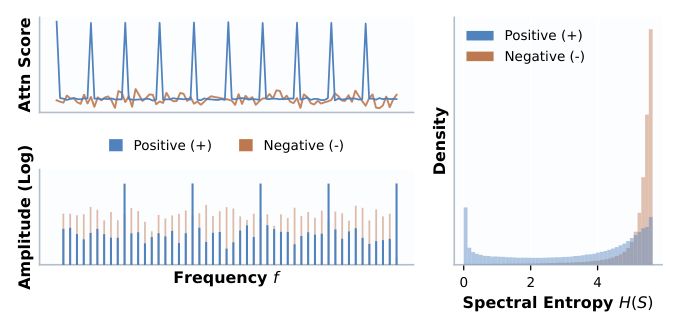
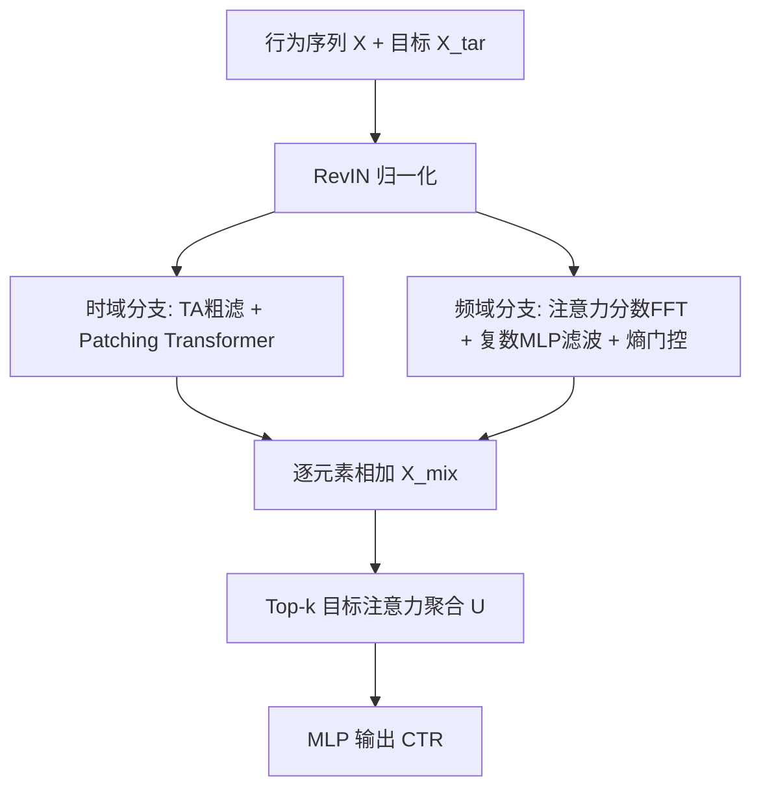
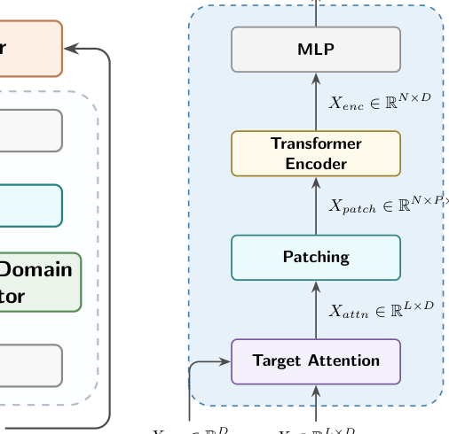

# FEDIN: Frequency-Enhanced Deep Interest Network for Click-Through Rate Prediction (频率增强深度兴趣网络)

- **会议/期刊**: SIGIR 2026
- **作者与机构**: Zenan Dai, Jinpeng Wang, Junwei Pan, Dapeng Liu, Lei Xiao, Shu-Tao Xia（清华大学深圳国际研究生院、哈工大深圳、腾讯）
- **推荐链路定位**: 精排（CTR 预估）
- **研究方向**: 序列与会话推荐 / CTR 预估与特征交叉
- **论文原文**: [https://arxiv.org/abs/2605.01726v1](https://arxiv.org/abs/2605.01726v1)
- **开源代码**: [https://github.com/otokoneko/FEDIN](https://github.com/otokoneko/FEDIN)

## TL;DR (1分钟核心速览)

时域序列模型（DIN/DIEN/Transformer）对用户行为中的点状噪声敏感，难以解耦稳定周期兴趣；已有频域方法（FMLP-Rec/FEARec/DIFF）对用户序列做**目标无关**的频谱滤波，忽略了"同一序列对不同候选物品应呈现不同频谱"这一事实。本文先给出经验观察：以正样本为条件时，目标注意力分数在频域呈现**低熵、集中的共振峰**，负样本则近似白噪声高熵分布。据此提出 FEDIN：对注意力分数（而非原始序列）做 FFT 得到目标条件化频谱，经复数 MLP 可学习滤波 + 频谱熵自适应门控，与时域 Patching-Transformer 分支并行融合。在 Tmall/Alipay/Taobao 三数据集上，GAUC 相对最优基线提升 1.11%/0.67%/0.22%，AUC 提升 1.48%/0.09%/0.65%。

## Background & Motivation (背景与核心矛盾)

- **主流范式**: Embedding&MLP + 目标注意力（DIN/BST）或序列编码器（GRU4Rec/SASRec/BERT4Rec）从行为序列抽取用户兴趣；频域路线（FMLP-Rec、FEARec、DIFF）用 FFT + 可学习/多序列滤波抑制随机噪声。
- **前人局限**: ① 纯时域模型对点状噪声敏感，长序列中稳定周期习惯与随机点击难以解耦；② 频域方法对**原始行为序列**做变换，滤波与候选物品无关——而用户序列是多态的，脱离目标上下文无法区分"真信号频段"与"背景噪声频段"。
- **核心洞察 (Key Insight)**: 把标准目标注意力的分数投影到频域后，正样本条件引发明显周期性共振（频谱峰集中、熵低），负样本条件则呈高熵白噪声状（图 1）。即**目标物品本身是一个天然的频率选择器**。
- **本文切入点**: 将 FFT 施加于目标条件化的注意力分数而非原始序列，用可学习复数滤波 + 熵驱动门控提取周期兴趣，并与时域分支互补融合。

<figure class="paper-figure" markdown="span">
  <figcaption>图1：目标条件化频谱模式的经验观察。（左）不同目标下注意力分数的案例对比：正样本倾向于在用户序列中引发更明显的周期性共振，表现为集中的频谱峰。（右）各数据集上频谱熵𝐻(𝑆) = −Í𝑝𝑘log2 𝑝𝑘的统计分布，表明正样本相比负样本总体呈现更低的熵特征。</figcaption>
</figure>

## Method (核心方法设计)

### 1. 整体框架 (Overall Architecture)

输入为用户行为序列 $\mathbf{X}\in\mathbb{R}^{L\times D}$ 与目标物品 $\mathbf{X}_{tar}\in\mathbb{R}^{D}$。先经 RevIN 缓解行为分布漂移与非平稳性；随后双分支并行：时域分支做"目标注意力粗滤 + Patching Transformer 细粒度演化建模"，频域分支做"目标条件化频谱生成 + 复数 MLP 滤波 + 自适应共振缩放"；两分支逐元素相加得 $\mathbf{X}_{mix}$，最后由 Top-$k$ 目标注意力聚合为用户兴趣 $\mathbf{U}$，接 MLP 输出 CTR。双分支完全解耦、可并行执行，频域分支复杂度 $O(L\log L)$，优于自注意力的 $O(L^2)$。

<figure class="paper-figure" markdown="span">
  <figcaption>图2：FEDIN的架构。</figcaption>
</figure>

### 2. 关键设计拆解 (Key Designs)

1. **目标条件化频谱生成（Target-Aware Spectrum）**：痛点在于 DIFF 等对原始序列做 FFT，频谱与候选物品无关。本文先算原始注意力分数 $\mathbf{X}_{score}=\mathbf{X}\mathbf{X}_{tar}^{\top}/\alpha$，对其做 FFT 得 $\hat{\mathbf{X}}_{score}=\mathcal{F}(\mathbf{X}_{score})$，再以幅度谱 Softmax 作为频域权重调制序列频谱：
$$\hat{\mathbf{X}}_{attn}=\mathrm{Softmax}\big(\mathrm{Amp}(\hat{\mathbf{X}}_{score})\big)\otimes\mathcal{F}(\mathbf{X})$$
直觉：Softmax 幅度谱等价于一个"目标激活的频率掩码"，只在用户与目标强共振的频段保留能量，从而把目标上下文注入频域分析。

2. **可学习复数谱滤波 + 自适应共振缩放**：固定滤波器无法适配不同用户-目标对的周期结构，故用复数 MLP 在频域做非线性映射 $\hat{\mathbf{X}}_{freq}=\mathcal{F}^{-1}\big(\mathrm{MLP}(\hat{\mathbf{X}}_{attn})\big)$，严格保留相位-幅度耦合。但并非所有用户-目标对都有强周期性，故以频谱清晰度做门控：
$$\mathbf{X}_{freq}=\mathrm{Sigmoid}\big(\mathrm{MLP}(\mathrm{Amp}(\hat{\mathbf{X}}_{score}))\big)\cdot\hat{\mathbf{X}}_{freq}$$
低熵（共振清晰）时放大频域贡献，否则回退到时域——这正是对"正样本低熵"经验规律的显式建模。

3. **训练目标、负采样与推理效率**：CTR 二分类交叉熵（FuxiCTR 框架默认），无显式负采样（曝光日志即负样本）；时域分支用非重叠 Patching（$P$ 为 patch 大小）将 Transformer 输入从 $L$ 降至 $N=L/P$，频域分支 $O(L\log L)$，双分支并行，实时推理开销可控。聚合端 Top-$k$ 目标注意力通过将非 top-$k$ 分数置 $-\infty$ 再 Softmax 保证可微，借鉴多任务"隔离参数防跷跷板"思想，避免弱兴趣信号稀释预测。

## Experimental Setup & Evaluation Protocol (实验设置与评估协议)

- **数据集与预处理**: 三个阿里系公开数据集，未做 5-core 过滤（工业日志原始分布）：

| 数据集 | 场景说明 | 特征/序列 |
| :--- | :--- | :--- |
| Tmall | 天猫电商行为 | 行为序列 + 目标物品，最大长度 100 |
| Taobao | 淘宝电商行为 | 同上 |
| Alipay | 支付宝行为 | 同上，稀疏度与行为复杂度更高 |

- **数据划分与防穿越 (Splitting Strategy)**: 按**全局时间戳**切分为 train/valid/test，严格防穿越。
- **排名评测协议 (Ranking Protocol)**: 采用 CTR 场景标准 **AUC 与 GAUC**（用户级分组 AUC），非全库 ranking 指标；GAUC 对用户内排序更敏感，契合精排目标。
- **对比基线与超参设置**: 基线含 Sum Pooling、DIN、DIEN、SASRec、BERT4Rec、GRU4Rec、BST、DIFF（DIFF 原为 next-item 任务，被改造为带候选物品 MLP 头的 CTR 版本）。统一 FuxiCTR 实现，Adam，lr $5e{-4}$，batch 2048，Embedding 维度 $d=32$，序列长度 100；显著性 $p<0.05$。

## Key Experimental Results (实验关键数据)

### 1. 主实验对比 (Main Results)

| Model | Tmall GAUC | Tmall AUC | Alipay GAUC | Alipay AUC | Taobao GAUC | Taobao AUC |
| :--- | :---: | :---: | :---: | :---: | :---: | :---: |
| Sum Pooling | 0.8978 | 0.8873 | 0.8557 | 0.8535 | 0.9345 | 0.9337 |
| DIN | 0.9547 | 0.9518 | 0.8897 | 0.8832 | 0.9689 | 0.9664 |
| DIEN | 0.9237 | 0.9157 | 0.8980 | 0.8953 | 0.9443 | 0.9442 |
| SASRec | 0.9183 | 0.9246 | 0.9238 | 0.9312 | 0.9583 | 0.9584 |
| GRU4Rec | 0.9210 | 0.9242 | 0.9268 | 0.9289 | 0.9618 | 0.9638 |
| BST | 0.9233 | 0.9269 | 0.9264 | 0.9285 | 0.9562 | 0.9576 |
| DIFF | 0.8513 | 0.8618 | 0.8962 | 0.8995 | 0.9463 | 0.9475 |
| **FEDIN** | **0.9658\*** | **0.9666\*** | **0.9335\*** | **0.9320\*** | **0.9740\*** | **0.9729\*** |
| Improv. (GAUC/AUC) | +1.11% / +1.48% | | +0.67% / +0.09% | | +0.22% / +0.65% | |

### 2. 消融实验 (Ablation Study)

| 变体 | Tmall GAUC | Alipay GAUC | Taobao GAUC | Taobao AUC |
| :--- | :---: | :---: | :---: | :---: |
| FEDIN 完整 | **0.9658** | **0.9335** | **0.9740** | **0.9729** |
| w/o Time-Domain Branch | 0.9482 | 0.9253 | 0.9674 | 0.9669 |
| w/o Freq-Domain Branch | 0.9605 | 0.9270 | 0.9727 | 0.9715 |
| w/o Freq-Domain TA（静态可学习滤波替代目标条件谱） | 0.9614 | 0.9327 | 0.9732 | 0.9724 |
| w/o Freq-Domain Scaling（去熵门控） | 0.9625 | 0.9303 | 0.9662 | 0.9655 |

### 3. 关键实验发现 (Key Findings)

1. **双分支互补且时域更"刚需"**：去掉时域分支在 Tmall 上 GAUC 掉 1.76pt（0.9658→0.9482），掉幅大于去频域分支的 0.53pt，说明局部序列演化仍是 CTR 主信号，频域提供的是增益而非替代；但两者缺一均降，验证互补性。
2. **"目标条件化"是频域分支的命门**：将目标条件谱换成静态可学习滤波（w/o Freq-Domain TA）后，Tmall GAUC 降 0.44pt、Alipay AUC 降 0.27pt，直接证实"脱离目标做频谱分析"次优，目标物品作为频率选择器的假设成立。
3. **熵门控对稀疏场景收益最大**：去掉自适应缩放后 Alipay GAUC 降 0.32pt（0.9335→0.9303），而 Taobao 仅降 0.78pt 于 AUC 但 GAUC 降 0.78pt，说明在行为复杂度高、周期性弱的场景中，"按频谱清晰度动态调节频域依赖"比无条件融合更关键；抗噪实验（图 4）进一步显示随噪声率 $\rho$ 升至 0.8，频域分支相对性能衰减显著慢于时域分支。

## Highlights, Limitations & Rating (亮点、对比与审稿评价)

- **与代表作对比 (vs. Prior Work)**: 与 DIN 的本质区别是把目标注意力从"加权池化"改为"频域频率选择器"，并保留加权序列供细粒度演化建模；与 DIFF/FMLP-Rec 的本质区别是频谱变换对象从原始序列变为**目标条件化注意力分数**，且滤波为复数 MLP 而非固定/多序列滤波；与 SASRec/BERT4Rec 的区别是显式引入全局周期视角对抗点状噪声。
- **可迁移亮点**: ① "对注意力分数而非原始输入做频域变换"可迁移到多模态序列、会话推荐等任意带 target attention 的结构；② 用频谱熵做门控的"按信号清晰度动态加权子分支"思路，可复用到多行为/多场景融合。
- **审稿级局限批判**: ① 仅在三个阿里系电商/支付数据集验证，Embedding 维度仅 32、序列长度 100，长序列（$L\gg100$）下 FFT 与 Patching 的收益边界未探明；② 频域分支引入 FFT + 复数 MLP + 双分支并行，工业级 QPS 约束下的实际延迟与显存开销缺少线上 A/B 与吞吐报告；③ 频谱熵门控依赖超参 $k$ 与 patch size，图 3 显示二者均存在明显最优点，跨数据集鲁棒性需更多验证。
- **四维评分**: 创新性 ⭐⭐⭐⭐ | 实验扎实度 ⭐⭐⭐⭐ | 方法清晰度 ⭐⭐⭐⭐⭐ | 落地价值 ⭐⭐⭐⭐

