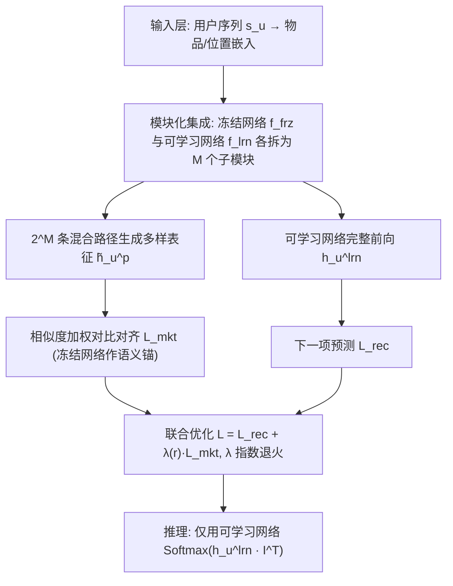
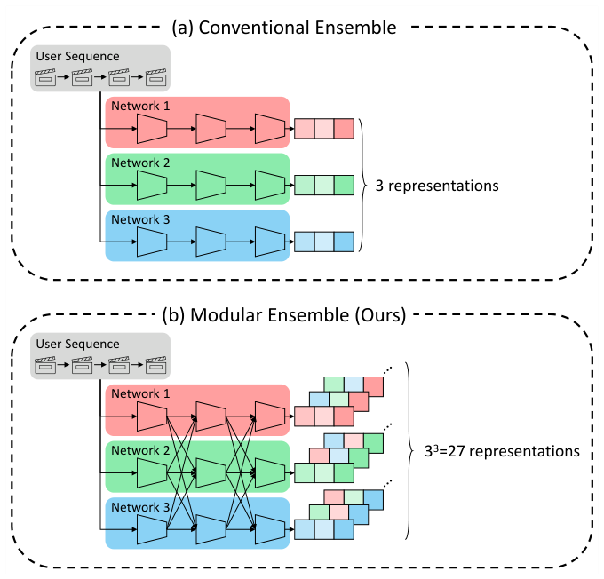
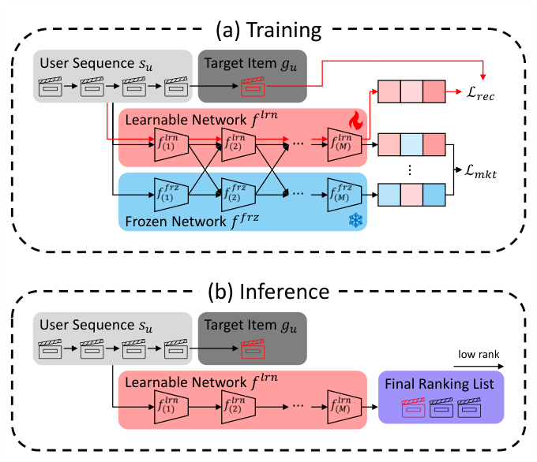
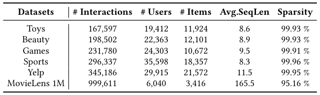
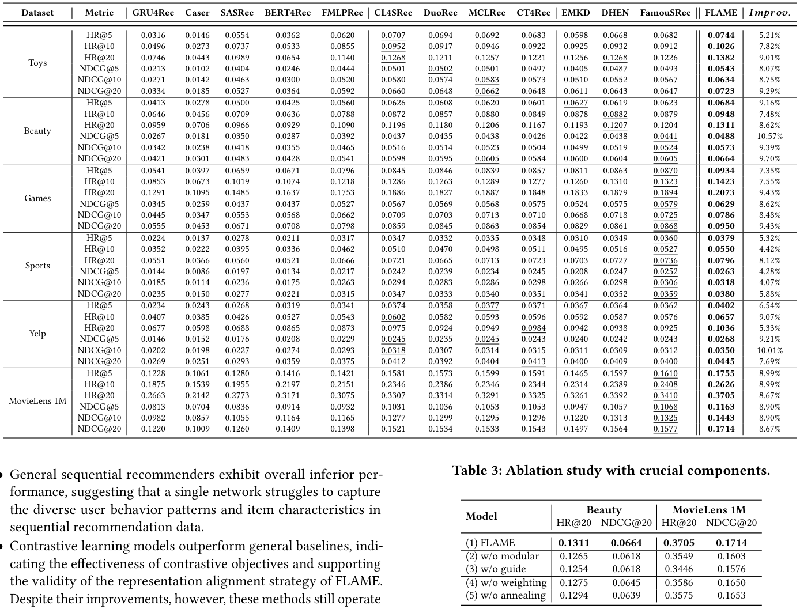
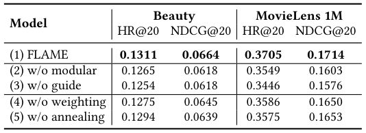
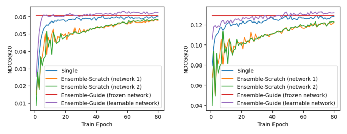
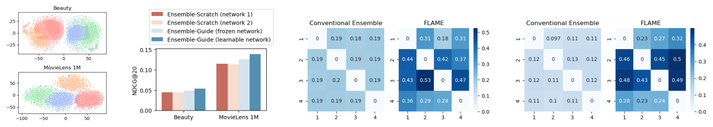
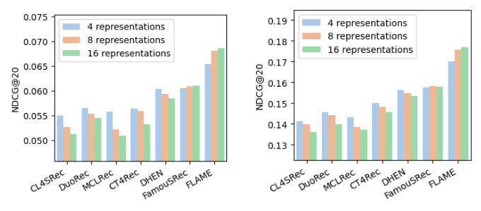

# FLAME: Condensing Ensemble Diversity into a Single Network for Efficient Sequential Recommendation (将集成多样性浓缩进单一网络的高效序列推荐)

- **会议/期刊**: SIGIR 2026 (Full Papers Track)
- **推荐链路定位**: 召回 (Retrieval) / 端到端序列打分 (Next-Item Prediction)
- **研究方向**: 序列与会话推荐 / 自监督对比学习
- **论文原文**: [https://arxiv.org/abs/2604.04038v3](https://arxiv.org/abs/2604.04038v3)
- **开源代码**: [https://github.com/woo-joo/FLAME_SIGIR26](https://github.com/woo-joo/FLAME_SIGIR26)

## TL;DR (核心速览)

针对序列推荐中单网络难以刻画多样用户行为、而传统多网络集成训练昂贵且互监督噪声导致训练不稳的痛点，FLAME 提出"冻结网络 + 可学习网络"的模块化集成：将每个网络拆为 $M$ 个子模块并交叉组合，用仅 2 个网络模拟 $2^M$ 条表征路径，再以冻结网络为语义锚做引导式互学习对齐。推理时仅保留可学习网络，零额外开销。在 6 个数据集、Leave-One-Out + Full-Ranking 协议下，NDCG@20 最高相对提升 9.70%，收敛速度最高快 7.69 倍。

## Background & Motivation (背景与动机)

- **领域背景与主流范式**: 序列推荐（Next-Item Prediction）主流以 SASRec/BERT4Rec 等单网络 Transformer 为主；为刻画用户序列中短期兴趣、长期偏好、口味漂移等多面模式，近期出现集成式方法（EMKD、SEM、FamouSRec），通过并行训练多个网络并施加互知识迁移（对比学习 + 知识蒸馏）来获取互补表征。
- **现有方法局限 (Limitations of Prior Work)**:
  1. **计算低效**：集成预测需前向每个网络并聚合输出，训练与推理成本是单网络的数倍，难以服务实时场景。
  2. **训练不稳**：所有网络从零开始 + 互监督，在早期无任何网络具备可靠先验时，互监督实为噪声，优化剧烈震荡。作者实测现有集成方法收敛所需时间最长可达单网络的 2.94 倍（图 1）。
- **核心挑战 (Key Challenge)**: 简单增加网络深度或堆叠常规对比学习无法解决——单网络内部视图增广的多样性有限（图 5 显示对比学习基线增加视图数反而退化），而异构集成（DHEN/FamouSRec）依赖架构差异获取多样性，结构约束阻碍知识共享，扩展性差。
- **核心洞察与切入点 (Key Insight)**: 两条先验观察：(1) 单网络内部不同子模块（embedding 层、浅层编码器、深层编码器）天然捕获不同粒度模式，因此**子模块组合**即可产生指数级多样表征，无需真的建多个网络；(2) 预训练并冻结一个网络作为稳定语义锚，可显著提升其余可学习网络的训练稳定性与最终性能（图 1 的 Ensemble-Guide 曲线优于 Single 与 Ensemble-Scratch）。图 3(a) 的 t-SNE 进一步证实：2 网络 × 2 子模块的模块化集成产生 4 类表征簇，而传统 2 网络集成仅 2 类。

## Problem Formulation & Method (问题定义与方法架构)

### 1. 符号定义与输入表征 (Notations & Input Representations)

- 用户集 $\mathcal{U}$、物品集 $\mathcal{I}$；用户 $u$ 的历史序列 $s_u=[i_{u,1},\dots,i_{u,|s_u|}]$，目标是 $\arg\max_{i\in\mathcal{I}} p(i_{u,|s_u|+1}=i\mid s_u)$。
- 序列截断/补零至最大长度 $T$；物品嵌入矩阵 $I\in\mathbb{R}^{|\mathcal{I}|\times d}$，位置嵌入矩阵 $P\in\mathbb{R}^{T\times d}$，序列嵌入 $e_u=[I_{i_{u,1}}+P_1,\dots,I_{i_{u,T}}+P_T]\in\mathbb{R}^{T\times d}$。
- 编码器为 $L$ 层多头 Transformer，第 $l$ 层输出 $H_u^l=\mathrm{Trm}^l(H_u^{l-1})\in\mathbb{R}^{T\times d}$，取末层末位置 $h_u=h_u^L,T\in\mathbb{R}^d$ 作为序列表征。
- 默认超参：$d=64$，$T=50$，$L=2$，2 个注意力头，dropout 0.5。

### 2. 整体流水线 (Overall Architecture)

FLAME 由两个同构 SASRec 网络构成：预训练后**冻结**的 $f^{frz}(\cdot)$ 与从零训练的**可学习**网络 $f^{lrn}(\cdot)$，每个网络拆为 $M$ 个子模块（默认 $M=2$：embedding 模块 + 序列编码模块）。训练时对每条序列枚举 $2^M$ 条"冻结/可学习"子模块混合路径生成多样表征，经相似度加权对比损失对齐到统一语义空间，同时可学习网络做下一项预测；推理时仅前向可学习网络。

<figure class="paper-figure" markdown="span">
  <figcaption>图2：(a) 传统集成与 (b) 所提模块化集成的概念示意图。当有 𝑁 个网络时，传统集成产生 𝑁 个不同的表示。当每个网络被分解为 𝑀 个子模块时，模块化集成生成 𝑁𝑀 个不同的表示。</figcaption>
</figure>

<figure class="paper-figure" markdown="span">
  <figcaption>图4：所提 FLAME 的 (a) 训练和 (b) 推理过程示意图。在 (a) 中，可学习网络通过下一项预测任务进行优化。同时，2𝑀</figcaption>
</figure>

### 3. 核心模块设计与数学原理 (Key Designs & Formulations)

**(1) 模块化集成 (Modular Ensemble)**：设 $f^{(i)}_{frz}(\cdot)$、$f^{(i)}_{lrn}(\cdot)$ 为两网络第 $i$ 个子模块。对路径 $p=(p_1,\dots,p_M)\in\mathcal{P}=\{frz,lrn\}^M$，定义混合表征

$$\tilde{h}_u^p=\big(f^{(M)}_{p_M}\circ f^{(M-1)}_{p_{M-1}}\circ\cdots\circ f^{(1)}_{p_1}\big)(s_u),\quad |\mathcal{P}|=2^M.$$

物理直觉：不同子模块捕获不同粒度信号（embedding 层=静态物品语义，浅层=局部物品级信号，深层=时间平滑的用户偏好），因此路径组合等价于从多个"视角"解读同一序列，以 2 个网络的参数获得 $2^M$ 个表征——2 网络 × 3 子模块即可模拟 8 网络传统集成。

**(2) 相似度加权引导式互学习 (Guided Mutual Learning with Similarity Weighting)**：将同一用户序列的不同路径表征视为正对、同 batch 内其他用户表征为负对，做 pairwise InfoNCE：

$$\mathcal{L}_{nce}(\tilde{h}_u^p,\tilde{h}_u^q)=-\log\frac{\exp(\tilde{h}_u^p\cdot\tilde{h}_u^q/\tau)}{\sum_{s_{u'}\in\mathcal{B}}\exp(\tilde{h}_u^p\cdot\tilde{h}_{u'}^q/\tau)}.$$

关键修正：共享子模块越多的路径对天然越相似，若等权处理会让这些"结构近邻对"主导损失。故按 batch 平均相似度 $sim_{p,q}=\frac{1}{|\mathcal{B}|}\sum_{s_u\in\mathcal{B}}\tilde{h}_u^p\cdot\tilde{h}_u^q$ 计算权重

$$w_{p,q}=\frac{\exp(-sim_{p,q})}{\sum_{\{p',q'\}\subset\mathcal{P}}\exp(-sim_{p',q'})},\qquad \mathcal{L}_{mkt}(u)=\sum_{\{p,q\}\subset\mathcal{P}}w_{p,q}\cdot\mathcal{L}_{nce}(\tilde{h}_u^p,\tilde{h}_u^q),$$

即对越相似的对降权，实现更均衡的优化。冻结网络在此充当稳定语义锚，把多样表征拉入可学习网络的语义空间。

**(3) 联合优化与系数退火**：可学习网络同时做下一项预测 $\hat{y}_u=\mathrm{Softmax}(h_u^{lrn}(I^{lrn})^\top)$，$\mathcal{L}_{rec}(u)=-\log\hat{y}_u[g_u]$；总损失

$$\mathcal{L}=\sum_{u\in\mathcal{U}}\big(\mathcal{L}_{rec}(u)+\lambda(r)\cdot\mathcal{L}_{mkt}(u)\big),\quad \lambda(r)=\lambda_0\Big(\frac{\lambda_R}{\lambda_0}\Big)^{r/R},$$

$\lambda$ 从 $\lambda_0$ 指数退火至 $\lambda_R=10^{-5}$，避免可学习网络过度拟合冻结网络的表征空间，后期转向自身任务表征质量。

### 4. 训练目标、负采样与推理复杂度 (Optimization, Negative Sampling & Complexity)

- **损失函数**: 上述 $\mathcal{L}_{rec}$（交叉熵式下一项预测）+ $\lambda(r)\mathcal{L}_{mkt}$（相似度加权 pairwise InfoNCE，温度 $\tau\in\{0.1,0.5,1,5,10\}$ 调参，$\lambda_0\in\{10^{-4},\dots,10^0\}$）。
- **训练负采样策略**: 无显式负采样；对比损失采用 **In-batch 负采样**（同 mini-batch 内其他用户序列表征为负），batch size 256；主任务为全库 Softmax 交叉熵（免负采样）。
- **时间与空间复杂度**: 训练阶段需前向 $2^M$ 条路径（默认 $M=2$ 即 4 条），参数量为 2 个 SASRec（Beauty 上 1.67M vs 单 SASRec 0.84M）；推理仅前向可学习网络，参数量与延迟与单 SASRec 完全一致（Beauty 1.30s、MovieLens 1M 0.16s 推理耗时，见表 4），比 EMKD/DHEN/FamouSRec 等集成低至 6.75 倍延迟。$M$ 从 2 增至 7 时训练时间显著上升而收益在 $M>4$ 后边际递减（图 6）。

## Experimental Setup & Evaluation Protocol (实验设置与评估协议)

- **数据集统计与预处理**: 6 个公开数据集，全部按 **5-core** 过滤（用户与物品交互数 < 5 剔除），全部交互视为隐式反馈正样本；Yelp 取 2020-01-01 之后交互，MovieLens 采用 1M 版本。

<figure class="paper-figure" markdown="span">
  <figcaption>表1：数据集统计信息。</figcaption>
</figure>

| 数据集 (Dataset) | 用户数 (#Users) | 物品数 (#Items) | 交互数 (#Interactions) | 平均序列长 (Avg.SeqLen) | 稀疏度 (Sparsity) |
| :--- | :---: | :---: | :---: | :---: | :---: |
| Toys | 19,412 | 11,924 | 167,597 | 8.6 | 99.93% |
| Beauty | 22,363 | 12,101 | 198,502 | 8.9 | 99.93% |
| Games | 24,303 | 10,672 | 231,780 | 9.5 | 99.91% |
| Sports | 35,598 | 18,357 | 296,337 | 8.3 | 99.96% |
| Yelp | 29,915 | 21,572 | 345,186 | 11.5 | 99.95% |
| MovieLens 1M | 6,040 | 3,416 | 999,611 | 165.5 | 95.16% |

- **数据划分方式 (Splitting Strategy)**: 标准 **Leave-One-Out (留一法)**——每个用户序列最后一项作测试、倒数第二项作验证。该协议为序列推荐社区惯例，但需注意其"未来信息"边界：验证/测试项严格位于序列末端，训练仅用前缀，无穿越；不过 LOO 对长序列用户（如 ML-1M 平均 165.5）仅评估单一目标，方差较大。
- **排名评测协议 (Ranking Protocol)**: **Full-Ranking（全库未交互物品排序，无负采样）**，与 DuoRec 等保持一致，评估公平性较好。
- **评价指标与显著性检验**: HR@{5,10,20}、NDCG@{5,10,20}；所有模型 embedding 维度 $d=64$ 对齐；训练 200 epoch、Adam、lr=0.001、batch=256、基于验证 NDCG@20 的 early stopping（patience=30），单卡 RTX 3090。**原文未报告多随机种子方差与配对显著性检验**（如 $t$-test / Wilcoxon），此为评估严谨性上的短板。

## Key Experimental Results (核心实验结果)

### 1. 主实验对比 (Main Results)

<figure class="paper-figure" markdown="span">
  <figcaption>表2：FLAME 与基线模型在六个公开数据集上的模型性能。每行中粗体分数表示最佳，下划线分数表示次佳。𝐼𝑚𝑝𝑟𝑜𝑣. 表示 FLAME 相对于最佳基线的相对提升。</figcaption>
</figure>

| 数据集 | 指标 | 单网络最强基线 (SASRec/BERT4Rec) | 对比学习/集成最强基线 (CL4SRec/DuoRec/FamouSRec) | 本文方法 (FLAME) | 相对提升 (Improv.) |
| :--- | :--- | :---: | :---: | :---: | :---: |
| Toys | HR@20 / NDCG@20 | 0.0989 / 0.0527 | 0.1268 (CL4SRec/DHEN) / 0.0662 (MCLRec) | **0.1382 / 0.0723** | +9.01% / +9.29% |
| Beauty | HR@20 / NDCG@20 | 0.0966 / 0.0483 | 0.1207 (DHEN) / 0.0605 (MCLRec/FamouSRec) | **0.1311 / 0.0664** | +8.62% / +9.70% |
| Games | HR@20 / NDCG@20 | 0.1637 / 0.0708 | 0.1894 (FamouSRec) / 0.0868 (FamouSRec) | **0.2073 / 0.0950** | +9.43% / +9.43% |
| Sports | HR@20 / NDCG@20 | 0.0560 / 0.0277 | 0.0736 (FamouSRec) / 0.0359 (FamouSRec) | **0.0796 / 0.0380** | +8.12% / +5.88% |
| Yelp | HR@20 / NDCG@20 | 0.0865 / 0.0359 | 0.0984 (CT4Rec) / 0.0413 (CT4Rec) | **0.1036 / 0.0445** | +5.33% / +7.69% |
| MovieLens 1M | HR@20 / NDCG@20 | 0.3171 / 0.1409 | 0.3410 (FamouSRec) / 0.1577 (FamouSRec) | **0.3705 / 0.1714** | +8.67% / +8.67% |

整体相对提升区间 4.07%–10.57%，全数据集全指标一致最优。作者归纳三点：(i) 单网络通用序列模型整体偏弱，说明单网络难捕获多样行为；(ii) 对比学习模型优于通用基线，验证表征对齐思路有效，但受限于单网络范式；(iii) 集成类（FamouSRec）虽强但训练不稳，FLAME 以冻结锚 + 模块化集成同时兼顾多样性与稳定性。

### 2. 消融实验与控制变量分析 (Ablation Study)

<figure class="paper-figure" markdown="span">
  <figcaption>表3：关键组件的消融研究。</figcaption>
</figure>

| 变体 | Beauty HR@20 | Beauty NDCG@20 | ML-1M HR@20 | ML-1M NDCG@20 |
| :--- | :---: | :---: | :---: | :---: |
| (1) FLAME 完整模型 | **0.1311** | **0.0664** | **0.3705** | **0.1714** |
| (2) w/o modular（传统集成） | 0.1265 | 0.0618 | 0.3549 | 0.1603 |
| (3) w/o guide（双网络从零训练） | 0.1254 | 0.0618 | 0.3446 | 0.1576 |
| (4) w/o weighting（等权 $\mathcal{L}_{cl}$） | 0.1275 | 0.0645 | 0.3586 | 0.1650 |
| (5) w/o annealing（常数 $\lambda$） | 0.1294 | 0.0639 | 0.3575 | 0.1653 |

移除模块化集成或引导式互学习造成最大降幅（最高 8.76%，ML-1M NDCG@20 从 0.1714 降至 0.1576），二者是核心贡献；相似度加权与系数退火各贡献约 2–4% 的 NDCG@20。需指出：消融未严格对齐参数量（w/o modular 与 w/o guide 的参数量配置与完整模型不同），控制变量严谨度有提升空间。

### 3. 稀疏度/冷启动分桶与超参敏感度 (Sparsity Buckets & Hyperparameters)

- **交互频次分桶**: **原文未报告**按用户/物品交互频次分桶的长尾分析，也未单独报告冷启动用户子群表现。
- **关键超参数敏感度**: (i) 子模块数 $M$：$M$ 从 2 增至 7 训练时间显著上升，$M>4$ 后收益边际递减，默认 $M=2$ 为最佳性价比（图 6）；(ii) 表征数（$L=1,2,3$ 对应 4/8/16 个表征）：FLAME 随表征数增加持续提升（最高 +4.74%），而对比学习基线增加视图反而退化、异构集成扩展性差（图 5）；(iii) 温度 $\tau$ 与初始系数 $\lambda_0$ 在宽范围内性能稳定（图 9）。
- **冻结网络鲁棒性**: FLAME 可跨 GRU4Rec/Caser/FMLPRec/SASRec 四种骨干一致提升；$d=32$ 时 FLAME-32 追平 FLAME-64（对弱教师鲁棒），$d=128$ 时 FLAME-128 仍较 FLAME-64 明显提升（图 7）。
- **效率与稳定性**: 表 4 显示 FLAME 以 1.67M 参数（Beauty）达到 NDCG@20=0.0660，优于 4.76M 参数的 EMKD（0.0600）与 2.30M 的 FamouSRec（0.0605），推理延迟 1.30s 与单 SASRec 持平；收敛速度比其它集成基线快 4.55–7.69 倍（图 8）。
- **线上 A/B 测试**: **原文仅包含离线实验**，未报告线上 A/B 结果。

<figure class="paper-figure" markdown="span">
  <figcaption>图1：Single、Ensemble-Scratch 和 Ensemble-Guide 的训练曲线。</figcaption>
</figure>

<figure class="paper-figure" markdown="span">
  <figcaption>图3：(a) 传统集成（红色和蓝色阴影区域）与模块化集成（红色、黄色、绿色和蓝色点）的序列表示 t-SNE 可视化。(b) Ensemble-Scratch 和 Ensemble-Guide 中单个网络的性能。(c, d) 传统集成和 FLAME 的 PER 图。</figcaption>
</figure>

<figure class="paper-figure" markdown="span">
  <figcaption>图5：FLAME 与基线模型在不同表示数量下的模型性能。</figcaption>
</figure>

## Highlights, Limitations & Critiques (亮点、局限与审稿级批判)

- **核心亮点与可迁移性**:
  1. **"子模块组合即集成"的算子思想**极具普适性：任何具备可分解模块结构的推荐骨干（图/序列/多模态编码器）都可用 $2^M$ 路径枚举 + 相似度加权对比对齐来低成本模拟集成多样性，且推理零开销，对工业实时系统友好。
  2. **冻结锚 + 退火互学习**为"自蒸馏式稳定训练"提供了序列推荐场景的实证支撑（图 1、图 3b），可迁移到其他易受互监督噪声困扰的多视图/多任务训练。
  3. **相似度加权对比损失**针对"结构近邻对主导损失"的失衡问题给出简洁闭式修正，可复用于任意多视图对比框架。
- **局限性与审稿视角批判 (Critical Limitations)**:
  1. **评估协议**: LOO + 单目标评估方差大，且未报告多随机种子均值/方差与配对显著性检验，"一致最优"的统计可信度需补强；未做时间戳全局切分，无法排除 LOO 在长序列数据集上的乐观偏差。
  2. **消融控制不严**: w/o modular、w/o guide 变体与完整模型的参数量/计算预算未对齐，性能下降中可能混入容量差异的混淆效应。
  3. **缺失关键分析**: 无长尾/冷启动分桶、无线上 A/B、无与"同参数量单网络 + 更强正则"的严格对照；$M$ 增大时对齐 $2^M$ 表征的训练开销与显存峰值原文未量化。
  4. **理论深度**: "子模块捕获不同粒度模式"主要靠 t-SNE 与 PER 的经验证据支撑，缺乏对多样性—可靠性权衡的形式化分析；$2^M$ 路径中有一条纯冻结路径（不参与可学习网络梯度），其对最终单网络表征的贡献未被单独讨论。
  5. **可扩展性边界**: 默认 $M=2$ 仅 4 条路径，与"指数级集成"的叙事存在张力；$M>4$ 收益递减说明对齐难度成为瓶颈，未来 elastic inference 的设想尚停留在展望。

## Rating (四维评分)

- **方法创新性 (Novelty)**: ⭐⭐⭐⭐
- **评估协议与实验扎实度 (Protocol & Experiments)**: ⭐⭐⭐
- **写作与数学规范度 (Clarity & Rigor)**: ⭐⭐⭐⭐
- **工业落地与复现价值 (Industrial & Practical Value)**: ⭐⭐⭐⭐⭐
